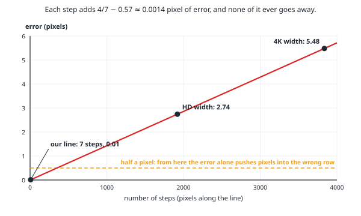
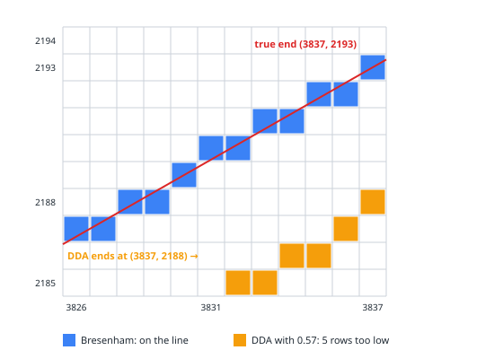

# Line Drawing and Antialiasing 2: Where DDA Goes Wrong

DDA draws short lines perfectly, but it drifts off long ones and spends floating-point work on every pixel.

## Before you start
<!-- bite: 77f0aa99-7158-4649-ad7f-1c2708154253 -->

You can build a DDA table by hand for a line like $(1, 1)$ to $(8, 5)$ ([[computer-graphics/03-line-drawing-and-antialiasing-1|Line Drawing and Antialiasing 1]]), and you know that $4/7$ written as a decimal never ends.

**After this lesson you will be able to:**
1. Explain cumulative rounding error, and work out how far DDA drifts after a given number of steps.
2. Say why the drift only shows on big screens, with the measured numbers.
3. Explain why DDA is computationally expensive, and why the cost is time, not memory.

## What this part is about
<!-- bite: eebf7f80-f282-45a5-b0f6-98ed6d3ff274 -->

In part 1, DDA drew the line from $(1, 1)$ to $(8, 5)$ and every pixel came out right. This part shows the two disadvantages that a short line hides:

1. **Cumulative rounding error**: on a long line, DDA slowly slides off the true line.
2. **Computationally expensive**: every pixel costs floating-point additions and roundings.

Both come from the same place, the fraction in $y_{inc}$, and that is what Bresenham (part 3) gets rid of.

## The kid version
<!-- bite: 7a380eaa-f7e4-4ac8-8bba-d40b21ae1303 -->

You walk 3,836 steps along a road, and each step should be 57.14 cm long. But your ruler only marks whole centimetres, so you measure every step as 57 cm. One step short by 0.14 cm doesn't matter. But you never correct it, so after 3,836 steps you are more than 5 metres short of where you should be.

**Where the analogy stops working.** A walker can look up and see the finish line. DDA never looks back at the true line; it only ever adds the same slightly-wrong increment, so nothing pulls it back.

## Terms used in this part
<!-- bite: 7b4b167e-3630-4d17-b61f-b1ce4dda869e -->

1. **Cumulative rounding error**: This is a small error made at every step that is never removed, so it keeps adding up the longer the line gets.
2. **Floating point**: This is the way a computer stores numbers with a fractional part, like 0.571428. It keeps only a fixed number of binary digits, so most fractions are stored slightly wrong.
3. **32-bit and 64-bit float**: These are the two common sizes of floating-point number. A 64-bit float keeps about twice as many digits as a 32-bit one, so it is far more exact. GPUs mostly use 32-bit.
4. **Fixed point**: This is a cheaper way to store fractions, used in simple hardware: a whole number with a set number of binary digits after the point, such as 8.

## Disadvantage 1: cumulative rounding error
<!-- bite: 35350e14-3d1a-475e-8406-6a7efa02cbd5 -->

Remember the line from part 1, $(1, 1)$ to $(8, 5)$, with $y_{inc} = 4/7$? We wrote $4/7 = 0.57$, but $4/7$ is really $0.571428\ldots$, and the digits never end. Any computer has to cut it off somewhere, just like we did. So every step adds a tiny error, and **nothing ever removes it**. After 1 step $y$ is wrong by a tiny bit, after 2 steps by twice that, after 100 steps by a hundred times that. That is cumulative rounding error.

## How fast the error grows
<!-- bite: fd321020-3936-4451-986f-91b29233a80b -->

With our 2-decimal $0.57$, each step is short by $4/7 - 0.57 \approx 0.0014$ of a pixel:

1. After our 7 steps: $7 \times 0.0014 = 0.01$ of a pixel. Nobody can see that.
2. After 350 steps: half a pixel. Now the error alone can push a pixel into the wrong row.
3. Across an HD screen (1,920 pixels wide): 2.74 pixels.
4. Across a 4K screen (about 3,840 wide): 5.48 pixels.

So for smaller displays you may not see it, but for bigger screens it becomes a problem:

## Seeing the drift on a 4K screen
<!-- bite: 3b580c7f-beac-4ebb-8d87-69f6e9397b98 -->

Now take our same line, slope $4/7$, but make it 548 times longer: from $(1, 1)$ to $(3837, 2193)$. That's about the width of a 4K screen. This picture zooms in on the last 12 columns.

Blue is the line drawn correctly (with Bresenham, which you'll meet in part 3). Orange is DDA with $y_{inc}$ kept as 0.57. The true end is $(3837, 2193)$, but DDA ends at $(3837, 2188)$: **5 rows too low**, and it has been sliding away from the line the whole way.

## How much real computers drift
<!-- bite: eda379f5-ca70-4902-a8e7-1b9b579fe387 -->

A real computer keeps more digits than our 2 decimals, in binary, so it drifts less. But it still cuts $4/7$ off somewhere. Here is what happens when DDA draws a line from one corner of the screen to the other, measured by running it. "Off at the end" is how many rows short the last pixel lands.

| Screen | 2 decimals (by hand) | 8 binary digits (cheap hardware) | 32-bit float | 64-bit float |
|---|---|---|---|---|
| 640 × 480 | 0 off at the end (160 pixels wrong on the way) | 2 off | 0 off (2 pixels wrong on the way) | 0 off |
| 1920 × 1080 (HD) | 4 off | 7 off | 0 off (6 pixels wrong) | 0 off |
| 3840 × 2160 (4K) | 9 off | 15 off | 0 off (45 pixels wrong) | 0 off |
| 7680 × 4320 (8K) | 19 off | 30 off | 0 off (1,032 pixels wrong) | 0 off |

The fewer digits, the worse it gets, and the longer the line, the worse it gets. A modern PC using 64-bit floats is fine, but small chips, old graphics hardware and GPUs (which mostly use 32-bit floats) are not. Bresenham, in part 3, has no error at all on any of these.

## Disadvantage 2: computationally expensive
<!-- bite: 3422af61-6651-43d5-a3b0-fdf64419de6a -->

For every pixel, DDA has to do floating-point work: add $x_{inc}$ to $x$, add $y_{inc}$ to $y$, then round both. Floating-point additions and roundings are slower than whole-number additions, and on chips with no floating-point hardware they are much slower. A line is drawn millions of times per picture, so that cost adds up.

It isn't a memory problem: DDA only keeps four numbers ($x$, $y$, $x_{inc}$, $y_{inc}$), not a table of all the pixels. The cost is time, spent on every single pixel.

**Good and bad, in one place:**

| | DDA |
|---|---|
| Good | Simple. Works for every slope. Only additions per pixel, no multiplication. |
| Bad | Floating point and a rounding at every step (slow). Rounding error adds up, so long lines drift off the true line. |

Both problems come from the same place: the fraction $0.57\ldots$. And this is why we need Bresenham. It makes the same choices using only whole numbers, so there is no fraction to cut off, nothing to round, and nothing to pile up.

## Common pitfalls
<!-- bite: 383984f5-07df-4597-a740-4a1bd6f29882 -->

1. **Thinking the error is too small to matter.** It is small per step, but it never goes away, so it grows with the length of the line.
2. **Blaming memory.** DDA keeps only four numbers. Its cost is the floating-point work on every pixel.
3. **Testing only short lines.** A 7-pixel line can't show the drift. Test a line thousands of pixels long.

## Check your understanding
<!-- bite: 20d77540-24c5-4d8e-9f6b-957f8901c20e -->

Try each one before you open the answer.

1. <!-- q: open id="e2a9d714" -->
   DDA draws a 7-pixel line perfectly, but the same slope drawn across a 4K screen ends several pixels off. Explain why.

   

Answer

   The increment (like 4/7 = 0.571428…) can't be stored exactly, so it is cut off, and each step adds a tiny error. Nothing removes that error, so it adds up with every step: cumulative rounding error. Over 7 steps it is a hundredth of a pixel; over thousands of steps it becomes whole pixels.

   

2. <!-- q: exact id="be3db928" answer="150" -->
   A DDA stores the y increment 1/3 as 0.33. How many steps until its error reaches half a pixel?

   

Answer

   150. Each step is short by 1/3 − 0.33 = 0.00333… of a pixel. Half a pixel takes 0.5 ÷ 0.00333… = 150 steps.

   

3. <!-- q: gap id="843acd71" answers="1;3836|3,836" -->
   Fill in the gaps. Keeping 4/7 as 0.57, DDA is short by about 0.0014 pixel per step. After 700 steps the error is ___ pixel, and the longest line it will draw across a 4K screen has about ___ steps.

   

Answer

   1 pixel, because 700 × (4/7 − 0.57) = 700 × 1/700 = 1. A line across a 4K screen with slope 4/7 from (1, 1) to (3837, 2193) has Δx = 3836, so 3836 steps.

   

4. <!-- q: mcq id="d408698a" -->
   Why is DDA called computationally expensive?

   - [ ] It stores every pixel of the line in memory before drawing
   - [x] Every pixel needs floating-point additions and a rounding
   - [ ] It multiplies m by x for every pixel

   

Answer

   Floating-point work on every pixel. DDA keeps only x, y and the two increments, and it adds rather than multiplies. The cost is that the additions are floating point and both values must be rounded, which is slower than whole-number work, especially on chips without floating-point hardware.

   

5. <!-- q: mcq id="25391182" -->
   DDA draws a line from corner to corner of a 3840 × 2160 screen. Which way of storing the increment lands the last pixel furthest from the true end?

   - [x] 8 binary digits of fixed point
   - [ ] 32-bit floating point
   - [ ] 64-bit floating point

   

Answer

   8 binary digits: it lands 15 rows short. A 32-bit float gets the end right but lights 45 pixels in the wrong row on the way; a 64-bit float gets every pixel right. Fewer digits means a bigger error per step.

   

## Practice: independent task
<!-- bite: 2587dfff-6f0d-44d3-9352-aacef99ba64b -->

**See the drift yourself.** In your DDA program from part 1, change one line so `yinc = round(dy / steps, 2)`, then draw $(1, 1)$ to $(3837, 2193)$. **Done when** the last pixel printed is $(3837, 2188)$, five rows below the true end, and the unchanged program prints $(3837, 2193)$.

## Before moving on
<!-- bite: e7117a8c-4ea7-4f94-ac1e-314c96521dbe -->

You can explain cumulative rounding error, work out the drift after any number of steps, and say why DDA is slow. **Next:** [[computer-graphics/05-line-drawing-and-antialiasing-3|Line Drawing and Antialiasing 3: Bresenham for Gentle Slopes]]. It makes the same pixel choices with whole numbers only, so there's no fraction to cut off and nothing to drift.

## Related
<!-- bite: a248f2d6-2a45-4141-b9a8-b7158a0b9d24 -->

- [[computer-graphics/03-line-drawing-and-antialiasing-1|Line Drawing and Antialiasing 1]] — the DDA algorithm itself
- [[computer-graphics/05-line-drawing-and-antialiasing-3|Line Drawing and Antialiasing 3]] — Bresenham, the fix for both disadvantages
- [[computer-graphics/index|Computer graphics map]]

## About this lesson
<!-- bite: a2e0ffa8-c18f-472c-b13c-a4ec7ec0962f -->

**Level:** Beginner to intermediate. **Covers:** DDA's two disadvantages: cumulative rounding error, worked by hand and measured on real screen sizes, and the cost of floating-point work on every pixel.

Part 2 of 6 on line drawing and antialiasing, in Part 1 of the course. The drift numbers come from running DDA in `scripts/diagrams/computer_graphics.py`, which asserts every one of them.
