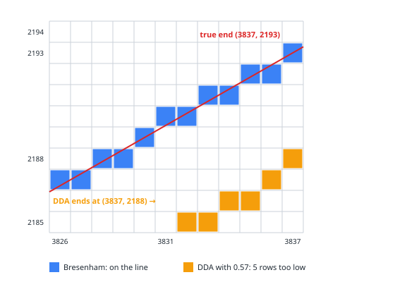
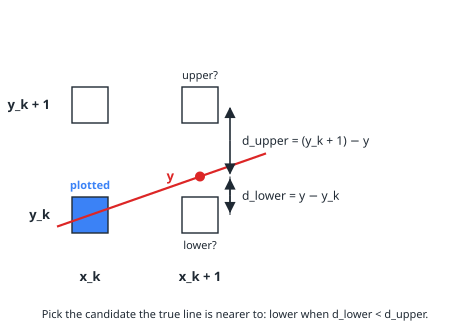
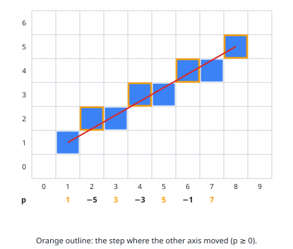
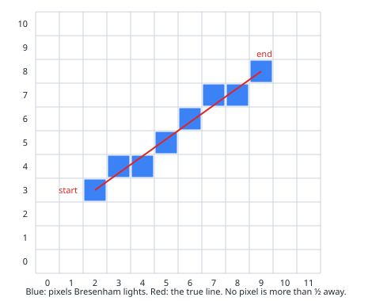

# Line Drawing and Antialiasing 3: Bresenham for Gentle Slopes

Bresenham's algorithm draws a line using whole numbers only, by asking at every step which of two pixels is closer to the true line.

## Before you start
<!-- bite: 7ae93a55-9d86-46e8-919c-03193b35eae2 -->

You can build a DDA table ([[computer-graphics/03-line-drawing-and-antialiasing-1|part 1]]) and you know why DDA drifts on long lines and why its floating-point work is slow ([[computer-graphics/04-line-drawing-and-antialiasing-2|part 2]]). You can expand brackets and rearrange a simple equation.

**After this lesson you will be able to:**
1. Give three reasons Bresenham is preferred over DDA.
2. Derive Bresenham's decision parameter $p_k$, its update and its start value $p_0$ for a gentle slope ($0 < m < 1$).
3. Trace a Bresenham table by hand for any gentle line and check it on a grid.

## What this part is about
<!-- bite: 09c5e82e-965e-40c9-a043-7c3409eece74 -->

Part 2 ended with DDA's problem: the fraction $0.57\ldots$ that gets cut off, rounded and piled up. Bresenham makes exactly the same pixel choices, but with no fraction anywhere. In this part we derive it for gentle slopes, where $\Delta x > \Delta y$, and run it on the same line DDA drew, $(1, 1)$ to $(8, 5)$. Part 4 does steep slopes.

## The kid version
<!-- bite: 4560c9e4-4d48-4719-ba9d-985a60e3ad03 -->

You want to draw a diagonal line on squared paper, but you are only allowed to colour whole squares. Walk along the long direction one square at a time. At each step, ask one question: "is the true line closer to the square I'm level with, or to the one just above?" Colour the closer one. **Bresenham's trick is that you can answer that question by keeping a running score and only ever adding whole numbers to it.**

**Where the analogy stops working.** On paper you can *see* which square is closer. The computer cannot; it needs the score (the *decision parameter*) precisely because comparing the real distances would need fractions.

## Terms used in Bresenham's algorithm
<!-- bite: 8991ed33-8a6c-4072-838e-508a5cb897c9 -->

1. **Candidate pixels**: These are the two pixels the line could go through next. For a gentle line, stepping one column right, they are the pixel level with the last one and the pixel one row above it.
2. **Decision parameter**: This is the whole number $p_k$ whose sign tells Bresenham which of the two candidates to colour next. Negative means "stay level"; zero or more means "go up".
3. **Integer arithmetic**: This is working only with whole numbers: adding, subtracting and doubling. No decimals, so nothing to round and nothing to cut off.
4. **dx and dy**: These are the same as $\Delta x$ and $\Delta y$ from part 1, written the way Bresenham's derivation usually writes them.

## Bresenham's line algorithm
<!-- bite: 2beeacc1-50ef-4f8a-962c-f3aaa215e51d -->

**Bresenham uses only integers.** At each step it picks whichever of two candidate pixels is closer to the true line, using the sign of a decision parameter $p$.

**Three reasons it is preferred over DDA:**
1. **Integer arithmetic only** — additions, subtractions and doubling; no floating point, no rounding.
2. **Faster and cheaper per pixel**, and easy to build into hardware.
3. **More accurate** — no accumulated round-off, and it always picks the pixel closest to the true line.

## Seeing Bresenham stay on the line
<!-- bite: 61ff2324-c596-4094-8f9a-8a2ae8febe90 -->

Remember the 4K line from part 2? Here it is again. Blue is Bresenham, sitting on the true line right to the end. Orange is DDA with $0.57$, five rows low:

## Naming the points for the derivation
<!-- bite: d3bdf35d-88ae-4916-bb78-acb7644000f4 -->

One small change before the maths. In part 1 the end points were $(x_1, y_1)$ and $(x_2, y_2)$. Bresenham numbers its steps $k = 0, 1, 2, \ldots$, and then $x_1$ would mean two things: the end point, and $x$ after step 1. So from here, **the start point is $(x_0, y_0)$** and $x_k, y_k$ is the pixel plotted at step $k$. Nothing else changes: $dx = \Delta x$ and $dy = \Delta y$.

## Bresenham for 0 < m < 1: the two distances
<!-- bite: 1bfaf5da-bce9-4267-95ce-ccc99029c331 -->

Let $dx$ and $dy$ be the changes along the line, with $0 < dy < dx$ (a gentle slope). Suppose pixel $(x_k, y_k)$ has just been plotted. **At column $x_k + 1$ the true line has height $y = m(x_k + 1) + b$**, and the two candidates are the lower pixel $(x_k + 1, y_k)$ and the upper pixel $(x_k + 1, y_k + 1)$.

$$d_{lower} = y - y_k = m(x_k+1) + b - y_k \qquad d_{upper} = (y_k + 1) - y = y_k + 1 - m(x_k+1) - b$$

## Bresenham for 0 < m < 1: the decision parameter
<!-- bite: 8a00848a-b236-430f-acfb-7c1220873120 -->

**Choose the lower pixel when it is closer, that is when $d_{lower} - d_{upper} < 0$:**

$$d_{lower} - d_{upper} = 2m(x_k + 1) - 2y_k + 2b - 1$$

This still contains the fraction $m$. **Multiply by $dx$** — positive, so the sign is unchanged — and substitute $m = dy/dx$. That product *is* the decision parameter:

$$p_k = dx(d_{lower} - d_{upper}) = 2dy\,x_k - 2dx\,y_k + c, \qquad c = 2dy + dx(2b - 1)$$

- **If $p_k < 0$, plot $(x_k + 1, y_k)$.**
- **If $p_k \ge 0$, plot $(x_k + 1, y_k + 1)$.**

## Bresenham for 0 < m < 1: the update and the start value
<!-- bite: 1c8fb45b-fd7e-42ad-94d5-aea79dd8c120 -->

**The update.** Subtract $p_k$ from $p_{k+1}$; the constant $c$ cancels:

$$p_{k+1} - p_k = 2dy(x_{k+1} - x_k) - 2dx(y_{k+1} - y_k) = 2dy - 2dx(y_{k+1} - y_k)$$

Since $x$ always moves by 1, the update depends only on whether $y$ moved:

$$p_{k+1} = \begin{cases} p_k + 2dy & p_k < 0 \;\;(y \text{ stays}) \\ p_k + 2dy - 2dx & p_k \ge 0 \;\;(y \text{ goes up by } 1)\end{cases}$$

**The start value.** Put $(x_0, y_0)$ into $p_k$ with $b = y_0 - m x_0$ (the line passes through the start point). Everything cancels except:

$$p_0 = 2dy - dx$$

## Bresenham worked: the table for (1, 1) to (8, 5)
<!-- bite: 0c9d766c-f4c6-4f45-9936-6327b72b8145 -->

Now run it on DDA's line from part 1. $dx = 7$, $dy = 4$, $p_0 = 2dy - dx = 2(4) - 7 = 1$. Add $2dy = 8$ when $p < 0$ ($y$ stays), and $2dy - 2dx = -6$ when $p \ge 0$ ($y$ goes up).

| k | $p_k$ | Decision | Plot | $p_{k+1}$ |
|---|---|---|---|---|
| start | | | (1, 1) | |
| 0 | 1 | $p \ge 0$, $y+1$ | (2, 2) | 1 − 6 = −5 |
| 1 | −5 | $p<0$, $y$ stays | (3, 2) | −5 + 8 = 3 |
| 2 | 3 | $y+1$ | (4, 3) | −3 |
| 3 | −3 | $y$ stays | (5, 3) | 5 |
| 4 | 5 | $y+1$ | (6, 4) | −1 |
| 5 | −1 | $y$ stays | (7, 4) | 7 |
| 6 | 7 | $y+1$ | (8, 5) | end |

The rows are $1, 2, 2, 3, 3, 4, 4, 5$: **exactly DDA's pixels from part 1**, with no fraction and no rounding anywhere. The end point is $(8, 5)$, so the last $y$ is $4 + 1 = 5$, not 8.

## Seeing p on the grid: (1, 1) to (8, 5)
<!-- bite: a11687b6-5914-4a20-8204-e17a0a2409a9 -->

Here is the same table on the grid. Each $p$ is written under the column where it is used. An orange outline marks each pixel where $y$ went up because the $p$ before it was 0 or more.

## Bresenham worked: a second line, (2, 3) to (9, 8)
<!-- bite: 99946edf-1a72-4754-91d5-b570b228bd6f -->

$dx = 7$, $dy = 5$, $p_0 = 2dy - dx = 3$. Updates: $+10$ ($y$ stays) or $-4$ ($y$ up).

| k | $p_k$ | Decision | Plot | $p_{k+1}$ |
|---|---|---|---|---|
| start | | | (2, 3) | |
| 0 | 3 | $y+1$ | (3, 4) | −1 |
| 1 | −1 | $y$ stays | (4, 4) | 9 |
| 2 | 9 | $y+1$ | (5, 5) | 5 |
| 3 | 5 | $y+1$ | (6, 6) | 1 |
| 4 | 1 | $y+1$ | (7, 7) | −3 |
| 5 | −3 | $y$ stays | (8, 7) | 7 |
| 6 | 7 | $y+1$ | (9, 8) | end |

## Seeing the shallow line on the grid
<!-- bite: 613f463a-db17-4d45-8d37-fdbd7d6a137d -->

These are the 8 pixels from the table above, with the true line drawn over them. Notice how y stays put twice, at x = 4 and x = 8, exactly where p was negative.

## Complexity of the line algorithms
<!-- bite: bb72c49f-ef58-4648-9ece-5f366a29112a -->

**Both DDA and Bresenham are $O(n)$**, where $n = \max(|dx|, |dy|)$ is the number of pixels drawn, because each does constant work per pixel. **They do not differ in big-O.** The difference is the work per pixel: DDA does two float additions and two roundings; Bresenham does integer additions and one comparison with 0. **Integer operations are faster, exact, and simple in hardware — that is what makes Bresenham more efficient.**

## Common pitfalls with Bresenham
<!-- bite: 4685336b-305e-4932-8af1-f52213d3904c -->

1. **Testing the update instead of the parameter.** The test is "if $p_k < 0$", not "if $p_{next} - p_k < 0$" — $p_{next} - p_k$ is only the amount added.
2. **Using $p > 0$ instead of $p \ge 0$** for "move up". At $p = 0$ the step is taken.
3. **Calling the first value $P_0$ in the steps and $P_1$ in the example.** Pick one name and keep it.
4. **Forgetting the final pixel.** Loop `dx + 1` times, so both end points are drawn.
5. **Spelling:** it is *Bresenham* (not "Bresendham").

## Check your understanding
<!-- bite: b43441a7-c391-4fae-b528-02a2e3f52f0e -->

Try each one before you open the answer.

1. <!-- q: mcq id="8a75268f" -->
   During Bresenham, the decision parameter is exactly p = 0. What happens?

   - [x] Take the step (p = 0 counts as p ≥ 0)
   - [ ] Stay on the same row or column
   - [ ] Plot both candidate pixels

   

Answer

   Take the step. Using p > 0 instead of p ≥ 0 is a common mistake.

   

2. <!-- q: open id="f9d71681" -->
   DDA and Bresenham are both O(n). In what sense is Bresenham "more efficient", then? And why is it safe to multiply d_lower − d_upper by dx?

   

Answer

   Constant factors: integer adds and a sign test per pixel versus float adds and rounding, and no accumulated error. Multiplying by dx is safe because dx > 0, so the sign doesn't change, and the sign is all the decision uses. It also clears the fraction m = dy/dx, leaving integers.

   

3. <!-- q: gap id="96801fda" answers="-2|−2;0;1" -->
   Fill in the gaps. Bresenham from (0, 0) to (8, 3): p₀ = ___. The pixel plotted at x = 1 has y = ___, and the pixel at x = 2 has y = ___.

   

Answer

   dx = 8, dy = 3, so p₀ = 2(3) − 8 = −2. p < 0, so y stays: (1, 0), and p becomes −2 + 6 = 4. p ≥ 0, so y goes up: (2, 1).

   

4. <!-- q: exact id="1e38c073" answer="9" accept="nine" -->
   How many pixels does Bresenham light for (0, 0) to (8, 3)?

   

Answer

   9. The line is shallow, so it steps x: dx + 1 = 9 pixels, one per column.

   

5. <!-- q: grid id="691f200e" cols="10" rows="5" answer="0,0 1,0 2,1 3,1 4,2 5,2 6,2 7,3 8,3" given="0,0" line="0,0 8,3" axes="true" -->
   Light every pixel Bresenham chooses for the line from (0, 0) to (8, 3). The start pixel is given.

   

Answer

   (0,0) (1,0) (2,1) (3,1) (4,2) (5,2) (6,2) (7,3) (8,3). p starts at −2; add 6 when p < 0 (y stays), add −10 when p ≥ 0 (y goes up). One pixel per column, 9 in all.

   

## Practice: independent task
<!-- bite: 3df74494-a2db-42f0-9a1f-7bd8015cbbc1 -->

**Trace $(0, 0)$ to $(10, 4)$ by hand.** Write the table with $p_k$, the decision and the pixel, then plot the pixels and draw the true line over them. **Done when** you have 11 pixels ending at $(10, 4)$, your $p$ values start $-2, 6, -6$, and no pixel is more than half a pixel from the line.

## Before moving on
<!-- bite: 89f8bb7e-c698-4165-b93c-2defbed66f20 -->

You can derive $p_k$, its update and $p_0$ for a gentle slope, and trace a table that matches DDA's pixels with no fractions at all. **Next:** [[computer-graphics/06-line-drawing-and-antialiasing-4|Line Drawing and Antialiasing 4: Bresenham for Steep Slopes and Every Direction]]. Everything here assumed $dx > dy$; a steep line breaks that, and the steep derivation is the 15-mark exam question.

## Related
<!-- bite: 9c4a68ce-9317-4a91-9737-94cce3ea0a93 -->

- [[computer-graphics/04-line-drawing-and-antialiasing-2|Line Drawing and Antialiasing 2]] — the DDA problems this fixes
- [[computer-graphics/06-line-drawing-and-antialiasing-4|Line Drawing and Antialiasing 4]] — steep slopes and every direction
- [[computer-graphics/27-ssg-511-formula-sheet|Formula sheet]]
- [[computer-graphics/index|Computer graphics map]]

## About this lesson
<!-- bite: b18c21e0-bd9d-4324-8fb8-a77f2952ea38 -->

**Level:** Intermediate. **Covers:** Why Bresenham beats DDA; the two distances, decision parameter, update and start value for $0 < m < 1$, derived in full; two worked tables, each drawn on the grid.

Part 3 of 6 on line drawing and antialiasing, in Part 1 of the course. **Line drawing is the most-examined topic in SSG 511.**
