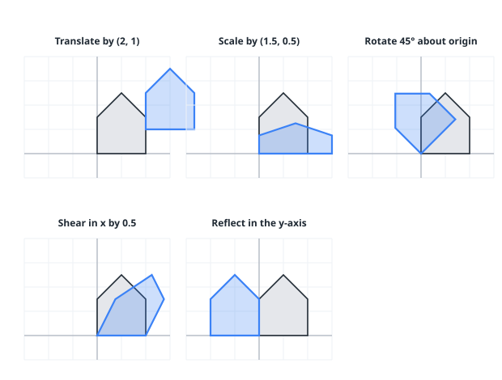
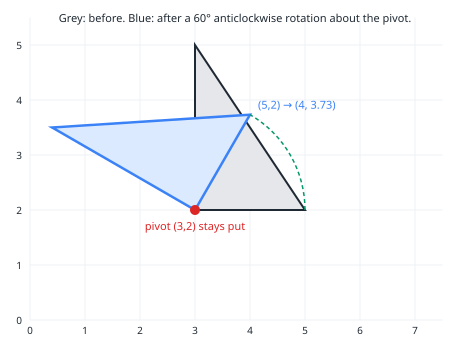
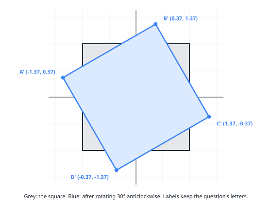

# 2D and 3D Transformations

A transformation moves, resizes, turns, slants or flips a shape, written as a matrix.

## Before you start
<!-- bite: 6f698ca3-b8d0-498c-8417-faa14923f3a3 -->

You can multiply a matrix by a vector and two matrices together, and you know $\cos 60° = 0.5$, $\sin 60° = \sqrt3/2 \approx 0.866$.

**After this note you will be able to:**
1. Write the 3 × 3 homogeneous matrix for any basic 2D transform, and say why the extra coordinate is needed.
2. Identify a given matrix by its pattern.
3. Compose transforms about an arbitrary pivot, in either vector convention, and check the result.
4. Plan a 3D transform from features (apex, base centre, size) and write it as a product.

## What a transformation is
<!-- bite: c06be02c-93cc-4df9-9810-c37c08f862c2 -->

A transformation is a way of moving, resizing, turning, slanting or flipping a shape, and in graphics each one is written as a matrix, a small table of numbers. Every time you pinch to zoom a photo or a game character turns around, the computer is applying transformations.

Next: the kid version, then the words you need.

## The kid version
<!-- bite: 2437ad4f-2163-4100-a4ad-e6fb542c3f24 -->

Picture a shape cut out of paper on a table. You can slide it (translate), stretch it (scale), spin it (rotate), or push its top sideways like a deck of cards (shear). Each move can be written as a little grid of numbers, and doing two moves one after another is the same as multiplying their grids. **The order matters**: spin-then-slide puts the shape somewhere different from slide-then-spin.

**Where the analogy stops working.** Sliding cannot be done by multiplying the ordinary 2-number position by a 2 × 2 grid at all. That is the whole reason for the extra "1" coordinate below — it is a trick, not something the paper "has".

## Terms used in transformations
<!-- bite: a1d5227d-154d-494d-b40b-14b843e71058 -->

1. **Affine transformation**: This is a transformation that keeps straight lines straight and parallel lines parallel. Translation, rotation, scaling, shear and reflection are all affine.
2. **Homogeneous coordinates**: This is writing a 2D point $(x, y)$ as $(x, y, 1)$, or a 3D point as $(x, y, z, 1)$, so that translation becomes a matrix multiplication too.
3. **Pivot**: This is also known as the **fixed point**. This is the point a rotation or scaling happens about; it does not move.
4. **Composition**: This is combining several transformations into one matrix by multiplying their matrices.
## More terms used in transformations
<!-- bite: 71ff60f2-c5fd-45b7-8bc8-cbfb8387bb3a -->

5. **Column-vector convention**: This is writing the point as a column and the new point as $p' = Mp$. A chain $M_3M_2M_1$ applies $M_1$ first (read right to left).
6. **Row-vector convention**: This is writing the point as a row and the new point as $p' = pM$. The matrices are the transposes of the column versions, and a chain reads left to right.
7. **Shear**: This is a transform that slides each point parallel to an axis by an amount proportional to its other coordinate, turning a square into a parallelogram.

## 1. Why homogeneous coordinates
<!-- bite: b9f1568b-9eeb-49ea-adeb-81347718e0b0 -->

**Rotation and scaling are matrix multiplications in ordinary 2D coordinates, but translation (adding a shift) is not** — no 2 × 2 matrix adds a constant. **Adding a third coordinate makes every transformation a multiplication**, so a whole chain combines into one matrix by multiplying.

> "Easier to use a 3 × 3 than a 2 × 2" is the usual half-answer. **The real reason is that translation cannot be written as a 2 × 2 multiplication**; with 3 × 3 homogeneous matrices, everything (translation included) is one, and chains combine.

A homogeneous 2D point is $(x_h, y_h, h)$ with $x = x_h/h$ and $y = y_h/h$; usually $h = 1$.

> **Convention warning.** With **column vectors**, $p' = Mp$ and $M_3M_2M_1$ applies $M_1$ first. With **row vectors**, $p' = pM$, every matrix is transposed, and the chain reads left to right. **Always check which convention the question uses** — SSG 511's assignment uses row vectors.

## 2. The 2D matrices (column-vector convention)
<!-- bite: cf0c8600-f80f-45aa-81ce-9e1a0acb88c0 -->

**Translation by $(t_x, t_y)$** — the shift sits in the right-hand column:

$$T(t_x, t_y) = \begin{pmatrix} 1 & 0 & t_x \\ 0 & 1 & t_y \\ 0 & 0 & 1 \end{pmatrix}$$

**Scaling by $(s_x, s_y)$ about the origin** — only the diagonal changes:

$$S(s_x, s_y) = \begin{pmatrix} s_x & 0 & 0 \\ 0 & s_y & 0 \\ 0 & 0 & 1 \end{pmatrix}$$

## The 2D rotation matrix
<!-- bite: b8f49475-7070-44c0-badd-0c11009fea5f -->

**Rotation by $\theta$ anticlockwise about the origin.** In words: the new $x$ is $x\cos\theta - y\sin\theta$ and the new $y$ is $x\sin\theta + y\cos\theta$; anticlockwise is positive.

$$R(\theta) = \begin{pmatrix} \cos\theta & -\sin\theta & 0 \\ \sin\theta & \cos\theta & 0 \\ 0 & 0 & 1 \end{pmatrix}$$

## Shear, reflection and the row-vector form
<!-- bite: cfd87fa4-a4d7-4a1f-a568-3697bdf4c6aa -->

**Shear in $x$ by $k$** ($x' = x + ky$) and **shear in $y$ by $k$** ($y' = y + kx$):

$$\begin{pmatrix} 1 & k & 0 \\ 0 & 1 & 0 \\ 0 & 0 & 1 \end{pmatrix}\qquad \begin{pmatrix} 1 & 0 & 0 \\ k & 1 & 0 \\ 0 & 0 & 1 \end{pmatrix}$$

**Reflection** about the $x$-axis flips the sign of $y$: diagonal $(1, -1, 1)$. About the $y$-axis it flips $x$: diagonal $(-1, 1, 1)$.

**Row-vector form** ($P' = PT$): transpose each. For rotation

$$R(\theta)^{T} = \begin{pmatrix} \cos\theta & \sin\theta & 0 \\ -\sin\theta & \cos\theta & 0 \\ 0 & 0 & 1 \end{pmatrix}$$

## Seeing the basic transforms
<!-- bite: aa2f5564-1bb5-4279-8ea3-bb979a9e9bea -->

Each panel applies one matrix from the last two bites to the same little house. Grey is before, blue is after.

## 3. Recognising a matrix by its pattern
<!-- bite: 0fcd670c-2785-4cb8-9615-c641f62d6d4b -->

| What you see | What it is |
|---|---|
| Non-zero numbers in the right-hand column (top two rows) — or, with row vectors, the bottom row | **Translation** |
| Only the diagonal differs from the identity | **Scaling** (a negative entry is a reflection) |
| A 2 × 2 block of cos and sin | **Rotation.** If the minus sign on sin is on the other row from the standard matrix, the direction reverses (clockwise with column vectors — or it is the row-vector form of anticlockwise) |
| Non-zero off-diagonal entries in the top-left 2 × 2 that are not cos/sin | **Shear.** If the diagonal is also not 1, shear combined with scaling |
| Bottom row $(0, 0, 1)$ | Any 2D affine transformation |

**How to draw the image of a shape:** transform each corner by multiplying its homogeneous coordinates by the matrix, then join the new corners in the same order. **This works because affine transforms keep straight lines straight.** For a square divided into four smaller squares, also transform the edge midpoints and the centre, so the inner lines can be drawn.

## 4. Composing transformations
<!-- bite: f9009bc5-120d-4a0d-b585-a9f5ea545f35 -->

**Matrix multiplication is not commutative, so order matters.**

**To rotate (or scale) about a point $(p_x, p_y)$ other than the origin: translate it to the origin, rotate, translate back.** With column vectors:

$$M = T(p_x, p_y)\; R(\theta)\; T(-p_x, -p_y)$$

## Worked: a composite 2D transform (row vectors)
<!-- bite: 384b9dee-2648-4385-b033-5201315020c3 -->

Triangle $(3,2)$, $(5,2)$, $(3,5)$. In order: **rotate 60° anticlockwise about $(3,2)$, then scale by 2 in $x$ and 0.5 in $y$ about the same point, then translate by $(4, -1)$.**

With row vectors the first operation is written first:

$$M = T(-3,-2)\; R(60°)\; S(2, 0.5)\; T(3,2)\; T(4,-1) = \begin{pmatrix} 1 & 0.433 & 0 \\ -1.732 & 0.25 & 0 \\ 7.464 & -0.799 & 1 \end{pmatrix}$$

| Point | Image |
|---|---|
| (3, 2) | (7, 1) |
| (5, 2) | (9, 1.866) |
| (3, 5) | (1.804, 1.75) |

**Check $(5,2)$ by hand:** relative to the pivot it is $(2,0)$. Rotated: $(1, 1.732)$. Scaled: $(2, 0.866)$. Add the pivot: $(5, 2.866)$. Add $(4,-1)$: $(9, 1.866)$. ✓

> **Always use the pivot check.** The pivot itself must land at $(3,2) + (4,-1) = (7,1)$ — and it does. If your pivot moves, your order is wrong.

## Seeing the first step: rotation about the pivot
<!-- bite: 3d019a8d-d0c4-4500-89c0-6e09f2852399 -->

This is just the first step of that example: the triangle turned 60° anticlockwise about (3, 2). The pivot does not move, and every other corner swings round it on a circle, like (5, 2) going to (4, 3.73).

## Worked: the square under a 30° rotation (row vectors)
<!-- bite: 45b73ffe-5dda-43e7-a1b2-9a269178ae80 -->

Square $A(-1,1)$, $B(1,1)$, $C(1,-1)$, $D(-1,-1)$, and

$$T = \begin{pmatrix} \cos30° & \sin30° & 0 \\ -\sin30° & \cos30° & 0 \\ 0 & 0 & 1\end{pmatrix} = \begin{pmatrix} 0.866 & 0.5 & 0 \\ -0.5 & 0.866 & 0 \\ 0 & 0 & 1\end{pmatrix}$$

With row vectors this is **a 30° anticlockwise rotation about the origin**: $x' = 0.866x - 0.5y$, $y' = 0.5x + 0.866y$.

| Point | Image |
|---|---|
| A(−1, 1) | (−1.366, 0.366) |
| B(1, 1) | (0.366, 1.366) |
| C(1, −1) | (1.366, −0.366) |
| D(−1, −1) | (−0.366, −1.366) |

## The 30° rotation: labels, and part (ii)
<!-- bite: 54e8b73a-2789-4375-bbd7-9d93ae7b138f -->

**Keep the question's labels.** Shifting the letters (writing $A = [-1\ {-1}\ 1]$ when the question's A is $(-1, 1)$) gives the right numbers on the wrong corners.

**Part (ii) of the same question**, $T = \begin{pmatrix}1&0&0\\1&2&0\\0&0&1\end{pmatrix}$: the rule is $x' = x + y$, $y' = 2y$ — a shear combined with a scaling in $y$. Do the four points the same way, then draw.

## 5. 3D transformations (4 × 4)
<!-- bite: 2a05423a-0636-44d0-8582-785cd6a084b2 -->

**Translation** has $t_x, t_y, t_z$ in the right-hand column. **Scaling** has the diagonal $(s_x, s_y, s_z, 1)$. **Rotations** about the axes (right-handed, anticlockwise looking toward the origin), with $c = \cos\theta$, $s = \sin\theta$:

$$R_x = \begin{pmatrix} 1&0&0&0 \\ 0&c&-s&0 \\ 0&s&c&0 \\ 0&0&0&1 \end{pmatrix}\quad R_y = \begin{pmatrix} c&0&s&0 \\ 0&1&0&0 \\ -s&0&c&0 \\ 0&0&0&1 \end{pmatrix}\quad R_z = \begin{pmatrix} c&-s&0&0 \\ s&c&0&0 \\ 0&0&1&0 \\ 0&0&0&1 \end{pmatrix}$$

**A rotation about one axis leaves that axis's row and column as the identity** and puts cos and sin in the other two. (Note $R_y$'s signs are swapped relative to the others — because going $z \to x$ is the positive direction about $y$.)

## Homogeneous coordinates in 3D
<!-- bite: 68b6db4c-a775-4ac2-9e9a-e38af83b4f1e -->

**Conversion:** $(x, y, z)$ becomes $(x, y, z, 1)$. Any $(wx, wy, wz, w)$ with $w \ne 0$ is the same point. **To go back, divide by the last coordinate**: $(X, Y, Z, W) \to (X/W,\; Y/W,\; Z/W)$, which needs $W \ne 0$. **A point with $W = 0$ is a point at infinity — a direction.**

**The four blocks of a general 4 × 4 matrix** (the usual layout):

$$\begin{pmatrix} a_{11} & a_{12} & a_{13} & b_1 \\ a_{21} & a_{22} & a_{23} & b_2 \\ a_{31} & a_{32} & a_{33} & b_3 \\ c_1 & c_2 & c_3 & d \end{pmatrix}$$

| Block | Coefficients | What it does |
|---|---|---|
| Top-left 3 × 3 | $a_{11}$ … $a_{33}$ | **Linear transforms**: rotation, scaling, shear, reflection |
| Right-hand column | $b_1$ … $b_3$ | **Translation** |
| Bottom row | $c_1$ … $c_3$ | **Perspective (projection)** |
| Bottom-right | $d$ | **Overall uniform scaling** via $W$; 1 for an ordinary matrix |

**A projection shows up as a bottom row that is not $(0, 0, 0, 1)$** — exactly the $-1$ in [[computer-graphics/10-the-transform-pipeline|note 10]]'s perspective matrix.

## Worked: rotation about an arbitrary axis
<!-- bite: 1b568cae-073b-4bba-a44c-7d142e64ffac -->

Rotate $(3,1,2)$ by 90° anticlockwise about **the line through $(2,1,0)$ parallel to the $z$-axis**, then scale by 2 about the origin.

1. Translate by $(-2,-1,0)$: $(1, 0, 2)$.
2. Rotate about $z$ ($(x, y) \to (-y, x)$): $(0, 1, 2)$.
3. Translate back by $(2,1,0)$: $(2, 2, 2)$.
4. Scale by 2: **$(4, 4, 4)$**.

As a product with row vectors: $T(-2,-1,0)\,R_z(90°)\,T(2,1,0)\,S(2,2,2)$. **The pattern — move the axis to the origin, rotate, move back — works for any axis.** For an axis not parallel to a coordinate axis, first rotate the axis onto a coordinate axis, rotate about it, then undo that alignment.

## 6. The "make these features end up there" method
<!-- bite: fe7e113e-ab73-4946-9375-61108de85e77 -->

For questions like the cone in SSG 511 Q4:

1. **Describe the object by a few key features.** For a cone: the apex, the centre of the base, the height, and the base radius.
2. **Work out where the same features must end up.**
## The method, step 3: compare old and new
<!-- bite: 6ceedd02-bbff-468c-996e-19172d827b96 -->

3. **Compare old and new:**
   - **A change of size is a scaling.** If it differs along different directions (say along the cone's axis and across it), do it in the object's own axes first, while the object still sits at the origin.
   - **A change in the direction of an axis is a rotation.** The rotation axis is the cross product of the old and new directions, and the angle comes from $\cos\theta = \frac{\mathbf a\cdot\mathbf b}{|\mathbf a||\mathbf b|}$. Or use a sequence of rotations about $x$, $y$ and $z$.
   - **A change of position is a translation, done last.**
4. **Write each matrix, then multiply them in order.** With column vectors $M = T\,R\,S$, so the scaling is applied first.

> **Sanity-check the plan on the features before writing any matrix.** Apply your sequence to the apex and the base centre in your head — both must land on their targets, and the distance between them must be the new height.

## Common pitfalls
<!-- bite: 1c132d6e-1153-4e5b-ae2b-6d15a8348184 -->

1. **Mixing conventions** — a row-vector question answered with column-vector matrices gives the transpose, which for rotation means the wrong direction.
2. **Rotating about the origin when the question says about a point.** Translate–rotate–translate back.
3. **Translating first** in a feature-matching problem, then scaling — the scale then moves the object.
4. **Relabelling corners.**
5. **Forgetting that $R_y$'s sine signs are swapped.**

## Check your understanding
<!-- bite: 21aa6e1a-cad4-44b3-a700-bd659a02196d -->

Try each one before you open the answer.

1. <!-- q: mcq id="76242a5c" -->
   Why does graphics use 3 × 3 homogeneous matrices for 2D transforms?

   - [ ] They are easier to type than 2 × 2 matrices
   - [x] Translation can't be written as a 2 × 2 multiplication; with the extra coordinate, every transform is a multiplication and chains combine
   - [ ] They make rotation faster

   

Answer

   No 2 × 2 matrix adds a constant, so translation needs the extra coordinate. Then a whole chain becomes one matrix.

   

2. <!-- q: gap id="b03de4c3" answers="2|2.0;2|2.0;2|2.0" -->
   Fill in the gaps. Rotate (3, 1, 2) by 90° about the line through (2, 1, 0) parallel to the z-axis. The point lands at (___, ___, ___).

   

Answer

   (2, 2, 2). Translate by (−2, −1, 0) to get (1, 0, 2), rotate about z to get (0, 1, 2), then translate back.

   

3. <!-- q: mcq id="84082ac1" -->
   To rotate a shape about the point (px, py), which column-vector product is right?

   - [x] T(px, py) · R(θ) · T(−px, −py)
   - [ ] R(θ) · T(px, py)
   - [ ] T(−px, −py) · R(θ) · T(px, py)

   

Answer

   Translate the pivot to the origin, rotate, translate back. With column vectors the rightmost matrix is applied first.

   

4. <!-- q: mcq id="8f2f31c4" -->
   A 4 × 4 matrix has bottom row (0, 0, 1, 0). What kind of transform is it?

   - [ ] A translation
   - [ ] A rotation about z
   - [x] A projection (perspective)

   

Answer

   A projection: W becomes z, so dividing by W divides by depth — perspective.

   

5. <!-- q: open id="c909510e" -->
   Why must the translation come last in "scale, rotate, then place"?

   

Answer

   Scaling and rotation are about the origin; once the object is moved away, they would also move (and swing) it.

   

6. <!-- q: open id="cdc38a9a" -->
   What does the matrix [[1, 0, 0.5], [0, 1, 0], [0, 0, 1]] do to a point in the column-vector convention? And in the row-vector convention?

   

Answer

   Column vectors: translation by 0.5 in x. Row vectors: x' = x, y' = y, w' = 0.5x + 1 — the 0.5 sits where a perspective term lives, so after dividing by w' it is a projective transform, not a translation. Which convention the question uses changes the answer, so say which you assumed.

   

## Check your understanding: worked problems
<!-- bite: f76c7fe5-5c1a-47fe-9457-a41be733302b -->

Work each one out on paper first, then type your answer.

1. <!-- q: gap id="6ed0778a" answers="0;1" -->
   Fill in the gaps. Rotating (1, 0) by 90° anticlockwise about the origin gives (___, ___).

   

Answer

   (0, 1). x' = x cos 90° − y sin 90° = 0, and y' = x sin 90° + y cos 90° = 1.

   

2. <!-- q: exact id="840955b9" answer="1.73205080757" accept="√3|sqrt(3)" sigfigs="3" -->
   Rotate (2, 0) by 30° anticlockwise about the origin. What is the new x?

   

Answer

   About 1.73. x' = 2 cos 30° = √3 ≈ 1.732 (and y' = 2 sin 30° = 1).

   

3. <!-- q: gap id="6805a654" answers="4;6" -->
   Fill in the gaps. Scale the point (3, 4) by 2 about the pivot (2, 2). It lands at (___, ___).

   

Answer

   (4, 6). Relative to the pivot it is (1, 2). Scaled: (2, 4). Add the pivot back: (4, 6).

   

4. <!-- q: gap id="4ca58e02" answers="7;3" -->
   Fill in the gaps. Shear in x by k = 2 (x' = x + 2y) moves the point (1, 3) to (___, ___).

   

Answer

   (7, 3). x' = 1 + 2 × 3 = 7, and y is unchanged.

   

5. <!-- q: sketch id="df387f96" -->
   The square A(−1, 1), B(1, 1), C(1, −1), D(−1, −1) is rotated 30° anticlockwise about the origin. Sketch the square and its image on the same axes, and label every new corner with the question's letters.

   

Answer

   

   What to check:
   - B(1, 1) went to (0.37, 1.37): up and to the left, the anticlockwise way.
   - It is still a square of the same size, centred at the origin.
   - Each new corner carries its old letter (A', B', C', D'), not a relabelled one.

   

6. <!-- q: points id="263f9fff" xmin="0" xmax="10" ymin="0" ymax="6" step="1" answer="7,1 9,1.866 1.804,1.75" labels="A',B',C'" tolerance="0.2" ghost="3,2 5,2 3,5" polygon="true" -->
   The triangle A(3, 2), B(5, 2), C(3, 5) is shown faintly. Rotate it 60° anticlockwise about (3, 2), then scale by 2 in x and 0.5 in y about the same point, then translate by (4, −1). Place A', B' and C'.

   

Answer

   A'(7, 1), B'(9, 1.87), C'(1.80, 1.75). Work relative to the pivot. C is (0, 3); rotated it becomes (−2.60, 1.5); scaled it becomes (−5.20, 0.75); adding the pivot and then (4, −1) gives (1.80, 1.75). Pivot check: A, the pivot, lands at (3, 2) + (4, −1) = (7, 1).

   

## Practice — independent tasks
<!-- bite: 13d731c6-802d-4c94-8efa-087d4137fc11 -->

From SSG 511 (see the [[computer-graphics/20-ssg-511-question-bank|question bank]] for the full wording):

1. **Exam Q2** — draw the subdivided square's image under the 60° rotation, the matrix $\begin{pmatrix}1&0&0\\1&3&0\\0&0&1\end{pmatrix}$, and $\begin{pmatrix}1&0&0.5\\0&1&0\\0&0&1\end{pmatrix}$. Transform the midpoints too.
2. **Exam Q4** — the cone: apex $(0,1,0)$, base of diameter 1 centred at the origin, to apex $(-1,2,-3)$, base centred at $(1,4,-3)$, diameter 2. Name the transforms, their order, and the product.
3. **Assignment B-3** — translate, rotate, rotate-about-a-point, and **recover an affine matrix from three point pairs** (six unknowns, six equations).
4. **Supplementary 2** — translate triangle $A(0,0)$, $B(5,0)$, $C(5,5)$ by $(2,3)$.

**Done when** each answer passes the pivot check (or the feature check for Q4).

## Before moving on
<!-- bite: f178c63e-97f4-4b36-857e-4504fb83721a -->

**Next:** [[computer-graphics/07-curves-bezier-and-b-splines|Curves: Bézier and B-splines]].

## Related
<!-- bite: 8ba7aa39-7696-4ef6-959e-c7b74efd4959 -->
- [[computer-graphics/10-the-transform-pipeline|The Transform Pipeline]] — model/view/projection, the normal matrix
- [[robotics/04-rigid-body-transforms|Rigid Body Transforms]] — rotations and quaternions in depth
- [[machine-learning/00-foundations/03-mathematics/01-linear-algebra/index|Linear Algebra]]
- [[computer-graphics/index|Computer graphics map]]

## About this lesson
<!-- bite: e94895f4-4b20-4b21-bbc9-560b4926ae76 -->

**Level:** Intermediate. **Covers:** Translation, scaling, rotation, shear and reflection as homogeneous matrices; reading a matrix by its pattern; composing transforms (and why order matters); row- versus column-vector conventions; and the "move this object so its features end up there" method for 3D questions.

Part 1 of the course. [[computer-graphics/10-the-transform-pipeline|Note 10]] uses these matrices in the camera pipeline; [[robotics/04-rigid-body-transforms|Rigid Body Transforms]] goes deeper on rotations. **This note is the by-hand, exam version.**
