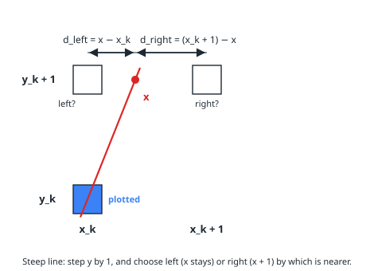
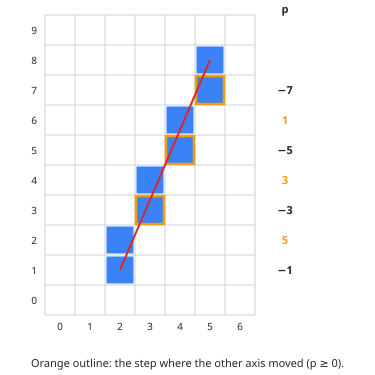
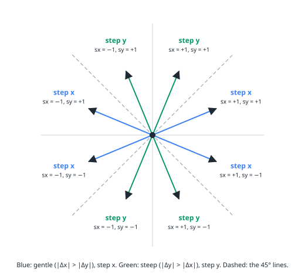
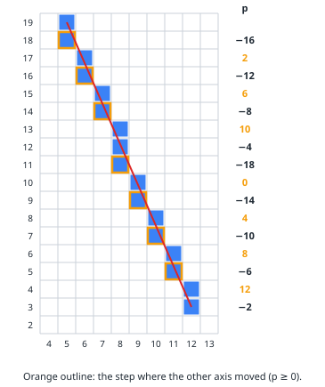

# Line Drawing and Antialiasing 4: Bresenham for Steep Slopes and Every Direction

A steep line is drawn the same way as a gentle one, with the roles of x and y swapped: step y by 1 and decide whether x moves.

## Before you start
<!-- bite: 5adb00df-f806-4152-a703-699bfb88ec51 -->

You can derive Bresenham's $p_k$, its update and $p_0$ for a gentle slope, and trace its table ([[computer-graphics/05-line-drawing-and-antialiasing-3|part 3]]).

**After this lesson you will be able to:**
1. Derive Bresenham's decision parameter for $m > 1$, including $p_0$ (the 15-mark exam question).
2. Handle lines in every direction with the signs $sx$ and $sy$.
3. Trace a steep table by hand, and check it against a program that draws every slope with integers only.

## What this part is about
<!-- bite: e1019e38-4644-4cfe-b0a2-723b62d370e5 -->

Everything in part 3 assumed a gentle slope, $dx > dy$, so we stepped $x$ and asked whether $y$ should go up. For a steep line, stepping $x$ would leave gaps, the same problem DDA had in part 1. So we swap: step $y$ every time, and ask whether $x$ should move. After that, one more idea (signs) covers lines going left or down, and we finish with one program for every slope.

## The kid version
<!-- bite: ce73e59e-76b5-4d06-81b0-0d5e62b5d655 -->

Now you're climbing a ladder instead of walking along the floor. Every step takes you up exactly one rung. At each rung you ask: "is the line closer to straight above me, or one square to the right?" and you shuffle across only when the answer is "right". Same score-keeping trick as before, just turned on its side.

**Where the analogy stops working.** A ladder only goes up. A line can go down or to the left too, so the program also needs a sign for each direction, which part 3 never needed.

## Terms used in this part
<!-- bite: 257fa754-de9c-4ba3-8b08-8c8ac496b50a -->

1. **Steep line**: This is a line with $|dy| > |dx|$, so $|m| > 1$. It is stepped along $y$.
2. **Left and right candidates**: These are the two pixels a steep line could go through on the next row: straight above the last pixel, or one column to the right of that.
3. **sx and sy**: These are the step directions, each $+1$ or $-1$. $sx = -1$ means the line goes left; $sy = -1$ means it goes down.
4. **Octant**: This is one of the eight slices you get by cutting the plane along the $x$ axis, the $y$ axis and the two 45° diagonals. Lines in the same octant are drawn the same way.

## Bresenham for m > 1: the two distances (the exam question)
<!-- bite: 353b71b5-f20a-424e-a913-754ffc28c8c9 -->

**Swap the roles of $x$ and $y$.** Now $dy > dx$. Step $y$ by 1 each time, and decide whether $x$ stays or increases by 1. Having plotted $(x_k, y_k)$, **at row $y_k + 1$ the true line is at $x = (y_k + 1 - b)/m$**. The candidates are the left pixel $(x_k, y_k + 1)$ and the right pixel $(x_k + 1, y_k + 1)$.



$$d_{left} = x - x_k,\qquad d_{right} = (x_k + 1) - x,\qquad d_{left} - d_{right} = 2x - 2x_k - 1$$

## Bresenham for m > 1: the decision parameter and update
<!-- bite: 70f55dbd-3d09-4d43-b932-122ebaa4794d -->

**Multiply by $dy$** (positive) and use $x = (y_k + 1 - b)\,dx/dy$:

$$p_k = dy(d_{left} - d_{right}) = 2dx\,y_k - 2dy\,x_k + c', \qquad c' = 2dx(1 - b) - dy$$

$$p_{k+1} = \begin{cases} p_k + 2dx & p_k < 0 \;\;(\text{left closer: } x \text{ stays}) \\ p_k + 2dx - 2dy & p_k \ge 0 \;\;(\text{right closer: } x + 1)\end{cases} \qquad p_0 = 2dx - dy$$

## Bresenham worked: steep line (2, 1) to (5, 8)
<!-- bite: af68eaef-2e20-44f0-b934-d2f06f52db74 -->

$dx = 3$, $dy = 7$, $m = 7/3 > 1$, so step $y$. $p_0 = 2dx - dy = -1$. Updates: $+2dx = +6$ ($x$ stays) or $2dx - 2dy = -8$ ($x$ goes up).

| k | $p_k$ | Decision | Plot | $p_{k+1}$ |
|---|---|---|---|---|
| start | | | (2, 1) | |
| 0 | −1 | $p<0$, $x$ stays | (2, 2) | −1 + 6 = 5 |
| 1 | 5 | $p \ge 0$, $x+1$ | (3, 3) | 5 − 8 = −3 |
| 2 | −3 | $x$ stays | (3, 4) | 3 |
| 3 | 3 | $x+1$ | (4, 5) | −5 |
| 4 | −5 | $x$ stays | (4, 6) | 1 |
| 5 | 1 | $x+1$ | (5, 7) | −7 |
| 6 | −7 | $x$ stays | (5, 8) | end |

**There are $dy + 1 = 8$ pixels, one per row.** To check, plot them on a grid and draw the true line over the top: no pixel is more than half a pixel away.

## Seeing the steep line on the grid
<!-- bite: 7d535beb-ccf0-45ef-b888-b51674d99991 -->

Here is that table drawn. The $p$ beside each row is the one used at that row; the orange outline marks each pixel where $x$ moved right because the $p$ before it was 0 or more. One pixel per row, 8 in all.



## Every direction: the signs sx and sy
<!-- bite: c5ae9068-1cad-4aa4-a451-0ea0af20916b -->

So far $x$ and $y$ only went up. A line can leave its start point in any of eight directions. The rule is still the same two questions:

1. **Which change is bigger?** If $|dx| \ge |dy|$ it is gentle: step $x$. Otherwise it is steep: step $y$.
2. **Which way does each go?** $sx = +1$ if the line goes right, $-1$ if it goes left. $sy = +1$ if it goes up, $-1$ if it goes down.

For negative slopes, work with $|dx|$ and $|dy|$ and step $x$ or $y$ by $-1$ instead of $+1$ (the `sx`, `sy` signs in the code below). Horizontal, vertical and 45° lines are special cases of the same rules.

## Seeing the eight directions
<!-- bite: 393c8d2d-9a23-4eb9-aff1-b5fff286f08c -->

Each arrow is a line leaving the start point. Blue ones are gentle and step $x$; green ones are steep and step $y$. Each is labelled with its signs.



## Bresenham worked: steep, going left, (12, 3) to (5, 19)
<!-- bite: c58f1104-4caa-4064-a1bd-17ad1c2dbe14 -->

$dx = 7$, $dy = 16$: step $y$; $x$ moves left ($sx = -1$). $p_0 = 2dx - dy = -2$. If $p < 0$: $p \mathrel{+}= 14$, $x$ stays. If $p \ge 0$: $x \mathrel{-}= 1$, $p \mathrel{+}= -18$. Then $y \mathrel{+}= 1$.

| k | p | pixel | k | p | pixel |
|---|---|---|---|---|---|
| 0 | −2 | (12,3) | 9 | −4 | (8,12) |
| 1 | 12 | (12,4) | 10 | 10 | (8,13) |
| 2 | −6 | (11,5) | 11 | −8 | (7,14) |
| 3 | 8 | (11,6) | 12 | 6 | (7,15) |
| 4 | −10 | (10,7) | 13 | −12 | (6,16) |
| 5 | 4 | (10,8) | 14 | 2 | (6,17) |
| 6 | −14 | (9,9) | 15 | −16 | (5,18) |
| 7 | 0 | (9,10) | 16 | −2 | (5,19) |
| 8 | −18 | (8,11) | | | |

17 pixels ($dy + 1$), ending exactly at $(5, 19)$. **At $k = 7$, $p = 0$ counts as "$p \ge 0$", so $x$ steps.**

## Seeing the line going left
<!-- bite: aa433cdc-2281-4617-be79-c75008c94261 -->

The same table on the grid. $y$ goes up one row each step, and $x$ moves one column **left** ($sx = -1$) after every $p$ of 0 or more. Look at row 10: $p = 0$ there, and $x$ still moves.



## The program: integer-only Bresenham for every slope
<!-- bite: 1c22a931-e61a-4e78-92b8-904cb1976c8d -->

```python
# bresenham.py — run: python3 bresenham.py, then type: 2 1 5 8
def bresenham(x0, y0, x1, y1):
    """Return the pixels of the line from (x0, y0) to (x1, y1), integers only."""
    pixels = []
    dx, dy = abs(x1 - x0), abs(y1 - y0)
    sx = 1 if x1 > x0 else -1   # direction of travel in x
    sy = 1 if y1 > y0 else -1   # direction of travel in y
    x, y = x0, y0

    if dy > dx:                 # steep line (|m| > 1): step in y
        p = 2 * dx - dy
        for _ in range(dy + 1):
            pixels.append((x, y))
            if p >= 0:
                x += sx
                p += 2 * (dx - dy)
            else:
                p += 2 * dx
            y += sy
    else:                       # shallow line (|m| <= 1): step in x
        p = 2 * dy - dx
        for _ in range(dx + 1):
            pixels.append((x, y))
            if p >= 0:
                y += sy
                p += 2 * (dy - dx)
            else:
                p += 2 * dy
            x += sx
    return pixels

x0, y0, x1, y1 = map(int, input("x0 y0 x1 y1: ").split())
print(bresenham(x0, y0, x1, y1))
```

## Bresenham program: test cases
<!-- bite: 1a2c697b-62a5-4ed6-bd15-fb4d5fee0e76 -->

**Test cases (all re-run and matching the hand tables):**

| Use case | Input | Output |
|---|---|---|
| Shallow, $m < 1$ | (2,3) to (9,8) | (2,3) (3,4) (4,4) (5,5) (6,6) (7,7) (8,7) (9,8) |
| Steep, $m > 1$ | (2,1) to (5,8) | (2,1) (2,2) (3,3) (3,4) (4,5) (4,6) (5,7) (5,8) |
| Steep, negative slope | (1,8) to (6,2) | (1,8) (2,7) (3,6) (4,5) (4,4) (5,3) (6,2) |
| Horizontal | (1,4) to (6,4) | (1,4) (2,4) (3,4) (4,4) (5,4) (6,4) |

**To justify results in an exam:** plot the pixels and the true line together and show that no pixel is more than half a pixel from it. (The code was also checked on 28,392 random lines; every pixel was within half a pixel.)

## Common pitfalls with steep lines
<!-- bite: 8909cf76-c95f-4748-a4c8-3932640ef629 -->

1. **Swapping the wrong things.** For a steep line, every $dx$ in the gentle formulas becomes $dy$ and every $dy$ becomes $dx$: $p_0 = 2dx - dy$, not $2dy - dx$.
2. **Using $p > 0$ instead of $p \ge 0$** for "move across". At $p = 0$ the step is taken.
3. **Using signed $dx$ and $dy$ in the formulas.** Work with $|dx|$ and $|dy|$, and let $sx$ and $sy$ carry the direction.
4. **Forgetting the final pixel.** Loop `dy + 1` times for a steep line, so both end points are drawn.

## Check your understanding
<!-- bite: b064f55a-475d-49c9-87fe-b3b62a407c6b -->

Try each one before you open the answer.

1. <!-- q: gap id="0aed2194" answers="14;y" -->
   Fill in the gaps. Without computing the table, Bresenham lights ___ pixels for (3, 2) to (7, 15), and it steps the ___ axis.

   <details><summary>Answer</summary>

   dx = 4, dy = 13, steep, so step y: dy + 1 = 14 pixels.

   </details>

2. <!-- q: exact id="8b05242c" answer="-3" accept="−3" -->
   For the steep line (3, 2) to (6, 11), what is Bresenham's starting decision parameter p₀ = 2dx − dy?

   <details><summary>Answer</summary>

   −3. dx = 3 and dy = 9, so p₀ = 2(3) − 9 = −3. Since p₀ < 0, x stays at the next row: the second pixel is (3, 3).

   </details>

3. <!-- q: mcq id="bedecef7" -->
   A line goes from (5, 5) to (1, 8). How does Bresenham draw it?

   - [x] Step x, with sx = −1 and sy = +1
   - [ ] Step y, with sx = −1 and sy = +1
   - [ ] Step x, with sx = +1 and sy = −1

   <details><summary>Answer</summary>

   Step x, going left and up. |dx| = 4 and |dy| = 3, so the line is gentle and x is stepped. It goes from x = 5 to x = 1 (left, sx = −1) and from y = 5 to y = 8 (up, sy = +1).

   </details>

4. <!-- q: grid id="a641764f" cols="5" rows="8" answer="1,0 1,1 2,2 2,3 2,4 3,5 3,6" given="1,0" line="1,0 3,6" axes="true" -->
   This line is steep: (1, 0) to (3, 6). Light every pixel Bresenham chooses.

   <details><summary>Answer</summary>

   (1,0) (1,1) (2,2) (2,3) (2,4) (3,5) (3,6). It steps y, so there is one pixel per row: dy + 1 = 7. p₀ = 2dx − dy = −2; add 4 when p < 0 (x stays), add −8 when p ≥ 0 (x goes right).

   </details>

5. <!-- q: grid id="aec84946" cols="6" rows="7" answer="1,6 2,5 2,4 3,3 3,2 4,1 4,0" given="1,6" line="1,6 4,0" axes="true" -->
   This steep line goes down and to the right: (1, 6) to (4, 0). Light every pixel Bresenham chooses.

   <details><summary>Answer</summary>

   (1,6) (2,5) (2,4) (3,3) (3,2) (4,1) (4,0). |dx| = 3, |dy| = 6, so step y with sy = −1, and sx = +1. p₀ = 2(3) − 6 = 0, so x moves straight away. Then p alternates −6, 0, −6, 0, −6: x moves after every 0 and stays after every −6.

   </details>

## Practice: independent tasks
<!-- bite: 327da5c7-fad2-4aff-bc49-643889715292 -->

These are SSG 511 Part A tasks; do them before reading anyone's code.

1. **Rasterise $A(1,1)$ to $B(3,11)$ by hand** with the $m > 1$ derivation: table and plot. *(Exam Q1b.)* **Done when** you have $dy + 1 = 11$ pixels ending at $(3, 11)$ and your code agrees.
2. **The cross**: $(10,10)$–$(50,50)$ and $(50,10)$–$(10,50)$ with full-octant Bresenham. **Done when** both lines have 41 pixels and they cross at the centre.

All of these are collected, with the rest of the paper, in the [[computer-graphics/25-ssg-511-question-bank|question bank]].

## Before moving on
<!-- bite: 898cd542-f8f9-4e27-8fc7-25483b8abd88 -->

You can derive the steep case, draw a line in any of the eight directions, and run one program for every slope. **Next:** [[computer-graphics/07-line-drawing-and-antialiasing-5|Line Drawing and Antialiasing 5: The Midpoint View and Drawing Shapes]]. It looks at the same algorithm a second way, the way that later draws circles, and then uses lines to build shapes.

## Related
<!-- bite: 8d4e7021-804b-4400-9e74-51dcfb8112e7 -->

- [[computer-graphics/05-line-drawing-and-antialiasing-3|Line Drawing and Antialiasing 3]] — the gentle case this mirrors
- [[computer-graphics/07-line-drawing-and-antialiasing-5|Line Drawing and Antialiasing 5]] — the midpoint view and shapes
- [[computer-graphics/27-ssg-511-formula-sheet|Formula sheet]]
- [[computer-graphics/index|Computer graphics map]]

## About this lesson
<!-- bite: 398a74e2-f867-4598-b202-2424e4888e04 -->

**Level:** Intermediate. **Covers:** Bresenham for $m > 1$ derived in full, lines in every direction with $sx$ and $sy$, two steep worked tables drawn on the grid, and one integer-only program for every slope with its test cases.

Part 4 of 6 on line drawing and antialiasing, in Part 1 of the course. **The Bresenham derivation for slope > 1 alone is worth 15 marks in SSG 511.**
