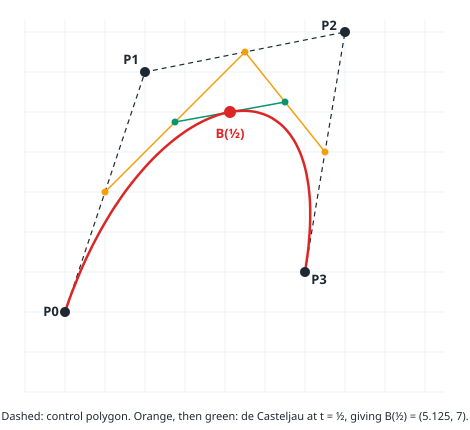
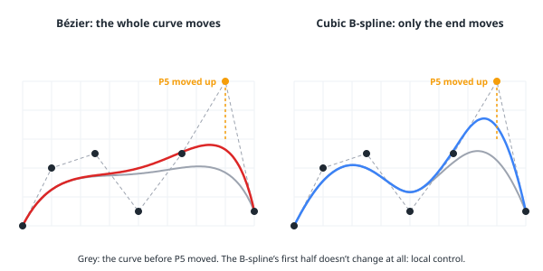
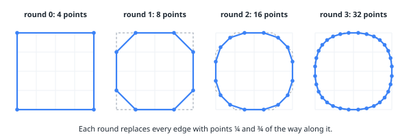
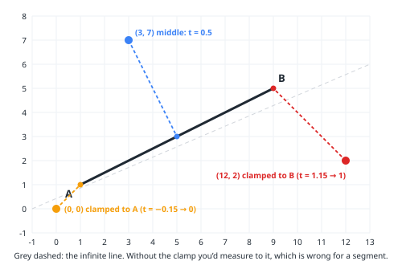
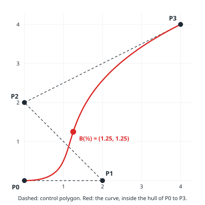

# Curves: Bézier and B-splines

Bézier curves and B-splines describe smooth curves with a few guide points you can drag.

## Before you start
<!-- bite: 5e87a314-f986-4d38-9d66-0904a266c15e -->

You can add vectors and multiply them by numbers, expand $(a + b)^2$ and $(a + b)^3$, and differentiate a polynomial.

**After this note you will be able to:**
1. Choose between implicit, explicit and parametric forms and say why.
2. Find a cubic Bézier's control points from end positions and velocities, and evaluate $B(t)$ and $B'(t)$.
3. Run de Casteljau by hand and read off the control points of each half.
4. Explain local versus global control, and what the B-spline knot vector does.

## What Bézier curves and B-splines are
<!-- bite: b0591f52-77ae-44c9-b818-f71dc2a07371 -->

Bézier curves and B-splines are ways of describing smooth curves with a few guide points that you can drag to change the shape. The pen tool in design apps like Figma and Photoshop uses them, and so do the outlines of the letters in every font on your phone.

Next: the kid version, then the words you need.

## The kid version
<!-- bite: 64ad974d-4030-4efe-bfd9-38ba6f2d6e65 -->

Stick a pin in a board at the start and another at the end, and add a couple of "magnet" pins in between. A bendy wire runs from the first pin to the last and is pulled towards the magnets without usually touching them. Move a magnet and the wire bends. **That wire is a Bézier curve, and the pins are its control points.**

There's a neat way to find any point on it: join the pins with straight lines, mark the point a fraction $t$ along each line, join those marks, mark $t$ along *those*, and keep going until one point is left. That point is on the curve. **That's de Casteljau's algorithm.**

**Where the analogy stops working.** With a Bézier curve, moving *any* magnet nudges the whole wire, even far away. B-splines fix that: each control point only influences a nearby stretch.

## Terms used in curves
<!-- bite: 8f4e1361-be36-4c57-b555-b7c5a125348a -->

1. **Control point**: This is one of the points $P_0, \dots, P_n$ that shape the curve.
2. **Control polygon**: This is the polyline joining the control points in order.
3. **Degree**: This is the highest power of $t$ in the curve's polynomial. For a Bézier curve it is the number of control points minus 1.
4. **Affine combination**: This is a weighted sum $\alpha_1P_1 + \alpha_2P_2 + \dots$ whose weights add up to 1. It always gives a point, whatever coordinate system you use.
5. **Barycentric combination**: This is an affine combination of a triangle's three corners. The weights are the point's barycentric coordinates.
## More terms used in curves
<!-- bite: d588a584-e262-4a4b-8856-50dd855d03b1 -->

6. **Bernstein basis functions**: These are the weights $B_i^n(t) = \binom{n}{i}t^i(1-t)^{n-i}$ that a Bézier curve gives its control points.
7. **Convex hull**: This is the smallest convex shape containing all the control points — the shape a rubber band makes when stretched around them.
8. **Knot vector**: This is the list of non-decreasing numbers $t_0 \le t_1 \le \dots$ that marks where a B-spline's polynomial pieces join.
9. **Order**: This is a B-spline's degree plus 1, written $k$.
10. **Local control**: This is the property that moving one control point only changes the nearby part of the curve.

## 1. Three ways to represent a curve
<!-- bite: 8499589a-b975-4ac2-b65d-4331780840e8 -->

| Type | Form | Circle of radius $r$ | Strength | Weakness |
|---|---|---|---|---|
| **Implicit** | $f(x,y) = 0$ | $x^2 + y^2 - r^2 = 0$ | Easy to test on/inside/outside — check the sign of $f$ | Hard to generate points in order |
| **Explicit** | $y = f(x)$ | $y = \sqrt{r^2 - x^2}$ | Simple | Single-valued: one $y$ per $x$, so no full circle or vertical line |
| **Parametric** | $P(t) = (x(t), y(t))$ | $(r\cos t, r\sin t)$, $t \in [0, 2\pi]$ | General: closed and multi-valued curves; tangents from the derivative; $t$ can be time | Needs a parameter; harder inside/outside test |

In a parametric curve, $x(t)$ and $y(t)$ give the coordinates while $t$ varies over an interval, usually $[0, 1]$. **Adding $z(t)$ gives a 3D curve.** Bézier curves and B-splines are parametric.

## 2. Vectors and affine combinations
<!-- bite: d34df689-e280-4dce-915d-8a6a01ab1d81 -->

A **vector** has magnitude and direction. It can stand for a direction (a velocity) or a point in space; in 2D it has $x$, $y$ components, in 3D $x$, $y$, $z$. It can be scaled and added to or subtracted from another.

**Two points.** Any point on the segment from $P_1$ to $P_2$ is "start at $P_1$ and go a fraction $t$ of the way to $P_2$":

$$P = P_1 + t(P_2 - P_1) = (1-t)P_1 + tP_2,\qquad 0 \le t \le 1$$

The weights $(1 - t)$ and $t$ sum to 1. **A sum $\alpha_1P_1 + \alpha_2P_2 + \dots$ with $\alpha_1 + \alpha_2 + \dots = 1$ is an affine combination.** (The *weights* are $\alpha$; $t$ is the parameter. Write "$\alpha_1 + \alpha_2 = 1$", not "$t_1 + t_2 = 1$".)

## Affine combinations of three points
<!-- bite: 02d13567-2854-4078-aa58-00a6a12e0a48 -->

**Three points (triangle $P_1P_2P_3$).** Start at $P_1$ and move along the edges $P_2 - P_1$ and $P_3 - P_1$:

$$P = P_1 + \alpha_2(P_2 - P_1) + \alpha_3(P_3 - P_1) = (1 - \alpha_2 - \alpha_3)P_1 + \alpha_2P_2 + \alpha_3P_3$$

Call $P_1$'s weight $\alpha_1 = 1 - \alpha_2 - \alpha_3$. Then $\alpha_1 + \alpha_2 + \alpha_3 = 1$ always. **This is a barycentric combination** — the same coordinates the rasteriser interpolates with in [[computer-graphics/11-rasterisation|note 11]].

## 3. Where the Bézier weights come from
<!-- bite: 6f57fe3a-3bda-44f7-9901-78380fcbe91b -->

**For any $t$, $(1 - t) + t = 1$.** Square both sides and expand:

$$[(1-t) + t]^2 = (1-t)^2 + 2t(1-t) + t^2 = 1$$

**Use those three terms as weights** — they are never negative on $[0,1]$ and they sum to 1, so the result is an affine combination. That *is* the quadratic Bézier curve:

$$P(t) = (1-t)^2P_0 + 2t(1-t)P_1 + t^2P_2$$

**For $n + 1$ control points, expand $[(1 - t) + t]^n = 1$.** Each term $\binom{n}{i}(1-t)^{n-i}t^i$ is one weight; Pascal's triangle gives the coefficients.

| Degree | Coefficients | Curve |
|---|---|---|
| 1 | 1, 1 | $(1-t)P_0 + tP_1$ |
| 2 | 1, 2, 1 | $(1-t)^2P_0 + 2t(1-t)P_1 + t^2P_2$ |
| 3 | 1, 3, 3, 1 | $(1-t)^3P_0 + 3t(1-t)^2P_1 + 3t^2(1-t)P_2 + t^3P_3$ |

## 4. Bézier curves
<!-- bite: c6627559-2894-4510-bf9c-d23c997aa475 -->

**A Bézier curve is the Bernstein-weighted sum of its control points:**

$$P(t) = \sum_{i=0}^{n} P_i\,B_i^n(t),\qquad B_i^n(t) = \binom{n}{i}t^i(1-t)^{n-i} = \frac{n!}{i!\,(n-i)!}\,t^i(1-t)^{n-i},\qquad 0 \le t \le 1$$

(Use one index throughout — summing over $k$ while the terms use $i$ is a common slip.)

- $n$ is the degree, $i$ the index, $t$ the variable, $P_i$ control point $i$.
- **Degree = number of control points − 1.** Two points give a line, three a quadratic, four a cubic.
- **It passes through the first and last control points** (not usually the others), and **lies inside the convex hull** of its control points.
- **Limits:** the degree grows with the number of control points, so long curves get expensive and hard to control; **and moving any one control point changes the whole curve (global control).**

## The cubic Bézier in detail
<!-- bite: 494de791-258c-4a7c-bd77-d9d1e2e3d4b1 -->

**Position:**

$$B(t) = (1-t)^3P_0 + 3(1-t)^2t\,P_1 + 3(1-t)t^2\,P_2 + t^3P_3$$

**Do every calculation separately on each coordinate** ($x$, $y$, $z$).

**Matrix form.** Expanding $(1-t)^3 = 1 - 3t + 3t^2 - t^3$, $3t(1-t)^2 = 3t - 6t^2 + 3t^3$, $3t^2(1-t) = 3t^2 - 3t^3$ and $t^3$:

$$B(t) = \begin{pmatrix} 1 & t & t^2 & t^3 \end{pmatrix}\begin{pmatrix} 1 & 0 & 0 & 0 \\ -3 & 3 & 0 & 0 \\ 3 & -6 & 3 & 0 \\ -1 & 3 & -3 & 1 \end{pmatrix}\begin{pmatrix} P_0 \\ P_1 \\ P_2 \\ P_3 \end{pmatrix}$$

(A cubic has four weights, so the column must hold four points.)

**Velocity.** If $t$ is time, the derivative is the velocity:

$$B'(t) = 3\left[(1-t)^2(P_1 - P_0) + 2(1-t)t\,(P_2 - P_1) + t^2(P_3 - P_2)\right]$$

## Bézier derivatives and end conditions
<!-- bite: 0dfee0fc-06f0-4b35-b930-d8b7eb0c19c8 -->

**In general, the derivative of a degree-$n$ Bézier is a degree-$(n-1)$ Bézier whose control points are $n$ times the differences of neighbouring control points:**

$$\frac{d}{dt}B_i^n(t) = n\left(B_{i-1}^{n-1}(t) - B_i^{n-1}(t)\right)\quad\Rightarrow\quad B'(t) = \sum_{i=0}^{n-1} B_i^{n-1}(t)\;n\,(P_{i+1} - P_i)$$

so $Q_0 = n(P_1 - P_0),\; Q_1 = n(P_2 - P_1),\; \dots,\; Q_{n-1} = n(P_n - P_{n-1})$.

**End conditions.** Put $t = 0$ and $t = 1$ into the two formulas:

$$B(0) = P_0,\quad B(1) = P_3,\quad B'(0) = 3(P_1 - P_0),\quad B'(1) = 3(P_3 - P_2)$$

**So given start/end positions and velocities $v_0$, $v_1$, the control points follow directly:**

$$P_1 = P_0 + \frac{v_0}{3},\qquad P_2 = P_3 - \frac{v_1}{3}$$

**Position at $t = \tfrac12$:** every weight is $\tfrac18$ times $1, 3, 3, 1$:

$$B\!\left(\tfrac12\right) = \frac{P_0 + 3P_1 + 3P_2 + P_3}{8}$$

## de Casteljau and splitting
<!-- bite: 496749cc-a816-47b3-b7de-c74d6e9031cb -->

**To find $B(t)$, repeatedly take points a fraction $t$ of the way along each segment:**

$$P_i^{\,r} = (1-t)P_i^{\,r-1} + tP_{i+1}^{\,r-1},\qquad P_i^{\,0} = P_i,\qquad B(t) = P_0^{\,n}$$

It forms a triangle of points; the one at the bottom is $B(t)$. **It is numerically stable and needs only interpolation** — no powers of $t$.

## Splitting a Bézier curve with de Casteljau
<!-- bite: b89c208f-a6a3-44d2-9b37-4c187b9f8113 -->

**Splitting.** The part of the curve for $t \in [0, s]$ is itself a cubic Bézier. **Its control points are the left edge of the de Casteljau triangle at $t = s$**: $P_0^0, P_0^1, P_0^2, P_0^3$. The second part uses the right edge, read from the bottom up.

**For $s = \tfrac12$ — the "first half" $B_1(t) = B(t/2)$:**

$$Q_0 = P_0,\quad Q_1 = \frac{P_0 + P_1}{2},\quad Q_2 = \frac{P_0 + 2P_1 + P_2}{4},\quad Q_3 = \frac{P_0 + 3P_1 + 3P_2 + P_3}{8}$$

and the second half has control points $Q_3$, $\frac{P_1 + 2P_2 + P_3}{4}$, $\frac{P_2 + P_3}{2}$, $P_3$. **It is still a cubic because replacing $t$ by $t/2$ in a degree-3 polynomial gives another degree-3 polynomial.**

## Properties of Bézier curves
<!-- bite: 7ebcbea0-a152-42dd-bdb0-a4b5d5291074 -->

1. **Convexity of the basis:** the weights are never negative and sum to 1.
2. **Convex-hull property:** the curve lies inside the convex hull of its control points. (This is what makes cheap curve clipping possible → [[computer-graphics/05-clipping|note 05]].)
3. **Affine invariance:** transforming the curve equals transforming its control points and redrawing — **which is why you move a Bézier curve by moving four points.**
4. **Linear precision:** control points on a line give that line.
5. **Variation diminishing:** no straight line crosses the curve more often than it crosses the control polygon.
6. **End tangents:** the curve leaves $P_0$ towards $P_1$ and arrives at $P_3$ from $P_2$.

## 5. Worked examples
<!-- bite: 5d798327-192a-45cd-8237-5cca60f14158 -->

## Worked (a): control points from end conditions
<!-- bite: d02139e5-4b42-45e8-b69e-6c147105eb53 -->

Position $(1,2)$ at $t = 0$, $(7,3)$ at $t = 1$; velocity $(3,6)$ at $t = 0$, $(-6,3)$ at $t = 1$.

$$P_1 = P_0 + \frac{v_0}{3} = (1,2) + (1,2) = (2,4),\qquad P_2 = P_3 - \frac{v_1}{3} = (7,3) - (-2,1) = (9,2)$$

## Worked (b): de Casteljau at t = 1/2
<!-- bite: 537edf1f-0c91-4391-91ff-1035a316211b -->

| Level | Points |
|---|---|
| 0 | (1,2), (3,8), (8,9), (7,3) |
| 1 | (2,5), (5.5,8.5), (7.5,6) |
| 2 | (3.75,6.75), (6.5,7.25) |
| 3 | **(5.125, 7)** |

**$B(\tfrac12) = (5.125, 7)$.** First half's control points (first point of each level): $(1,2), (2,5), (3.75,6.75), (5.125,7)$. Second half (last point of each level, bottom up): $(5.125,7), (6.5,7.25), (7.5,6), (7,3)$. End tangents: $B'(0) = 3(P_1 - P_0) = (6,18)$, $B'(1) = 3(P_3 - P_2) = (-3,-18)$.

Check with the formula: $\frac{(1,2) + 3(3,8) + 3(8,9) + (7,3)}{8} = \frac{(41, 56)}{8} = (5.125, 7)$. ✓

## Seeing de Casteljau at t = ½
<!-- bite: 5ca513ac-95ef-4507-900b-5c1c39139d4b -->

Here is the same curve. Halfway along each dashed side of the control polygon gives the orange points. Halfway along the orange lines gives the green points. Halfway along the green line is B(½), and it sits right on the red curve.



## Worked (c): a curve through two points with given slopes
<!-- bite: 03d658ab-557d-406d-a979-d5e0c8b7ed1b -->

**A slope gives a direction, not a speed.** So $P_1$ must lie on the line through $P_0$ with the first slope, and $P_2$ on the line through $P_3$ with the second slope — **but how far along is your choice.** Write $P_1 = P_0 + a(1, m_0)$ and $P_2 = P_3 - b(1, m_1)$, pick sensible positive $a$, $b$ (say a fraction of the distance between the points), **state the choice**, and substitute into the cubic. A different $a$, $b$ gives a different curve through the same points with the same slopes.

## Bézier runnable check
<!-- bite: 1e8f5b05-355e-421d-8986-f167bfe2dc70 -->

```python
# bezier.py — run: python3 bezier.py
def lerp(a, b, t):
    return tuple((1 - t) * x + t * y for x, y in zip(a, b))

def de_casteljau(points, t):
    """Return all levels of the de Casteljau triangle; the last level is B(t)."""
    levels = [list(points)]
    while len(levels[-1]) > 1:
        prev = levels[-1]
        levels.append([lerp(prev[i], prev[i + 1], t) for i in range(len(prev) - 1)])
    return levels

levels = de_casteljau([(1, 2), (3, 8), (8, 9), (7, 3)], 0.5)
for level in levels:
    print(level)
first_half = [level[0] for level in levels]
second_half = [level[-1] for level in reversed(levels)]
print("first half:", first_half)
print("second half:", second_half)
```

**Expected:** the four levels in the table above, then `first half: [(1, 2), (2.0, 5.0), (3.75, 6.75), (5.125, 7.0)]` and `second half: [(5.125, 7.0), (6.5, 7.25), (7.5, 6.0), (7, 3)]`.

## 6. B-spline curves
<!-- bite: 70b66c7c-1eca-4bd4-957d-0b4e1261bc7c -->

**A B-spline is built from several polynomial pieces joined smoothly.** It is more flexible than a Bézier curve because **the degree does not have to grow with the number of control points.** It is a weighted sum of the control points with B-spline basis functions $N_{i,k}(t)$:

$$C(t) = \sum_{i=0}^{n} P_i\,N_{i,k}(t),\qquad t_{k-1} \le t \le t_{n+1},\qquad n \ge k - 1$$

- There are $n + 1$ control points. **$k$ is the order, and the degree is $k - 1$.**
- **The knot vector** $t_0 \le t_1 \le \dots \le t_{n+k}$ marks where the pieces join.
## The B-spline basis functions (Cox–de Boor)
<!-- bite: 3709572f-2787-4858-8c4d-2d676629765c -->

- **The basis functions come from the Cox–de Boor recursion.** In words: order-1 functions are "1 on their own knot interval, 0 elsewhere", and each higher order blends two neighbouring lower-order functions with linear ramps:

$$N_{i,1}(t) = \begin{cases} 1 & t_i \le t < t_{i+1} \\ 0 & \text{otherwise}\end{cases}$$

$$N_{i,k}(t) = \frac{t - t_i}{t_{i+k-1} - t_i}\,N_{i,k-1}(t) + \frac{t_{i+k} - t}{t_{i+k} - t_{i+1}}\,N_{i+1,k-1}(t)$$

(A term with a zero denominator is taken as 0.)

## Properties of B-splines
<!-- bite: 5f47c619-e8cc-4c38-aa74-07ab9da287d1 -->

What follows from that definition:

- **The maximum order is the number of control points** ("the number of vertices defining the B-spline polygon"). **With that order and suitable knots, the B-spline is a Bézier curve.**
- **Local control:** $N_{i,k}$ is non-zero only on $[t_i, t_{i+k})$, so moving $P_i$ changes only that stretch.
- The basis functions are never negative and sum to 1, so **the curve stays inside the convex hull** of its control points.
- **With distinct knots the curve has continuity $C^{k-2}$.** A cubic B-spline ($k = 4$) is smooth up to the second derivative — why it is the default in modelling tools.

## Seeing local control
<!-- bite: 0780b1ca-b922-49d6-81b5-5578a2571b9c -->

The same seven control points drive both curves. Move P5 up and the whole Bézier curve shifts, while the B-spline only changes near P5. Its left half stays exactly where it was.



## Bézier vs B-spline
<!-- bite: ab5804bf-06c0-432a-b459-7f13ed84d9a9 -->

| | Bézier | B-spline |
|---|---|---|
| Degree | Number of control points − 1 | Chosen separately (order $k$) |
| Control | **Global** — one point moves the whole curve | **Local** — one point moves part of it |
| Extra ingredient | None | A knot vector |
| Relationship | | A Bézier is a B-spline with order = number of control points |

## 7. Chaikin's corner-cutting algorithm
<!-- bite: 604e6453-ce43-41b4-a133-6f92a0da6233 -->

> Class notes only have the heading "curve drawing algorithm: George Chaikin's algorithm"; this is the standard method — **check it against the lecturer's version.**

**Start with a polygon $P_0, \dots, P_n$. For each edge $P_iP_{i+1}$, make two new points a quarter and three-quarters of the way along:**

$$Q_i = \tfrac34P_i + \tfrac14P_{i+1},\qquad R_i = \tfrac14P_i + \tfrac34P_{i+1}$$

Replace the polygon with $Q_0, R_0, Q_1, R_1, \dots$ and repeat. **Each round cuts the corners off, and the polygon converges to a smooth quadratic B-spline.**

**Worked — the closed square $(0,0), (4,0), (4,4), (0,4)$:** after one round the 4 points become 8: $(1,0), (3,0), (4,1), (4,3), (3,4), (1,4), (0,3), (0,1)$. After the next round there are 16.

## Seeing Chaikin rounds
<!-- bite: b226e5a4-4b81-4f56-aa38-3fd63e56d9b0 -->

Starting from the square, each round cuts every corner off. After three rounds the 32 points already look like a smooth rounded shape.



## 8. Drawing a curve with straight lines
<!-- bite: 7e20f6fc-4e7e-4193-ae80-dbb3274fcf8a -->

## Distance from a point to a segment
<!-- bite: c34971d1-ca83-4957-9075-5b1b499c7967 -->

**Assumptions:** 2D Euclidean space; segment from $A$ to $B$; point $P$; $A \ne B$ (if $A = B$, the distance is $|P - A|$).

1. Let $\vec{AB} = B - A$ and $\vec{AP} = P - A$.
2. **Project $P$ onto the line through $A$ and $B$:** $t = \frac{\vec{AP}\cdot\vec{AB}}{\vec{AB}\cdot\vec{AB}}$. $t = 0$ is $A$, $t = 1$ is $B$.
3. **A segment stops at its ends, so clamp $t$ to $[0, 1]$.**
4. The closest point is $C = A + t\,\vec{AB}$; the distance is $|P - C|$.

$$t = \frac{(P - A)\cdot(B - A)}{(B - A)\cdot(B - A)},\qquad C = A + \operatorname{clamp}(t, 0, 1)\,(B - A),\qquad d = \lVert P - C\rVert$$

Three cases: nearest to $A$ ($t \le 0$), nearest to $B$ ($t \ge 1$), or the perpendicular foot in between.

## Worked: distance to the segment A(1,1) to B(9,5)
<!-- bite: ee94b334-705a-4536-b8f2-b16e469e9870 -->

**Worked — segment $A(1,1)$ to $B(9,5)$**, $\vec{AB} = (8,4)$, $|\vec{AB}|^2 = 80$:

| P | t | Clamped | Closest point | Distance |
|---|---|---|---|---|
| (3,7) | 0.5 | 0.5 | (5,3) | $\sqrt{20} = 4.472$ |
| (12,2) | 1.15 | 1 | B (9,5) | $\sqrt{18} = 4.243$ |
| (0,0) | −0.15 | 0 | A (1,1) | $\sqrt2 = 1.414$ |

**Rows 2 and 3 are why the clamp matters:** without it you measure to the infinite line, which is wrong for a segment. (Also: $A = (0,0)$, $B = (4,0)$ gives 1 for $(1,1)$, 5 for $(-3,4)$, and 5 for $(7,4)$.)

## Seeing the three cases
<!-- bite: 7365e27d-2366-4328-add5-18d077382468 -->

The three points from the table. (3, 7) drops onto the middle of the segment. (12, 2) and (0, 0) would land on the line beyond the ends, so the clamp moves them to B and A.



## Flattening a quadratic Bézier to a tolerance
<!-- bite: a458c184-1cf0-4c2b-b040-177931058bb9 -->

**Split the curve until each piece is nearly straight, then draw each piece as a line.** The quadratic's furthest point from its chord $P_1P_3$ is at $t = \tfrac12$, where the tangent is parallel to the chord. That point is $M = (P_1 + 2P_2 + P_3)/4$.

```text
draw_bezier(P1, P2, P3, sigma):
    M = (P1 + 2*P2 + P3) / 4
    if distance(M, segment P1P3) <= sigma:     # the point-to-segment routine above
        draw_line(P1, P3)                      # flat enough
    else:                                      # de Casteljau split at t = 1/2
        A = (P1 + P2) / 2
        B = (P2 + P3) / 2
        draw_bezier(P1, A, M, sigma)           # first half
        draw_bezier(M, B, P3, sigma)           # second half
```

## Flatness, and a worked flattening
<!-- bite: 11cfc308-b377-40e0-8a13-a202f818bc37 -->

**The flatness (maximum distance from the chord) is**

$$\delta = \frac{|P_1 - 2P_2 + P_3|}{4}$$

and **each split in half divides it by 4**, so the recursion always stops. (Equivalently, it is half the distance of $P_2$ from the chord's line — another common flatness test.)

**Worked:** $P_1(0,0)$, $P_2(4,8)$, $P_3(8,0)$. $P_1 - 2P_2 + P_3 = (0,-16)$, so $\delta = 16/4 = 4$ (indeed $P(\tfrac12) = (4,4)$ and the chord midpoint is $(4,0)$). For $\sigma = 0.25$: $4 \to 1 \to 0.25$, **two levels of splitting, giving 4 straight segments.**

## Common pitfalls
<!-- bite: 8d166a19-8813-443e-b093-5ae50f55d150 -->

1. **Mixing $P_0$–$P_3$ with $P_1$–$P_4$ labels** mid-question. Pick one.
2. **Forgetting the factor 3** in $B'(0) = 3(P_1 - P_0)$, so $P_1 = P_0 + v_0$ instead of $P_0 + v_0/3$.
3. **Reading the second half from the wrong edge** of the de Casteljau triangle.
4. **Not clamping $t$** in the point-to-segment distance.
5. **Treating a slope as a velocity** — a slope fixes direction only.
6. **Reversed binomial index** — the standard form is $\binom{n}{r}(1-t)^{n-r}t^r$ so the highest power of $(1 - t)$ sits on the first point.

## Check your understanding
<!-- bite: 424e062a-4fa2-45ab-ac0d-54c63dc0fbfd -->

Try each one before you open the answer.

1. <!-- q: exact id="d0f3cc15" answer="3" accept="three" -->
   A Bézier curve has 4 control points. What is its degree?

   <details><summary>Answer</summary>

   3, a cubic. Degree = number of control points − 1.

   </details>

2. <!-- q: gap id="c3093da0" answers="2;4;9;2" -->
   Fill in the gaps. A cubic Bézier starts at (1,2) with velocity (3,6) and ends at (7,3) with velocity (−6,3). Then P₁ = (___, ___) and P₂ = (___, ___).

   <details><summary>Answer</summary>

   P₁ = P₀ + v₀/3 = (1,2) + (1,2) = (2,4). P₂ = P₃ − v₁/3 = (7,3) − (−2,1) = (9,2).

   </details>

3. <!-- q: mcq id="20ff78a8" -->
   A cubic Bézier has P₀ = P₁. What is B'(0), and what does it mean physically?

   - [x] Zero: the particle starts at rest
   - [ ] It is undefined
   - [ ] It equals P₂ − P₀

   <details><summary>Answer</summary>

   Zero: the particle starts at rest (the curve still leaves towards P₂). B'(0) = 3(P₁ − P₀).

   </details>

4. <!-- q: mcq id="b3dc0668" -->
   You move one control point of a long Bézier curve. What happens?

   - [ ] Only the nearby part of the curve changes
   - [x] The whole curve changes (global control)

   <details><summary>Answer</summary>

   The whole curve changes. B-splines fix this with local control.

   </details>

5. <!-- q: exact id="3a5929ee" answer="4" accept="four" -->
   How many line segments does flattening need for a quadratic with δ = 8 at tolerance σ = 0.5?

   <details><summary>Answer</summary>

   8 → 2 → 0.5: two levels of splitting, 4 segments. Each split divides the flatness by 4.

   </details>

6. <!-- q: open id="9b6e2194" -->
   Why does moving one control point of a cubic B-spline with many points leave most of the curve unchanged?

   <details><summary>Answer</summary>

   Each basis function is non-zero only over k knot intervals, so each control point's weight is zero elsewhere.

   </details>

## Check your understanding: worked problems
<!-- bite: 9ec30a35-1880-4cf1-a569-3ac79dd6df35 -->

Work each one out on paper first, then type your answer.

1. <!-- q: gap id="7846c4e3" answers="2;3" -->
   Fill in the gaps. A cubic Bézier has P₀(0, 0), P₁(0, 4), P₂(4, 4), P₃(4, 0). B(½) = (___, ___).

   <details><summary>Answer</summary>

   (2, 3). B(½) = (P₀ + 3P₁ + 3P₂ + P₃)/8. x: (0 + 0 + 12 + 4)/8 = 2. y: (0 + 12 + 12 + 0)/8 = 3.

   </details>

2. <!-- q: gap id="83638f58" answers="0;12" -->
   Fill in the gaps. The cubic Bézier has P₀(0, 0), P₁(0, 4), P₂(4, 4), P₃(4, 0). B'(0) = (___, ___).

   <details><summary>Answer</summary>

   (0, 12). B'(0) = 3(P₁ − P₀) = 3 × (0, 4). The curve leaves P₀ straight up.

   </details>

3. <!-- q: gap id="5b80faff" answers="2;2" -->
   Fill in the gaps. A quadratic Bézier has P₀(0, 0), P₁(2, 4), P₂(4, 0). P(½) = (___, ___).

   <details><summary>Answer</summary>

   (2, 2). Weights ¼, ½, ¼: 0.25 × (0, 0) + 0.5 × (2, 4) + 0.25 × (4, 0) = (2, 2).

   </details>

4. <!-- q: exact id="cccf71ee" answer="3" -->
   A quadratic Bézier has P₁(0, 0), P₂(2, 6), P₃(4, 0). What is its flatness δ = |P₁ − 2P₂ + P₃| / 4?

   <details><summary>Answer</summary>

   3. P₁ − 2P₂ + P₃ = (0, −12), and 12/4 = 3.

   </details>

5. <!-- q: sketch id="d06e63b4" -->
   Sketch the cubic Bézier with P0(0, 0), P1(2, 0), P2(0, 2), P3(4, 4). Draw the control polygon first, mark B(½), and show the direction the curve leaves P0 and arrives at P3.

   <details><summary>Answer</summary>

   

   What to check:
   - B(½) = (P0 + 3P1 + 3P2 + P3)/8 = (10, 10)/8 = (1.25, 1.25).
   - The curve leaves P0 along P0→P1 (to the right) and arrives at P3 along P2→P3.
   - It passes through P0 and P3 only, and stays inside the control polygon's hull.

   </details>

6. <!-- q: points id="ceb559fe" xmin="-0.5" xmax="4.5" ymin="-0.5" ymax="4.5" step="0.5" snap="0.25" answer="1,0.5 1.5,2 1.25,1.25" labels="R0,R1,B(½)" tolerance="0.15" ghost="0,0 2,0 0,2 4,4" -->
   The control points P0(0, 0), P1(2, 0), P2(0, 2), P3(4, 4) are shown faintly. Run de Casteljau at t = ½. Place the two second-level points R0 and R1, then B(½).

   <details><summary>Answer</summary>

   The first level is the midpoints (1, 0), (1, 1) and (2, 3). The second level is R0 = (1, 0.5) and R1 = (1.5, 2). Their midpoint is B(½) = (1.25, 1.25), which matches (P0 + 3P1 + 3P2 + P3)/8.

   </details>

## Practice — independent tasks
<!-- bite: 208958e3-ec15-47ee-a2e3-6169d88ea0d2 -->

From SSG 511 — full wording in the [[computer-graphics/20-ssg-511-question-bank|question bank]]:

1. **Exam Q1(c)** — particle from $(0,0,0)$ to $(4,0,2)$, velocities $(6,0,0)$ and $(0,0,3)$: equations, $P_1$, $P_2$, $B(\tfrac12)$, and the first half's control points.
2. **B-9** — $P_0(0,0)$, $P_1(2,0)$, $P_2(0,2)$, $P_3(4,4)$: sketch, de Casteljau $B(\tfrac12)$, sketch the curve with end slopes.
3. **B-10** — the 2D particle with velocities $(6,0)$ and $(-12,0)$, including the second half's control points.
4. **Supplementary 4–6** — point-to-segment distance, flattening, and the curve through $(0,5)$ slope 2 and $(6,1)$ slope 3.

**Done when** each $B(\tfrac12)$ agrees between the formula and de Casteljau, and the `bezier.py` script reproduces your halves.

## Before moving on
<!-- bite: 870db173-9d38-44cb-95a9-53fecaf028cd -->

**Next:** [[computer-graphics/08-visible-surface-detection|Visible Surface Detection]].

## Related
<!-- bite: 3fb80f5f-bf51-4233-9def-28e2d9e1f10f -->
- [[computer-graphics/16-geometry-and-meshes|Geometry and Meshes]] — NURBS, subdivision surfaces, the CAD divide
- [[computer-graphics/17-animation-and-simulation|Animation]] — curves as motion paths
- [[mathematics/07-applied-and-computational/01-numerical-methods/06-interpolation-and-approximation|Interpolation and splines]]
- [[computer-graphics/index|Computer graphics map]]

## About this lesson
<!-- bite: 83ba19b6-0a4c-48c7-96d1-bcc957466766 -->

**Level:** Intermediate → Advanced. **Covers:** Implicit, explicit and parametric curves; affine and barycentric combinations; where the Bézier weights come from; position, velocity, de Casteljau and splitting; B-splines and the Cox–de Boor recursion; Chaikin corner cutting; and drawing a curve with straight lines to a tolerance.

Part 1 of the course. [[computer-graphics/16-geometry-and-meshes|Note 16]] gives the big picture (NURBS, subdivision surfaces, CAD versus real-time). **This note is the hand-calculation version that SSG 511 Q1(c) is worth 15 marks on.**
