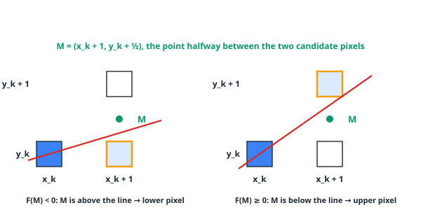
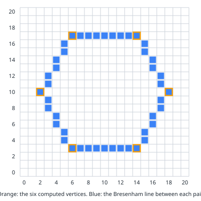
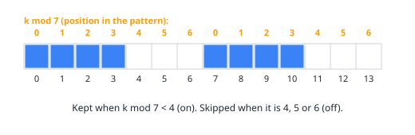

# Line Drawing and Antialiasing 5: The Midpoint View and Drawing Shapes

The midpoint algorithm is Bresenham seen another way: test the point halfway between the two candidate pixels, and see which side of the line it falls on.

## Before you start
<!-- bite: 934f540f-3e3b-4865-acfa-67c7f77a628d -->

You can trace Bresenham for any slope and direction ([[computer-graphics/06-line-drawing-and-antialiasing-4|part 4]]), and you know that a regular shape's corners can sit on a circle, using $\cos$ and $\sin$.

**After this lesson you will be able to:**
1. Explain the midpoint test and why it gives the same pixels as Bresenham.
2. Compare DDA, Bresenham and the midpoint algorithm.
3. Build a polygon and a regular $n$-gon from the line function, and draw dashed lines.

## What this part is about
<!-- bite: 5de6c9f2-6759-472b-83f7-807bec2499c5 -->

Parts 3 and 4 chose between two pixels by comparing two distances. There is a second way to ask the same question, and it is worth learning because the next lesson, circles, is built on it. Then we put the line function to work: once you can draw one line, you can draw any shape made of lines, solid or dashed.

## The kid version
<!-- bite: 34d7ae70-37c4-4085-a589-e33b87cf288d -->

Two pixels are fighting to be part of the line. Instead of measuring how far each one is from the line, put a pin exactly halfway between them. If the line passes below the pin, the bottom pixel wins; if above, the top one wins. Same answer as measuring, less work.

**Where the analogy stops working.** You can see which side of a pin a line passes. The computer finds out by putting the pin's coordinates into the line's equation and looking at the sign of the answer.

## Terms used in this part
<!-- bite: 9bf809a4-69ea-44e4-b4bb-b1774711d4cb -->

1. **Midpoint**: This is the point $M$ exactly halfway between the two candidate pixels, $(x_k + 1,\; y_k + \tfrac12)$ for a gentle line.
2. **Line function**: This is $F(x, y)$, the line's equation rearranged so it equals 0 on the line. Its sign tells you which side of the line a point is on.
3. **Polygon**: This is a closed shape made of straight sides, drawn by joining each corner (vertex) to the next.
4. **Regular n-gon**: This is a polygon with $n$ equal sides and equal angles, like a hexagon ($n = 6$). Its vertices lie on a circle.

## The midpoint line algorithm
<!-- bite: 04dafa87-8f3d-4f1f-989b-562fee5a94a4 -->

**Same result, different way of seeing it.** Write the line as $F(x, y) = dy\,x - dx\,y + dx\,b = 0$. Points above the line give $F < 0$; below give $F > 0$. **Evaluate $F$ at the midpoint between the two candidates**, $M = (x_k + 1,\; y_k + \tfrac12)$:

- $F(M) < 0$: the midpoint is above the line, so the line is nearer the lower pixel — plot $(x_k + 1, y_k)$.
- $F(M) \ge 0$: plot $(x_k + 1, y_k + 1)$.

With $d = 2F(M)$: $d_0 = 2dy - dx$, then $d \mathrel{+}= 2dy$ (lower) or $d \mathrel{+}= 2(dy - dx)$ (upper). **For lines it is exactly Bresenham. Its advantage is that it extends to circles and ellipses** → [[computer-graphics/09-circles-and-polygon-filling|note 09]].

## Seeing the midpoint test
<!-- bite: cda7ae38-01c6-4b4f-ad98-196d707a7c1a -->

The green dot is $M$, halfway between the two candidates. On the left the line passes below $M$, so $F(M) < 0$ and the lower pixel is chosen. On the right it passes above $M$, so $F(M) \ge 0$ and the upper pixel is chosen. The chosen pixel has the orange outline.



## DDA vs Bresenham vs midpoint
<!-- bite: ed862a86-5bd7-4a0d-880d-406bd4801db8 -->

| Algorithm | Arithmetic | Main idea | Notes |
|---|---|---|---|
| DDA | Floating point | Step the long axis, add slope increments, round | Simple but slow; error builds up |
| Bresenham | Integers only | Decision parameter picks the closer pixel | Fast and exact |
| Midpoint | Integers only | Test the midpoint of the two candidates | Same as Bresenham for lines; generalises to circles |

## From lines to shapes
<!-- bite: 4f6c00e5-a5fa-4b17-a40a-f7355bda213b -->

**A polygon is a set of lines.** Call the line function for each pair of consecutive vertices, and for the last vertex back to the first — the `% n` closes the shape:

```python
def draw_polygon(vertices, draw_line):
    n = len(vertices)
    for i in range(n):
        x0, y0 = vertices[i]
        x1, y1 = vertices[(i + 1) % n]
        draw_line(x0, y0, x1, y1)
```

**A regular $n$-gon's vertices lie on a circle, spaced $360°/n$ apart:**

$$x_i = x_c + r\cos\!\left(\theta_0 + i\,\tfrac{360°}{n}\right),\qquad y_i = y_c + r\sin\!\left(\theta_0 + i\,\tfrac{360°}{n}\right),\qquad i = 0,\dots,n-1$$

Round each vertex to integers before passing it to the line function. A hexagon has $n = 6$, so the vertices are 60° apart.

## Seeing a hexagon built from lines
<!-- bite: aefbd5b9-0002-4534-8c3a-abad85b03c82 -->

Here is a small hexagon: centre $(10, 10)$, radius 8, $\theta_0 = 0$. The six vertices are 60° apart; rounded to whole pixels they are $(18,10)$, $(14,17)$, $(6,17)$, $(2,10)$, $(6,3)$ and $(14,3)$. Each pair is then joined by one Bresenham line.



## Dashed (styled) lines
<!-- bite: 0809b9f1-87b2-47cb-8295-733e949db7df -->

**Count pixels along the line, and plot one only when its position in the repeating pattern falls in the "on" part:**

```python
def dashed_pixels(pixels, on=4, off=3):
    """Keep `on` pixels, skip `off` pixels, and repeat."""
    return [p for k, p in enumerate(pixels) if k % (on + off) < on]
```

For a horizontal line of 14 pixels ($x = 0$ to $13$) with on = 4, off = 3, this keeps $x = 0$–$3$ and $x = 7$–$10$. To toggle styles, add an option that either plots every pixel or applies this filter. **For a rectangle, decide whether the pattern restarts at each corner or carries on around it** — and say which.

## Seeing the dash pattern
<!-- bite: 2adf0432-0e64-4573-9ac4-d1007e089fc8 -->

The same 14-pixel line. The orange number above each pixel is its position in the pattern, $k \bmod 7$. Positions 0 to 3 are "on" and get drawn; 4, 5 and 6 are "off" and are skipped.



## Common pitfalls
<!-- bite: abf01d3f-2f53-44c9-9cd4-5716c42d5438 -->

1. **Mixing up the midpoint signs.** With $F = dy\,x - dx\,y + dx\,b$, a point *above* the line gives $F < 0$. So $F(M) < 0$ means the line is below $M$: choose the lower pixel.
2. **Forgetting to close the polygon.** The last vertex joins back to the first; that is what `% n` does.
3. **Drawing vertices before rounding.** Round each vertex to whole pixels first, then pass it to the line function.
4. **Not saying where the dash pattern restarts** on a rectangle: at each corner, or carried on around it.

## Check your understanding
<!-- bite: 617ea04c-8f5e-4fca-9f59-e8d4ef7a2650 -->

Try each one before you open the answer.

1. <!-- q: mcq id="65967441" -->
   For a gentle line, the line function at the midpoint is F(M) = −3. Which pixel does the midpoint algorithm plot next?

   - [x] The lower one, (x_k + 1, y_k)
   - [ ] The upper one, (x_k + 1, y_k + 1)
   - [ ] Both, because the line is close to M

   <details><summary>Answer</summary>

   The lower one. F(M) < 0 means M is above the line, so the line is nearer the lower candidate.

   </details>

2. <!-- q: exact id="e32c336c" answer="-2" accept="−2" -->
   The midpoint algorithm draws (0, 0) to (8, 3). What is its starting value d₀ = 2dy − dx?

   <details><summary>Answer</summary>

   −2. dx = 8 and dy = 3, so d₀ = 6 − 8 = −2. It is the same start value as Bresenham's p₀, because for lines the two algorithms are the same.

   </details>

3. <!-- q: mcq id="d769eb54" -->
   Which line algorithm extends naturally to drawing circles and ellipses?

   - [ ] DDA
   - [ ] Bresenham's distance comparison
   - [x] The midpoint algorithm

   <details><summary>Answer</summary>

   The midpoint algorithm. Testing the sign of a function at the midpoint works for any curve with an equation, such as x² + y² − r² for a circle.

   </details>

4. <!-- q: exact id="ec31b841" answer="45" -->
   You draw a regular octagon (8 sides) from its vertices on a circle. How many degrees apart are the vertices?

   <details><summary>Answer</summary>

   45. The vertices are spaced 360°/n apart, and 360/8 = 45.

   </details>

5. <!-- q: grid id="ddafc0e5" cols="12" rows="1" answer="0,0 1,0 2,0 5,0 6,0 7,0 10,0 11,0" axes="true" -->
   A horizontal line of 12 pixels (x = 0 to 11) is drawn dashed with on = 3, off = 2. Light the pixels that are drawn.

   <details><summary>Answer</summary>

   x = 0, 1, 2, 5, 6, 7, 10, 11. The pattern repeats every 3 + 2 = 5 pixels, and a pixel is kept when k mod 5 < 3.

   </details>

## Practice: independent tasks
<!-- bite: 21eb6801-a109-4cef-b222-a536a1c83080 -->

1. **A regular hexagon** centred at $(100, 100)$, radius 50, from six vertices you compute yourself.
2. **A dashed rectangle** with vertices $(50,50)$, $(200,50)$, $(200,150)$, $(50,150)$ and a toggle between solid and dashed.
3. **A DDA-versus-Bresenham viewer** that draws the same line both ways in different colours (or offset), so you can compare end points and smoothness. Try a line thousands of pixels long and look for part 2's drift.

All of these are collected, with the rest of the paper, in the [[computer-graphics/25-ssg-511-question-bank|question bank]].

## Before moving on
<!-- bite: 54089328-aeba-47ec-a38c-855cdc19d3fd -->

You can explain the midpoint test, compare the three line algorithms, and build polygons and dashed lines from the line function. **Next:** [[computer-graphics/08-line-drawing-and-antialiasing-6|Line Drawing and Antialiasing 6: Antialiasing]]. Every line in these five parts has a staircase edge; the last part makes it look smooth.

## Related
<!-- bite: c99b1cf6-3736-4687-90d0-7dc70dd06e73 -->

- [[computer-graphics/09-circles-and-polygon-filling|Circles and Polygon Filling]] — where the midpoint idea earns its keep
- [[computer-graphics/08-line-drawing-and-antialiasing-6|Line Drawing and Antialiasing 6]] — antialiasing
- [[computer-graphics/index|Computer graphics map]]

## About this lesson
<!-- bite: 9fadddd7-b798-4a48-a876-64377889f489 -->

**Level:** Intermediate. **Covers:** The midpoint line algorithm and how it matches Bresenham, a comparison of the three line algorithms, polygons and regular $n$-gons from the line function, and dashed lines.

Part 5 of 6 on line drawing and antialiasing, in Part 1 of the course.
