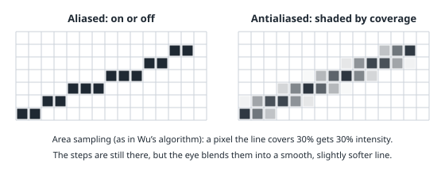

# Line Drawing and Antialiasing 6: Antialiasing

Antialiasing is softening the jagged, staircase edges of lines and shapes drawn on a pixel grid, so they look smooth.

## Before you start
<!-- bite: ec4d1417-46bf-4588-a4f4-1796634476cc -->

You can draw a line with Bresenham ([[computer-graphics/05-line-drawing-and-antialiasing-3|parts 3]] and [[computer-graphics/06-line-drawing-and-antialiasing-4|4]]) and you have seen the staircase it leaves on a slanted line. You know a pixel can be shown at in-between brightness, not just on or off ([[computer-graphics/02-graphics-systems-and-display-hardware|note 02]]).

**After this lesson you will be able to:**
1. Explain why jaggies happen.
2. Explain four antialiasing methods, and work out a pixel's shade by area sampling or supersampling.
3. State the trade-off antialiasing makes.

## What this part is about
<!-- bite: 7681f940-537a-49bb-b1af-61923673c4e2 -->

Every line in parts 1 to 5 was drawn with pixels that are fully on or fully off, and that is why a slanted line looks like a staircase. Look closely at the text on any screen and you'll see the fix: the edge pixels are in-between shades. This part explains why the staircase appears, and the four ways to soften it.

## The kid version
<!-- bite: a293b643-d3ac-4f8f-9bbc-617971b06c2b -->

Draw a slanted line on squared paper by colouring whole squares, then step back: it looks like stairs. Now, instead of colouring a square fully or not at all, shade it lightly when the line only clips its corner and darkly when the line runs right through it. Step back again, and your eye blends the shades into a smooth line.

**Where the analogy stops working.** On paper you can see how much of each square the line covers. The computer has to measure that coverage, by working out areas or by testing several points inside each pixel, and that costs extra work for every pixel.

## Terms used in antialiasing
<!-- bite: c1ee4778-04c2-4066-bab5-15a06af4b913 -->

1. **Aliasing**: This is the jagged, stair-step look of a smooth edge drawn on a pixel grid, caused by sampling a continuous shape at too few points.
2. **Jaggies**: This is the everyday name for those stair steps.
3. **Antialiasing**: This is any technique that reduces aliasing, usually by shading edge pixels with in-between intensities.
4. **Coverage**: This is the fraction of a pixel's area that the line or shape covers, from 0 (none) to 1 (all of it).
5. **Sample**: This is one test point inside a pixel. Supersampling takes several per pixel and checks whether each is inside the shape.

## Antialiasing
<!-- bite: 6868ee9b-4c80-4e59-b2b2-1fa37400f3cd -->

**Antialiasing is a set of techniques that reduce the jagged, stair-step look of lines and edges that should be smooth.**

**Why jaggies happen.** A line is continuous, but the screen is a grid with limited resolution. Scan conversion samples the shape at only a few points, so smooth edges become staircases. The same problem shows up as crawling or flickering edges in animation, and odd patterns on fine detail. **The cause is the output device not having enough resolution to show the shape exactly** — the raster weakness from [[computer-graphics/01-introduction-to-computer-graphics|note 01]]. → [[computer-graphics/21-how-rendering-works|Rendering as sampling]] for the signal-processing view.

## Four antialiasing methods
<!-- bite: 7ba72a38-e25c-4792-84e3-59904978c8eb -->

1. **Higher resolution.** More, smaller pixels make smaller steps. It works, but costs memory and time.
2. **Area sampling** (shading the in-between pixels). **Set each pixel's intensity in proportion to how much of it the line covers.** A line covering 30% of a pixel gives it 30% of the line's intensity — shades of grey on a monochrome screen, or shades of the line colour. **Wu's line algorithm** is the well-known example.
3. **Supersampling.** Compute the image at higher resolution (say 4 samples per pixel), then average each pixel's samples. Simple and works for any shape, but cost multiplies with the sample count. **MSAA** is the cheaper hardware version that takes extra samples only near edges → [[computer-graphics/23-rasterisation|note 23]].
4. **Pixel phasing** (smoothing). The output device shifts pixel positions by fractions of a pixel, adjusting dot size and horizontal alignment so lines and curves land more exactly.

**Trade-off:** antialiased lines look smoother but also **softer (fuzzier)**, and need more computation.

## Seeing antialiasing
<!-- bite: ff1dcc10-0d72-4944-b042-d7cc3dd7813c -->

The same line twice. On the left each pixel is fully on or off, so you see stairs. On the right each pixel is shaded by how much of it the line covers, so the edge looks smooth, though a little softer.

## Seeing supersampling
<!-- bite: bc894d56-49f0-458f-8012-0128d56aae75 -->

Supersampling, step by step, on a patch of six pixels with a red edge running through it. Left: each pixel has 4 sample points, and the blue ones are inside the shape. Right: each pixel's shade is the fraction of its samples inside. The bottom-left pixel has 3 of 4 inside, so it gets $3/4 = 75\%$ intensity.

## Common pitfalls
<!-- bite: 735617e8-81a3-46f8-b6b1-3214a93aae96 -->

1. **Thinking antialiasing removes the steps.** The pixels are still there; the in-between shades only make the eye blend them.
2. **Forgetting the cost.** Supersampling with 4 samples does about 4 times the work per pixel.
3. **Expecting sharper lines.** Antialiased lines are smoother but slightly softer (fuzzier).

## Check your understanding
<!-- bite: b7186c4b-12cb-41bc-a08e-32e7a5d91c02 -->

Try each one before you open the answer.

1. <!-- q: mcq id="90e019ec" -->
   A line covers 30% of a pixel. With area sampling, what intensity does that pixel get?

   - [ ] Full intensity
   - [x] 30% of the line's intensity
   - [ ] Zero, because the line covers less than half

   

Answer

   30%. Area sampling sets each pixel's intensity in proportion to how much of it the line covers. Wu's line algorithm is the well-known example.

   

2. <!-- q: exact id="cc625a67" answer="0.5" accept="50%|1/2|2/4|50" -->
   A pixel is supersampled with 4 samples, and 2 of them fall inside the shape. What intensity does it get, as a fraction of full?

   

Answer

   0.5 (50%). The shade is the fraction of samples inside: 2/4.

   

3. <!-- q: mcq id="ce9ecf3f" -->
   What causes jaggies?

   - [x] The screen samples a smooth shape at too few points, on a grid of limited resolution
   - [ ] Rounding errors that pile up in DDA
   - [ ] Lines drawn with integers instead of floating point

   

Answer

   Too few samples on a limited grid. Even a perfect Bresenham line has stair steps, because each pixel is fully on or off. Rounding drift is a different problem (part 2).

   

4. <!-- q: mcq id="66062ff2" -->
   What do you give up when you antialias a line?

   - [ ] The line no longer reaches its end points
   - [x] The line looks slightly softer, and it costs more computation
   - [ ] Nothing: it is free and only improves the picture

   

Answer

   Some sharpness and some speed. The in-between shades soften the edge, and working out coverage or extra samples is extra work per pixel.

   

5. <!-- q: open id="6468399f" -->
   Define antialiasing, and describe two methods of achieving it.

   

Answer

   Antialiasing is any technique that reduces the jagged, stair-step look (aliasing) of edges drawn on a pixel grid. Area sampling shades each pixel in proportion to how much of it the line covers (Wu's algorithm). Supersampling computes the image at a higher resolution, several samples per pixel, then averages them. Others: a higher-resolution display, and pixel phasing, which shifts pixel positions by fractions of a pixel.

   

## Practice: independent task
<!-- bite: 3f2b8058-5487-4dcd-973d-ff22fc7934f9 -->

**Antialias your Bresenham line.** For the line $(0, 0)$ to $(13, 5)$, give every pixel in a 15 × 7 grid a shade from 4 samples (at the quarter points) per pixel, using a line 1 pixel wide. Print the grid as numbers from 0 to 4. Count a sample as inside when it is within half a pixel of the line segment. **Done when** your bottom row ($y = 0$) starts `4 2 1 0`, the numbers rise to 3 or 4 along the line and fall to 0 away from it, and printed as shades it looks like the right-hand picture in "Seeing antialiasing".

## Before moving on
<!-- bite: 7a417b49-00e9-4c5f-bf04-128c77bc6baf -->

You can explain why jaggies happen, describe four ways to soften them, and work out a pixel's shade from coverage or samples. That finishes line drawing. **Next:** [[computer-graphics/09-circles-and-polygon-filling|Circles and Polygon Filling]], where the midpoint idea from part 5 draws curves.

## Related
<!-- bite: b087abd8-e669-422e-9ca7-f5fcb9682d60 -->

- [[computer-graphics/23-rasterisation|Rasterisation]] — MSAA and the modern versions of these methods
- [[computer-graphics/21-how-rendering-works|How Rendering Works]] — rendering as sampling, the signal-processing view
- [[computer-graphics/index|Computer graphics map]]

## About this lesson
<!-- bite: ec78e688-7adc-4523-8b70-6989cd26cf21 -->

**Level:** Intermediate. **Covers:** Why aliasing happens, and four antialiasing methods: higher resolution, area sampling, supersampling and pixel phasing, with their trade-off.

Part 6 of 6 on line drawing and antialiasing, in Part 1 of the course.
