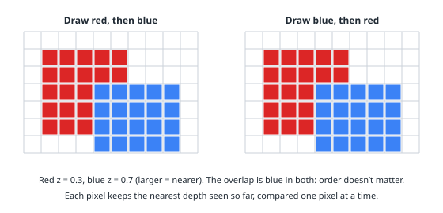
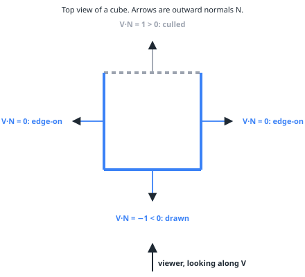

# Visible Surface Detection

Visible surface detection works out which surfaces the viewer can actually see.

## Before you start
<!-- bite: becefebf-75dd-48fd-b7c4-9421e88fc3e7 -->

You can take a dot product, and you know a plane can be written $Ax + By + Cz + D = 0$ with normal $(A, B, C)$.

**After this note you will be able to:**
1. Classify a visibility method as object-space or image-space.
2. Run the depth-buffer algorithm by hand in either depth convention, and update $z$ incrementally.
3. Apply the back-face test, and say what it does *not* solve.
4. Compare painter's, BSP, scan-line, Warnock and ray casting.

## What visible surface detection is
<!-- bite: d3db8553-1352-4b13-ab22-9d996ab12a51 -->

Visible surface detection is working out which surfaces in a 3D scene the viewer can actually see, and which are hidden behind something else. In a game, the wall in front of you has to cover the room behind it, and this lesson shows the methods that make that happen.

Next: the kid version, then the words you need.

## The kid version
<!-- bite: 27c3e864-5e0e-4960-b851-c297d1320c72 -->

Hold up a book in front of a poster. You can't see the part of the poster behind the book. A computer drawing the scene has to work that out itself. One way: for every dot on the screen, remember how close the nearest thing drawn there so far is, and only paint over it if something new is even closer. Another: paint the far things first and the near things last, like a painter doing the sky before the trees.

**Where the analogy stops working.** The painter's trick breaks when three objects overlap each other in a circle (A over B, B over C, C over A) — there is no "back" to start from. The remember-the-closest trick doesn't care.

## Terms used in visible surface detection
<!-- bite: edb31fbd-85d6-458e-b021-226720e29ea3 -->

1. **Visible surface detection**: This is also known as **hidden surface removal**. This is working out which surfaces are visible from the viewer's position and removing the rest, so the picture is correct.
2. **Object-space method**: This is a method that compares objects or faces with each other in the 3D scene, independent of pixels.
3. **Image-space method**: This is a method that decides visibility pixel by pixel on the screen.
4. **Depth buffer**: This is also known as the **z-buffer**. This is an array the size of the frame buffer storing, for each pixel, the depth of the nearest surface found so far.
5. **Back face**: This is a polygon whose outward normal points away from the viewer.
6. **Z-fighting**: This is flicker where two surfaces are at almost the same depth and limited depth precision makes the test flip between them.

## 1. Two families
<!-- bite: 657db4ed-4007-42e5-8eef-d5b1163d03b8 -->

- **Object-space methods** compare objects or faces with each other: **back-face detection, painter's algorithm, BSP trees.**
- **Image-space methods** decide visibility per pixel: **depth buffer, scan-line method, area subdivision, ray casting.**

## 2. The depth-buffer (z-buffer) method
<!-- bite: 3a4d255d-09e6-4cff-97b6-525c71f6519b -->

**Test the depth of every surface at every pixel, and keep the closest.** Two buffers of the same size:

- The **depth buffer** stores a depth for each $(x, y)$ as surfaces are processed.
- The **frame buffer** stores the colour for each pixel ([[computer-graphics/02-graphics-systems-and-display-hardware|note 02]]).

## The depth-buffer algorithm
<!-- bite: a1fde5e8-869b-49c1-bd1c-6b8918ab5e2e -->

Here is the whole method as pseudocode.

```text
for every pixel (x, y):
    depthBuffer(x, y) = farthest value     # 0 in the "larger z = nearer" convention
    frameBuffer(x, y) = background colour

for each polygon (one at a time):
    for each pixel (x, y) the polygon covers:
        z = depth of the polygon at (x, y)
        if z is nearer than depthBuffer(x, y):   # z > depthBuffer(x, y) in that convention
            depthBuffer(x, y) = z
            frameBuffer(x, y) = surface colour at (x, y)
```

> **State your depth convention.** The SSG 511 notes use **depth 0 as farthest and larger $z$ as nearer**, so the test is `z > depthBuffer`. OpenGL and most systems do the opposite: clear to the maximum and keep the *smaller* $z$. **Both are correct as long as you are consistent.**

**Surfaces are processed one polygon at a time, and each polygon pixel by pixel** — not "one pixel at a time" overall.

## Getting z cheaply
<!-- bite: f29b1275-38f3-4c8f-84a7-dc6a638796da -->

**A polygon lies on a plane, so its depth at any pixel comes from the plane equation:**

$$Ax + By + Cz + D = 0 \quad\Rightarrow\quad z = \frac{-Ax - By - D}{C}$$

**Moving one pixel right changes $z$ by $-A/C$; moving one scan line down ($y - 1$) changes it by $+B/C$.** So $z$ is updated with **one addition per pixel** instead of being recomputed — the same incremental trick as Bresenham.

$$z(x + 1, y) = z(x, y) - \frac{A}{C}\qquad z(x, y - 1) = z(x, y) + \frac{B}{C}$$

## Worked: two polygons at one pixel
<!-- bite: 21ba605e-c371-4fab-b87f-be6868432b37 -->

At pixel $(5, 5)$, a red polygon has $z = 0.3$ and a blue one $z = 0.7$ (larger = nearer, buffer cleared to 0).

1. Red first: $0.3 > 0$ → store red, depth 0.3.
2. Blue next: $0.7 > 0.3$ → replace with blue, depth 0.7.

**Reverse the order:** blue stores 0.7; red's $0.3 > 0.7$ fails. **Same result — the order of polygons does not matter.**

## Seeing the depth buffer at work
<!-- bite: 253a0965-f9b9-4eb5-a60f-e7e6b67cd639 -->

The same idea over a whole patch of pixels. Wherever the two squares overlap, the nearer blue one wins, and it wins whichever order they are drawn in.



## Depth buffer: advantages and disadvantages
<!-- bite: f0ad22bf-bd22-49d4-861a-fd23ec74ee4a -->

**Advantages:**
1. Easy to implement, and built into graphics hardware.
2. **Surfaces can be processed in any order, with no sorting.**
3. Handles surfaces that cut through each other.

**Disadvantages:**
1. **Memory:** a depth buffer as large as the frame buffer. At 1920 × 1080 with 4 bytes per depth, $2{,}073{,}600 \times 4 \approx 8.3$ MB.
2. **Depth is computed at every covered pixel**, and work is wasted on pixels that end up hidden (modern GPUs reduce this with early-Z → [[computer-graphics/11-rasterisation|note 11]]).
3. **Limited precision causes z-fighting** where two surfaces are almost at the same depth (the fix is in [[computer-graphics/10-the-transform-pipeline|note 10]]). **Transparency needs extra work.**

## 3. Back-face detection
<!-- bite: f230e55b-d703-47c3-982c-b7db5817a134 -->

**An object-space test.** Each polygon has an outward normal $N$. Let $V$ be the viewing direction (from the eye into the scene). **The polygon is a back face — facing away from the viewer — if $V \cdot N > 0$, so discard it.**

**For a viewer looking down the $-z$ axis**, $V = (0, 0, -1)$ and $V\cdot N = -N_z$, so **a back face has $N_z < 0$** (edge-on when $N_z = 0$).

**For a closed solid, this removes about half the faces cheaply.** It does *not* solve everything: front faces can still hide each other when there are several objects or the shape is concave. **It is a pre-pass, not a full visibility method.**

## Seeing back-face culling
<!-- bite: 99d1e11a-0974-463c-88c5-e4408ed25cec -->

A cube from above. The viewer looks along V. The back face’s normal points the same way as V, so V · N > 0 and it is culled. The front face’s normal points back at the viewer, so it is drawn.



## 4. The other methods
<!-- bite: 2bd89754-60bc-4da8-85d2-ce444459984e -->

| Method | Type | Idea | Weakness |
|---|---|---|---|
| **Painter's algorithm** (depth sort) | Object space | Sort polygons far to near; paint back to front so nearer ones overwrite farther ones | Sorting cost; **polygons that overlap in a cycle** have no valid order and must be split |
| **BSP trees** | Object space | Split space with planes into a binary tree; then for any eye position, traverse the tree to draw back to front | Building the tree is slow, so best for static scenes (it powered *Doom*-era engines) |
| **Scan-line method** | Image space | On each scan line, find which surfaces overlap each span and show the nearest in each span | Bookkeeping of active edges and surfaces |
| **Area subdivision (Warnock)** | Image space | Split the window into quarters recursively until one surface is clearly visible in each area, or the area is a single pixel | Many subdivisions on complex scenes |
| **Ray casting** | Image space | Shoot a ray through every pixel and take the nearest surface it hits | Cost grows with pixels × objects without an acceleration structure → [[computer-graphics/15-ray-tracing-and-path-tracing\|note 15]] |

## How a BSP tree gives back-to-front order
<!-- bite: 9239af7e-c3f5-4040-827c-f003a2c1cc92 -->

Each node holds a splitting plane (usually a polygon's own plane). Polygons in front go in the front subtree, behind go in the back subtree, and polygons crossing the plane are split. To draw: **at each node, if the eye is in front of the plane, draw the back subtree, then the node's polygon, then the front subtree** (reverse if the eye is behind). The result is a correct painter's order for any viewpoint, with no per-frame sort.

## Warnock's four cases
<!-- bite: 36886430-a5e8-414e-957d-2b2f7f48f3a3 -->

For each area, every polygon is one of: **surrounding** (covers the whole area), **intersecting**, **contained**, or **disjoint**. The area is simple enough to draw directly if all polygons are disjoint (background), there is one intersecting or contained polygon, or there is a surrounding polygon in front of all others. Otherwise split into four and recurse.

## Common pitfalls
<!-- bite: f1b0be59-247b-41da-b396-dfcec5c99c8f -->

1. **Not stating the depth convention** — "nearer" is $z >$ in one and $z <$ in the other.
2. **Thinking back-face culling is enough** — it isn't, for multiple or concave objects.
3. **Getting the back-face sign backwards.** With $V$ pointing *into* the scene, back faces have $V \cdot N > 0$. (Some books use $V$ from the surface to the eye, which flips the sign — check which.)
4. **Calling the painter's algorithm image-space.** It sorts objects; it is object-space.

## Check your understanding
<!-- bite: b8f10eeb-e605-4a03-8a25-ca36b19e4591 -->

Try each one before you open the answer.

1. <!-- q: mcq id="41cd393a" -->
   Which of these are image-space methods? Choose all that apply.

   - [x] Depth buffer
   - [x] Ray casting
   - [ ] Painter's algorithm
   - [ ] Back-face detection

   <details><summary>Answer</summary>

   Depth buffer and ray casting decide visibility per pixel. The painter's algorithm and back-face detection compare objects, so they are object-space.

   </details>

2. <!-- q: exact id="89d5a68a" answer="-0.5" accept="−0.5|-1/2|−1/2" tolerance="0.001" -->
   A plane has A = 2, B = −1, C = 4. Moving one pixel to the right, how much does z change?

   <details><summary>Answer</summary>

   By −A/C = −0.5. That one addition per pixel replaces recomputing z.

   </details>

3. <!-- q: mcq id="d04fbd9a" -->
   With "larger z = nearer", pixel (5, 5) gets red at z = 0.3 and then blue at z = 0.7. What ends up in the frame buffer? And if blue is drawn first?

   - [x] Blue either way
   - [ ] Red, then blue if the order is swapped
   - [ ] Whichever polygon was drawn last

   <details><summary>Answer</summary>

   Blue either way. The z-buffer keeps the nearest surface at each pixel, so the order of polygons doesn't matter.

   </details>

4. <!-- q: exact id="6194e3e8" answer="3" accept="three" -->
   A single cube is viewed from a general direction. How many of its six faces does back-face detection remove?

   <details><summary>Answer</summary>

   Three. And nothing else is needed: a single convex object's front faces never hide each other. Add a second object, or a concave shape, and it is no longer enough.

   </details>

5. <!-- q: gap id="d18a9e0e" answers="z-fighting|z fighting" -->
   Fill in the gap. Flicker where two surfaces are at almost the same depth, caused by limited depth precision, is called ___.

   <details><summary>Answer</summary>

   Z-fighting.

   </details>

6. <!-- q: open id="a00d29e8" -->
   Why can the z-buffer handle two polygons that pass through each other, when the painter's algorithm cannot without splitting?

   <details><summary>Answer</summary>

   It decides per pixel, so each pixel independently keeps whichever surface is nearer there; the painter's algorithm needs one order for whole polygons.

   </details>

## Check your understanding: worked problems
<!-- bite: eaae5587-a5e6-4b97-8687-7ab1500a9ec4 -->

Work each one out on paper first, then type your answer.

1. <!-- q: gap id="25f8fcf3" answers="-0.5|−0.5|-1/2;0.333333333333|1/3" sigfigs="2" -->
   Fill in the gaps. A plane has A = 3, B = 2, C = 6. Moving one pixel right changes z by ___, and moving one scan line down changes it by ___.

   <details><summary>Answer</summary>

   −A/C = −0.50, and +B/C ≈ 0.33.

   </details>

2. <!-- q: exact id="a7b2d4c1" answer="2764800" accept="2,764,800" -->
   A 1280 × 720 depth buffer stores 3 bytes per pixel. How many bytes does it need?

   <details><summary>Answer</summary>

   2,764,800 bytes. 1280 × 720 = 921,600 pixels, × 3.

   </details>

3. <!-- q: mcq id="35804392" -->
   The viewer looks down −z, so V = (0, 0, −1). A polygon's outward normal is N = (0, 0, −1). Is it a back face?

   - [x] Yes: V · N = 1 > 0
   - [ ] No: V · N = −1 < 0

   <details><summary>Answer</summary>

   Yes. V · N = (−1)(−1) = 1 > 0, so the face points away from the viewer and is discarded (its N_z < 0).

   </details>

## Practice — independent task
<!-- bite: 2dacd889-25c2-4551-af27-d34dc074d8e1 -->

Write a tiny software z-buffer in Python: a 20 × 20 grid, two overlapping triangles at constant (different) depths, and the "larger = nearer" convention. Print the frame buffer as characters. **Done when** swapping the order you draw the triangles gives an identical picture, and switching to "smaller = nearer" (clear to $+\infty$, test `<`) also gives the same picture once you negate the depths.

## Before moving on
<!-- bite: 97a844aa-48b5-4040-a2b2-d8df2ddd7327 -->

That ends the teaching notes of Part 1. **Next:** the [[computer-graphics/20-ssg-511-question-bank|SSG 511 question bank]] to test it, then Part 2 from [[computer-graphics/09-how-rendering-works|note 09]] for the modern view.

## Related
<!-- bite: 141dd939-59fb-4d84-9e1d-1ce3ca40efc4 -->
- [[computer-graphics/11-rasterisation|Rasterisation]] — the z-buffer on a GPU
- [[computer-graphics/15-ray-tracing-and-path-tracing|Ray Tracing]] — ray casting grown up
- [[computer-graphics/index|Computer graphics map]]

## About this lesson
<!-- bite: aeefad66-932c-41a9-b7f9-5ce83eb54ca1 -->

**Level:** Intermediate. **Covers:** Deciding which surfaces the viewer can actually see: object-space versus image-space methods, the depth buffer worked by hand (including the plane-equation increment), back-face detection, the painter's algorithm, BSP trees, the scan-line method, Warnock's area subdivision, and ray casting.

Part 1 of the course. [[computer-graphics/11-rasterisation|Note 11]] covers the z-buffer as modern GPUs run it (early-Z, depth pre-pass, transparency); [[computer-graphics/10-the-transform-pipeline|note 10]] covers depth precision. **This note is the full classical family of methods.**
