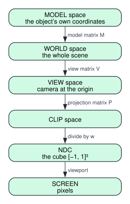

# The Transform Pipeline

The transform pipeline is the chain of steps that takes every 3D point to its spot on the screen.

## What the transform pipeline is
<!-- bite: 487198e1-a17c-4e35-8c3c-612bfc53991c -->

The transform pipeline is the chain of steps every point of a 3D object goes through to end up at the right spot on a flat screen. It takes the object from its own space, to its place in the scene, to what the camera sees, to the screen, which is what happens to every character and building in a 3D game.

Next: the whole chain at a glance.

## The chain
<!-- bite: d9124fd6-167c-4036-ad5a-8eb4f4120426 -->

$$\mathbf{v}_{\text{clip}} = P \cdot V \cdot M \cdot \mathbf{v}_{\text{model}}$$

**Every vertex in every frame goes through this.** It's the single most-executed calculation in graphics, which is why the vertex shader stage exists in hardware.

**Model matrix $M$** — places an object in the world. Scale, rotate, translate. **One per object.**

**View matrix $V$** — moves the world so the camera sits at the origin looking down $-z$. **It's the inverse of the camera's world transform** — you don't move the camera, you move everything else.

**Projection matrix $P$** — the interesting one.

## Projection
<!-- bite: c02c1c04-a4f5-4b37-971c-c9d85adfd5ad -->

**Perspective** — distant things are smaller. What a real camera does.

$$P = \begin{bmatrix}
\frac{1}{a\tan(f/2)} & 0 & 0 & 0\\
0 & \frac{1}{\tan(f/2)} & 0 & 0\\
0 & 0 & \frac{-(n+f)}{f-n} & \frac{-2fn}{f-n}\\
0 & 0 & -1 & 0
\end{bmatrix}$$

with field of view $f$, aspect ratio $a$, near plane $n$, far plane $f$.

> **The critical row is the last one: it puts $-z$ into the $w$ component.** After the matrix multiply you divide $x, y, z$ by $w$ — **and dividing by depth is exactly what makes distant things smaller.**
>
> **That's the whole trick, and it's why homogeneous coordinates are used.** A $4\times4$ matrix can't perform division, but it *can* set up a division that happens afterwards. **The perspective divide is a separate hardware step precisely because no matrix can do it.**

**Orthographic** — no perspective, parallel lines stay parallel. **CAD, 2D games, isometric views, and shadow maps for directional lights.**

**Choosing near and far planes matters more than people expect** — see the depth precision section below.

## Clip space and NDC
<!-- bite: 9211bebf-09df-4f15-acbd-ea53ee5b5d8a -->

**After $P$, before the divide, vertices are in *clip space*.** The visible region is:

$$-w \leq x,y,z \leq w$$

**Clipping happens here**, before the divide (the algorithms — Cohen–Sutherland extended to six planes, Cyrus–Beck — are in [[computer-graphics/05-clipping|note 05]]), because the divide breaks for $w \leq 0$ — points behind the camera. **A triangle straddling the near plane must be clipped or the maths produces garbage.**

**After dividing by $w$ you're in normalised device coordinates**, and then a viewport transform maps to pixels.

## Clip space conventions that cause real bugs
<!-- bite: ac2c7ff6-5c62-464f-90d8-2e6316ce6f4f -->

**The convention differences that cause real bugs:**

| | OpenGL | Direct3D / Vulkan / Metal |
|---|---|---|
| NDC depth range | **$[-1, 1]$** | **$[0, 1]$** |
| $y$ axis | **up** | **down** (D3D, Vulkan framebuffer) |
| Texture origin | bottom-left | top-left |
| Matrix convention | column-major | row-major (D3D) |

> **These are the classic "my image is upside down" and "everything is invisible" bugs**, and every graphics programmer hits them. **A projection matrix from an OpenGL tutorial used in Vulkan gives you a depth range half wrong.** GLM's `GLM_FORCE_DEPTH_ZERO_TO_ONE` exists for exactly this.

## Depth precision
<!-- bite: 771ca9cd-1144-4d43-ae5c-24fe98209ab8 -->

**The most common source of visual artefacts in a first 3D renderer.**

**Z-fighting** — two surfaces at nearly the same depth flicker between frames as the depth test flips.

**The cause: depth precision is not uniform.** After the perspective divide, depth is distributed as $1/z$ — **enormously more precision near the camera than far away.**

$$\text{precision} \propto \frac{n}{z^2}$$

> **The near plane dominates.** With $n = 0.01$ and $f = 1000$, most of your depth buffer resolves the first metre and almost nothing resolves the last hundred.
>
> **The fix is almost always "push the near plane out."** Going from $n=0.01$ to $n=0.1$ buys you 10× the far-field precision, and costs you only the ability to get within 10 cm of geometry. **Increasing the far plane barely matters by comparison** — which is the opposite of what people try first.

## Reversed-Z, the better depth fix
<!-- bite: 56db0c3d-d732-472a-b31a-0092b2d5ec76 -->

**The better fix: reversed-Z.** Map near to 1.0 and far to 0.0, use a floating-point depth buffer, and flip the comparison to `GREATER`.

**Floating point has more precision near zero, and $1/z$ concentrates values near zero for distant geometry — so the two non-uniformities cancel.** Nearly uniform precision across the whole range, for free. **This is standard practice in modern engines** and there's no reason not to do it.

## Normals need a different matrix
<!-- bite: d5e302d7-9875-4b67-925b-1082fc2e177f -->

**A subtle and commonly-wrong detail.**

**Transforming a normal by $M$ is wrong when $M$ has non-uniform scale.** Squash a sphere along $x$ and the surface normals should tilt *outward*, not squash with the geometry.

$$\mathbf{n}' = (M^{-1})^T\,\mathbf{n}$$

**The inverse transpose — the normal matrix.**

**For a rotation-only matrix, $(M^{-1})^T = M$** (since rotations are orthogonal), so it doesn't matter. **The moment you add non-uniform scaling, lighting goes visibly wrong** — and the symptom is subtle enough that people chase it in the shading code.

**And renormalise after transforming**, since scaling changes the length.

## Coordinate systems
<!-- bite: 80ce62f2-a7a1-4526-bc65-786a77d0bddf -->

**Handedness is a convention you must pin down and stick to.**

**Right-handed** — OpenGL, and most maths. Camera looks down $-z$.

**Left-handed** — Direct3D traditionally, and Unity's world space.

**Up axis:** $+y$ up in most graphics; $+z$ up in CAD, Blender and [[robotics/04-rigid-body-transforms|robotics]].

> **Importing an asset from a tool with different conventions gives you a model that's rotated, mirrored, or both** — and a mirrored model has inverted winding order, so backface culling hides the front and shows the back. **The symptom ("my model is inside-out") looks like a rendering bug and is a coordinate convention bug.**

**Write the conventions down in your project README.** Same advice as the robotics note, same reason.

## The scene graph
<!-- bite: 6298ffe5-55b9-47cd-baac-ed46abf8d8da -->

**A tree of transforms.** A wheel's transform is relative to the car; the car's is relative to the world.

$$M_{\text{wheel→world}} = M_{\text{car→world}} \cdot M_{\text{wheel→car}}$$

**Compose down the tree.** Move the car and the wheels follow.

**This is exactly [[robotics/04-rigid-body-transforms|the transform tree]]** — and `tf2` in ROS solves the same problem with the same maths. **Graphics calls it a scene graph; robotics calls it a kinematic chain.**

**Practical notes:** cache world transforms and mark dirty on change rather than recomputing every frame; flatten the hierarchy for rendering (GPUs want flat arrays, not tree traversal); and **watch for accumulated floating-point error in deep hierarchies** — renormalise rotation matrices periodically. → [[mathematics/07-applied-and-computational/01-numerical-methods/02-floating-point-and-error|Error accumulation]]

## Culling
<!-- bite: f344778e-7f72-475c-bbb2-ed54f533158c -->

**The cheapest optimisation in graphics: don't draw what isn't visible.**

**Frustum culling** — test each object's bounding volume against the six planes of the view frustum. **Discards most of a large scene immediately.**

**Backface culling** — a triangle facing away from the camera is discarded, tested by the sign of its screen-space winding. **Roughly halves the fragment work on closed meshes**, for one cross product.

**Occlusion culling** — objects hidden behind others. **Harder**, needs a depth pre-pass or hardware occlusion queries, and it's where the "hierarchical Z-buffer" and GPU-driven rendering techniques live.

**Level of detail (LOD)** — swap in simpler meshes with distance. **Nanite (Unreal 5) is a continuous, GPU-driven version** of this idea.

**Do culling before the vertex shader where possible.** The cheapest triangle is the one never submitted.

## Practical notes
<!-- bite: e9c59c2b-7b19-4d43-9dbb-c4bcca841849 -->

**Use a library for matrices.** GLM (C++), `glam`/`nalgebra` (Rust), `numpy` for prototyping. **Hand-rolled matrix code is a classic source of transposition bugs.**

**Know your library's convention.** Row vs column vectors changes multiplication order — $Mv$ or $vM$ — and getting it backwards produces transposed transforms that *almost* work.

**Push the near plane out** before anything else when you see z-fighting.

**Use reversed-Z** in new projects.

**Use the normal matrix** if you have non-uniform scale.

**Debug by visualising.** Render normals as colours, render depth as greyscale, draw the coordinate axes at the origin. **A transform bug is obvious visually and invisible numerically** — the same advice as the robotics note.

## Check your understanding
<!-- bite: a94c7776-7a17-49e4-99ef-b624a4ac96ae -->

Try each one before you open the answer.

1. <!-- q: gap id="76702e08" answers="model;view;projection" -->
   Fill in the gaps. Every vertex goes through three matrices: the ___ matrix places the object in the world, the ___ matrix moves the world so the camera sits at the origin, and the ___ matrix sets up perspective.

   

Answer

   Model, view, projection. The view matrix is the inverse of the camera's world transform: you move everything else, not the camera.

   

2. <!-- q: mcq id="ad512168" -->
   What makes distant things smaller in a perspective projection?

   - [ ] The model matrix scales them down
   - [x] The last row puts −z into w, and dividing x, y, z by w divides by depth
   - [ ] The viewport transform

   

Answer

   The perspective divide. A matrix can't divide, but it can set up a division that happens afterwards, which is why homogeneous coordinates are used.

   

3. <!-- q: mcq id="871cd843" -->
   Your scene has z-fighting, with near = 0.01 and far = 1000. What is the first fix to try?

   - [x] Push the near plane out (for example to 0.1)
   - [ ] Push the far plane further out
   - [ ] Use more triangles

   

Answer

   Push the near plane out. Depth precision is distributed as 1/z, so the near plane dominates. Going from 0.01 to 0.1 buys 10× the far-field precision. Reversed-Z is the better long-term fix.

   

4. <!-- q: mcq id="64f4f970" -->
   A model has non-uniform scale and its lighting looks wrong. What should you transform the normals with?

   - [ ] The model matrix M
   - [x] The inverse transpose of M (the normal matrix), then renormalise
   - [ ] The projection matrix

   

Answer

   The normal matrix, (M⁻¹)ᵀ. For a rotation-only matrix it equals M, so the bug only shows up with non-uniform scale.

   

5. <!-- q: open id="072f433a" -->
   An imported model looks "inside-out". What is the likely cause?

   

Answer

   It came from a tool with different handedness or up-axis conventions, so it is mirrored. Mirroring inverts the winding order, so back-face culling hides the front faces and shows the back ones.

   

---

## Related
<!-- bite: 44849c26-bcfb-4f44-9833-342d747b462c -->
- [[robotics/04-rigid-body-transforms|Rigid Body Transforms]] — the same maths, more depth on rotations
- [[computer-graphics/11-rasterisation|Rasterisation]] — what happens after this
- [[computer-graphics/06-2d-and-3d-transformations|2D and 3D Transformations]] — the basic matrices, by hand
- [[computer-graphics/05-clipping|Clipping]] — the clipping algorithms
- [[machine-learning/00-foundations/03-mathematics/01-linear-algebra/index|Linear Algebra]] — the prerequisite
- [[computer-graphics/index|Computer graphics map]]

## About this lesson
<!-- bite: 25bccd34-cd42-4dc0-89bb-7c9de2ab3e46 -->

**Level:** Intermediate. **Covers:** Model to world to camera to screen. The matrix chain every vertex goes through.

**[[robotics/04-rigid-body-transforms|Rigid Body Transforms]] covers rotations, quaternions and homogeneous matrices** — the same mathematics, in a different field's vocabulary. **This note is the graphics-specific part**: the projection matrices and the clip-space conventions. **For the basic 2D and 3D matrices worked by hand** — shear, reflection, recognising a matrix by its pattern, rotating about a pivot, row- versus column-vector conventions — see [[computer-graphics/06-2d-and-3d-transformations|note 06]].
