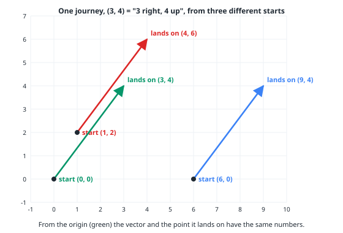
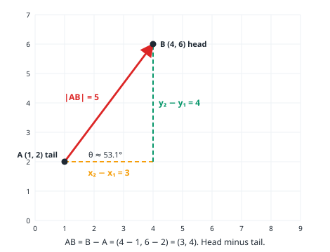
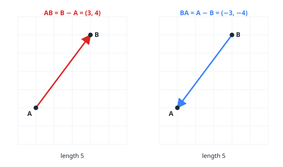
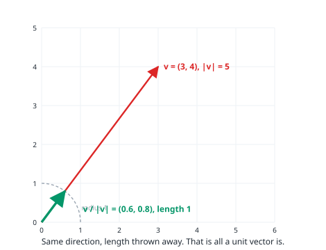
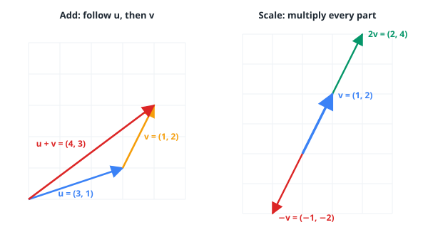
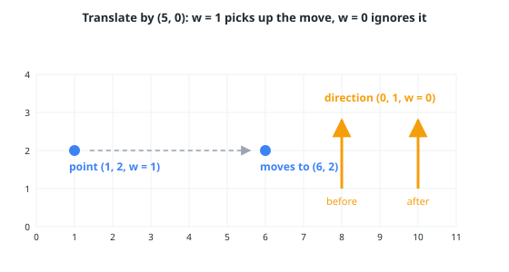

# Vectors 1: Points, Vectors and the Journey from A to B

A vector is a quantity with a size and a direction, like "walk 3 steps right and 4 steps up".

## Before you start
<!-- bite: 2bd52e96-e21b-4511-a991-bcf8be143b1e -->

You can plot a point like $(1, 2)$ on graph paper, you know Pythagoras ($c^2 = a^2 + b^2$), and you have met the line from $(x_1, y_1)$ to $(x_2, y_2)$ in [[computer-graphics/03-line-drawing-and-antialiasing-1|Line Drawing 1]].

**After this lesson you will be able to:**
1. Say the difference between a point and a vector, in one sentence each.
2. Find the vector from one point to another, and explain why it is "end minus start".
3. Find a vector's length and its unit vector, and the angle it makes with the x-axis.
4. Add vectors, scale them, and say why graphics stores a fourth number $w$.

## What vectors are
<!-- bite: 75238731-2053-48df-bc31-d4decaaffb3b -->

A vector is a quantity with two parts: how far (its **magnitude**) and which way (its **direction**). In computer graphics, vectors are everywhere. They hold the corners of every shape, the direction a light shines, the direction a surface faces, how far a character moves between two frames, and even colours.

This topic is big, so it comes in three parts, listed next.

## The three parts of vectors
<!-- bite: e7339adb-fd28-47ec-9c33-ad7b53d10298 -->

Each part is one sitting, and each one needs the part before it:

1. **Points, vectors and the journey from A to B** (this part): what a vector is, and the vector from one point to another.
2. **The line between two points**: using that vector and a number $t$ to reach every point between A and B.
3. **The dot and cross products**: two ways to multiply vectors, and why lighting needs them.

After these three, [[computer-graphics/14-2d-and-3d-transformations|transformations]] move vectors with matrices, and the [[computer-graphics/15-curves-1|curves]] lessons build smooth curves out of part 2.

## The kid version
<!-- bite: d1508c38-f684-4223-b351-5c699402a1ac -->

Think of a vector as a set of instructions for getting from one place to another: "go 3 steps right and 4 steps up." It doesn't care where you start. It only describes the journey. A point is different: it is a place, like "the house is at $(1, 2)$." **Same instructions, different starting points, different destinations.**

**Where the analogy stops working.** Instructions on paper can say "go round the corner". A vector can only say "go straight": one direction, one distance, no turns. A trip with a turn in it is two vectors added together.

## Terms used in vectors
<!-- bite: 65233e15-dc72-4b15-8e12-35abaa0f2433 -->

1. **Point**: This is a location, written as coordinates like $(1, 2)$. It answers "where?".
2. **Vector**: This is a movement or a direction, also written as numbers like $(3, 4)$. It answers "how far, and which way?".
3. **Magnitude**: This is also known as the **length** of a vector, written $|v|$. This is how far the vector goes, as one number.
4. **Direction**: This is which way the vector points, with its length ignored.

## More terms used in vectors
<!-- bite: 3f711447-4459-4f36-ab12-68b27e924c9d -->

5. **Tail and head**: The tail is where a vector starts and the head (the arrowhead) is where it ends.
6. **Unit vector**: This is a vector whose length is exactly 1. It keeps only the direction.
7. **Normalising**: This is turning a vector into its unit vector, by dividing it by its own length.
8. **Scalar**: This is an ordinary single number, like 2 or 0.5, as opposed to a vector.

## Points and vectors
<!-- bite: 9b3ccca9-ef31-4651-a56c-1a35b5196a8e -->

Remember the line from lesson 03, from $(x_1, y_1)$ to $(x_2, y_2)$? Its two end points are **points**: they are places on the screen. The move from one to the other is a **vector**.

The picture shows the same vector, $(3, 4)$, "3 right, 4 up", drawn from three different starting points. From $(1, 2)$ it lands on $(4, 6)$. From $(6, 0)$ it lands on $(9, 4)$. Same journey every time, different destination every time.

That's why a vector has two parts, how far and which way, and no "where".

## Why a vector can look like a point
<!-- bite: b8c78ac3-63f8-4e65-9251-8c75b4d44df9 -->

Look at the green arrow in that picture. It starts at the origin $(0, 0)$, and it lands on the point $(3, 4)$. The vector and the point have the same numbers.

That's the one special case where they look the same, and it's why it can feel like points and vectors are the same thing. They are not. As soon as you start anywhere else, the vector $(3, 4)$ and the point you land on are different numbers.

So now we know what a vector is. The question graphics asks all the time is: I'm at one point and I want to get to another. What's the vector?

## The vector from A to B
<!-- bite: 0d0c3aa6-465e-4137-a351-7befa814a5f2 -->

Our running example: you are standing at $A = (1, 2)$ and want to reach $B = (4, 6)$. Ask: how far do I have to move in each direction?

- Horizontally, from 1 to 4, you move $4 - 1 = 3$.
- Vertically, from 2 to 6, you move $6 - 2 = 4$.

That's literally just "where I'm going minus where I am." If you're at 1 and want to get to 4, you walk $4 - 1 = 3$ steps. The vector does that for each axis at once.

The vector from A to B is the end point minus the start point, done on every coordinate:

$$\vec{AB} = B - A = (x_2 - x_1,\ y_2 - y_1) = (4 - 1,\ 6 - 2) = (3, 4)$$

## Seeing the vector from A to B
<!-- bite: 32209de9-f7e8-4b80-ad8d-bb52a680ab39 -->

The red arrow is $\vec{AB}$. The orange dashes are the 3 across, and the green dashes the 4 up. Together they make a right-angled triangle, and the arrow is its long side.

A memory trick for the order: **head minus tail**. The arrowhead is the destination, the tail is where you start, and you always write head minus tail.

## Order matters
<!-- bite: 1682370c-d1b5-4cb9-bd58-1659ca729d86 -->

$\vec{AB}$ means "start at A, end at B". $\vec{BA}$ means "start at B, end at A". It is the same distance, but the opposite direction:

$$\vec{BA} = A - B = (1 - 4,\ 2 - 6) = (-3, -4) = -\vec{AB}$$

Mix up the order and every sign comes out wrong, so always write it as end minus start.

## Adding it back: start + journey = destination
<!-- bite: c3c74c42-ed3a-4d9c-a3f7-82bf3894a90d -->

If you start at A and follow the instructions $\vec{AB}$, you land at B. So:

$$\text{start} + \text{journey} = \text{destination}, \qquad B = A + \vec{AB} = (1, 2) + (3, 4) = (4, 6)$$

Rearranged, journey = destination − start, which is $\vec{AB} = B - A$ again. Same idea, just flipped.

Remember this one: **subtract to find the journey, add to apply the journey.** Everything else (distance, direction, angles, lines) comes from those two moves. In graphics, adding a vector to a point is how you move a point along a direction.

## Length: how far
<!-- bite: 2ab74a48-d67a-4629-b08a-1cb25dedd1d5 -->

The length of $\vec{AB}$ is just the distance between the two points. The vector $(3, 4)$ is the long side of a right-angled triangle with sides 3 and 4 (look back at the picture), so Pythagoras gives it:

$$|\vec{AB}| = \sqrt{3^2 + 4^2} = \sqrt{25} = 5$$

In general, for a vector $(x, y)$ the length is $\sqrt{x^2 + y^2}$. In 3D, with a third coordinate $z$, you add one more square: $\sqrt{x^2 + y^2 + z^2}$. So $(2, 3, 6)$ has length $\sqrt{4 + 9 + 36} = \sqrt{49} = 7$.

**Length and direction are separate ideas.** The length is one number (5). The vector $(3, 4)$ is the length *and* the direction together. That pairing is what makes it a vector.

## Direction: the unit vector
<!-- bite: ab825cfc-f4c5-41bf-ab84-c0a6843b2a28 -->

Sometimes you care which way something points but not how far: which way a surface faces, or which way the light comes from. Then you divide the vector by its own length. What's left has length exactly 1, and it keeps only the direction:

$$\hat{v} = \frac{\vec{AB}}{|\vec{AB}|} = \frac{(3, 4)}{5} = (0.6,\ 0.8)$$

Check: $\sqrt{0.6^2 + 0.8^2} = \sqrt{0.36 + 0.64} = 1$. ✓ This is called **normalising**, and lighting can't work without it, as part 3 shows.

## The angle with the x-axis
<!-- bite: 96a19a09-c4a2-4dc7-a04c-4af00bedd18b -->

The same triangle gives the vector's angle from the x-axis. The side opposite the angle is 4 and the side next to it is 3, so:

$$\theta = \tan^{-1}\!\left(\frac{4}{3}\right) \approx 53.1^\circ$$

You can see that angle at A in the picture of $\vec{AB}$ above. (When the vector points left, $x < 0$, the calculator's $\tan^{-1}$ gives the wrong quarter of the circle. Programs use `atan2(y, x)`, which handles every direction.)

## Adding vectors and scaling them
<!-- bite: aae27060-8fd5-4b56-8e14-efb0ffa22e1f -->

Two more moves you'll use everywhere:

1. **Adding** two vectors means following one and then the other, tip to tail. You add the matching parts: $(3, 1) + (1, 2) = (4, 3)$.
2. **Scaling** a vector means multiplying every part by one number. $2 \times (1, 2) = (2, 4)$ goes twice as far the same way. $-1 \times (1, 2) = (-1, -2)$ turns it round.

So "move 2× further along a direction" is just scaling, and a trip with a turn in it is two vectors added. Keep scaling in mind: part 2 is built on it.

## What vectors hold in graphics
<!-- bite: bd2db549-a78d-464e-87fc-19d35da395e0 -->

Now you can see why graphics stores almost everything as vectors:

1. **Points and positions**: the $(x, y, z)$ corners (vertices) of every shape.
2. **Directions**: the way a surface faces (its **normal**), the way the light shines, the way the camera looks.
3. **Movements**: how far an object moves between two frames, and its speed (velocity).
4. **Colours**: red, green and blue as three numbers, (R, G, B), with a fourth for transparency in RGBA. Treating a colour as a vector means you can blend colours with the same maths.

A position and a direction are both three numbers, but they behave differently when you move a shape. The next section shows how the computer keeps them apart.

## Points and directions in the computer: w
<!-- bite: 3d04530e-78b7-45f8-837f-b5b397d218aa -->

Move a whole scene 5 to the right. Every corner should move. But the direction a light shines should not change at all: "straight up" is still straight up.

So graphics adds a fourth number, $w$. **A point gets $w = 1$; a direction gets $w = 0$.** When a [[computer-graphics/14-2d-and-3d-transformations|transformation]] matrix moves things, the move is multiplied by $w$: a point picks it up once, a direction picks it up zero times.

This is exactly the point-versus-vector idea from the start of the lesson, stored as one number. These four-number vectors $(x, y, z, w)$ are called **homogeneous coordinates**, and lesson 14 does the matrix side.

## "Vector graphics" means something else
<!-- bite: f608338e-8c96-4e52-acb8-d816a7c96e4a -->

Careful: you'll also hear "vector graphics", and that is a different meaning. A **vector graphics** image (an SVG file, a PDF drawing, a font) stores shapes as maths: lines, curves and fills. A **raster** image (a photo, a PNG) stores a grid of pixels.

Vector graphics can be scaled to any size without going blocky, because the computer redraws the shapes at the new size. The curves inside them are Bézier curves, which you'll build in the curves lessons. Both meanings come from the same root: describing things with directions and coordinates instead of pixels.

## Common pitfalls
<!-- bite: 120e5b26-66b5-46a1-85b9-328bce81cb21 -->

1. **Start minus end.** $A - B$ gives the vector from B to A, pointing the wrong way. Always head minus tail.
2. **Treating the vector as a place.** $B - A = (3, 4)$ is a journey, not a point on the line from A to B. Part 2 shows this one in a picture.
3. **Forgetting to normalise.** A direction used for lighting must have length 1, or the maths comes out too bright or too dark.
4. **Using $\tan^{-1}(y/x)$ for a vector pointing left.** It gives the opposite direction. Use `atan2`.

## Check your understanding
<!-- bite: ac2a3f50-dc94-440f-b9fb-8e04ec26aa86 -->

Try each one before you open the answer.

1. <!-- q: gap id="4066fa7a" answers="5;3" -->
   Fill in the gaps. The vector from A = (2, 1) to B = (7, 4) is (___, ___).

   

Answer

   (5, 3). Head minus tail: B − A = (7 − 2, 4 − 1) = (5, 3).

   

2. <!-- q: mcq id="8f39cf14" -->
   P = (3, 5) and Q = (1, 2). Which is the vector from P to Q?

   - [ ] (2, 3)
   - [x] (−2, −3)
   - [ ] (4, 7)

   

Answer

   (−2, −3). From P to Q is Q − P = (1 − 3, 2 − 5). The vector from Q to P would be (2, 3): same length, opposite way.

   

3. <!-- q: exact id="f5ee08e6" answer="13" -->
   What is the length of the vector from (1, 1) to (6, 13)?

   

Answer

   13. The vector is (5, 12), and √(25 + 144) = √169 = 13.

   

4. <!-- q: gap id="a622528d" answers="0.8;0.6" -->
   Fill in the gaps. The unit vector of (8, 6) is (___, ___).

   

Answer

   (0.8, 0.6). The length is √(64 + 36) = 10, and (8, 6) / 10 = (0.8, 0.6).

   

5. <!-- q: open id="62236cc0" -->
   Why is the vector B − A not a point on the line from A to B? Use A = (1, 2), B = (4, 6) in your answer.

   

Answer

   B − A = (3, 4) is a journey: 3 right and 4 up. It says how far and which way, but not where you start. The point (3, 4) is not on the line from (1, 2) to (4, 6) at all. To turn the journey into a place you add it to a starting point: A + (B − A) = B.

   

6. <!-- q: mcq id="7e59ce1a" -->
   A scene is moved 10 units to the right. Which of these changes?

   - [x] A vertex stored as (2, 3, 0, 1)
   - [ ] A light direction stored as (0, −1, 0, 0)
   - [ ] Both
   - [ ] Neither

   

Answer

   Only the vertex. It has w = 1, so it picks up the move. The light direction has w = 0, so it ignores the move and still points straight down.

   

## Check your understanding: worked problems
<!-- bite: 294496c0-bf59-4bb4-ad00-650eb7b616c6 -->

Work each one out on paper first, then type your answer.

1. <!-- q: exact id="6a11638b" answer="7" -->
   A = (1, 2, 3) and B = (3, 5, 9). How far apart are A and B?

   

Answer

   7. B − A = (2, 3, 6), and √(4 + 9 + 36) = √49 = 7.

   

2. <!-- q: gap id="8af42e10" answers="9;3" -->
   Fill in the gaps. You start at (2, −1) and follow the vector (7, 4). You land at (___, ___).

   

Answer

   (9, 3). Start + journey = destination: (2 + 7, −1 + 4).

   

3. <!-- q: exact id="2d15540f" answer="36.87" sigfigs="3" -->
   What angle, in degrees, does the vector from (0, 0) to (8, 6) make with the x-axis?

   

Answer

   About 36.9°. tan⁻¹(6/8) = tan⁻¹(0.75) ≈ 36.87°.

   

4. <!-- q: points id="5b2054f9" xmin="-2" xmax="7" ymin="-2" ymax="7" step="1" snap="1" answer="5,2 4,6 -1,4" labels="u+v,2v,v−u" tolerance="0.3" -->
   u = (3, −1) and v = (2, 3). Starting from the origin each time, place the point you reach by following u + v, then 2v, then v − u.

   

Answer

   u + v = (3 + 2, −1 + 3) = (5, 2). 2v = (4, 6). v − u = (2 − 3, 3 − (−1)) = (−1, 4).

   

5. <!-- q: sketch id="a563e412" -->
   Draw the points A = (2, 1) and B = (5, 5) on squared paper. Draw the vector from A to B as an arrow, mark its across and up parts, and write its length.

   

Answer

   

   What to check:
   - The arrow starts at A (the tail) and its head is at B.
   - The across part is 5 − 2 = 3 and the up part is 5 − 1 = 4.
   - The length is √(9 + 16) = 5, the same as the picture above, because it is the same vector (3, 4) from a different start.

   

## Practice: independent tasks
<!-- bite: 3401337b-5de3-4833-893c-b215b2ca4040 -->

1. **Pick three pairs of points** on squared paper, one pair where B is to the left of A. For each, find $B - A$, its length, its unit vector and its angle. **Done when** each unit vector checks out to length 1 and the left-pointing one has an angle between 90° and 270°.
2. **Write a five-line Python function** `vec(a, b)` that returns `b - a` for two tuples, and `length(v)`. Test it on $A = (1, 2)$, $B = (4, 6)$. **Done when** it prints `(3, 4)` and `5.0`.

## Before moving on
<!-- bite: a6a99396-0ca1-4c99-b43c-d5d0db7974e1 -->

You can tell a point from a vector, find the vector from A to B as head minus tail, add it back with start + journey = destination, and get its length, unit vector and angle. **Next:** [[computer-graphics/12-vectors-2|Vectors 2: The Line Between Two Points]]. $A + (B - A)$ only ever lands you on B. Part 2 adds one number, $t$, so you can stop anywhere along the way, which is how every line, animation and curve in graphics is drawn.

## Related
<!-- bite: 2418cf8c-f084-46b1-9917-ffdd28ba536c -->

- [[computer-graphics/12-vectors-2|Vectors 2]] — the line between two points
- [[computer-graphics/14-2d-and-3d-transformations|2D and 3D Transformations]] — moving vectors with matrices, and $w$ in full
- [[machine-learning/00-foundations/03-mathematics/01-linear-algebra/index|Linear algebra]] — vectors in general
- [[computer-graphics/34-ssg-511-formula-sheet|Formula sheet]]
- [[computer-graphics/index|Computer graphics map]]

## About this lesson
<!-- bite: 7afd7d21-b7b4-4225-92cd-7d0f7e75f76f -->

**Level:** Beginner. **Covers:** points versus vectors; the vector from A to B (head minus tail); why order matters; start + journey = destination; length, unit vector and angle; adding and scaling vectors; what vectors hold in graphics; $w = 1$ for points and $w = 0$ for directions; and the other meaning of "vector graphics".

Part 1 of 3 on vectors, in Part 1 of the course, after [[computer-graphics/10-clipping|note 10]]. Vectors were added in November 2026 from a study conversation the author had while revising vectors for graphics, so every idea he asked about there is here; the running example $A = (1, 2)$, $B = (4, 6)$ is the one from that conversation.
