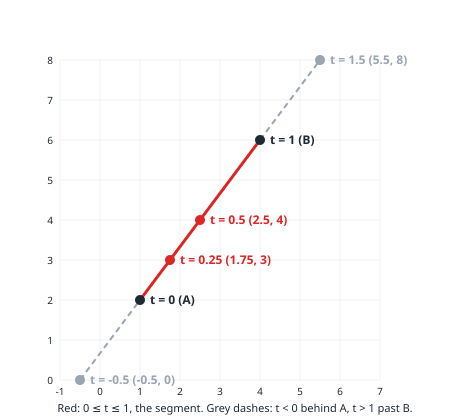
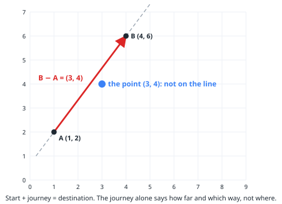
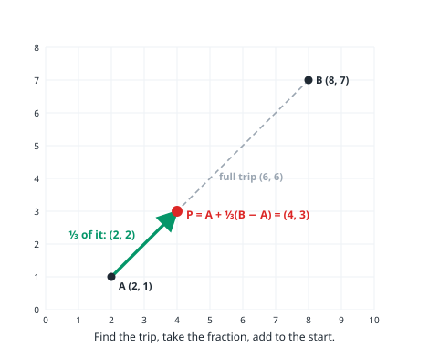
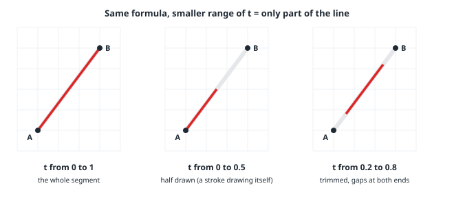
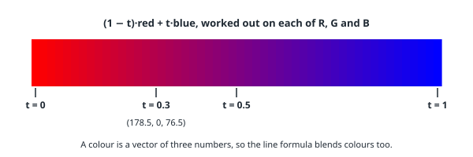
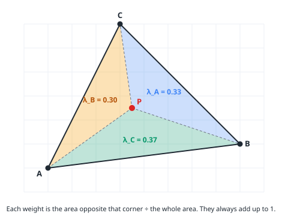
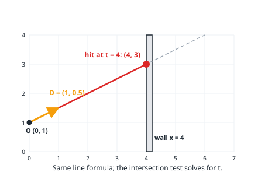

# Vectors 2: The Line Between Two Points

The line between two points is every place you can reach by starting at one point and walking part of the way to the other.

## Before you start
<!-- bite: f789e966-7a8d-48e9-bb90-bf2fa1727feb -->

You can find the vector from A to B as $B - A$, and you know start + journey = destination ([[computer-graphics/11-vectors-1|Vectors 1]]). You can scale a vector by a number.

**After this lesson you will be able to:**
1. Explain each piece of $P(t) = A + t(B - A)$, and what $t$ is.
2. Find any point a fraction of the way from A to B, in three steps.
3. Say what happens for $t$ between 0 and 1, above 1 and below 0, and use part of the range to draw part of a line.
4. Rewrite the formula as a blend, $(1 - t)A + tB$, and use it on colours and rays.

## What the line between two points is
<!-- bite: 144b251a-5c0d-447a-85b8-cbcb1706c8da -->

In part 1 we found the journey from $A = (1, 2)$ to $B = (4, 6)$: $B - A = (3, 4)$. But following the whole journey only ever lands you on B. Graphics needs every point *between* A and B: to draw the line, to slide an object smoothly from A to B, to blend one colour into another.

This lesson adds one number, $t$, that does it. The formula it gives, $P(t) = A + t(B - A)$, is probably the most used formula in all of graphics.

## The kid version
<!-- bite: db93e468-a7af-4096-b1e1-2e9f6f02e05d -->

You're walking from your house to the shop. Someone asks "where are you now?" You could say "I've done a quarter of the trip" or "I'm halfway". That fraction is $t$. If you know where you started, which way the shop is, and what fraction you've walked, anyone can tell exactly where you're standing. **That's the whole formula: start, plus a fraction of the trip.**

**Where the analogy stops working.** A real walk stops at the shop. The formula doesn't: put in "twice the trip" and it happily carries on past the shop, or "minus half" and it goes backwards behind your house.

## Terms used in this lesson
<!-- bite: 0229d792-c3ff-4b64-a602-4ef1c45f8034 -->

1. **Parameter**: This is a number you choose and turn like a dial, which picks out one result from many. Here it is $t$.
2. **Parametric line**: This is a line written as a formula in a parameter, $P(t)$, so that each value of $t$ gives one point on the line.
3. **Segment**: This is the part of a line between two end points, A and B, and no further.
4. **Lerp**: The word is short for **linear interpolation**. This is blending two values by a fraction $t$: $(1 - t)A + tB$.

## The formula, as a sentence
<!-- bite: f2f4c8b0-9f8a-4da1-b2f0-62c3ea1227c2 -->

The formula is

$$P(t) = A + t(B - A)$$

Read it as a sentence: "Start at A, then walk a fraction $t$ of the way toward B." Piece by piece:

1. $A$ is where you begin.
2. $(B - A)$ is the full journey from A to B (head minus tail).
3. $t(B - A)$ is a fraction of that journey. If $t = 0.5$, you take half of it.
4. $A + t(B - A)$ is start + partial journey = where you end up. That's the point $P$.

The picture for it comes once we put numbers in, next.

## Putting in our numbers
<!-- bite: 93f7142f-ffae-4935-8cc5-fe287ca397c2 -->

With $A = (1, 2)$ and $B = (4, 6)$, the journey is $B - A = (3, 4)$, so

$$P(t) = (1, 2) + t\,(3, 4) = (1 + 3t,\ 2 + 4t)$$

Notice each coordinate is its own mini-formula: $x = 1 + 3t$ and $y = 2 + 4t$. The formula just does the "start + fraction of the move" idea on every axis at once.

- $t = 0$ gives $(1, 2)$, which is A.
- $t = 0.25$ gives $(1.75, 3)$, a quarter of the way.
- $t = 0.5$ gives $(2.5, 4)$, the midpoint.
- $t = 1$ gives $(4, 6)$, which is B.

## Seeing t on the line
<!-- bite: cd909a3f-8880-4d14-81ee-5c7e428cf326 -->

Every value of $t$ picks one point. The red part is $t$ from 0 to 1. The grey dashes show $t$ outside that range, which we'll come back to.

Since the journey direction $(B - A)$ never changes, only how much of it you take, all the points stay on one straight line.

## What t is
<!-- bite: d0bb85bb-6a4a-4c9b-8880-55b880f90568 -->

$t$ is just a number that says how far along the journey you are. It's a "progress" value, a dial you turn to pick a spot on the line from A to B. Think of it as a fraction of the trip:

- $t = 0$: 0% of the way, so you're still at A.
- $t = 0.25$: a quarter of the way.
- $t = 0.5$: halfway, the midpoint.
- $t = 1$: 100%, so you've arrived at B.

**Where does $t$ come from? You choose it.** It isn't found from the points; it's a free variable. Change $t$ and the point $P$ slides along the line. In animation $t$ is often time (0 at the start, 1 at the end), which is why it's the letter used.

## Why not just B − A?
<!-- bite: ca038dc9-0c66-47b4-b894-7de27eac0859 -->

A fair question: why all this, and not just $B - A$? Because $B - A$ is not a point; it's the journey. It tells you how to get from A to B, but not where you end up until you say where you start.

$B - A = (3, 4)$ means "move 3 right, 4 up". It is not the location of anything on the line.

An everyday version: someone says "the shop is 3 blocks east and 4 blocks north". That's $B - A$. It's useless unless you know where you're starting from. Add your own position and you get the shop's actual address.

## Seeing the journey and the point
<!-- bite: 225ca382-4112-4c4f-9a64-f5fae0c953a4 -->

The point $(3, 4)$ isn't on the line from A to B at all:

$B - A$ answers "how far, and which way?". $P(t)$ answers "where am I standing?". To turn a journey into a location you apply it to a starting point, start + journey. That's the "$A\,+$" in the formula.

## Why the t? Why not A + (B − A)?
<!-- bite: d1e43548-9b7e-455b-9d75-f4d9f62e7c1a -->

Then why not just $A + (B - A)$? Try it: $(1, 2) + (3, 4) = (4, 6)$, which is just B. The A cancels out: $A + B - A = B$. You've done the whole trip, so you land at the destination and nothing else.

$t$ lets you do *part* of the trip. Your idea, $A + (B - A)$, is actually the special case $t = 1$; it's already inside the formula. Adding $t$ turns it from "one fixed point" into "any point along the way".

If you only wanted B, you'd just write B. The reason for the formula is to describe the whole line between A and B, so you can ask for the midpoint or the quarter point, or move an object smoothly from A to B. You can't do that without a dial for how far you go, and $t$ is that dial.

## In your own words
<!-- bite: d83d4764-c06b-41a1-9f42-f4c6a78c682b -->

When this was first explained to the author, he summed it up like this:

> So B minus A is like the distance away to B from A, and then t is a fraction of distance traveled. Then A is the point you're starting from. Okay, so point P of t is actually A plus the fraction of the distance traveled.

That's it exactly, with one refinement: $B - A$ is distance **and direction** together. The distance alone would be one number (5); $(3, 4)$ also says which way. Tightened up:

1. $A$: the starting point.
2. $B - A$: the full trip, how far and which way.
3. $t$: the fraction of the trip you've completed.
4. $P(t) = A + t(B - A)$: the point where you are after completing that fraction.

And his second summary: **the purpose of $t$ is to describe the points between A and B.** Without $t$ you'd only have the two end points.

## Worked: one-third of the way
<!-- bite: 392da4eb-f066-4c94-81c5-9cc58ccc727c -->

Let's find the point one-third of the way from $A = (2, 1)$ to $B = (8, 7)$. Three steps.

1. **Find the full trip (head minus tail).** $B - A = (8 - 2,\ 7 - 1) = (6, 6)$.
2. **Take the fraction of it.** $\tfrac13 \times (6, 6) = (2, 2)$.
3. **Add it to the start.** $P = (2, 1) + (2, 2) = (4, 3)$.

Sanity check: the whole trip moves 6 right and 6 up, so one-third is 2 right and 2 up. It's closer to A than B, as expected.

## What t does outside 0 to 1
<!-- bite: 68de5ffd-fd08-4af1-82e0-f7b90cbbf22e -->

The formula doesn't stop at B. Look back at the grey dashes in the picture of $t$ on the line:

- $0 \le t \le 1$: points between A and B, the **segment**.
- $t > 1$: beyond B. $t = 2$ is twice the trip; $t = 1.5$ is $(5.5, 8)$.
- $t < 0$: behind A, going backwards. $t = -0.5$ is $(-0.5, 0)$.
- All real $t$: the entire, endless line through A and B.

So when you want just the segment from A to B, you keep $t$ between 0 and 1. Clipping ([[computer-graphics/10-clipping|note 10]]) does exactly this: Liang–Barsky works out the range of $t$ that stays inside the window.

## Using only part of the range
<!-- bite: a47d7bd1-6291-4569-8a00-2211aaac66f7 -->

Running $t$ over only part of 0 to 1 draws only part of the line. You're still on the same path; you just stop early, or start late.

## Where part of the range is used
<!-- bite: 349b10ab-36a8-4156-a190-11857cd1abb1 -->

1. **Drawing or animating a stroke.** To make a line "draw itself", you increase the end value of $t$ from 0 to 1 over time. At the halfway moment, only $t = 0$ to 0.5 is drawn. SVG line-drawing animations work this way.
2. **Splitting.** A line or curve can be cut at $t = 0.5$ into two pieces, one for 0 to 0.5 and one for 0.5 to 1. Software does this to break curves into smaller ones ([[computer-graphics/18-curves-4|Curves 4]]).
3. **Trimming.** Cutting off the start or end of a path, for example 0.2 to 0.8, to leave gaps near the end points.
4. **Partial animation.** Moving an object only part of the way along a path.

## The same formula as a blend
<!-- bite: 6da22bd6-4994-4c0b-a3de-2ca67f88a16f -->

Multiply out the brackets and the formula takes another shape:

$$P(t) = A + tB - tA = (1 - t)A + tB$$

This reads as a **blend** of the two points. At $t = 0.3$ you get 70% A and 30% B. Check it on our line: $0.7 \times (1, 2) + 0.3 \times (4, 6) = (0.7 + 1.2,\ 1.4 + 1.8) = (1.9, 3.2)$, and the first form gives $(1 + 0.9,\ 2 + 1.2)$, the same point. (The picture of $t$ on the line shows it: $t = 0.3$ sits just past the quarter mark.)

Both forms are identical. The first says "start plus journey", the second says "mix of the two points". This blend is called **linear interpolation**, or **lerp** for short.

## Lerp on colours
<!-- bite: 0987b199-5ad4-4430-a849-7bb7fd749bc5 -->

Lerp is used everywhere in graphics: for positions, colours, and more. A colour is a vector of three numbers, so the same formula blends colours. From red $(255, 0, 0)$ to blue $(0, 0, 255)$ at $t = 0.3$:

$$0.7 \times (255, 0, 0) + 0.3 \times (0, 0, 255) = (178.5,\ 0,\ 76.5)$$

Every gradient you've seen on a button is this formula, worked out once per pixel.

## 2. Vectors and affine combinations
<!-- bite: d34df689-e280-4dce-915d-8a6a01ab1d81 -->

There's a name for blends like this, which the curves lessons use. In the blend $(1 - t)A + tB$, the two weights, $(1 - t)$ and $t$, always add up to 1:

$$P = (1-t)P_1 + tP_2,\qquad (1 - t) + t = 1$$

**A sum $\alpha_1P_1 + \alpha_2P_2 + \dots$ with $\alpha_1 + \alpha_2 + \dots = 1$ is an affine combination.** It always gives a point, whatever coordinate system you use. (The *weights* are $\alpha$; $t$ is the parameter. Write "$\alpha_1 + \alpha_2 = 1$", not "$t_1 + t_2 = 1$".)

The picture is the line from earlier: every point on the red segment is an affine combination of A and B with weights between 0 and 1.

## Affine combinations of three points
<!-- bite: 02d13567-2854-4078-aa58-00a6a12e0a48 -->

The same idea works with three points. Inside a triangle $P_1P_2P_3$, start at $P_1$ and move along the two edges $P_2 - P_1$ and $P_3 - P_1$:

$$P = P_1 + \alpha_2(P_2 - P_1) + \alpha_3(P_3 - P_1) = (1 - \alpha_2 - \alpha_3)P_1 + \alpha_2P_2 + \alpha_3P_3$$

Call $P_1$'s weight $\alpha_1 = 1 - \alpha_2 - \alpha_3$. Then $\alpha_1 + \alpha_2 + \alpha_3 = 1$ always. **This is a barycentric combination.** Graphics uses it to blend a triangle's corner colours, texture positions and normals across the inside of the triangle → [[computer-graphics/23-rasterisation|note 23]].

## Seeing the three weights
<!-- bite: 928bb8cc-ae4a-437c-bccf-950445668b13 -->

Each weight is the area of the small triangle opposite that corner, divided by the whole triangle's area. They always add up to 1.

## Rays: the same formula, aimed
<!-- bite: 882a8b18-9260-485c-b014-3bde0762d770 -->

A ray in ray tracing is the same line formula, with a start point $O$ (the origin) and a direction $D$:

$$P(t) = O + tD$$

To find where the ray hits something, you **solve for $t$**. A ray from $O = (0, 1)$ going $D = (1, 0.5)$ hits the wall $x = 4$ when $0 + t \times 1 = 4$, so $t = 4$, at the point $(0, 1) + 4 \times (1, 0.5) = (4, 3)$.

## Seeing the ray hit the wall
<!-- bite: 30857b15-3d63-4934-af6b-a20014e93d4e -->

The orange arrow is $D$, one step of the ray. Four of those steps reach the wall:

A ray only goes forward, so only $t > 0$ counts. Every intersection test in [[computer-graphics/27-ray-tracing-and-path-tracing|ray tracing]] is "find the smallest positive $t$".

## The big picture
<!-- bite: e6d4ccc1-5b21-4d3a-8575-eb9f88f52cb9 -->

You've now seen one formula do four jobs: draw a segment, move an object, blend a colour, aim a ray. Even DDA from [[computer-graphics/03-line-drawing-and-antialiasing-1|lesson 03]] is this formula in disguise: stepping $t$ up by $1/\text{steps}$ each time, and rounding $P(t)$ to a pixel.

**In short:** pick a start, pick a direction and distance, and $t$ controls how far along that direction you go.

## Common pitfalls
<!-- bite: ec0e4de4-c8d7-4cff-a959-db13deb43a00 -->

1. **Writing $A + (B - A)$ and wondering why you only get B.** That's $t = 1$. The $t$ is what gets you the points between.
2. **Using $B - A$ as the point.** It's the journey. Add it to A.
3. **Forgetting to keep $0 \le t \le 1$** when you want the segment, not the whole line.
4. **Mixing up the blend weights.** In $(1 - t)A + tB$, A gets $(1 - t)$, so at small $t$ you're near A.

## Check your understanding
<!-- bite: 96740515-1dfd-4b8e-b85c-63b1aefa91b8 -->

Try each one before you open the answer.

1. <!-- q: mcq id="0b9e6639" -->
   In P(t) = A + t(B − A), what does t = 1 give?

   - [ ] A
   - [ ] The midpoint
   - [x] B
   - [ ] A point past B

   

Answer

   B. A + 1·(B − A) = B. You've done the whole trip.

   

2. <!-- q: gap id="2cec5c7e" answers="5;3" -->
   Fill in the gaps. The midpoint of A = (0, 4) and B = (10, 2) is (___, ___).

   

Answer

   (5, 3). B − A = (10, −2). Half of it is (5, −1). A + (5, −1) = (5, 3).

   

3. <!-- q: mcq id="6bb7e411" -->
   A point on the line through A and B has t = −0.5. Where is it?

   - [ ] Between A and B
   - [x] Behind A, on the side away from B
   - [ ] Past B

   

Answer

   Behind A. Negative t walks the journey backwards from A.

   

4. <!-- q: open id="b77fbeb4" -->
   Why do we need t at all? Why not just use A + (B − A)?

   

Answer

   A + (B − A) simplifies to B, so it only ever gives one point. t lets you take part of the trip, so each value of t picks out a different point between A and B. That's what lets you draw the whole line, find the midpoint, or move an object smoothly from A to B.

   

5. <!-- q: mcq id="d3f14785" -->
   An SVG path animation is halfway through drawing itself. Which range of t is drawn?

   - [ ] 0.5 to 1
   - [x] 0 to 0.5
   - [ ] 0.25 to 0.75

   

Answer

   0 to 0.5. The end value of t grows from 0 to 1 over the animation, so halfway through, the first half is drawn.

   

6. <!-- q: gap id="e70cfeb7" answers="0.8;0.2" -->
   Fill in the gaps. Written as a blend, P(0.2) = ___ × A + ___ × B.

   

Answer

   0.8 and 0.2. (1 − t)A + tB with t = 0.2. Near the start, A has most of the weight.

   

## Check your understanding: worked problems
<!-- bite: 38630254-dd2d-47f5-b5b6-39baa2f736d8 -->

Work each one out on paper first, then type your answer.

1. <!-- q: gap id="314ee0e2" answers="4;6" -->
   Fill in the gaps. The point a quarter of the way from A = (2, 2) to B = (10, 18) is (___, ___).

   

Answer

   (4, 6). B − A = (8, 16). A quarter of it is (2, 4). (2, 2) + (2, 4) = (4, 6).

   

2. <!-- q: exact id="1da63c8c" answer="0.6" accept="3/5" -->
   A line goes from A = (1, 1) to B = (6, 11). For which t is the point (4, 7)?

   

Answer

   0.6. x = 1 + 5t = 4 gives t = 0.6, and y = 1 + 10 × 0.6 = 7 agrees.

   

3. <!-- q: gap id="dbeee735" answers="200;100;100" -->
   Fill in the gaps. Lerping from the colour (100, 200, 0) to (250, 50, 150) at t = 2/3 gives (___, ___, ___).

   

Answer

   (200, 100, 100). The trip is (150, −150, 150), and two-thirds of it is (100, −100, 100). Add it to the start: (100 + 100, 200 − 100, 0 + 100).

   

4. <!-- q: exact id="765b1d49" answer="3" -->
   A ray starts at O = (1, 0) with direction D = (2, 1). For what t does it reach the line y = 3?

   

Answer

   3. y = 0 + t × 1 = 3 gives t = 3, at the point (1, 0) + 3(2, 1) = (7, 3).

   

5. <!-- q: points id="6c51d0d4" xmin="-1" xmax="9" ymin="-1" ymax="9" step="1" snap="0.5" answer="2,1 4,3 6,5 8,7" labels="t=0,t=1/3,t=2/3,t=1" tolerance="0.3" -->
   A = (2, 1) and B = (8, 7). Place the points of the line P(t) = A + t(B − A) for t = 0, 1/3, 2/3 and 1.

   

Answer

   B − A = (6, 6), so each third is (2, 2): (2, 1), (4, 3), (6, 5), (8, 7).

   

## Practice: independent tasks
<!-- bite: 2c2ac9c9-f349-442d-a51f-2140ef75789f -->

1. **Write `lerp(a, b, t)` in Python** for tuples of any length, and use it to print 11 points from $(1, 2)$ to $(4, 6)$ for $t = 0, 0.1, \dots, 1$. **Done when** the 6th point is $(2.5, 4.0)$ and the last is $(4.0, 6.0)$.
2. **Make a gradient.** Use the same function to print 5 colours from black $(0, 0, 0)$ to orange $(255, 165, 0)$. **Done when** the middle one is $(127.5, 82.5, 0)$.

## Before moving on
<!-- bite: 5a14a7a5-7e84-490f-b120-757aa27eccb5 -->

You can read $P(t) = A + t(B - A)$ as "start plus a fraction of the trip", find any point by the three steps, say what $t$ outside 0 to 1 does, and switch to the blend form $(1 - t)A + tB$ for colours. **Next:** [[computer-graphics/13-vectors-3|Vectors 3: The Dot and Cross Products]]. So far we've only added and scaled vectors. Lighting asks a new question: how much do two vectors point the same way? That needs a way to multiply them.

## Related
<!-- bite: 720b050a-d54d-4d6e-9339-0b598eb14d53 -->

- [[computer-graphics/11-vectors-1|Vectors 1]] — points, vectors and $B - A$
- [[computer-graphics/15-curves-1|Curves 1]] — the same formula, used three times, makes a curve
- [[computer-graphics/10-clipping|Clipping]] — Liang–Barsky works with the range of $t$
- [[computer-graphics/index|Computer graphics map]]

## About this lesson
<!-- bite: da5026b9-fff3-4094-9fb7-d2118b0f3dbf -->

**Level:** Beginner. **Covers:** the parametric line $P(t) = A + t(B - A)$; what $t$ is and where it comes from; why $B - A$ alone is not a point and why $t$ is needed; finding a fraction of the way; $t$ outside 0 to 1; partial ranges (stroke drawing, splitting, trimming); the blend form and lerp; colours; affine and barycentric combinations; rays $O + tD$.

Part 2 of 3 on vectors, in Part 1 of the course. Built from the author's study conversation on vectors (his two summaries are quoted in "In your own words"), plus the affine and barycentric sections that used to open the curves note.
