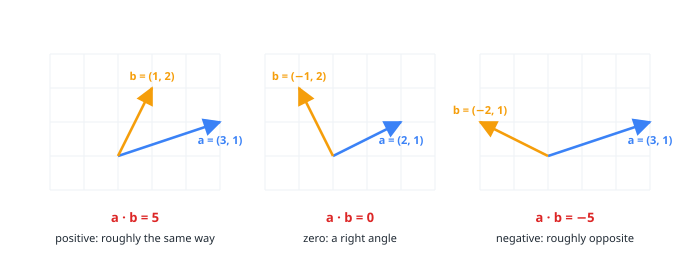
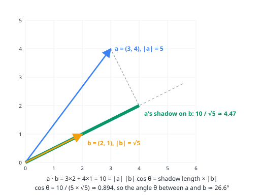
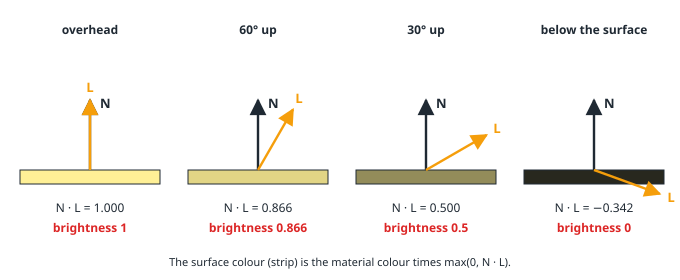
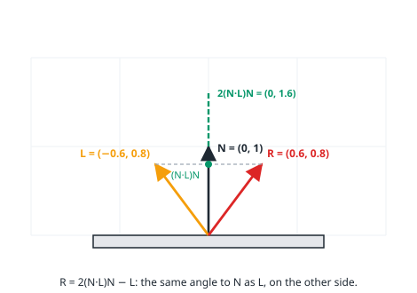
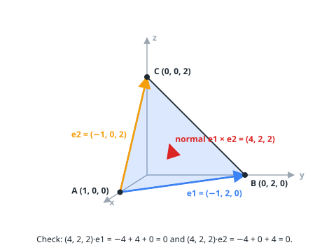

# Vectors 3: The Dot and Cross Products

The dot product turns two vectors into one number that says how much they point the same way, and the cross product turns them into a third vector at right angles to both.

## Before you start
<!-- bite: e5c76de5-168a-4922-bb25-0be309940b70 -->

You can find the length and unit vector of a vector ([[computer-graphics/11-vectors-1|Vectors 1]]) and use $P(t) = A + t(B - A)$ ([[computer-graphics/12-vectors-2|Vectors 2]]). You know what cos of an angle is.

**After this lesson you will be able to:**
1. Work out a dot product, and read its sign: same way, right angle, or opposite.
2. Find the angle between two vectors.
3. Use $\max(0, N \cdot L)$ for diffuse lighting and $R = 2(N \cdot L)N - L$ for the reflection direction.
4. Work out a cross product and use it to find a triangle's normal.

## What the dot and cross products are
<!-- bite: ab23eb92-6591-44fd-817d-94d4521ddbbf -->

So far we have added vectors and scaled them by a number. Graphics also needs to **multiply two vectors together**, and there are two ways, for two different questions.

1. **The dot product** answers "how much do these two vectors point the same way?" Its answer is one number. Lighting runs on it.
2. **The cross product** answers "which direction is at right angles to both of these?" Its answer is a vector. It gives every triangle the direction it faces.

## The kid version
<!-- bite: cc3090da-f10a-4ffd-8c6c-97354a35c22d -->

Hold a torch over a stick. The stick's shadow on the floor is long when the stick lies flat and disappears when the stick stands straight up. **The dot product measures that shadow**: how much of one vector lies along another. Now hold two pencils flat on a table at an angle. A third pencil standing straight up out of the table is at right angles to both. **The cross product finds that third pencil.**

**Where the analogy stops working.** A shadow is never negative, but a dot product can be: when the two vectors point away from each other, the answer goes below zero, and that sign is useful.

## Terms used in this lesson
<!-- bite: 3c665d4b-53a0-4166-ba6e-3ae38bdfcd3e -->

1. **Dot product**: This is also known as the **scalar product**. This is the number $a \cdot b$ you get by multiplying matching parts of two vectors and adding.
2. **Cross product**: This is the vector $a \times b$ that is at right angles to both $a$ and $b$. It only exists in 3D.
3. **Perpendicular**: This is also known as **orthogonal**. This means at a right angle, 90°.
4. **Normal**: This is the unit vector sticking straight out of a surface, written $N$. It says which way the surface faces.
5. **Projection**: This is the shadow of one vector on another: how much of $a$ lies along $b$.

## The dot product: multiply and add
<!-- bite: 970ae189-9164-4835-910f-9cfef36195a0 -->

The dot product of two vectors is what you get when you multiply their matching parts and add the results:

$$a \cdot b = a_xb_x + a_yb_y \qquad (\text{in 3D, add } a_zb_z)$$

Our example: $a = (3, 4)$, $b = (2, 1)$:

$$a \cdot b = (3 \times 2) + (4 \times 1) = 6 + 4 = 10$$

The answer is one number, not a vector. The picture of what that number means comes in the next two sections.

## What the sign tells you
<!-- bite: bb6011d1-165d-491e-bda6-9d55cd540a98 -->

That one number measures how aligned the two vectors are:

1. **Positive**: they point roughly the same way.
2. **Zero**: they're perpendicular, a right angle.
3. **Negative**: they point roughly opposite ways.

Remember this one: **dot product zero means right angle.** It's the fastest perpendicular test there is: $(1, 0) \cdot (0, 5) = 0 + 0 = 0$, so those two are perpendicular.

## The meaning: the angle version
<!-- bite: beec4f28-9910-494e-82ce-4a777babd740 -->

The same number has a second formula, with the angle $\theta$ between the vectors:

$$a \cdot b = |a|\,|b|\cos\theta$$

Think of it as "how much of $a$ lies along $b$, times the length of $b$". It's like the shadow of one vector cast onto the other.

- $\theta = 0^\circ$ (same direction): $\cos = 1$, the biggest possible value.
- $\theta = 90^\circ$: $\cos = 0$, so the dot product is 0.
- $\theta = 180^\circ$ (opposite): $\cos = -1$, the most negative value.

That's where the signs in the last section come from: cos is positive below 90°, zero at 90° and negative past it.

## Finding the angle
<!-- bite: 3c0b6a50-0738-4d8c-a873-1ea6ba9db7df -->

Rearrange the angle version to get the angle from the dot product:

$$\cos\theta = \frac{a \cdot b}{|a|\,|b|}$$

For our example, $|a| = 5$ and $|b| = \sqrt{5} \approx 2.236$, so

$$\cos\theta = \frac{10}{5 \times 2.236} \approx 0.894, \qquad \theta \approx 26.6^\circ$$

The green bar is $a$'s shadow on $b$: $10 / \sqrt5 \approx 4.47$ long. Shadow length times $|b|$ gives back the 10.

## Why it matters: lighting
<!-- bite: 892e01a0-d8c7-4c75-bd6a-4a1daafc9e10 -->

Here's why graphics cares. Every surface has a **normal** $N$, the direction it faces. $L$ points from the surface toward the light. Both are unit vectors (length 1), so $N \cdot L$ is just $\cos$ of the angle between them, and it tells you how directly the light hits:

- Facing the light: $N \cdot L = 1$, full brightness.
- At a slant: between 0 and 1, dimmer.
- Sideways: 0, no light.
- Facing away: negative. Light can't be negative, so we clamp it to 0.

This is **Lambert's law** of diffuse lighting:

$$\text{brightness} = \max(0,\ N \cdot L)$$

## Seeing Lambert lighting
<!-- bite: 681a1400-2e89-43d4-a879-e7f9d57b43cc -->

The same surface, lit from four directions. The strip's colour is the material colour times $\max(0, N \cdot L)$:

This is why the side of a ball away from the lamp goes dark, and why the sun at noon heats the ground more than the sun at sunset.

## Why normalising matters
<!-- bite: d653f7a0-3a85-4724-aa5b-86bb2d755bc2 -->

The lighting formula only works when $N$ and $L$ have length 1. Suppose someone forgets, and $N = (0, 2)$ instead of $(0, 1)$. With the light overhead, $N \cdot L = 2$: **twice as bright as possible**, which shows up on screen as a blown-out white patch.

That's why part 1 said normalising is essential for lighting. A normal that has been scaled by a transformation must be normalised again before it's used ([[computer-graphics/22-the-transform-pipeline|note 22]] has the full story).

## Reflection: where the shine goes
<!-- bite: e70f80ef-0cef-44b7-bfda-2e6489d79569 -->

Shiny surfaces reflect the light like a mirror. The reflected direction $R$ is $L$ flipped over the normal, and the dot product builds it:

$$R = 2(N \cdot L)N - L$$

Worked: $N = (0, 1)$ and $L = (-0.6, 0.8)$. Then $N \cdot L = 0.8$, so $2(N \cdot L)N = (0, 1.6)$, and

$$R = (0, 1.6) - (-0.6, 0.8) = (0.6,\ 0.8)$$

The same angle to $N$ as $L$, on the other side.

## Seeing the reflection
<!-- bite: 103a3fb4-617e-4b4e-8191-6c063850212a -->

$(N \cdot L)N$ is $L$'s shadow on the normal. Doubling it and taking $L$ away swings $L$ over to the other side:

**Phong specular lighting** compares $R$ with the direction to the viewer, again with a dot product: the closer they line up, the brighter the shiny highlight. [[computer-graphics/24-shading-and-lighting|Shading and lighting]] builds on this.

## Two more jobs for the dot product
<!-- bite: 80e7dd70-bee5-4d55-bc1f-3f7ef634ce3c -->

1. **Back-face culling.** A triangle whose normal points away from the camera can't be seen. If the dot product of the normal with the direction to the camera is negative, skip the triangle. That's half the triangles of a closed model gone for one multiply-and-add each → [[computer-graphics/20-visible-surface-detection|note 20]].
2. **Projections.** The shadow length $a \cdot b / |b|$ is how far along $b$ the vector $a$ reaches. The distance from a point to a line segment in [[computer-graphics/18-curves-4|Curves 4]] is built on exactly this.

So the dot product handles "how aligned are these two?". The next question is "which way does this triangle face?", and that needs the other product.

## The cross product: a vector at right angles
<!-- bite: eeb3095b-32d3-48d2-bb75-33e2dd9524d7 -->

The cross product of two 3D vectors is a third vector that is perpendicular to both of them:

$$a \times b = (a_yb_z - a_zb_y,\ \ a_zb_x - a_xb_z,\ \ a_xb_y - a_yb_x)$$

To remember it: for the $x$ part, cover the $x$ column and cross-multiply what's left, $y$ with $z$. Then do the same for $y$ and $z$, going round in the order $x \to y \to z \to x$.

Its length is $|a|\,|b|\sin\theta$, so two vectors pointing the same way have a cross product of zero.

## Worked: the normal of a triangle
<!-- bite: 8506d9d6-a41c-460c-a356-6ee5575a158d -->

Take the triangle $A = (1, 0, 0)$, $B = (0, 2, 0)$, $C = (0, 0, 2)$. Its two edges from A are:

$$e_1 = B - A = (-1, 2, 0), \qquad e_2 = C - A = (-1, 0, 2)$$

Cross them:

$$e_1 \times e_2 = (2 \cdot 2 - 0 \cdot 0,\ \ 0 \cdot (-1) - (-1) \cdot 2,\ \ (-1) \cdot 0 - 2 \cdot (-1)) = (4, 2, 2)$$

Check it with the dot product: $(4, 2, 2) \cdot e_1 = -4 + 4 + 0 = 0$ and $(4, 2, 2) \cdot e_2 = -4 + 0 + 4 = 0$. Both zero, so it's at right angles to both edges. ✓ Normalised, with length $\sqrt{24} \approx 4.899$, the normal is about $(0.816, 0.408, 0.408)$.

## Seeing the triangle's normal
<!-- bite: 5a4cbfe9-c7d7-43ba-b63a-9e6cb8700d68 -->

**Order matters here too.** $e_2 \times e_1 = (-4, -2, -2)$: the same line, pointing the other way. That's why 3D models list every triangle's corners in a fixed order (usually anticlockwise when seen from the front): the order decides which side counts as the front.

## The cross product builds a camera
<!-- bite: 7d443759-8d3b-461a-95a3-0ab5dd9ef203 -->

A camera needs three directions at right angles: forward, right and up. You know which way it looks (forward $f$) and roughly which way is up. One cross product gives the third: right $= f \times \text{up}$.

For a camera looking down $f = (0, 0, -1)$ with up $= (0, 1, 0)$:

$$f \times \text{up} = (0 \cdot 0 - (-1) \cdot 1,\ \ (-1) \cdot 0 - 0 \cdot 0,\ \ 0 \cdot 1 - 0 \cdot 0) = (1, 0, 0)$$

which is straight right, as it should be. A second cross product, right $\times f$, makes the true up exactly perpendicular. The [[computer-graphics/22-the-transform-pipeline|view matrix]] is built from these three.

## Where vectors show up: the whole picture
<!-- bite: ac552e84-5ff4-4ea7-9781-eb0255dcfbb8 -->

Across the three parts, here is every place you've seen vectors working:

1. **Positions and movements**: $B - A$ to find the journey, $A + \vec{v}$ to apply it.
2. **Transformations**: points as $(x, y, z, 1)$ and directions as $(x, y, z, 0)$, multiplied by $4 \times 4$ matrices → [[computer-graphics/14-2d-and-3d-transformations|note 14]].
3. **Lines, animation and colour**: $P(t) = A + t(B - A)$, and lerp.
4. **Ray tracing**: $P(t) = O + tD$, solved for $t$.
5. **Inside triangles**: barycentric weights blend colours, texture positions and normals.
6. **Lighting**: $\max(0, N \cdot L)$ for diffuse light and $R = 2(N \cdot L)N - L$ for shine.
7. **Facing**: cross products for normals and camera axes, dot products for culling.

## Common pitfalls
<!-- bite: 002a175a-fd6a-4a8c-90c0-c806389aca91 -->

1. **Dot product as a vector.** $a \cdot b$ is one number. $a \times b$ is the vector.
2. **Lighting with unnormalised vectors.** $N \cdot L$ is only $\cos\theta$ when both have length 1.
3. **Forgetting the $\max(0, \dots)$.** Without it, surfaces facing away from the light get negative light and come out darker than black.
4. **Swapping the cross product order.** $b \times a = -(a \times b)$, which flips the normal and turns a front face into a back face.
5. **Minus signs in the cross product's middle part.** It's $a_zb_x - a_xb_z$, not $a_xb_z - a_zb_x$.

## Check your understanding
<!-- bite: e03b60bb-3e50-4276-8b09-3afd637b937f -->

Try each one before you open the answer.

1. <!-- q: exact id="282594e1" answer="0" -->
   What is (1, 0) · (0, 5)?

   

Answer

   0. (1 × 0) + (0 × 5) = 0, so the two vectors are perpendicular.

   

2. <!-- q: mcq id="be95a6cb" -->
   Two vectors have a dot product of −7. What does that tell you?

   - [ ] They are perpendicular
   - [ ] They point roughly the same way
   - [x] They point roughly opposite ways

   

Answer

   Roughly opposite. A negative dot product means the angle between them is more than 90°.

   

3. <!-- q: mcq id="ed58d20a" -->
   A surface's normal points straight up and the light is directly below the surface. What does Lambert's law give?

   - [ ] 1
   - [ ] −1
   - [x] 0

   

Answer

   0. N · L = −1, and max(0, −1) = 0: no light reaches a surface facing away.

   

4. <!-- q: open id="ebbfbbfc" -->
   Why must N and L be unit vectors before working out N · L for lighting?

   

Answer

   Because N · L = |N| |L| cos θ. Only when both lengths are 1 is it equal to cos θ, which runs from −1 to 1. A normal of length 2 would make the surface up to twice as bright as possible.

   

5. <!-- q: mcq id="4ac1bf64" -->
   What does the cross product of two edges of a triangle give?

   - [ ] The triangle's area as one number
   - [x] A vector at right angles to the triangle: its normal direction
   - [ ] The angle between the edges

   

Answer

   A vector perpendicular to both edges, which is the triangle's normal direction. (Its length is twice the triangle's area, which is a handy extra.)

   

6. <!-- q: mcq id="30c74754" -->
   You swap the order: e₂ × e₁ instead of e₁ × e₂. What happens to the normal?

   - [ ] Nothing
   - [x] It points the opposite way
   - [ ] It becomes zero

   

Answer

   It points the opposite way: b × a = −(a × b). The triangle's front and back swap.

   

## Check your understanding: worked problems
<!-- bite: 478c7728-3615-4acf-9239-7134aee4964b -->

Work each one out on paper first, then type your answer.

1. <!-- q: exact id="c8af404b" answer="90" accept="90°" -->
   What is the angle in degrees between (4, 2) and (−1, 2)?

   

Answer

   90°. The dot product is −4 + 4 = 0, and cos θ = 0 means θ = 90°.

   

2. <!-- q: exact id="3fe46815" answer="45" accept="45°" -->
   What is the angle in degrees between a = (1, 0) and b = (3, 3)?

   

Answer

   45°. a · b = 3, |a| = 1, |b| = √18 ≈ 4.243. cos θ = 3 / 4.243 ≈ 0.707, so θ = 45°.

   

3. <!-- q: exact id="bb9ef241" answer="0.6" accept="3/5" -->
   A surface has normal N = (0, 1) and the light direction is L = (0.8, 0.6). What diffuse brightness does max(0, N · L) give?

   

Answer

   0.6. N · L = 0 × 0.8 + 1 × 0.6 = 0.6, which is positive, so the brightness is 0.6.

   

4. <!-- q: gap id="a4f2dc56" answers="0.8;0.6" -->
   Fill in the gaps. N = (0, 1) and L = (−0.8, 0.6). The reflection R = 2(N · L)N − L is (___, ___).

   

Answer

   (0.8, 0.6). N · L = 0.6, so 2(N · L)N = (0, 1.2), and (0, 1.2) − (−0.8, 0.6) = (0.8, 0.6).

   

5. <!-- q: gap id="cea65725" answers="0;0;6" -->
   Fill in the gaps. The triangle A = (0, 0, 0), B = (2, 0, 0), C = (0, 3, 0) has edges e₁ = B − A and e₂ = C − A. e₁ × e₂ = (___, ___, ___).

   

Answer

   (0, 0, 6). e₁ = (2, 0, 0), e₂ = (0, 3, 0). x: 0·0 − 0·3 = 0. y: 0·0 − 2·0 = 0. z: 2·3 − 0·0 = 6. The triangle lies flat in the xy-plane, so its normal points straight along z.

   

6. <!-- q: sketch id="aed8708f" -->
   Draw a flat surface with its normal N = (0, 1). Draw a light direction L at 45° up and to the left of N. Then draw where the reflection R goes, and write the diffuse brightness max(0, N · L).

   

Answer

   

   What to check:
   - L = (−0.707, 0.707), so N · L ≈ 0.707: the brightness is about 0.71.
   - R = 2(0.707)(0, 1) − L = (0.707, 0.707): up and to the right, the mirror image of L.
   - L and R make the same angle, 45°, with N.

   

## Practice: independent tasks
<!-- bite: 9a3c8ce9-0da2-48c9-beb1-6ffe4bb871c7 -->

1. **Write `dot(a, b)` and `cross(a, b)` in Python** for tuples. Check `cross((-1, 2, 0), (-1, 0, 2))` gives `(4, 2, 2)` and that its dot product with both inputs is 0. **Done when** both checks print 0.
2. **Shade a ball in text.** For each point $(x, y)$ on a $21 \times 21$ grid inside the unit circle, the normal of a sphere is $(x, y, \sqrt{1 - x^2 - y^2})$. Print a character for $\max(0, N \cdot L)$ with $L = (0.577, 0.577, 0.577)$, using `" .:-=+*#%@"` from dark to bright. **Done when** the top-right of the ball is brightest and the bottom-left is dark.

## Before moving on
<!-- bite: 6ec3f804-fcaf-42fe-a55a-54ae38e620c8 -->

You can work out a dot product, read its sign, find an angle, light a surface with $\max(0, N \cdot L)$, reflect with $R = 2(N \cdot L)N - L$, and find a normal with a cross product. **Next:** [[computer-graphics/14-2d-and-3d-transformations|2D and 3D Transformations]]. You've been moving one point at a time by adding vectors. A real shape has thousands of points, and it needs to move, turn and resize all at once. Matrices do that, using the $w$ from part 1.

## Related
<!-- bite: ccd8950f-82ea-4a0a-adc7-fcd357b2f8f2 -->

- [[computer-graphics/12-vectors-2|Vectors 2]] — the line between two points
- [[computer-graphics/24-shading-and-lighting|Shading and Lighting]] — Lambert, Phong and Blinn–Phong in full
- [[computer-graphics/20-visible-surface-detection|Visible Surface Detection]] — back-face culling
- [[machine-learning/00-foundations/03-mathematics/01-linear-algebra/index|Linear algebra]]
- [[computer-graphics/index|Computer graphics map]]

## About this lesson
<!-- bite: b0d1310f-5a98-4f5d-902b-d57370b93f8b -->

**Level:** Beginner → Intermediate. **Covers:** the dot product (component and angle forms, its sign, the angle between vectors, projection); Lambert's $\max(0, N \cdot L)$ and why normalising matters; the reflection vector $R = 2(N \cdot L)N - L$; back-face culling; the cross product, triangle normals, winding order and camera axes; and a summary of where vectors show up in graphics.

Part 3 of 3 on vectors, in Part 1 of the course. Built from the author's study conversation on vectors in graphics; the dot product example $(3, 4) \cdot (2, 1)$ and the quick check $(1, 0) \cdot (0, 5)$ are the ones from that conversation.
