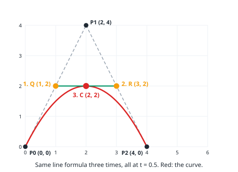
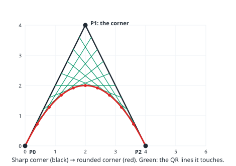
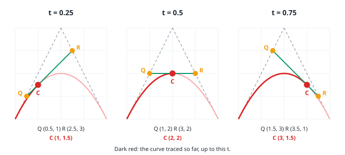

# Curves 1: Bézier Curves from Straight Lines

A Bézier curve is a smooth curve defined by a few control points, traced out by a number $t$ running from 0 to 1.

## Before you start
<!-- bite: 9607999c-6cce-454e-be29-d67fe64a98de -->

You can use the line formula $P(t) = A + t(B - A) = (1 - t)A + tB$ and say what $t$ means ([[computer-graphics/12-vectors-2|Vectors 2]]).

**After this lesson you will be able to:**
1. Say what a Bézier curve is, and what its control points do.
2. Find a point on a 3-point Bézier curve by using the line formula three times.
3. Explain why the result bends instead of going straight, and why it lies between Q and R.

## What Bézier curves are
<!-- bite: b0591f52-77ae-44c9-b818-f71dc2a07371 -->

Bézier curves are a way of describing smooth curves with a few guide points that you can drag to change the shape. The pen tool in design apps like Figma, Illustrator and Photoshop uses them, and so do the outlines of the letters in every font on your phone, SVG paths, logos, and the "ease-in, ease-out" timing of animations.

You already know the 2-point version. $P(t) = (1 - t)A + tB$ is a Bézier curve with 2 points, which is just a straight line. **Add more points and the curve bends.** This lesson shows how, using nothing but the line formula you already have.

## The five parts of curves
<!-- bite: e0bc507d-0a27-4405-8700-85881d24c93b -->

Curves come in five parts, each one sitting:

1. **Bézier curves from straight lines** (this part): how three points and the line formula make a curve.
2. **The Bézier formula and Pascal's triangle**: turning those steps into one formula, and where its numbers come from.
3. **The cubic Bézier: velocity and end conditions**: the 4-point curve the exam uses, and how fast it moves.
4. **de Casteljau, splitting and drawing with lines**: how computers actually draw curves.
5. **B-splines and other curve families**: long curves, and curves that pass through every point.

## The kid version
<!-- bite: 64ad974d-4030-4efe-bfd9-38ba6f2d6e65 -->

Stick a pin in a board at the start and another at the end, and add a couple of "magnet" pins in between. A bendy wire runs from the first pin to the last and is pulled towards the magnets without usually touching them. Move a magnet and the wire bends. **That wire is a Bézier curve, and the pins are its control points.**

There's a neat way to find any point on it: join the pins with straight lines, mark the point a fraction $t$ along each line, join those marks, mark $t$ along *those*, and keep going until one point is left. That point is on the curve. **That's de Casteljau's algorithm.**

**Where the analogy stops working.** With a Bézier curve, moving *any* magnet nudges the whole wire, even far away. B-splines (part 5) fix that: each control point only influences a nearby stretch.

## Terms used in curves
<!-- bite: 8f4e1361-be36-4c57-b555-b7c5a125348a -->

1. **Control point**: This is one of the points $P_0, P_1, P_2, \dots$ that shape the curve. You choose them, and they never move as $t$ changes.
2. **Control polygon**: This is the chain of straight lines joining the control points in order, like $P_0 \to P_1 \to P_2$.
3. **Degree**: This is the highest power of $t$ in the curve's formula. For a Bézier curve it is the number of control points minus 1.
4. **Helper point**: This is a temporary point, like $Q$ or $R$ below, that slides along a line of the control polygon as $t$ changes. It only exists to help find the curve point.
5. **Curve point**: This is the point on the curve for one value of $t$, written $C(t)$.

## From a line to a curve
<!-- bite: 7154da7e-1d6a-4210-a03e-67c49e218c64 -->

Two points give a straight line. More points give a curve:

1. **2 points** $(A, B)$: a straight line, $P(t) = (1 - t)A + tB$.
2. **3 points**: a curve with one bend (a **quadratic** Bézier).
3. **4 points**: a curve that can bend twice, like an S (a **cubic** Bézier).

The extra points in the middle are the magnets from the kid version. The curve starts at the first point and ends at the last, but the points in between pull the curve toward them without the curve usually touching them.

**The key link:** a Bézier curve is just the line idea (a blend of points controlled by $t$) repeated with more points. Every point on the curve is still a mix of the control points, and $t$ still goes from 0 (start) to 1 (end).

## A nice way to see it: three line steps
<!-- bite: bd5af3c0-fca5-4994-9574-d5cf7ee39f0b -->

Here's the idea in one sentence: **you already know how to find a point on a line between two points. For a curve with 3 points, you just do that three times, using the same $t$.**

Our running example is $P_0 = (0, 0)$, $P_1 = (2, 4)$, $P_2 = (4, 0)$, at $t = 0.5$. Think of it as two straight lines joined at $P_1$:

- Line 1: $P_0$ to $P_1$.
- Line 2: $P_1$ to $P_2$.

Then three steps, next.

## The three steps, with numbers
<!-- bite: c63cdbfb-ca8d-47a9-9fbb-6572d53ddeb6 -->

**Step 1: find the point halfway along Line 1. Call it Q.**

$$Q = (0, 0) + 0.5 \times \big((2, 4) - (0, 0)\big) = (0, 0) + (1, 2) = (1, 2)$$

**Step 2: find the point halfway along Line 2. Call it R.**

$$R = (2, 4) + 0.5 \times \big((4, 0) - (2, 4)\big) = (2, 4) + (1, -2) = (3, 2)$$

**Step 3: Q and R are two new points. Draw a line between them and find the point halfway along that.**

$$C = (1, 2) + 0.5 \times \big((3, 2) - (1, 2)\big) = (1, 2) + (1, 0) = (2, 2)$$

That final point, $(2, 2)$, is the point on the Bézier curve at $t = 0.5$. All three steps use the same line formula you already know.

## Seeing the three steps
<!-- bite: 8ae20b20-033f-4098-b86c-34677fc2bac1 -->

Notice $(2, 2)$ sits below $P_1 = (2, 4)$. The curve is pulled toward $P_1$ but doesn't reach it.

**Why it makes a curve:** change $t$ and repeat the three steps. At $t = 0.25$, Q and R sit nearer the start of their lines, and you get a different final point. As $t$ goes from 0 to 1, that last point slides along and traces out the curve. People call this "lerp of lerps".

## Which points are the end points?
<!-- bite: 4960dc38-da08-4924-a3c7-bd8729ba26db -->

A naming trap first. In the line formula, B was the end point. Here we call the final point $C(t)$, for "curve point", so it doesn't clash. It is not an end point.

The line formula doesn't care where its two points came from. Give it any two points and it finds a point between them. So it's used three times, each time with a different pair of "end points":

1. End points $P_0$ and $P_1$ → gives $Q$.
2. End points $P_1$ and $P_2$ → gives $R$.
3. End points $Q$ and $R$ → gives $C(t)$, the curve point.

Each time it is start $+\ t \times$ (end $-$ start). In step 3, $Q$ plays the role of A and $R$ plays the role of B: $A + t(B - A)$ becomes $Q + t(R - Q)$.

## Fixed points and temporary points
<!-- bite: c5c0bc26-6b59-485b-8082-36c752100ac5 -->

The difference is what *kind* of end points they are:

- $P_0, P_1, P_2$ are the **fixed** control points. You choose them, and they never move.
- $Q$ and $R$ are **temporary** end points. They slide along their lines as $t$ changes, and they only exist to help you find the next point. The line from Q to R is a helper, not part of the curve.

Only $P_0$ and $P_2$ are the true ends of the finished curve. $P_1$ is used as an end point in the helper steps, but the curve never reaches it.

## Freeze t, one value at a time
<!-- bite: 6e3efc69-a25d-4cdb-87a3-17166339ccd1 -->

Here's the part that trips people up. $Q$ is a function of $t$: it gives every point between $P_0$ and $P_1$. $R$ gives every point between $P_1$ and $P_2$. So does $C(t)$ give every point between Q and R? And how can it, when Q and R are moving?

**The key idea: $t$ is frozen at one value at a time.** $Q(t)$, $R(t)$ and $C(t)$ all use the same $t$. At any single moment:

1. Pick one $t$, say 0.25.
2. Q and R each become one fixed point.
3. C is **one** point on the line between that Q and R, $t$ of the way along.

So C isn't sweeping across all of $QR$. It picks just one spot on $QR$. Then $t$ changes and everything moves together.

## Freezing t: the numbers
<!-- bite: 34ca5bdc-39eb-4c56-b049-4373b3922023 -->

With $P_0 = (0, 0)$, $P_1 = (2, 4)$, $P_2 = (4, 0)$:

| $t$ | $Q$ | $R$ | $C$ ($t$ of the way from Q to R) |
|---|---|---|---|
| 0.25 | (0.5, 1) | (2.5, 3) | (1, 1.5) |
| 0.5 | (1, 2) | (3, 2) | (2, 2) |
| 0.75 | (1.5, 3) | (3.5, 1) | (3, 1.5) |

In each row, Q and R are fixed, and C is a single point between them. Moving to the next row changes $t$, so Q, R and C all move together. The curve is the path traced by all the C points: $(1, 1.5)$, $(2, 2)$, $(3, 1.5)$, and so on.

## Seeing the frozen t
<!-- bite: 6da11496-b917-40b5-9def-e064b55dbd7c -->

In one sentence: **$t$ is a single dial controlling all three points together, and $C(t)$ is the point that dial picks out on the line $QR$ at that setting.**

## Is C always between Q and R?
<!-- bite: 1a187edf-5cc7-492b-85e7-06863a50f333 -->

Yes. For every $t$, the curve point $C(t)$ lies on the segment between $Q(t)$ and $R(t)$. That's exactly how we built it: $C = Q + t(R - Q)$ is the line formula with Q as the start and R as the end, so for $t$ between 0 and 1, C is between them. Look at the middle snapshot: Q = (1, 2), R = (3, 2), and C = (2, 2) is exactly halfway, because $t = 0.5$.

So two things are true at once:

- **True:** at any chosen $t$, $C(t)$ is somewhere on the segment from $Q(t)$ to $R(t)$.
- **Not true:** $C(t)$ is all the points between Q and R at once. At each $t$ it is just one point on that segment.

Since Q and R slide along different lines, the segment $QR$ keeps tilting and moving as $t$ changes. C picks one point on that moving segment each time, and the path of all those picked points is the curve.

## Why do we even need the last step?
<!-- bite: baef61ab-c5f8-436c-8f73-bfeee0936259 -->

If you stopped at Q, you'd just have a point sliding along line $P_0P_1$: a straight line. Same for R. **Neither one knows about all three control points.** Q knows about $P_0$ and $P_1$; R knows about $P_1$ and $P_2$.

The last step combines them. Taking a point between Q and R mixes all three control points into one point, so $P_0$, $P_1$ and $P_2$ all influence it.

## Why it bends: three walkers
<!-- bite: 1ac142a9-79c2-4198-beb9-0651e943eb1c -->

Picture three walkers, all moving at the same pace, with $t$ as the clock:

1. Walker 1 walks along $P_0 \to P_1$.
2. Walker 2 walks along $P_1 \to P_2$.
3. Walker 3 walks from Walker 1 to Walker 2, always staying $t$ of the way between them.

Walker 1 and Walker 2 are moving in different directions, so the line between them keeps tilting and shifting. Walker 3 is chasing a target that keeps changing, so their path can't be straight. It curves.

With only two points (a plain line), there's one walker and the direction never changes, so you get a straight path. **The extra "walker of walkers" is what brings in the bend.**

## Why it bends: the rounded corner
<!-- bite: faee2d32-0a14-4af8-9a8a-5a8133e9c636 -->

Here's another way to see what we're even trying to do. The two lines $P_0P_1$ and $P_1P_2$ make a sharp corner, like the letter Λ. **The Bézier curve is that corner rounded off**: it still starts at $P_0$, ends at $P_2$, and leans toward $P_1$.

Early on ($t$ near 0), Q is near $P_0$ and R is near $P_1$, and the point we pick sits mostly toward Q. Late ($t$ near 1), Q is near $P_1$ and R is near $P_2$, and the point sits mostly toward R. So the curve point hands over smoothly from "following the $P_0P_1$ side" to "following the $P_1P_2$ side". That smooth handover is what rounds the corner at $P_1$.

## Seeing the rounded corner
<!-- bite: 3d7ae139-e455-4953-b7d7-0df1491cdd34 -->

Every green line below is one $QR$ helper line, for $t = 0.1, 0.2, \dots, 0.9$. The curve touches each one at exactly one point (the red dots), which is why it is smooth and follows the green lines round the corner.

## So what does C(t) signify?
<!-- bite: a59cfb80-75a5-41ec-956d-82b5654914be -->

It means **"the point on the rounded path at time $t$."** Q and R are just scaffolding we use to build it. We could throw them away, and that's exactly what the single formula in part 2 does:

$$C(t) = (1 - t)^2P_0 + 2(1 - t)t\,P_1 + t^2P_2$$

It says: at time $t$, the curve point is a weighted mix of $P_0$, $P_1$ and $P_2$. Early on $P_0$ has most of the weight, in the middle $P_1$ has the most pull, and at the end $P_2$ takes over. Check it at $t = 0.5$: $0.25(0, 0) + 0.5(2, 4) + 0.25(4, 0) = (2, 2)$, the same point the three steps gave, and the same point in the first picture.

**In one sentence:** the Bézier function blends three points so that control passes smoothly from $P_0$ to $P_1$ to $P_2$ as $t$ goes from 0 to 1, and Q and R are the steps that make the blending work.

## Common pitfalls
<!-- bite: bc14f9d4-6f3b-4151-b02f-4528212428db -->

1. **Thinking the curve goes through every control point.** It goes through the first and last only. The middle ones pull.
2. **Thinking $C(t)$ is all of the segment $QR$.** It's one point on it, for one frozen $t$.
3. **Using different $t$ values in the three steps.** All three steps use the same $t$.
4. **Calling the curve point B.** In the line formula B was an end point; the curve point is a different thing.

## Check your understanding
<!-- bite: 424e062a-4fa2-45ab-ac0d-54c63dc0fbfd -->

Try each one before you open the answer.

1. <!-- q: exact id="d0f3cc15" answer="3" accept="three" -->
   A Bézier curve has 4 control points. What is its degree?

   

Answer

   3, a cubic. Degree = number of control points − 1.

   

2. <!-- q: mcq id="6fcbcc55" -->
   A quadratic Bézier has control points P₀, P₁ and P₂. Which of them does the curve pass through?

   - [ ] All three
   - [x] P₀ and P₂ only
   - [ ] P₁ only

   

Answer

   P₀ and P₂, the first and last. P₁ pulls the curve toward it but the curve doesn't usually touch it.

   

3. <!-- q: mcq id="2404c84b" -->
   At one value of t, the helper points are Q and R. Where is the curve point C(t)?

   - [ ] Every point between Q and R
   - [x] One point on the segment from Q to R, t of the way from Q
   - [ ] At the midpoint of P₀ and P₂

   

Answer

   One point on the segment from Q to R, t of the way along: C = Q + t(R − Q).

   

4. <!-- q: open id="e495efea" -->
   Why does the final point bend into a curve, when every step only uses the straight-line formula?

   

Answer

   Because Q and R move along two different lines in different directions. The segment from Q to R keeps tilting and shifting as t changes, so the point picked on it is chasing a moving target and its path can't be straight. With only two points there is one line and one direction, so the path stays straight.

   

5. <!-- q: mcq id="cf8c0165" -->
   Which line formula gives the curve point in step 3?

   - [ ] P₀ + t(P₂ − P₀)
   - [x] Q + t(R − Q)
   - [ ] Q + R

   

Answer

   Q + t(R − Q). In step 3, Q plays the role of A and R the role of B.

   

## Check your understanding: worked problems
<!-- bite: 9ec30a35-1880-4cf1-a569-3ac79dd6df35 -->

Work each one out on paper first, then type your answer.

1. <!-- q: gap id="ca91fd46" answers="1;3" -->
   Fill in the gaps. A quadratic Bézier has P₀ = (0, 0), P₁ = (0, 4), P₂ = (4, 4). At t = 0.5, the curve point is (___, ___).

   

Answer

   (1, 3). Q = midpoint of P₀P₁ = (0, 2). R = midpoint of P₁P₂ = (2, 4). The midpoint of Q and R is (1, 3).

   

2. <!-- q: gap id="75cbd335" answers="1.5;2.5;4.5;2.5" -->
   Fill in the gaps. P₀ = (0, 0), P₁ = (3, 5), P₂ = (6, 0). At t = 0.5, Q = (___, ___) and R = (___, ___).

   

Answer

   Q = (1.5, 2.5), halfway along P₀P₁. R = (4.5, 2.5), halfway along P₁P₂.

   

3. <!-- q: points id="93a9adb9" xmin="-0.5" xmax="4.5" ymin="-0.5" ymax="4.5" step="0.5" snap="0.25" answer="0.5,1 2.5,3 1,1.5" labels="Q,R,C" tolerance="0.15" ghost="0,0 2,4 4,0" -->
   The control points P₀ (0, 0), P₁ (2, 4), P₂ (4, 0) are shown faintly. Freeze t = 0.25 and place Q, R and the curve point C.

   

Answer

   Q = (0, 0) + 0.25(2, 4) = (0.5, 1). R = (2, 4) + 0.25(2, −4) = (2.5, 3). C = Q + 0.25(R − Q) = (0.5, 1) + 0.25(2, 2) = (1, 1.5).

   

4. <!-- q: sketch id="fa15adf3" -->
   Draw P₀ = (0, 0), P₁ = (2, 4), P₂ = (4, 0) and the control polygon. Using the three steps, mark the curve points for t = 0.25, 0.5 and 0.75, and sketch the curve through them.

   

Answer

   

   What to check:
   - The curve points are (1, 1.5), (2, 2) and (3, 1.5).
   - The curve starts at P₀, ends at P₂, and stays below P₁: its top is (2, 2), not (2, 4).
   - It leaves P₀ heading toward P₁ and arrives at P₂ coming from P₁'s direction.

   

## Practice: independent tasks
<!-- bite: abc3d93c-fc18-4056-b259-7815841dfb9d -->

1. **By hand,** for $P_0 = (0, 0)$, $P_1 = (0, 4)$, $P_2 = (4, 4)$, find Q, R and C for $t = 0.25$, 0.5 and 0.75, and sketch the curve. **Done when** your three C points are $(0.25, 1.75)$, $(1, 3)$ and $(2.25, 3.75)$.
2. **In Python,** use your `lerp` from Vectors 2 three times inside a function `quad_point(p0, p1, p2, t)`, and print 11 points for $t = 0, 0.1, \dots, 1$ for the running example. **Done when** the middle one is `(2.0, 2.0)`.

## Before moving on
<!-- bite: 6e79a72b-9c4d-4c6d-8e5a-51cf288e0b0a -->

You can build a point on a 3-point Bézier from three line steps, say why Q and R are temporary end points, freeze $t$ to see that C is one point on $QR$, and explain the bend with the three walkers or the rounded corner. **Next:** [[computer-graphics/16-curves-2|Curves 2: The Bézier Formula and Pascal's Triangle]]. Three steps per point is fine by hand, but where did that one-line formula with the 2 in it come from? Part 2 derives it, and finds Pascal's triangle hiding inside.

## Related
<!-- bite: dfa51bab-743f-4d6d-abca-8de1025b13cb -->

- [[computer-graphics/12-vectors-2|Vectors 2]] — the line formula this is built from
- [[computer-graphics/16-curves-2|Curves 2]] — the formula and Pascal's triangle
- [[computer-graphics/index|Computer graphics map]]

## About this lesson
<!-- bite: eadac877-9940-4aa5-aaf1-4816f50bd8d4 -->

**Level:** Beginner. **Covers:** what a Bézier curve is; from a line to a curve; the three line steps ("lerp of lerps") with numbers; fixed and temporary end points; freezing $t$; why $C(t)$ lies on $QR$; why the curve bends (three walkers, the rounded corner); and what $C(t)$ means.

Part 1 of 5 on curves, in Part 1 of the course, after [[computer-graphics/14-2d-and-3d-transformations|note 14]]. Added in November 2026 from the author's study conversation on Bézier curves: the running example $P_0 = (0, 0)$, $P_1 = (2, 4)$, $P_2 = (4, 0)$, the frozen-$t$ table, the walkers and the rounded corner are all from it. The kid version and terms came from the earlier single curves note, which this part and the next four replaced.
