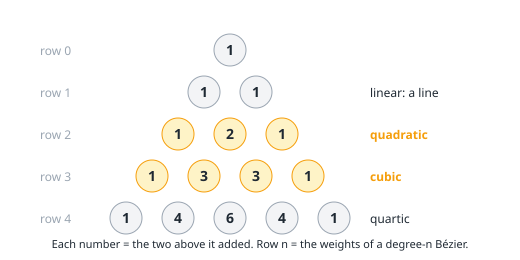
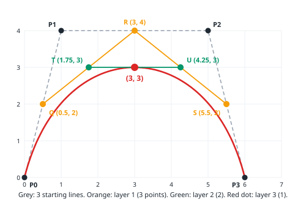
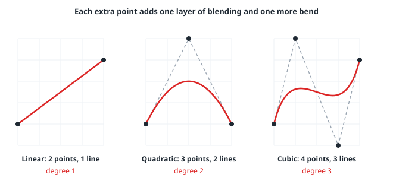
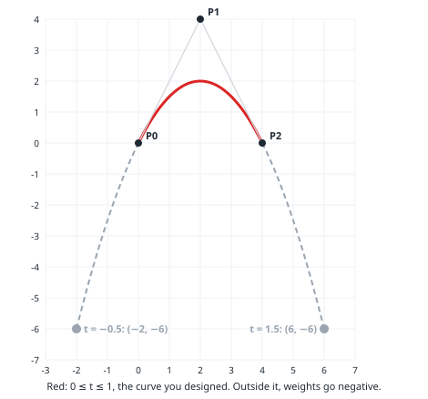

# Curves 2: The Bézier Formula and Pascal's Triangle

The Bézier formula gives a curve point in one line, as a weighted mix of the control points whose weights come from Pascal's triangle.

## Before you start
<!-- bite: ecabf7d3-59da-44f4-8d60-ce256a50e17c -->

You can find a point on a 3-point Bézier curve with three line steps ([[computer-graphics/15-curves-1|Curves 1]]), and you can multiply out brackets like $(a + b)^2$.

**After this lesson you will be able to:**
1. Derive the quadratic Bézier formula from the three line steps, and say why the middle term has a 2.
2. Read the weights of any Bézier curve off Pascal's triangle.
3. Build a cubic Bézier point in layers, and check it with the formula.
4. Say what $t$ outside 0 to 1 does, and where the name Bézier comes from.

## What the Bézier formula is
<!-- bite: d30e172e-b5e0-4b3c-8bfc-2ce2e3d1dde5 -->

In part 1 we found a curve point with three steps: Q on the first line, R on the second, then C between them. The **Bézier formula** squashes those three steps into one line, so you can work out a curve point straight away:

$$C(t) = (1 - t)^2P_0 + 2(1 - t)t\,P_1 + t^2P_2$$

This lesson derives it, step by step, and then finds the pattern that gives the formula for any number of control points.

## Step 1: write the three line steps
<!-- bite: f803729e-f3bd-4c9e-b84a-9520ae24d619 -->

Using the line formula $P = (1 - t)A + tB$ each time:

$$Q = (1 - t)P_0 + tP_1$$
$$R = (1 - t)P_1 + tP_2$$
$$C = (1 - t)Q + tR$$

These are exactly the three steps from part 1, the ones drawn in its first picture (Q on line 1, R on line 2, C on the line $QR$).

## Step 2: put Q and R into C
<!-- bite: 642a180b-f2b2-4b03-8877-a0aec8a89ed4 -->

Replace Q and R in the third line with what they equal:

$$C = (1 - t)\big[(1 - t)P_0 + tP_1\big] + t\big[(1 - t)P_1 + tP_2\big]$$

Nothing new has happened yet. It's the same three steps, written as one line.

## Steps 3 to 5: multiply out and combine
<!-- bite: 03764d46-dbc5-4603-85d4-78054aeada33 -->

**Step 3: multiply out the brackets.** The first part and the second part:

$$(1 - t)\big[(1 - t)P_0 + tP_1\big] = (1 - t)^2P_0 + (1 - t)t\,P_1$$
$$t\big[(1 - t)P_1 + tP_2\big] = t(1 - t)P_1 + t^2P_2$$

**Step 4: put them together.**

$$C = (1 - t)^2P_0 + (1 - t)t\,P_1 + t(1 - t)P_1 + t^2P_2$$

**Step 5: combine the two $P_1$ terms.** $(1 - t)t$ and $t(1 - t)$ are the same thing, so together they make $2(1 - t)t\,P_1$:

$$C(t) = (1 - t)^2P_0 + 2(1 - t)t\,P_1 + t^2P_2$$

## Why the 2 appears
<!-- bite: 47c7cd3d-3a35-4aa9-ab84-4aa71c72c9b6 -->

$P_1$ shows up twice: once from Q (the **end** of line 1) and once from R (the **start** of line 2). Those two contributions add up, giving the 2. $P_0$ and $P_2$ each show up only once, so they get 1.

So the numbers in front are **1, 2, 1**. Keep those in mind; they come back in a moment.

**Quick check that it makes sense:**

- $t = 0$: $(1)^2P_0 + 0 + 0 = P_0$. ✓ It starts at the first point.
- $t = 1$: $0 + 0 + (1)^2P_2 = P_2$. ✓ It ends at the last point.

## Check it against the three steps
<!-- bite: 3249ad05-cfa7-4f20-b8db-54cfae6620fe -->

With our example $P_0 = (0, 0)$, $P_1 = (2, 4)$, $P_2 = (4, 0)$ at $t = 0.5$, the three weights are:

$$(1 - t)^2 = 0.25, \qquad 2(1 - t)t = 0.5, \qquad t^2 = 0.25$$

$$C = 0.25(0, 0) + 0.5(2, 4) + 0.25(4, 0) = (0, 0) + (1, 2) + (1, 0) = (2, 2)$$

The same answer as the step-by-step method. **Use the step-by-step way when you want to understand it, and the formula when you want to calculate quickly.**

## The weights always add up to 1
<!-- bite: d7d4c461-9c5e-4e38-89e0-48a6feb91422 -->

Look at the weights at $t = 0.5$: $0.25 + 0.5 + 0.25 = 1$. That's true at every $t$, so the curve point is always a **blend** of the control points, an affine combination from [[computer-graphics/12-vectors-2|Vectors 2]].

You can read the curve's whole story off this picture: early on $P_0$ has most of the weight, in the middle $P_1$ has the most pull, and at the end $P_2$ takes over.

## Pascal's triangle
<!-- bite: 887a28f2-dcf4-4ac4-808c-0c535de60acd -->

Here's where the 1, 2, 1 comes from. **Pascal's triangle** is the triangle of numbers where each number is the two above it added together:

**The row number matches the degree of the curve, and each number is the weight on the matching control point.** Row 1 (1, 1) is the straight line, $(1 - t)A + tB$. Row 2 (1, 2, 1) is the quadratic we just derived. Row 3 (1, 3, 3, 1) is the cubic:

$$B(t) = (1 - t)^3P_0 + 3(1 - t)^2t\,P_1 + 3(1 - t)t^2\,P_2 + t^3P_3$$

## 3. Where the Bézier weights come from
<!-- bite: 6f57fe3a-3bda-44f7-9901-78380fcbe91b -->

Why Pascal's triangle? **For any $t$, $(1 - t) + t = 1$.** Square both sides and expand:

$$[(1-t) + t]^2 = (1-t)^2 + 2t(1-t) + t^2 = 1$$

**Those three terms are the quadratic weights.** They are never negative on $[0,1]$ and they sum to 1, which is why the weights picture always adds to 1.

**For $n + 1$ control points, expand $[(1 - t) + t]^n = 1$.** Each term $\binom{n}{i}(1-t)^{n-i}t^i$ is one weight, and the numbers $\binom{n}{i}$ in front are exactly Pascal's triangle (the binomial coefficients).

| Degree | Coefficients | Curve |
|---|---|---|
| 1 | 1, 1 | $(1-t)P_0 + tP_1$ |
| 2 | 1, 2, 1 | $(1-t)^2P_0 + 2t(1-t)P_1 + t^2P_2$ |
| 3 | 1, 3, 3, 1 | $(1-t)^3P_0 + 3t(1-t)^2P_1 + 3t^2(1-t)P_2 + t^3P_3$ |

## 4. Bézier curves
<!-- bite: c6627559-2894-4510-bf9c-d23c997aa475 -->

Putting it together, **a Bézier curve is the weighted sum of its control points, with these weights** (called the Bernstein basis functions):

$$P(t) = \sum_{i=0}^{n} P_i\,B_i^n(t),\qquad B_i^n(t) = \binom{n}{i}t^i(1-t)^{n-i} = \frac{n!}{i!\,(n-i)!}\,t^i(1-t)^{n-i},\qquad 0 \le t \le 1$$

(Use one index throughout — summing over $k$ while the terms use $i$ is a common slip.)

## Bézier curves: what the formula tells you
<!-- bite: 655b665e-88a4-4b92-8f5f-549b4cb5ce15 -->

In the formula, $n$ is the degree, $i$ the index, $t$ the variable, and $P_i$ is control point $i$. Three things follow from it:

- **Degree = number of control points − 1.** Two points give a line, three a quadratic, four a cubic.
- **It passes through the first and last control points** (not usually the others), and **lies inside the convex hull** of its control points.
- **Limits:** the degree grows with the number of control points, so long curves get expensive and hard to control; **and moving any one control point changes the whole curve (global control).**

The pictures for this are the weights picture above (for $n = 2$) and the degree pattern picture coming up.

## A cubic, built in layers
<!-- bite: 96dc0bf3-a87e-4102-bd5e-bd1386be4f36 -->

Part 1 built a quadratic from 2 lines. A cubic has 4 points, so it starts from 3 lines, and it is built **in layers**, each one using the same line formula with one fewer point:

1. **Layer 1:** 3 lines give 3 points.
2. **Layer 2:** blend those into 2 points.
3. **Layer 3:** blend those into 1 final point, the curve point.

Worked, at $t = 0.5$, with $P_0 = (0, 0)$, $P_1 = (1, 4)$, $P_2 = (5, 4)$, $P_3 = (6, 0)$:

- Layer 1: $Q = (0.5, 2)$, $R = (3, 4)$, $S = (5.5, 2)$, halfway along each of $P_0P_1$, $P_1P_2$, $P_2P_3$.
- Layer 2: $T = (1.75, 3)$ halfway along $QR$, $U = (4.25, 3)$ halfway along $RS$.
- Layer 3: halfway along $TU$ is $(3, 3)$.

Check with the formula: weights $\tfrac18(1, 3, 3, 1)$ give $x = \frac{0 + 3 + 15 + 6}{8} = 3$ and $y = \frac{0 + 12 + 12 + 0}{8} = 3$. ✓

## Seeing the cubic layers
<!-- bite: 3985a2ca-52f2-45d5-a8fa-1bae4a93b3e7 -->

This layered method has a name, **de Casteljau's algorithm**, and it's how computers actually work out Bézier points. Part 4 does it properly.

## The pattern
<!-- bite: d01c44d0-4a42-41b8-845f-e8c6be23025b -->

Each time you add a point, you add one more layer of blending, and the degree goes up by one:

| Control points | Starting lines | Degree | Name |
|---|---|---|---|
| 2 | 1 | 1 | Linear |
| 3 | 2 | 2 | Quadratic |
| 4 | 3 | 3 | Cubic |

## A function of straight lines
<!-- bite: 24b93c60-39e0-4fc8-bbba-79e953991462 -->

When the author worked this out, he put it like this: *"Can I say a quadratic function is a function of 2 straight lines? And maybe say a cubic function is a function of 3 straight lines."*

The core idea is right: a quadratic Bézier is built by combining two straight-line functions. Q(t) and R(t) are each a line function, and C(t) blends them. "Function of functions" is a good way to say it. Two fixes:

1. **Quadratic = 2 lines, yes. Cubic = 3 lines, but not in one step.** The cubic starts from 3 lines, then blends in layers: 3 points, then 2, then 1.
2. **"Quadratic" has two meanings here,** and both are true. Normally it means a polynomial of degree 2 in $t$, like $t^2$. Our Bézier is quadratic in that sense too: multiplying two line functions (each degree 1 in $t$) gives degree 2, which is why $(1 - t)^2$ and $t^2$ appear. A cubic multiplies three, giving degree 3.

A one-sentence version for an exam: **a quadratic Bézier is a blend of two line functions, which gives a degree-2 polynomial in $t$; a cubic is built by blending line functions in three layers, which gives a degree-3 polynomial in $t$.**

## Must t run from 0 to 1?
<!-- bite: 58d791e2-6a52-4af7-80c3-14e736e35b9e -->

Not strictly, but for the curve itself, yes: $t$ from 0 to 1 is the part that counts. $t = 0$ is the start point, $t = 1$ is the end point, and everything in between is the curve you designed. Inside that range, all the weights are between 0 and 1 and add up to 1, so every point stays inside the blend of your control points.

The formula still works outside 0 to 1, but you're no longer on the curve you designed:

- $t > 1$: the path keeps going past the end point.
- $t < 0$: the path extends backward before the start point.

For a straight line, that's just the segment extended into the infinite line, as in Vectors 2. **For a Bézier, the extension can swing off in odd directions, because the weights can go negative.**

## Seeing t outside 0 to 1
<!-- bite: 81b302e4-3390-4f35-b7d9-67110dedb4da -->

At $t = -0.5$ the weights are $2.25$, $-1.5$ and $0.25$. The middle one is negative, so $P_1$ *pushes* instead of pulls, and the point lands at $(-2, -6)$, far below anything you drew:

In practice, graphics software clamps $t$ to $[0, 1]$ for Béziers. Going beyond is rare, mostly for extrapolation. In short: **$t$ is a progress dial, and 0 to 1 means "from start to finish of the curve you defined".**

## Using part of the range
<!-- bite: 1097deb8-adc9-47c4-b729-8616d63bc262 -->

Running $t$ over only part of 0 to 1 draws only part of the curve, the same as for a line ([[computer-graphics/12-vectors-2|Vectors 2]]):

1. **Drawing a curve as it animates:** the end value of $t$ grows from 0 to 1, so halfway through, $t = 0$ to 0.5 is drawn.
2. **Splitting:** a Bézier can be cut at $t = 0.5$ into two smaller Béziers, one for 0 to 0.5 and one for 0.5 to 1. Software does this to break curves up for drawing, or to insert a new point ([[computer-graphics/18-curves-4|Curves 4]]).
3. **Trimming:** keeping, say, 0.2 to 0.8 leaves gaps near the end points.
4. **Partial animation:** moving an object only part of the way along a path.

## Why it's called Bézier
<!-- bite: 7e87ec3a-0fb4-4290-a5b5-ff31c5a7fd69 -->

It's named after **Pierre Bézier**, a French engineer at Renault who popularised the curves in the 1960s and 70s. He used them to design smooth car body shapes in a computer system called **UNISURF**, so designers could control a curve with a few points instead of drawing it by hand.

A twist: another French engineer, **Paul de Casteljau** at Citroën, worked out the same curves slightly earlier, around 1959. His work was kept as an internal company secret, so it wasn't published. Bézier published his, so his name stuck. De Casteljau's name still lives on: the "lerp of lerps" method from part 1 is called **de Casteljau's algorithm**, and it's how Béziers are usually computed.

So the name is partly history and partly luck: whoever went public first got the credit.

## Where Béziers are used
<!-- bite: dd47a65e-5b01-487e-8c95-4b14081a481e -->

Because a few points give you a smooth, easy-to-control curve, Béziers are everywhere:

1. **Fonts:** every letter's outline. TrueType fonts use quadratics, and PostScript and OpenType CFF fonts use cubics.
2. **SVG paths and PDF drawings:** the `Q` and `C` commands in an SVG path are quadratic and cubic Béziers.
3. **Design tools:** the pen tool in Illustrator, Figma and Photoshop.
4. **Animation easing:** CSS `cubic-bezier(…)` timing curves, which make movement speed up and slow down smoothly.

## Common pitfalls
<!-- bite: 7e57f16b-4dee-4398-aba5-9f714779c80a -->

1. **Dropping the 2** in the middle term of the quadratic, or the 3s in the cubic. Read them off Pascal's triangle.
2. **Reversed binomial index.** The standard form puts the highest power of $(1 - t)$ on the first point.
3. **Thinking a cubic blends 3 lines in one step.** It blends in three layers.
4. **Using $t$ outside 0 to 1** and expecting to stay on the curve.

## Check your understanding
<!-- bite: c8f733b7-ed08-460f-9530-60d28c7f6ebd -->

Try each one before you open the answer.

1. <!-- q: gap id="fa07930a" answers="1;3;3;1" -->
   Fill in the gaps. The weights of a cubic Bézier come from row 3 of Pascal's triangle: ___, ___, ___, ___.

   

Answer

   1, 3, 3, 1. Each number is the two above it in row 2 (1, 2, 1) added together.

   

2. <!-- q: open id="a88020ce" -->
   Why does the middle term of the quadratic Bézier have a 2 in front?

   

Answer

   Because P₁ appears twice in the three line steps: once as the end of line 1 (in Q) and once as the start of line 2 (in R). When Q and R are blended, those two (1 − t)t P₁ terms add up to 2(1 − t)t P₁. P₀ and P₂ appear only once each.

   

3. <!-- q: mcq id="e95569c4" -->
   What do the three weights of a quadratic Bézier add up to?

   - [ ] It depends on t
   - [x] Always 1
   - [ ] Always 2

   

Answer

   Always 1, because they are the expansion of ((1 − t) + t)² = 1², so the curve point is always a blend of the control points.

   

4. <!-- q: mcq id="7f08d888" -->
   A quadratic Bézier is evaluated at t = 1.5. What happens?

   - [ ] It returns the end point P₂
   - [x] The formula keeps going, past P₂, and a weight goes negative
   - [ ] The formula breaks and gives no point

   

Answer

   The formula keeps going past the end of the curve you designed. At t = 1.5 the middle weight is 2(−0.5)(1.5) = −1.5, so the point leaves the curve. Software clamps t to [0, 1].

   

5. <!-- q: mcq id="d3cdd57e" -->
   Whose name is on the "lerp of lerps" method for computing Bézier points?

   - [ ] Pierre Bézier
   - [x] Paul de Casteljau
   - [ ] Blaise Pascal

   

Answer

   Paul de Casteljau, the Citroën engineer who found the curves around 1959 but whose work was kept secret. Bézier published first, so the curves carry his name.

   

## Check your understanding: worked problems
<!-- bite: 6d4d4c9d-b5b9-4eb0-b98b-97902bb21fe6 -->

Work each one out on paper first, then type your answer.

1. <!-- q: gap id="5b80faff" answers="2;2" -->
   Fill in the gaps. A quadratic Bézier has P₀(0, 0), P₁(2, 4), P₂(4, 0). P(½) = (___, ___).

   

Answer

   (2, 2). Weights ¼, ½, ¼: 0.25 × (0, 0) + 0.5 × (2, 4) + 0.25 × (4, 0) = (2, 2).

   

2. <!-- q: gap id="5106dab0" answers="0.49;0.42;0.09" -->
   Fill in the gaps. At t = 0.3, the three quadratic weights (1 − t)², 2(1 − t)t and t² are ___, ___ and ___.

   

Answer

   0.49, 0.42 and 0.09. They add up to 1.

   

3. <!-- q: gap id="2273b4a7" answers="2.58;2.1" -->
   Fill in the gaps. A quadratic Bézier has P₀(0, 0), P₁(4, 5), P₂(10, 0). At t = 0.3, using the weights 0.49, 0.42 and 0.09, the curve point is (___, ___).

   

Answer

   (2.58, 2.1). P₀ is the origin, so it adds nothing. x = 0.42 × 4 + 0.09 × 10 = 1.68 + 0.9 = 2.58. y = 0.42 × 5 + 0.09 × 0 = 2.1.

   

4. <!-- q: gap id="929f6a15" answers="4;3" -->
   Fill in the gaps. A cubic Bézier has P₀(0, 0), P₁(2, 4), P₂(6, 4), P₃(8, 0). Using the weights ⅛(1, 3, 3, 1), B(½) = (___, ___).

   

Answer

   (4, 3). x = (0 + 6 + 18 + 8)/8 = 4. y = (0 + 12 + 12 + 0)/8 = 3.

   

5. <!-- q: points id="739f98e7" xmin="-0.5" xmax="8.5" ymin="-0.5" ymax="4.5" step="0.5" snap="0.5" answer="1,2 4,4 7,2 2.5,3 5.5,3 4,3" labels="Q,R,S,T,U,C" tolerance="0.2" ghost="0,0 2,4 6,4 8,0" -->
   The control points P₀(0, 0), P₁(2, 4), P₂(6, 4), P₃(8, 0) are shown faintly. Build the cubic in layers at t = ½: place the three layer-1 points Q, R, S, the two layer-2 points T, U, and the curve point C.

   

Answer

   Layer 1: Q (1, 2), R (4, 4), S (7, 2). Layer 2: T (2.5, 3), U (5.5, 3). Layer 3: C (4, 3), which matches the formula.

   

## Practice: independent tasks
<!-- bite: 68f1dcbd-0075-4418-bcff-e80bc33cbcf1 -->

1. **Derive the cubic yourself.** Write the 6 line steps (3 in layer 1, 2 in layer 2, 1 in layer 3), substitute, and multiply out until you reach $(1-t)^3P_0 + 3(1-t)^2t\,P_1 + 3(1-t)t^2P_2 + t^3P_3$. **Done when** you can say which paths through the layers give each 3.
2. **In Python, write `bezier(points, t)`** using `math.comb` for the weights, for any number of points. **Done when** it gives `(2.0, 2.0)` for the quadratic example and `(3.0, 3.0)` for the cubic in layers, both at $t = 0.5$.

## Before moving on
<!-- bite: 231105eb-5043-4d20-a8a6-22b1ef6410d1 -->

You can derive the quadratic formula from the three line steps, explain the 2, read any Bézier's weights from Pascal's triangle, build a cubic in layers, and say what $t$ outside 0 to 1 does. **Next:** [[computer-graphics/17-curves-3|Curves 3: The Cubic Bézier: Velocity and End Conditions]]. If $t$ is time, the curve is a path something moves along, and the exam asks how fast it moves at the ends. Part 3 differentiates the cubic and turns velocities into control points.

## Related
<!-- bite: 20170fe1-b781-4106-a0a4-3105ae27bf70 -->

- [[computer-graphics/15-curves-1|Curves 1]] — the three line steps
- [[computer-graphics/17-curves-3|Curves 3]] — the cubic, its velocity and end conditions
- [[mathematics/07-applied-and-computational/01-numerical-methods/06-interpolation-and-approximation|Interpolation and splines]]
- [[computer-graphics/index|Computer graphics map]]

## About this lesson
<!-- bite: a9f89d33-dded-4991-91a0-b9ee6638069a -->

**Level:** Beginner → Intermediate. **Covers:** deriving the quadratic Bézier from the line steps; why the 2; checking the formula; weights that add to 1; Pascal's triangle and the cubic formula; the binomial expansion behind the weights; the general Bernstein form; a cubic built in layers; the degree pattern; "a function of straight lines"; $t$ outside 0 to 1 and partial ranges; the history of the name; and where Béziers are used.

Part 2 of 5 on curves, in Part 1 of the course. Built from the author's study conversation (the derivation, the Pascal's triangle question, his "function of 2 straight lines" definition and the history of the name are from it), plus the weights and Bernstein sections of the earlier single curves note.
