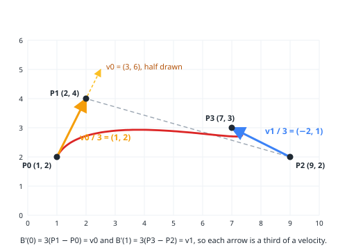
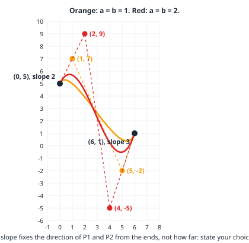

# Curves 3: The Cubic Bézier: Velocity and End Conditions

The cubic Bézier is the 4-point curve, and when $t$ is time its derivative is the velocity of whatever moves along it.

## Before you start
<!-- bite: 43d15198-7137-40fd-a004-2f2255904a44 -->

You can write the cubic Bézier formula from Pascal's triangle ([[computer-graphics/16-curves-2|Curves 2]]), and you can differentiate a polynomial like $t^3$.

**After this lesson you will be able to:**
1. Choose between implicit, explicit and parametric forms and say why curves use parametric.
2. Evaluate a cubic $B(t)$ and its velocity $B'(t)$.
3. Find a cubic's control points from its end positions and velocities.
4. Build a curve through two points with given slopes, and state the choice you made.

## What this lesson is about
<!-- bite: 8b5d857e-74c1-44ab-ab19-7fcca6b1a628 -->

In parts 1 and 2 the curve was a shape. Here, $t$ is **time**: an object starts at $P_0$ at $t = 0$ and arrives at $P_3$ at $t = 1$. Then two new questions appear: how fast is it moving, and which way, at each moment? And the reverse, which the SSG 511 exam asks: if I know where it starts and ends and how fast it's going at each end, what are the control points?

First, why curves are written with $t$ at all.

## 1. Three ways to represent a curve
<!-- bite: 8499589a-b975-4ac2-b65d-4331780840e8 -->

| Type | Form | Circle of radius $r$ | Strength | Weakness |
|---|---|---|---|---|
| **Implicit** | $f(x,y) = 0$ | $x^2 + y^2 - r^2 = 0$ | Easy to test on/inside/outside — check the sign of $f$ | Hard to generate points in order |
| **Explicit** | $y = f(x)$ | $y = \sqrt{r^2 - x^2}$ | Simple | Single-valued: one $y$ per $x$, so no full circle or vertical line |
| **Parametric** | $P(t) = (x(t), y(t))$ | $(r\cos t, r\sin t)$, $t \in [0, 2\pi]$ | General: closed and multi-valued curves; tangents from the derivative; $t$ can be time | Needs a parameter; harder inside/outside test |

In a parametric curve, $x(t)$ and $y(t)$ give the coordinates while $t$ varies over an interval, usually $[0, 1]$. **Adding $z(t)$ gives a 3D curve.** Bézier curves are parametric, which is why "$t$ can be time" comes for free.

## The cubic Bézier in detail
<!-- bite: 494de791-258c-4a7c-bd77-d9d1e2e3d4b1 -->

**Position:**

$$B(t) = (1-t)^3P_0 + 3(1-t)^2t\,P_1 + 3(1-t)t^2\,P_2 + t^3P_3$$

**Do every calculation separately on each coordinate** ($x$, $y$, $z$).

**Matrix form.** Expanding $(1-t)^3 = 1 - 3t + 3t^2 - t^3$, $3t(1-t)^2 = 3t - 6t^2 + 3t^3$, $3t^2(1-t) = 3t^2 - 3t^3$ and $t^3$:

$$B(t) = \begin{pmatrix} 1 & t & t^2 & t^3 \end{pmatrix}\begin{pmatrix} 1 & 0 & 0 & 0 \\ -3 & 3 & 0 & 0 \\ 3 & -6 & 3 & 0 \\ -1 & 3 & -3 & 1 \end{pmatrix}\begin{pmatrix} P_0 \\ P_1 \\ P_2 \\ P_3 \end{pmatrix}$$

(A cubic has four weights, so the column must hold four points.)

## The cubic's velocity
<!-- bite: fce09d6e-ca33-49bd-9777-872714f01863 -->

**Velocity.** If $t$ is time, the derivative of the position is the velocity: how fast, and which way, the object is moving at time $t$:

$$B'(t) = 3\left[(1-t)^2(P_1 - P_0) + 2(1-t)t\,(P_2 - P_1) + t^2(P_3 - P_2)\right]$$

The picture for position and velocity together is under "Seeing the end conditions" below.

## Bézier derivatives and end conditions
<!-- bite: 0dfee0fc-06f0-4b35-b930-d8b7eb0c19c8 -->

**In general, the derivative of a degree-$n$ Bézier is a degree-$(n-1)$ Bézier whose control points are $n$ times the differences of neighbouring control points:**

$$\frac{d}{dt}B_i^n(t) = n\left(B_{i-1}^{n-1}(t) - B_i^{n-1}(t)\right)\quad\Rightarrow\quad B'(t) = \sum_{i=0}^{n-1} B_i^{n-1}(t)\;n\,(P_{i+1} - P_i)$$

so $Q_0 = n(P_1 - P_0),\; Q_1 = n(P_2 - P_1),\; \dots,\; Q_{n-1} = n(P_n - P_{n-1})$.

**End conditions.** Put $t = 0$ and $t = 1$ into the two formulas:

$$B(0) = P_0,\quad B(1) = P_3,\quad B'(0) = 3(P_1 - P_0),\quad B'(1) = 3(P_3 - P_2)$$

**So given start/end positions and velocities $v_0$, $v_1$, the control points follow directly:**

$$P_1 = P_0 + \frac{v_0}{3},\qquad P_2 = P_3 - \frac{v_1}{3}$$

**Position at $t = \tfrac12$:** every weight is $\tfrac18$ times $1, 3, 3, 1$:

$$B\!\left(\tfrac12\right) = \frac{P_0 + 3P_1 + 3P_2 + P_3}{8}$$

## 5. Worked examples
<!-- bite: 5d798327-192a-45cd-8237-5cca60f14158 -->

Two worked examples follow. The first turns velocities into control points; the second, slopes. The third worked example, de Casteljau at $t = \tfrac12$, is in [[computer-graphics/18-curves-4|Curves 4]].

## Worked (a): control points from end conditions
<!-- bite: d02139e5-4b42-45e8-b69e-6c147105eb53 -->

Position $(1,2)$ at $t = 0$, $(7,3)$ at $t = 1$; velocity $(3,6)$ at $t = 0$, $(-6,3)$ at $t = 1$.

$$P_1 = P_0 + \frac{v_0}{3} = (1,2) + (1,2) = (2,4),\qquad P_2 = P_3 - \frac{v_1}{3} = (7,3) - (-2,1) = (9,2)$$

## Seeing the end conditions
<!-- bite: f70af98c-acdb-4359-9339-8495fbda83ab -->

Each control point sits a third of a velocity away from its end. The curve leaves $P_0$ heading toward $P_1$ and arrives at $P_3$ coming from $P_2$:

Notice $P_2 = (9, 2)$ is further right than the end point $P_3 = (7, 3)$. That's because the object arrives moving left, at velocity $(-6, 3)$, so the curve has to swing out past $P_3$ and come back.

## Worked (c): a curve through two points with given slopes
<!-- bite: 03d658ab-557d-406d-a979-d5e0c8b7ed1b -->

**A slope gives a direction, not a speed.** So $P_1$ must lie on the line through $P_0$ with the first slope, and $P_2$ on the line through $P_3$ with the second slope — **but how far along is your choice.** Write $P_1 = P_0 + a(1, m_0)$ and $P_2 = P_3 - b(1, m_1)$, pick sensible positive $a$, $b$ (say a fraction of the distance between the points), **state the choice**, and substitute into the cubic. A different $a$, $b$ gives a different curve through the same points with the same slopes.

## Seeing the slope choice
<!-- bite: 325a9e0d-5ff6-4740-8c65-4ea4bf22f4d3 -->

Through $(0, 5)$ with slope 2 and $(6, 1)$ with slope 3. With $a = b = 1$: $P_1 = (1, 7)$, $P_2 = (5, -2)$. With $a = b = 2$: $P_1 = (2, 9)$, $P_2 = (4, -5)$. Both curves fit the question; they are different curves.

## Properties of Bézier curves
<!-- bite: 7ebcbea0-a152-42dd-bdb0-a4b5d5291074 -->

1. **Convexity of the basis:** the weights are never negative and sum to 1.
2. **Convex-hull property:** the curve lies inside the convex hull of its control points. (This is what makes cheap curve clipping possible → [[computer-graphics/10-clipping|note 10]].)
3. **Affine invariance:** transforming the curve equals transforming its control points and redrawing — **which is why you move a Bézier curve by moving four points.**
4. **Linear precision:** control points on a line give that line.
5. **Variation diminishing:** no straight line crosses the curve more often than it crosses the control polygon.
6. **End tangents:** the curve leaves $P_0$ towards $P_1$ and arrives at $P_3$ from $P_2$.

The end-conditions picture above shows 2 and 6: the curve stays inside the shape the four points make, and leaves and arrives along the first and last control-polygon lines.

## Common pitfalls
<!-- bite: e18ed9ba-8641-4ea9-a4ca-0a82b1f28f24 -->

1. **Forgetting the factor 3** in $B'(0) = 3(P_1 - P_0)$, so $P_1 = P_0 + v_0$ instead of $P_0 + v_0/3$.
2. **Adding instead of subtracting at the end:** it's $P_2 = P_3 - v_1/3$, because the curve *arrives* at $P_3$ from $P_2$.
3. **Treating a slope as a velocity.** A slope fixes direction only; say what length you chose.
4. **Mixing $P_0$–$P_3$ with $P_1$–$P_4$ labels** mid-question. Pick one.

## Check your understanding
<!-- bite: 92c788a1-7106-4f1c-bd47-c01ed7dc5ee4 -->

Try each one before you open the answer.

1. <!-- q: gap id="fc696aca" answers="2;1;7;4" -->
   Fill in the gaps. A cubic Bézier starts at (0, 0) with velocity (6, 3) and ends at (8, 2) with velocity (3, −6). Then P₁ = (___, ___) and P₂ = (___, ___).

   

Answer

   P₁ = P₀ + v₀/3 = (0, 0) + (2, 1) = (2, 1). P₂ = P₃ − v₁/3 = (8, 2) − (1, −2) = (7, 4).

   

2. <!-- q: mcq id="20ff78a8" -->
   A cubic Bézier has P₀ = P₁. What is B'(0), and what does it mean physically?

   - [x] Zero: the particle starts at rest
   - [ ] It is undefined
   - [ ] It equals P₂ − P₀

   

Answer

   Zero: the particle starts at rest (the curve still leaves towards P₂). B'(0) = 3(P₁ − P₀).

   

3. <!-- q: mcq id="6c9b8d80" -->
   Which form of curve can draw a full circle and gives the direction of travel from its derivative?

   - [ ] Explicit, y = f(x)
   - [ ] Implicit, f(x, y) = 0
   - [x] Parametric, P(t) = (x(t), y(t))

   

Answer

   Parametric. Explicit can't give two y values for one x, and implicit can't easily list points in order.

   

4. <!-- q: open id="098b6f33" -->
   A question asks for a cubic Bézier through two points with given slopes. Why is there no single right answer?

   

Answer

   A slope fixes only the direction from each end point to its neighbouring control point, not the distance. Any positive distances a and b give a curve with the right end points and slopes, so you must choose them and say what you chose.

   

## Check your understanding: worked problems
<!-- bite: af700b07-2150-4ab2-9291-1da4883213f6 -->

Work each one out on paper first, then type your answer.

1. <!-- q: gap id="7846c4e3" answers="2;3" -->
   Fill in the gaps. A cubic Bézier has P₀(0, 0), P₁(0, 4), P₂(4, 4), P₃(4, 0). B(½) = (___, ___).

   

Answer

   (2, 3). B(½) = (P₀ + 3P₁ + 3P₂ + P₃)/8. x: (0 + 0 + 12 + 4)/8 = 2. y: (0 + 12 + 12 + 0)/8 = 3.

   

2. <!-- q: gap id="83638f58" answers="0;12" -->
   Fill in the gaps. The cubic Bézier has P₀(0, 0), P₁(0, 4), P₂(4, 4), P₃(4, 0). B'(0) = (___, ___).

   

Answer

   (0, 12). B'(0) = 3(P₁ − P₀) = 3 × (0, 4). The curve leaves P₀ straight up.

   

3. <!-- q: gap id="c6b0eb1f" answers="6;-3|−3" -->
   Fill in the gaps. A cubic Bézier has P₂(5, 4) and P₃(7, 3). B'(1) = (___, ___).

   

Answer

   (6, −3). B'(1) = 3(P₃ − P₂) = 3 × (2, −1).

   

4. <!-- q: gap id="8ba04495" answers="3;9;5;-2|−2" -->
   Fill in the gaps. A cubic Bézier goes through (1, 1) with slope 4 and through (7, 4) with slope 3. Choosing a = b = 2, P₁ = P₀ + a(1, m₀) = (___, ___) and P₂ = P₃ − b(1, m₁) = (___, ___).

   

Answer

   P₁ = (1, 1) + 2(1, 4) = (3, 9). P₂ = (7, 4) − 2(1, 3) = (5, −2).

   

## Practice: independent tasks
<!-- bite: 5180350e-0912-4ddb-b608-937dad64262b -->

From SSG 511 — full wording in the [[computer-graphics/32-ssg-511-question-bank|question bank]]:

1. **Exam Q1(c), first parts** — particle from $(0,0,0)$ to $(4,0,2)$, velocities $(6,0,0)$ and $(0,0,3)$: the equations, $P_1$, $P_2$ and $B(\tfrac12)$. (The first half's control points need [[computer-graphics/18-curves-4|Curves 4]].)
2. **B-8** — the derivative of a Bézier curve, then the particle from $(1,0,1)$ to $(5,2,4)$.
3. **Supplementary 6** — the curve through $(0,5)$ with slope 2 and $(6,1)$ with slope 3. **State your $a$ and $b$.**

**Done when** each $P_1$, $P_2$ gives back the right $B'(0)$ and $B'(1)$ when you put them into $3(P_1 - P_0)$ and $3(P_3 - P_2)$.

## Before moving on
<!-- bite: 12ebb02b-8b66-4e0d-b5a8-f4878aa80641 -->

You can say why curves are parametric, evaluate a cubic and its velocity, turn end velocities into $P_1$ and $P_2$, and handle slopes by stating a choice. **Next:** [[computer-graphics/18-curves-4|Curves 4: de Casteljau, Splitting and Drawing with Lines]]. A screen can only draw pixels and straight lines, so how does a computer actually draw one of these? Part 4 splits the curve in half, again and again, until each piece is straight enough.

## Related
<!-- bite: 51d4594a-abc2-47b0-84c7-a442eb7e5daf -->

- [[computer-graphics/16-curves-2|Curves 2]] — the formula and Pascal's triangle
- [[computer-graphics/18-curves-4|Curves 4]] — de Casteljau and splitting
- [[computer-graphics/29-animation-and-simulation|Animation]] — curves as motion paths
- [[computer-graphics/34-ssg-511-formula-sheet|Formula sheet]]
- [[computer-graphics/index|Computer graphics map]]

## About this lesson
<!-- bite: 6af03deb-cb81-471b-a24c-6f16dd528f62 -->

**Level:** Intermediate. **Covers:** implicit, explicit and parametric curves; the cubic Bézier's position, matrix form and velocity; the derivative of any Bézier; end conditions; control points from velocities and from slopes; and the properties of Bézier curves.

Part 3 of 5 on curves, in Part 1 of the course. **SSG 511 Q1(c) is worth 15 marks on this part and the next.** Taken from the earlier single curves note, which was split into five parts in November 2026.
