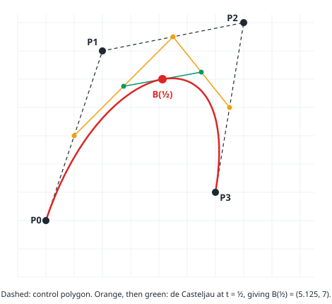
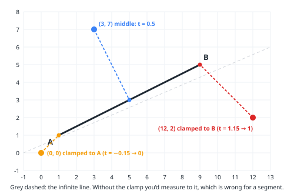
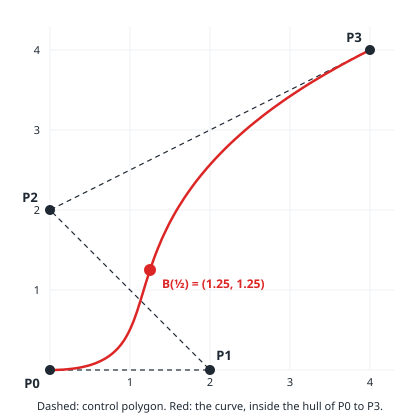

# Curves 4: de Casteljau, Splitting and Drawing with Lines

de Casteljau's algorithm finds a Bézier point by repeated line steps, and the same steps split the curve so it can be drawn with lines.

## Before you start
<!-- bite: 5e87a314-f986-4d38-9d66-0904a266c15e -->

You can build a Bézier point in layers ([[computer-graphics/16-curves-2|Curves 2]]), evaluate a cubic and its end velocities ([[computer-graphics/17-curves-3|Curves 3]]), and use the dot product ([[computer-graphics/13-vectors-3|Vectors 3]]).

**After this note you will be able to:**
1. Run de Casteljau by hand and read off the control points of each half.
2. Find the distance from a point to a line segment, with the clamp.
3. Draw a quadratic Bézier with straight lines to a given tolerance, and say how many lines it needs.

## What de Casteljau's algorithm is
<!-- bite: e8441ca7-bed6-4040-9b14-5951ce163c4f -->

de Casteljau's algorithm is the "lerp of lerps" from [[computer-graphics/15-curves-1|Curves 1]], done properly for any number of control points. It's how computers work out Bézier points, because it needs nothing but the line formula.

It also does something the formula can't: as a side effect, it **splits** the curve into two smaller Bézier curves. That's the key to drawing curves on a screen, which can only draw pixels and straight lines. Split the curve until each piece is nearly straight, then draw each piece as a line.

## de Casteljau and splitting
<!-- bite: 496749cc-a816-47b3-b7de-c74d6e9031cb -->

**To find $B(t)$, repeatedly take points a fraction $t$ of the way along each segment:**

$$P_i^{\,r} = (1-t)P_i^{\,r-1} + tP_{i+1}^{\,r-1},\qquad P_i^{\,0} = P_i,\qquad B(t) = P_0^{\,n}$$

It forms a triangle of points; the one at the bottom is $B(t)$. **It is numerically stable and needs only interpolation** — no powers of $t$.
The pictures for this come with the worked example below: the triangle of points is the orange and green levels there.

## Splitting a Bézier curve with de Casteljau
<!-- bite: b89c208f-a6a3-44d2-9b37-4c187b9f8113 -->

**Splitting.** The part of the curve for $t \in [0, s]$ is itself a cubic Bézier. **Its control points are the left edge of the de Casteljau triangle at $t = s$**: $P_0^0, P_0^1, P_0^2, P_0^3$. The second part uses the right edge, read from the bottom up.

**For $s = \tfrac12$ — the "first half" $B_1(t) = B(t/2)$:**

$$Q_0 = P_0,\quad Q_1 = \frac{P_0 + P_1}{2},\quad Q_2 = \frac{P_0 + 2P_1 + P_2}{4},\quad Q_3 = \frac{P_0 + 3P_1 + 3P_2 + P_3}{8}$$

and the second half has control points $Q_3$, $\frac{P_1 + 2P_2 + P_3}{4}$, $\frac{P_2 + P_3}{2}$, $P_3$. **It is still a cubic because replacing $t$ by $t/2$ in a degree-3 polynomial gives another degree-3 polynomial.**
## Worked (b): de Casteljau at t = 1/2
<!-- bite: 537edf1f-0c91-4391-91ff-1035a316211b -->

| Level | Points |
|---|---|
| 0 | (1,2), (3,8), (8,9), (7,3) |
| 1 | (2,5), (5.5,8.5), (7.5,6) |
| 2 | (3.75,6.75), (6.5,7.25) |
| 3 | **(5.125, 7)** |

**$B(\tfrac12) = (5.125, 7)$.** First half's control points (first point of each level): $(1,2), (2,5), (3.75,6.75), (5.125,7)$. Second half (last point of each level, bottom up): $(5.125,7), (6.5,7.25), (7.5,6), (7,3)$. End tangents: $B'(0) = 3(P_1 - P_0) = (6,18)$, $B'(1) = 3(P_3 - P_2) = (-3,-18)$.

Check with the formula: $\frac{(1,2) + 3(3,8) + 3(8,9) + (7,3)}{8} = \frac{(41, 56)}{8} = (5.125, 7)$. ✓
## Seeing de Casteljau at t = ½
<!-- bite: 5ca513ac-95ef-4507-900b-5c1c39139d4b -->

Here is the same curve. Halfway along each dashed side of the control polygon gives the orange points. Halfway along the orange lines gives the green points. Halfway along the green line is B(½), and it sits right on the red curve.


## Bézier runnable check
<!-- bite: 1e8f5b05-355e-421d-8986-f167bfe2dc70 -->

```python
# bezier.py — run: python3 bezier.py
def lerp(a, b, t):
    return tuple((1 - t) * x + t * y for x, y in zip(a, b))

def de_casteljau(points, t):
    """Return all levels of the de Casteljau triangle; the last level is B(t)."""
    levels = [list(points)]
    while len(levels[-1]) > 1:
        prev = levels[-1]
        levels.append([lerp(prev[i], prev[i + 1], t) for i in range(len(prev) - 1)])
    return levels

levels = de_casteljau([(1, 2), (3, 8), (8, 9), (7, 3)], 0.5)
for level in levels:
    print(level)
first_half = [level[0] for level in levels]
second_half = [level[-1] for level in reversed(levels)]
print("first half:", first_half)
print("second half:", second_half)
```

**Expected:** the four levels in the table above, then `first half: [(1, 2), (2.0, 5.0), (3.75, 6.75), (5.125, 7.0)]` and `second half: [(5.125, 7.0), (6.5, 7.25), (7.5, 6.0), (7, 3)]`.
## 8. Drawing a curve with straight lines
<!-- bite: 7e20f6fc-4e7e-4193-ae80-dbb3274fcf8a -->

A screen can draw straight lines fast ([[computer-graphics/05-line-drawing-and-antialiasing-3|Bresenham]]), so the plan is: split the curve until each piece is close enough to straight, then draw each piece as a line. "Close enough" needs a way to measure how far a point is from a line segment, which comes first.

## Distance from a point to a segment
<!-- bite: c34971d1-ca83-4957-9075-5b1b499c7967 -->

**Assumptions:** 2D Euclidean space; segment from $A$ to $B$; point $P$; $A \ne B$ (if $A = B$, the distance is $|P - A|$).

1. Let $\vec{AB} = B - A$ and $\vec{AP} = P - A$.
2. **Project $P$ onto the line through $A$ and $B$:** $t = \frac{\vec{AP}\cdot\vec{AB}}{\vec{AB}\cdot\vec{AB}}$. $t = 0$ is $A$, $t = 1$ is $B$.
3. **A segment stops at its ends, so clamp $t$ to $[0, 1]$.**
4. The closest point is $C = A + t\,\vec{AB}$; the distance is $|P - C|$.

$$t = \frac{(P - A)\cdot(B - A)}{(B - A)\cdot(B - A)},\qquad C = A + \operatorname{clamp}(t, 0, 1)\,(B - A),\qquad d = \lVert P - C\rVert$$

Three cases: nearest to $A$ ($t \le 0$), nearest to $B$ ($t \ge 1$), or the perpendicular foot in between.
## Worked: distance to the segment A(1,1) to B(9,5)
<!-- bite: ee94b334-705a-4536-b8f2-b16e469e9870 -->

**Worked — segment $A(1,1)$ to $B(9,5)$**, $\vec{AB} = (8,4)$, $|\vec{AB}|^2 = 80$:

| P | t | Clamped | Closest point | Distance |
|---|---|---|---|---|
| (3,7) | 0.5 | 0.5 | (5,3) | $\sqrt{20} = 4.472$ |
| (12,2) | 1.15 | 1 | B (9,5) | $\sqrt{18} = 4.243$ |
| (0,0) | −0.15 | 0 | A (1,1) | $\sqrt2 = 1.414$ |

**Rows 2 and 3 are why the clamp matters:** without it you measure to the infinite line, which is wrong for a segment. (Also: $A = (0,0)$, $B = (4,0)$ gives 1 for $(1,1)$, 5 for $(-3,4)$, and 5 for $(7,4)$.)
## Seeing the three cases
<!-- bite: 7365e27d-2366-4328-add5-18d077382468 -->

The three points from the table. (3, 7) drops onto the middle of the segment. (12, 2) and (0, 0) would land on the line beyond the ends, so the clamp moves them to B and A.


## Flattening a quadratic Bézier to a tolerance
<!-- bite: a458c184-1cf0-4c2b-b040-177931058bb9 -->

**Split the curve until each piece is nearly straight, then draw each piece as a line.** The quadratic's furthest point from its chord $P_1P_3$ is at $t = \tfrac12$, where the tangent is parallel to the chord. That point is $M = (P_1 + 2P_2 + P_3)/4$.

```text
draw_bezier(P1, P2, P3, sigma):
    M = (P1 + 2*P2 + P3) / 4
    if distance(M, segment P1P3) <= sigma:     # the point-to-segment routine above
        draw_line(P1, P3)                      # flat enough
    else:                                      # de Casteljau split at t = 1/2
        A = (P1 + P2) / 2
        B = (P2 + P3) / 2
        draw_bezier(P1, A, M, sigma)           # first half
        draw_bezier(M, B, P3, sigma)           # second half
```
## Flatness, and a worked flattening
<!-- bite: 11cfc308-b377-40e0-8a13-a202f818bc37 -->

**The flatness (maximum distance from the chord) is**

$$\delta = \frac{|P_1 - 2P_2 + P_3|}{4}$$

and **each split in half divides it by 4**, so the recursion always stops. (Equivalently, it is half the distance of $P_2$ from the chord's line — another common flatness test.)

**Worked:** $P_1(0,0)$, $P_2(4,8)$, $P_3(8,0)$. $P_1 - 2P_2 + P_3 = (0,-16)$, so $\delta = 16/4 = 4$ (indeed $P(\tfrac12) = (4,4)$ and the chord midpoint is $(4,0)$). For $\sigma = 0.25$: $4 \to 1 \to 0.25$, **two levels of splitting, giving 4 straight segments.**
## Seeing a flattening
<!-- bite: 1d699486-8335-49e8-b995-0fab355d2715 -->

The picture for flattening is a curve split in half at $t = \tfrac12$, which is exactly the de Casteljau picture above: each half is a smaller Bézier, closer to straight than the whole. Flattening just keeps splitting until the flatness is under $\sigma$.

## Common pitfalls
<!-- bite: 8d166a19-8813-443e-b093-5ae50f55d150 -->

1. **Reading the second half from the wrong edge** of the de Casteljau triangle. The first half is the first point of each level; the second half is the last point of each level, from the bottom up.
2. **Not clamping $t$** in the point-to-segment distance, so you measure to the endless line.
3. **Mixing $P_0$–$P_3$ with $P_1$–$P_4$ labels** mid-question. The flattening routine uses $P_1, P_2, P_3$ for a quadratic; say which labels you're using.

## Check your understanding
<!-- bite: d91ab5bf-27a1-43ed-a1df-1cbf954c0c7c -->

Try each one before you open the answer.

1. <!-- q: exact id="3a5929ee" answer="4" accept="four" -->
   How many line segments does flattening need for a quadratic with δ = 8 at tolerance σ = 0.5?

   <details><summary>Answer</summary>

   8 → 2 → 0.5: two levels of splitting, 4 segments. Each split divides the flatness by 4.

   </details>

2. <!-- q: mcq id="96d71fc8" -->
   You split a cubic Bézier at t = ½ with de Casteljau. Where are the first half's control points?

   - [x] The first point of each level of the triangle
   - [ ] The last point of each level
   - [ ] The middle point of each level

   <details><summary>Answer</summary>

   The first point of each level, read top to bottom (the left edge). The second half uses the last point of each level, read from the bottom up.

   </details>

3. <!-- q: mcq id="47572f9a" -->
   In the distance from a point to a segment, t comes out as 1.4. What do you do?

   - [ ] Use t = 1.4: the closest point is past B
   - [x] Clamp it to 1: the closest point is B itself
   - [ ] Clamp it to 0

   <details><summary>Answer</summary>

   Clamp it to 1. A segment stops at B, so the closest point on it is B. Without the clamp you'd measure to the endless line instead.

   </details>

4. <!-- q: open id="ea343067" -->
   Why does the recursive flattening always stop?

   <details><summary>Answer</summary>

   Because each split in half divides the flatness δ by 4. However big δ starts, after enough splits it falls below any tolerance σ > 0, and then each piece is drawn as one line.

   </details>

## Check your understanding: worked problems
<!-- bite: e3636d37-9bdd-4ff0-ae7f-2b5fb37958c4 -->

Work each one out on paper first, then type your answer.

1. <!-- q: exact id="cccf71ee" answer="3" -->
   A quadratic Bézier has P₁(0, 0), P₂(2, 6), P₃(4, 0). What is its flatness δ = |P₁ − 2P₂ + P₃| / 4?

   <details><summary>Answer</summary>

   3. P₁ − 2P₂ + P₃ = (0, −12), and 12/4 = 3.

   </details>

2. <!-- q: exact id="b1c4e7a2" answer="7" -->
   What is the distance from P = (4, 7) to the segment from A = (0, 0) to B = (8, 0)?

   <details><summary>Answer</summary>

   7. t = ((4, 7) · (8, 0)) / 64 = 0.5, so the closest point is (4, 0), and the distance is 7.

   </details>

3. <!-- q: sketch id="d06e63b4" -->
   Sketch the cubic Bézier with P0(0, 0), P1(2, 0), P2(0, 2), P3(4, 4). Draw the control polygon first, mark B(½), and show the direction the curve leaves P0 and arrives at P3.

   <details><summary>Answer</summary>

   

   What to check:
   - B(½) = (P0 + 3P1 + 3P2 + P3)/8 = (10, 10)/8 = (1.25, 1.25).
   - The curve leaves P0 along P0→P1 (to the right) and arrives at P3 along P2→P3.
   - It passes through P0 and P3 only, and stays inside the control polygon's hull.

   </details>

4. <!-- q: points id="ceb559fe" xmin="-0.5" xmax="4.5" ymin="-0.5" ymax="4.5" step="0.5" snap="0.25" answer="1,0.5 1.5,2 1.25,1.25" labels="R0,R1,B(½)" tolerance="0.15" ghost="0,0 2,0 0,2 4,4" -->
   The control points P0(0, 0), P1(2, 0), P2(0, 2), P3(4, 4) are shown faintly. Run de Casteljau at t = ½. Place the two second-level points R0 and R1, then B(½).

   <details><summary>Answer</summary>

   The first level is the midpoints (1, 0), (1, 1) and (2, 3). The second level is R0 = (1, 0.5) and R1 = (1.5, 2). Their midpoint is B(½) = (1.25, 1.25), which matches (P0 + 3P1 + 3P2 + P3)/8.

   </details>

## Practice — independent tasks
<!-- bite: 208958e3-ec15-47ee-a2e3-6169d88ea0d2 -->

From SSG 511 — full wording in the [[computer-graphics/32-ssg-511-question-bank|question bank]]:

1. **Exam Q1(c), last part** — the first half's control points for the particle from $(0,0,0)$ to $(4,0,2)$ (the first parts are in [[computer-graphics/17-curves-3|Curves 3]]).
2. **B-9** — $P_0(0,0)$, $P_1(2,0)$, $P_2(0,2)$, $P_3(4,4)$: sketch, de Casteljau $B(\tfrac12)$, sketch the curve with end slopes.
3. **B-10** — the 2D particle with velocities $(6,0)$ and $(-12,0)$, including the second half's control points.
4. **Supplementary 4–5** — point-to-segment distance, and flattening.

**Done when** each $B(\tfrac12)$ agrees between the formula and de Casteljau, and the `bezier.py` script reproduces your halves.

## Before moving on
<!-- bite: 870db173-9d38-44cb-95a9-53fecaf028cd -->

You can run de Casteljau, read off both halves, measure a point's distance to a segment with the clamp, and flatten a quadratic to a tolerance. **Next:** [[computer-graphics/19-curves-5|Curves 5: B-splines and Other Curve Families]]. Every Bézier so far had one big problem: move any control point and the whole curve moves. Part 5 fixes that for long curves, and meets the curves that pass through every point.

## Related
<!-- bite: 3fb80f5f-bf51-4233-9def-28e2d9e1f10f -->
- [[computer-graphics/17-curves-3|Curves 3]] — the cubic and its end conditions
- [[computer-graphics/19-curves-5|Curves 5]] — B-splines and other curve families
- [[computer-graphics/10-clipping|Clipping]] — curve clipping with the convex hull and de Casteljau splits
- [[computer-graphics/28-geometry-and-meshes|Geometry and Meshes]] — NURBS, subdivision surfaces, the CAD divide
- [[computer-graphics/index|Computer graphics map]]

## About this lesson
<!-- bite: 83ba19b6-0a4c-48c7-96d1-bcc957466766 -->

**Level:** Intermediate → Advanced. **Covers:** de Casteljau's algorithm and splitting a Bézier; the de Casteljau worked example and its runnable check; the distance from a point to a segment; and drawing a quadratic Bézier with straight lines to a tolerance.

Part 4 of 5 on curves, in Part 1 of the course. [[computer-graphics/28-geometry-and-meshes|Note 28]] gives the big picture (NURBS, subdivision surfaces, CAD versus real-time). **This part and part 3 are the hand-calculation version that SSG 511 Q1(c) is worth 15 marks on.** This was the single curves note until November 2026; it keeps that note's id, and the other parts were split out of it.
