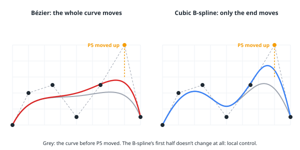
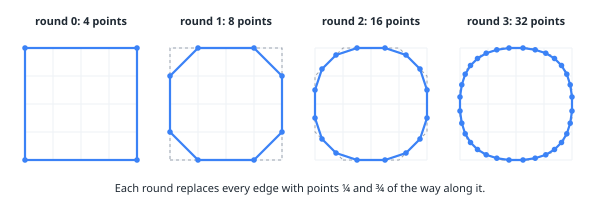
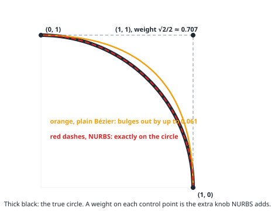

# Curves 5: B-splines and Other Curve Families

A B-spline is a chain of curve pieces joined smoothly, so you can have many control points and moving one only changes the curve nearby.

## Before you start
<!-- bite: 4679eb30-d914-4b7a-a33a-5a09159c9639 -->

You can write a Bézier curve as a weighted sum of its control points ([[computer-graphics/16-curves-2|Curves 2]]), and you know that moving any one of its control points changes the whole curve.

**After this lesson you will be able to:**
1. Explain local versus global control, and what the B-spline knot vector does.
2. Run one round of Chaikin's corner cutting by hand.
3. Name the other common curve families, and sort them into curves that are pulled toward their points and curves that pass through them.

## What this lesson is about
<!-- bite: c615fe7b-2758-4997-a988-3ce26eb6387e -->

A Bézier curve has two limits. **Its degree grows with its control points**: 20 points means a degree-19 polynomial, which is slow and hard to control. And **moving any one control point changes the whole curve**. For a long path, like the outline of a car or a road in a game, both are a problem.

Beside Bézier curves, graphics has a whole family of other curve types that fix one problem or another. B-splines come first, because they fix both.

## Terms used in B-splines
<!-- bite: d588a584-e262-4a4b-8856-50dd855d03b1 -->

1. **Convex hull**: This is the smallest convex shape containing all the control points — the shape a rubber band makes when stretched around them.
2. **Knot vector**: This is the list of non-decreasing numbers $t_0 \le t_1 \le \dots$ that marks where a B-spline's polynomial pieces join.
3. **Order**: This is a B-spline's degree plus 1, written $k$.
4. **Local control**: This is the property that moving one control point only changes the nearby part of the curve.
5. **Approximating and interpolating**: An approximating curve is pulled toward its points; an interpolating curve passes through them.

## 6. B-spline curves
<!-- bite: 70b66c7c-1eca-4bd4-957d-0b4e1261bc7c -->

**A B-spline is built from several polynomial pieces joined smoothly.** It is more flexible than a Bézier curve because **the degree does not have to grow with the number of control points.** It is a weighted sum of the control points with B-spline basis functions $N_{i,k}(t)$:

$$C(t) = \sum_{i=0}^{n} P_i\,N_{i,k}(t),\qquad t_{k-1} \le t \le t_{n+1},\qquad n \ge k - 1$$

- There are $n + 1$ control points. **$k$ is the order, and the degree is $k - 1$.**
- **The knot vector** $t_0 \le t_1 \le \dots \le t_{n+k}$ marks where the pieces join.
## The B-spline basis functions (Cox–de Boor)
<!-- bite: 3709572f-2787-4858-8c4d-2d676629765c -->

- **The basis functions come from the Cox–de Boor recursion.** In words: order-1 functions are "1 on their own knot interval, 0 elsewhere", and each higher order blends two neighbouring lower-order functions with linear ramps:

$$N_{i,1}(t) = \begin{cases} 1 & t_i \le t < t_{i+1} \\ 0 & \text{otherwise}\end{cases}$$

$$N_{i,k}(t) = \frac{t - t_i}{t_{i+k-1} - t_i}\,N_{i,k-1}(t) + \frac{t_{i+k} - t}{t_{i+k} - t_{i+1}}\,N_{i+1,k-1}(t)$$

(A term with a zero denominator is taken as 0.)
## Properties of B-splines
<!-- bite: 5f47c619-e8cc-4c38-aa74-07ab9da287d1 -->

What follows from that definition:

- **The maximum order is the number of control points** ("the number of vertices defining the B-spline polygon"). **With that order and suitable knots, the B-spline is a Bézier curve.**
- **Local control:** $N_{i,k}$ is non-zero only on $[t_i, t_{i+k})$, so moving $P_i$ changes only that stretch.
- The basis functions are never negative and sum to 1, so **the curve stays inside the convex hull** of its control points.
- **With distinct knots the curve has continuity $C^{k-2}$.** A cubic B-spline ($k = 4$) is smooth up to the second derivative — why it is the default in modelling tools.
## Seeing local control
<!-- bite: 0780b1ca-b922-49d6-81b5-5578a2571b9c -->

The same seven control points drive both curves. Move P5 up and the whole Bézier curve shifts, while the B-spline only changes near P5. Its left half stays exactly where it was.

## Bézier vs B-spline
<!-- bite: ab5804bf-06c0-432a-b459-7f13ed84d9a9 -->

| | Bézier | B-spline |
|---|---|---|
| Degree | Number of control points − 1 | Chosen separately (order $k$) |
| Control | **Global** — one point moves the whole curve | **Local** — one point moves part of it |
| Extra ingredient | None | A knot vector |
| Relationship | | A Bézier is a B-spline with order = number of control points |
## 7. Chaikin's corner-cutting algorithm
<!-- bite: 604e6453-ce43-41b4-a133-6f92a0da6233 -->

> Class notes only have the heading "curve drawing algorithm: George Chaikin's algorithm"; this is the standard method — **check it against the lecturer's version.**

**Start with a polygon $P_0, \dots, P_n$. For each edge $P_iP_{i+1}$, make two new points a quarter and three-quarters of the way along:**

$$Q_i = \tfrac34P_i + \tfrac14P_{i+1},\qquad R_i = \tfrac14P_i + \tfrac34P_{i+1}$$

Replace the polygon with $Q_0, R_0, Q_1, R_1, \dots$ and repeat. **Each round cuts the corners off, and the polygon converges to a smooth quadratic B-spline.**

**Worked — the closed square $(0,0), (4,0), (4,4), (0,4)$:** after one round the 4 points become 8: $(1,0), (3,0), (4,1), (4,3), (3,4), (1,4), (0,3), (0,1)$. After the next round there are 16.
## Seeing Chaikin rounds
<!-- bite: b226e5a4-4b81-4f56-aa38-3fd63e56d9b0 -->

Starting from the square, each round cuts every corner off. After three rounds the 32 points already look like a smooth rounded shape.

## NURBS: weights on the control points
<!-- bite: 7f33948c-8232-4446-88e2-8da367b19ea4 -->

**NURBS** are B-splines with a **weight** on each control point. The letters stand for non-uniform rational B-splines: "non-uniform" because the knots can be unevenly spaced, and "rational" because the formula divides by the sum of the weights. A bigger weight pulls the curve harder toward that point.

## Seeing NURBS make a circle
<!-- bite: 43c121e9-dcea-4a5f-bec2-225579cb06a2 -->

The weights buy one thing ordinary Béziers and B-splines can't do: **exact circles and arcs**. A plain quadratic Bézier from $(1, 0)$ through the corner $(1, 1)$ to $(0, 1)$ bulges up to 0.061 outside the true quarter circle. Give the corner a weight of $\sqrt2/2 \approx 0.707$ and it lands exactly on the circle:

That's why NURBS are the standard in **CAD** and 3D modelling tools, where a hole has to be exactly round → [[computer-graphics/28-geometry-and-meshes|note 28]].

## Curves that pass through their points
<!-- bite: 014983e6-da2e-4091-926d-51687b1dcbb6 -->

Béziers and B-splines are **pulled toward** their control points. Sometimes you want the opposite: a curve that goes **through** every point you give it, like a camera path through the spots you clicked. Three families do that:

1. **Catmull–Rom splines** pass through every point you give them. Each piece between two points uses the points on either side to set its direction. Handy for animation and camera paths.
2. **Hermite curves** are defined by two end points plus the direction (tangent) at each end, instead of control points. A cubic Bézier is a Hermite curve in disguise: $P_1$ and $P_2$ are the end tangents divided by 3, exactly the end conditions of [[computer-graphics/17-curves-3|Curves 3]].
3. **Polynomial interpolation (Lagrange)** forces one single curve through all the points. It works for a few points, but with many it can wiggle wildly between them.

## Seeing the curve families
<!-- bite: 89707d3f-af44-4d0f-a8d3-febd9bd948f8 -->

Look at the Lagrange panel: the data is flat except one bump, and the curve still overshoots below zero between the flat points. That wiggle is why nobody draws long paths with one big polynomial; they chain small pieces, which is the B-spline and Catmull–Rom idea.

## Pulled toward, or passing through
<!-- bite: 2bd92019-9a4f-4f54-994a-25a80592118b -->

The main difference to remember:

| Family | Through its points? | Used for |
|---|---|---|
| Bézier | First and last only; pulled toward the rest | Fonts, SVG, design tools, easing |
| B-spline | Pulled toward them; local control | Modelling long smooth curves |
| NURBS | Like B-splines, with weights | CAD, exact circles and arcs |
| Catmull–Rom | Through every point | Animation and camera paths |
| Hermite | Through both ends, with set end directions | Joining curves smoothly, animation |
| Lagrange | Through every point, but wiggles | A few points only |

A one-sentence version for an exam: **Bézier curves and B-splines approximate their control points (the points pull the curve), while Catmull–Rom and Lagrange curves interpolate them (the curve passes through every point).**

## Common pitfalls
<!-- bite: b852da62-cb0d-47a3-9679-53fe2d9b0b39 -->

1. **Expecting a B-spline to pass through its control points.** Like a Bézier, it is pulled toward them.
2. **Forgetting the knot vector** when asked what a B-spline needs that a Bézier doesn't.
3. **Using one high-degree polynomial through many points.** It wiggles. Chain pieces instead.
4. **Mixing up the two Chaikin points.** $Q_i$ is a quarter of the way from $P_i$; $R_i$ is three-quarters.

## Check your understanding
<!-- bite: 8f22eefc-ae6f-4ac2-aaf5-4fbcfeae1076 -->

Try each one before you open the answer.

1. <!-- q: mcq id="b3dc0668" -->
   You move one control point of a long Bézier curve. What happens?

   - [ ] Only the nearby part of the curve changes
   - [x] The whole curve changes (global control)

   

Answer

   The whole curve changes. B-splines fix this with local control.

   

2. <!-- q: open id="9b6e2194" -->
   Why does moving one control point of a cubic B-spline with many points leave most of the curve unchanged?

   

Answer

   Each basis function is non-zero only over k knot intervals, so each control point's weight is zero elsewhere.

   

3. <!-- q: mcq id="1f2a6c3e" -->
   Which curve family is used in CAD because it can draw an exact circle?

   - [ ] Catmull–Rom
   - [x] NURBS
   - [ ] Lagrange

   

Answer

   NURBS. The weight on each control point lets it make exact circles and arcs, which plain Béziers and B-splines can only approximate.

   

4. <!-- q: mcq id="4b9d0e71" -->
   You want a camera path that passes through every point a designer clicks. Which family fits?

   - [ ] Bézier
   - [ ] B-spline
   - [x] Catmull–Rom

   

Answer

   Catmull–Rom, which passes through every point. Bézier and B-splines are only pulled toward their points.

   

5. <!-- q: gap id="8e3c51d7" answers="Hermite" -->
   Fill in the gap. A curve defined by two end points and the direction at each end is a ___ curve.

   

Answer

   Hermite. A cubic Bézier is a Hermite curve in disguise, with P₁ and P₂ set by the end directions divided by 3.

   

## Check your understanding: worked problems
<!-- bite: 98c5adad-f466-47a9-b7fe-71d95363024c -->

Work each one out on paper first, then type your answer.

1. <!-- q: gap id="5d7e2a90" answers="1;0;3;0" -->
   Fill in the gaps. One round of Chaikin on the edge from (0, 0) to (4, 0) gives Q = (___, ___) and R = (___, ___).

   

Answer

   Q = ¾(0, 0) + ¼(4, 0) = (1, 0). R = ¼(0, 0) + ¾(4, 0) = (3, 0).

   

2. <!-- q: exact id="a6f04c18" answer="24" -->
   A closed polygon has 6 corners. How many points does it have after two rounds of Chaikin's algorithm?

   

Answer

   24. Each round turns every edge into two points, doubling the count: 6 → 12 → 24.

   

3. <!-- q: exact id="c2e9b7d5" answer="4" -->
   A cubic B-spline (order k = 4) has 7 control points. Over how many knot intervals is each basis function non-zero?

   

Answer

   4. N_{i,k} is non-zero only on [t_i, t_{i+k}), which is k = 4 intervals, whatever the number of control points.

   

4. <!-- q: sketch id="e7b3f6a2" -->
   Draw the closed square (0, 0), (4, 0), (4, 4), (0, 4) and one round of Chaikin's corner cutting on it. Label the new points.

   

Answer

   

   What to check:
   - The 8 new points are (1, 0), (3, 0), (4, 1), (4, 3), (3, 4), (1, 4), (0, 3), (0, 1).
   - Each is a quarter or three-quarters of the way along an edge.
   - Joined in order they make an octagon: every corner of the square has been cut off.

   

## Practice — independent task
<!-- bite: 1159af80-6e84-4dfe-aaa4-7e41189a4383 -->

1. **Supplementary, Chaikin** — run two rounds by hand on the triangle $(0, 0)$, $(8, 0)$, $(4, 8)$, then write a Python function `chaikin(points, rounds)` for closed polygons. **Done when** your program prints the same 6 points after one round as your hand working, and 12 after two.
2. **The lecturer's version** — check §7 against the SSG 511 slides ([[computer-graphics/32-ssg-511-question-bank|question bank]]).

## Before moving on
<!-- bite: 5fe43261-f02d-4477-b290-87d71d9715e7 -->

You can explain local control and the knot vector, cut corners with Chaikin, and sort curve families into "pulled toward" and "passes through". **Next:** [[computer-graphics/20-visible-surface-detection|Visible Surface Detection]]. You can now draw lines, curves and filled shapes, and move them. With many shapes in a 3D scene, some hide others, so the last Part 1 question is which ones to draw.

## Related
<!-- bite: 0929ed5d-3add-478b-98d8-669b3f75e96e -->

- [[computer-graphics/15-curves-1|Curves 1]] — Bézier curves from straight lines
- [[computer-graphics/28-geometry-and-meshes|Geometry and Meshes]] — NURBS, subdivision surfaces, the CAD divide
- [[computer-graphics/29-animation-and-simulation|Animation]] — curves as motion paths
- [[mathematics/07-applied-and-computational/01-numerical-methods/06-interpolation-and-approximation|Interpolation and splines]]
- [[computer-graphics/index|Computer graphics map]]

## About this lesson
<!-- bite: 8453df20-acf4-48b9-9b1f-f5f2c9de4b36 -->

**Level:** Intermediate. **Covers:** why long curves need more than Bézier; B-splines, the knot vector and the Cox–de Boor recursion; local control; Chaikin's corner cutting; NURBS and exact circles; Catmull–Rom, Hermite and Lagrange curves; and approximating versus interpolating curves.

Part 5 of 5 on curves, in Part 1 of the course. The B-spline and Chaikin sections come from the earlier single curves note; the other curve families were added in November 2026 from the author's study conversation, where he asked what else there is beside Bézier.
