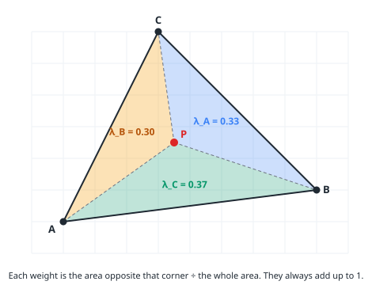

# Rasterisation

Rasterisation is turning shapes, almost always triangles, into pixels.

## What rasterisation is
<!-- bite: 74c62e87-05fa-4c95-a9c0-7b8f73269e5a -->

Rasterisation is turning shapes, almost always triangles, into the coloured pixels you see on the screen. Nearly every 3D game and app draws its pictures this way, many times every second.

Next: why triangles.

## Why triangles
<!-- bite: cd5da7cd-2ccd-4e68-b2c3-6a7fe3857b2c -->

**Everything is triangles**, and the reasons are all practical:

**Always planar.** Three points define a plane; four might not.

**Always convex.** No self-intersection, no ambiguous interior.

**Simple interpolation** — barycentric coordinates work directly.

**Any polygon decomposes into triangles**, and any surface approximates as a mesh.

**So hardware only has to do one thing well**, and it does.

## Finding covered pixels
<!-- bite: aada3ed4-bfb7-441f-8de6-ace2f36f4597 -->

**The naive approach — compute the triangle's bounding box, test every pixel inside it.**

**The test uses edge functions.** For an edge from $\mathbf{a}$ to $\mathbf{b}$ and a point $\mathbf{p}$:

$$E(\mathbf{p}) = (\mathbf{b}_x - \mathbf{a}_x)(\mathbf{p}_y - \mathbf{a}_y) - (\mathbf{b}_y - \mathbf{a}_y)(\mathbf{p}_x - \mathbf{a}_x)$$

**That's the 2D cross product — its sign tells you which side of the line $\mathbf{p}$ is on.**

> **A point is inside the triangle iff all three edge functions have the same sign.** Three cross products, three sign checks. **That's the entire coverage test.**
>
> **And it's incremental:** $E$ is linear, so stepping one pixel right adds a constant. **The inner loop is three additions and three sign tests** — which is why this maps so beautifully to hardware, and why Pineda's 1988 formulation replaced scanline algorithms ([[computer-graphics/09-circles-and-polygon-filling|note 09]] works the scan-line polygon fill by hand, and [[computer-graphics/03-line-drawing-and-antialiasing-1|notes 03–08]] the line algorithms that came before).

## How real hardware finds covered pixels
<!-- bite: 02af848c-7d24-4834-a679-cc1bea7242e0 -->

**Real hardware refines this:** tile-based traversal (test 8×8 blocks before individual pixels), hierarchical rejection, and **fragments processed in 2×2 quads** — because screen-space derivatives for texture filtering need neighbouring pixels. **That quad requirement is why a thin triangle wastes up to 75% of the shading work**, and it's a real cost of highly tessellated geometry.

## Barycentric coordinates
<!-- bite: bac1d020-90a4-478e-be27-cd8072fd8960 -->

**The edge functions give you interpolation for free.**

$$\mathbf{p} = \lambda_0\mathbf{v}_0 + \lambda_1\mathbf{v}_1 + \lambda_2\mathbf{v}_2, \qquad \lambda_0+\lambda_1+\lambda_2 = 1$$

**The $\lambda$ values are the normalised edge functions** — the areas of the sub-triangles.

**Interpolate any per-vertex attribute** — colour, normal, texture coordinates, anything:

$$\text{attr}(\mathbf{p}) = \lambda_0 a_0 + \lambda_1 a_1 + \lambda_2 a_2$$

## Seeing barycentric weights
<!-- bite: 6da40356-b3f1-45e7-b6d4-bf927c72dbc0 -->

Point P splits the triangle into three smaller ones. Each corner’s weight is the area of the triangle opposite it, divided by the whole. The nearer P is to a corner, the bigger that corner’s weight.



## Perspective-correct interpolation
<!-- bite: 451aa33d-f49b-4824-8adb-d3aad65e0ced -->

**The subtlety that produces a very recognisable bug if you miss it.**

**Linear interpolation in *screen* space is wrong**, because the perspective divide is nonlinear. A texture on a floor stretching to the horizon should compress with distance; naive interpolation spreads it evenly.

**The fix — interpolate attribute/$w$ and $1/w$ linearly, then divide:**

$$\text{attr} = \frac{\lambda_0 \frac{a_0}{w_0} + \lambda_1\frac{a_1}{w_1} + \lambda_2\frac{a_2}{w_2}}{\lambda_0\frac{1}{w_0} + \lambda_1\frac{1}{w_1} + \lambda_2\frac{1}{w_2}}$$

> **Why it works: $1/w$ *is* linear in screen space, even though $w$ isn't.** So you interpolate the things that are linear and divide at the end.
>
> **The classic symptom of getting this wrong is the original PlayStation's warping textures** — it had no perspective correction in hardware, and floor and wall textures visibly swim as the camera moves. **A very recognisable look, and now you know its cause.**

**Modern hardware does this automatically.** In GLSL, `noperspective` opts out; `flat` disables interpolation entirely (useful for integer IDs, which must not be interpolated).

## The z-buffer
<!-- bite: b85ff33d-fc80-41ac-97db-7b86b865d279 -->

**Solving visibility: which surface is nearest?**

```text
for each fragment:
    if depth < zbuffer[x][y]:
        zbuffer[x][y] = depth
        colour[x][y] = shaded_colour
```

**Per-pixel, order-independent, trivially parallel.** Catmull, 1974.

**Depth across a triangle is linear in screen space**, so it is stepped incrementally: from the plane $Ax + By + Cz + D = 0$, one pixel right changes $z$ by $-A/C$. **Depth conventions differ** — this pseudocode keeps the *smaller* $z$; many textbooks clear to 0 and keep the *larger*. Both are fine if consistent. The full family of visibility methods (back-face detection, painter's, BSP trees, Warnock, the scan-line method) is in [[computer-graphics/20-visible-surface-detection|note 20]].

## Why the z-buffer won
<!-- bite: 3de17100-b738-4d06-ba16-1fbd5c5b2f26 -->

> **The z-buffer won because it needs no sorting.** The alternative — the painter's algorithm, drawing back to front — **fails on mutually overlapping triangles**, where no valid order exists. And sorting is $O(n\log n)$ per frame with global knowledge, which is exactly what rasterisation is trying to avoid.
>
> **The cost is memory and bandwidth**, which was prohibitive in 1974 and is trivial now.

## Early-Z
<!-- bite: 170f8126-2ba3-4417-afd0-98a58cf6b4ec -->

**Early-Z** is the important optimisation: **test depth *before* running the fragment shader.** Rejected fragments cost nothing.

**But it's disabled if the shader writes `gl_FragDepth` or uses `discard`**, because the hardware can no longer know the depth in advance. **A single `discard` for alpha testing can therefore cost you a large fraction of your fill rate** — a real and non-obvious performance trap.

**A depth pre-pass** renders geometry depth-only first, then the real pass gets perfect early-Z rejection. **Worth it when shading is expensive.**

## Transparency
<!-- bite: dca3caf5-2a3f-4630-9243-acc77da5a887 -->

**The z-buffer's weakness, and it's fundamental.**

**Transparent surfaces must be blended in order**, because blending isn't commutative:

$$C = \alpha_{\text{src}}C_{\text{src}} + (1-\alpha_{\text{src}})C_{\text{dst}}$$

**So you must sort back-to-front** — reintroducing exactly the problem the z-buffer solved, and it fails on intersecting transparent geometry for the same reason the painter's algorithm did.

**The practical approaches:**

## Transparency: what most games do
<!-- bite: 6a2f3c12-bf56-4917-a1ea-f9c5bd6c8b51 -->

**Sort per object**, accept errors within objects. **What most games do**, and why transparent objects sometimes render in the wrong order.

**Alpha testing** — binary cut-out, no blending, works with the z-buffer. **Foliage and fences.** Costs early-Z.

**Order-independent transparency** — depth peeling (multiple passes), or weighted-blended OIT (an approximation in one pass). **Correct-ish, more expensive.**

**Premultiplied alpha** is worth adopting: store $(\alpha R, \alpha G, \alpha B, \alpha)$. **Blending becomes associative**, filtering doesn't produce dark fringes at edges, and compositing composes correctly. **It's simply the better representation** and the fringing artefact from non-premultiplied alpha is extremely common.

## Antialiasing
<!-- bite: a89e34ed-8a67-4b54-bd31-404edc29a4b5 -->

**A pixel is an area, not a point** — so a hard in/out coverage test aliases. → [[computer-graphics/21-how-rendering-works|Rendering as sampling]]

The classical, per-line methods — area sampling (Wu's lines), supersampling and pixel phasing — are in [[computer-graphics/08-line-drawing-and-antialiasing-6|note 08]]. The modern ones:

| Technique | How | Cost |
|---|---|---|
| **SSAA** | render bigger, downsample | **brutal** — 4× everything |
| **MSAA** | multiple *coverage/depth* samples, **one shading sample** | moderate |
| **FXAA/SMAA** | post-process edge detection and blur | **cheap**, blurry |
| **TAA** | accumulate over frames with jitter and motion vectors | **cheap, excellent — and ghosts** |
| DLSS/FSR | learned upscaling from a lower-resolution jittered render | needs hardware/model |

## Why MSAA, and why the industry moved to TAA
<!-- bite: c81254f5-b449-4829-b310-24ab54e77d3d -->

> **MSAA is the elegant one:** it recognises that **edge aliasing is a geometry problem, not a shading problem.** Sample coverage at 4 or 8 points per pixel but shade once — most of the quality of SSAA for a fraction of the cost.
>
> **It fails on deferred rendering** (the G-buffer would need multisampling throughout, which is prohibitive), and **doesn't help shader aliasing** — specular highlights and alpha-tested foliage still shimmer. **That's why the industry moved to TAA** despite its ghosting artefacts, and why upscalers like DLSS are essentially TAA with a learned reconstruction.

## Deferred shading
<!-- bite: 55fe9440-b8f1-4f4d-aa61-9e6fb4314dee -->

**A structural alternative worth knowing.**

**Forward rendering:** rasterise and shade in one pass. **Cost is $O(\text{objects} \times \text{lights})$**, and it wastes shading on fragments later overdrawn.

**Deferred:** rasterise into a **G-buffer** (position/depth, normal, albedo, roughness), then a second full-screen pass shades using it.

> **Cost becomes $O(\text{objects}) + O(\text{pixels}\times\text{lights})$** — **and shading happens exactly once per visible pixel**, which decouples light count from geometry complexity. **Hundreds of lights become feasible.**

## The costs of deferred shading
<!-- bite: 8e3e8a84-374a-4f07-9f29-098ccf2347e5 -->

**The costs:** heavy bandwidth (the G-buffer is several full-screen textures), **MSAA is impractical**, transparency needs a separate forward pass, and material variety is limited by what fits in the G-buffer.

**Forward+ / clustered forward** is the modern compromise: a depth pre-pass, then bin lights into screen-space tiles or 3D clusters so each fragment only evaluates nearby lights. **Keeps MSAA and material flexibility, scales to many lights.** This is what most current engines use.

## Practical notes
<!-- bite: 8fa2cda3-13f8-4073-a3ee-379200a32126 -->

**Cull before rasterising.** Frustum and backface culling are nearly free. → [[computer-graphics/22-the-transform-pipeline|Culling]]

**Minimise overdraw.** Draw roughly front-to-back for opaque geometry so early-Z rejects more; back-to-front for transparent.

**Avoid `discard` and depth writes in shaders** unless necessary — they disable early-Z.

**Watch for tiny triangles.** Quad-based shading means sub-pixel triangles waste up to 75% of their work. **This is why extreme tessellation has diminishing returns**, and what Nanite's software rasteriser for small triangles addresses.

## More practical notes on rasterisation
<!-- bite: 10dc988d-8d63-4c63-afb6-4ed0c12746e7 -->

**Batch draw calls.** Each has CPU overhead and a potential pipeline flush. Instancing, texture atlases, and indirect drawing.

**Use premultiplied alpha.**

**Profile with a graphics debugger** — RenderDoc is excellent and free. **It shows you every draw call, every bound resource, and the state of every buffer** — the equivalent of `perf` for rendering.

## Check your understanding
<!-- bite: f33796b2-71c7-463f-a552-c5a594d9b37b -->

Try each one before you open the answer.

1. <!-- q: mcq id="8d04277d" -->
   Why does hardware draw everything as triangles? Choose all that apply.

   - [x] A triangle is always planar
   - [x] A triangle is always convex
   - [x] Barycentric interpolation works directly
   - [ ] Triangles never need clipping

   <details><summary>Answer</summary>

   The first three, plus any polygon breaks into triangles. Triangles still get clipped at the near plane.

   </details>

2. <!-- q: gap id="741697cd" answers="three|3;same" -->
   Fill in the gap. A point is inside a triangle exactly when all ___ edge functions have the ___ sign.

   <details><summary>Answer</summary>

   Three, same. That's the entire coverage test: three cross products and three sign checks.

   </details>

3. <!-- q: mcq id="8022c3db" -->
   Floor textures on the original PlayStation visibly swim as the camera moves. Why?

   - [ ] It had no z-buffer
   - [x] It had no perspective-correct interpolation
   - [ ] Its textures had no mipmaps

   <details><summary>Answer</summary>

   No perspective correction. The fix is to interpolate attribute/w and 1/w linearly, then divide, because 1/w is linear in screen space.

   </details>

4. <!-- q: mcq id="d93fc923" -->
   A fragment shader uses `discard` for alpha-tested leaves. What does that cost?

   - [x] Early-Z is disabled, so hidden fragments get shaded anyway
   - [ ] Nothing
   - [ ] The leaves lose their colour

   <details><summary>Answer</summary>

   It disables early-Z, because the hardware can no longer know the depth in advance. That can cost a big share of your fill rate.

   </details>

5. <!-- q: open id="94cb021e" -->
   Why can't the z-buffer handle transparent surfaces the way it handles opaque ones?

   <details><summary>Answer</summary>

   Blending isn't commutative, so transparent surfaces must be blended in order, back to front. That reintroduces sorting, which is exactly what the z-buffer avoided, and it still fails on intersecting transparent geometry.

   </details>

---

## Related
<!-- bite: ec2e0843-63f7-43f2-bc13-92283344bc04 -->
- [[computer-graphics/24-shading-and-lighting|Shading and Lighting]] — computing the colour
- [[computer-graphics/26-the-gpu-graphics-pipeline|The GPU Graphics Pipeline]] — how this runs in hardware
- [[computer-graphics/22-the-transform-pipeline|The Transform Pipeline]] — what feeds this
- [[computer-graphics/20-visible-surface-detection|Visible Surface Detection]] — the classical visibility methods
- [[computer-graphics/03-line-drawing-and-antialiasing-1|Line Drawing]] — DDA and Bresenham, in six parts
- [[computer-graphics/index|Computer graphics map]]

## About this lesson
<!-- bite: 92422afb-8efb-4d6a-8e7d-fd92dfe64e79 -->

**Level:** Intermediate → Advanced. **Covers:** Turning triangles into pixels. Edge functions, the z-buffer, and why interpolation needs a perspective correction.
