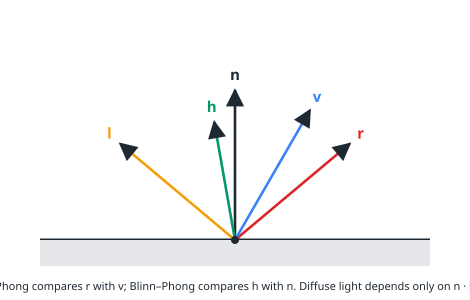

# Shading and Lighting

Shading is working out what colour each point on a surface should be.

## What shading is
<!-- bite: ec8ccb46-6eb0-43ca-93f4-779949ef6f12 -->

Shading is working out what colour each point on a surface should be, based on the lights in the scene, the material and where the viewer is standing. It is why a ball in a game looks round, with a bright side facing the light and a darker side away from it.

Next: the question shading answers.

## The question
<!-- bite: e8bd660b-b8af-4430-bab4-622341828736 -->

**Given a surface point, its normal, the light, and the viewer — what colour?**

**The answer is the rendering equation restricted to direct lighting:**

$$L_o = \sum_{\text{lights}} f_r(\omega_i, \omega_o)\, L_i\,(\omega_i\cdot\mathbf{n})$$

**Everything below is a choice of $f_r$** — the BRDF. → [[computer-graphics/21-how-rendering-works|The Rendering Equation]]

## The classical models
<!-- bite: cffeacd0-e0a7-4de0-8eed-fabe19b3e74a -->

**Lambertian (diffuse)** — light scatters equally in all directions:

$$L_o = \frac{\rho}{\pi}\,L_i\,\max(0, \mathbf{n}\cdot\mathbf{l})$$

> **The $\mathbf{n}\cdot\mathbf{l}$ term is the whole of basic shading**, and it's geometry rather than optics: **a surface at a glancing angle catches light spread over a larger area, so less lands per unit area.** Lambert's cosine law.

**Phong specular** — a highlight from the reflected direction:

$$L_{\text{spec}} = k_s\,(\mathbf{r}\cdot\mathbf{v})^{\alpha}$$

## Blinn–Phong
<!-- bite: 5a30264c-8f8e-44a0-9e1e-631f7e09652a -->

**Blinn–Phong** uses the halfway vector $\mathbf{h} = \frac{\mathbf{l}+\mathbf{v}}{\|\mathbf{l}+\mathbf{v}\|}$ instead — **cheaper and closer to measured reality** at grazing angles.

**Flat, Gouraud and Phong shading** are about *where* you evaluate, not which model:

| | Evaluated | Result |
|---|---|---|
| **Flat** | per triangle | faceted |
| **Gouraud** | per vertex, interpolated | **misses highlights inside triangles** |
| **Phong** | per fragment | correct, standard now |

**Gouraud's failure is visible:** a specular highlight falling in the middle of a large triangle disappears entirely, because it was never sampled at a vertex. **Per-fragment shading is standard now precisely because of this.**

## Seeing the shading vectors
<!-- bite: b334d566-540f-4748-b0ef-b154a72dbbbe -->

All the vectors the formulas use, at one surface point. Diffuse light only needs n and l. Phong’s highlight compares the reflection r with the view direction v; Blinn–Phong compares the halfway vector h with n.

## Physically based rendering
<!-- bite: 4fb52ffb-7ae1-49ae-934c-49ff3b9b68e7 -->

**The shift, roughly 2012 onwards, that made materials look consistent.**

> **The core idea: obey physics.** Energy conservation (a surface can't reflect more light than it receives), reciprocity, and parameters that describe *materials* rather than *appearance under this light*.
>
> **The practical payoff is enormous: an asset authored once looks right in every lighting environment.** Before PBR, artists tuned specular values per scene, and a model that looked good outdoors looked wrong indoors. **PBR decoupled material from lighting**, which is why it became universal so quickly.

**The metallic-roughness workflow** — the parameters you'll see everywhere:

| Parameter | Meaning |
|---|---|
| **Base colour / albedo** | diffuse colour (or specular tint, if metal) |
| **Metallic** | 0 = dielectric, 1 = metal. **Essentially binary** |
| **Roughness** | 0 = mirror, 1 = fully diffuse |
| **Normal map** | surface detail |
| **Ambient occlusion** | baked local shadowing |

## Metals and dielectrics
<!-- bite: 3eca88e5-a0aa-4852-a54d-c3ac61dafe7f -->

**Metals and dielectrics differ physically:** metals have no diffuse component (light is absorbed or reflected at the surface) and **tint their specular reflection**; dielectrics have white specular and coloured diffuse. **That's why metallic is nearly binary** — intermediate values are physically meaningless and used only for blending at material boundaries.

## The Cook–Torrance BRDF
<!-- bite: 570204b0-40f2-407c-a870-4fd6af3cc581 -->

**The microfacet model behind essentially every modern renderer.**

**The idea: a rough surface is a field of tiny perfect mirrors.** Roughness controls their distribution.

$$f_r = \underbrace{\frac{k_d\,c}{\pi}}_{\text{diffuse}} + \underbrace{\frac{D\,F\,G}{4(\mathbf{n}\cdot\mathbf{l})(\mathbf{n}\cdot\mathbf{v})}}_{\text{specular}}$$

**$D$ — normal distribution.** How many microfacets point toward $\mathbf{h}$. **GGX/Trowbridge–Reitz is the standard**, chosen over Beckmann for its longer tails — which match measured materials better and give the characteristic soft highlight falloff.

## Cook–Torrance: the Fresnel and geometry terms
<!-- bite: 86688a6f-5760-4677-b98a-3ee15058e690 -->

**$F$ — Fresnel.** Reflectance rises toward grazing angles.

> **Fresnel is why every surface becomes mirror-like at a glancing angle.** Look along a rough wooden table toward a window and you'll see a reflection you can't see looking straight down. **Schlick's approximation** — $F_0 + (1-F_0)(1-\cos\theta)^5$ — is cheap and accurate enough that it's universal.

**$G$ — geometry/shadowing.** Microfacets occluding each other at grazing angles. Smith's formulation is standard.

## Image-based lighting
<!-- bite: 41db191c-a211-4a01-b00a-3b147466f90e -->

**Real environments don't have three point lights.**

**IBL uses an environment map — a captured or rendered panorama — as the light source**, which is what makes PBR materials actually look right.

**Split into two precomputed pieces:**

**Irradiance map** — the diffuse contribution, convolved with a cosine lobe. **A tiny cubemap** (32×32 is plenty).

**Prefiltered environment map** — the specular contribution, with **roughness in the mip levels.** Rougher surfaces sample blurrier mips.

**Plus a BRDF lookup table**, precomputed once for all materials — the split-sum approximation from Epic's 2013 course notes, which is what made real-time IBL practical.

**HDR is essential here.** A light source is thousands of times brighter than a wall; **8-bit textures cannot represent that**, and clamping destroys the highlights that make reflections read as reflections.

## Shadows
<!-- bite: 2eddc275-54ee-4e40-b40b-818a75fe0eff -->

**Rasterisation's fundamental weakness** — a fragment can't see other geometry. → [[computer-graphics/21-how-rendering-works|How Rendering Works]]

**Shadow mapping** is the standard workaround:

1. **Render depth from the light's point of view**
2. **When shading, transform the fragment into light space and compare depths**
3. **Farther than the stored depth → in shadow**

**The problems, all of which have named workarounds:**

## Shadow problems: acne and peter-panning
<!-- bite: dda327f5-bd63-4064-9a66-5fd87bbc2069 -->

**Shadow acne** — self-shadowing from depth quantisation. **Fixed with a depth bias**, which causes **peter-panning** (shadows detaching from objects). **Normal-offset bias and slope-scaled bias** are better; front-face culling in the shadow pass helps.

**Aliasing** — the shadow map has fixed resolution. **Cascaded shadow maps** use several maps at different scales for the view frustum — **standard for directional lights and outdoor scenes.**

**Hard edges** — a real penumbra needs an area light. **PCF** (percentage-closer filtering) samples several depths and averages; **PCSS** varies the filter width by estimated blocker distance for contact-hardening.

## Shadows from point lights, and softer shadows
<!-- bite: d7c39e0b-922f-4fe2-9ba6-8a2364e0e4f5 -->

**Point lights need a cubemap** — six renders, or a geometry-shader trick.

**Ray-traced shadows** solve all of this correctly and cost a ray per light per pixel — **the first thing hardware ray tracing was used for**, because shadows are where rasterisation's approximations are most visible.

## Tone mapping and colour
<!-- bite: 5a54859a-5c15-4aee-8963-a027361260f9 -->

**The step people skip, and it's why renders look flat.**

**Rendering happens in HDR** — linear radiance values with no upper bound. **Displays take 8 bits in a nonlinear space.**

**Tone mapping compresses the range**, and it's a creative as well as technical choice. Reinhard, ACES (the film-industry standard, and a good default), and Uncharted 2's filmic curve.

> **Do all lighting maths in linear space.** Textures authored in sRGB **must be converted to linear before use**, and the result converted back for display.
>
> **Getting this wrong is extremely common and looks like "my renders are too dark and the highlights blow out."** The gamma curve is roughly $x^{2.2}$ — treating sRGB values as linear makes mid-tones far too dark and breaks every blend and interpolation.
>
> **Hardware does it for free:** use `GL_SRGB8_ALPHA8` texture formats and an sRGB framebuffer, and the conversions happen in the sampler and the output merger at no cost.

**Also: alpha and normal maps must NOT be sRGB-decoded.** They're data, not colour. **Tagging a normal map as sRGB is a subtle bug that produces slightly wrong lighting everywhere.**

## Normal and other maps
<!-- bite: adbc7c5a-8d83-4a9d-b598-c98613c375ba -->

**Normal mapping** — perturb the shading normal per-pixel from a texture. **Detail without geometry**, and it's the highest-value texture after albedo.

**Tangent space** is the usual encoding — normals relative to the surface, so the map works on a deforming or instanced mesh. Requires a tangent basis per vertex, and **mismatched tangent conventions between your modelling tool and renderer produce subtly wrong lighting** (MikkTSpace exists to standardise this).

**Parallax and displacement mapping** add apparent depth; displacement actually moves geometry.

**Ambient occlusion** — baked local shadowing, or computed in screen space (SSAO). **Cheap approximation of contact shadows**, and it does a lot of visual work for the cost.

## Practical notes
<!-- bite: 260ef79d-30b4-448f-90cf-309a72397c83 -->

**Work in linear space. Verify it.** Render a mid-grey and check the output value.

**Use HDR and tone map.** Without it, bright areas clip and the image looks washed out.

**Normalise your normals after interpolation** — barycentric interpolation of unit vectors doesn't give a unit vector.

**Use the halfway vector** (Blinn–Phong) over the reflection vector.

**Prefer PBR parameters** even in a toy renderer. **Energy conservation makes materials look right without tuning**, and it's less work, not more.

**Check for the classic tells:** shadow acne (bias), peter-panning (too much bias), dark mid-tones (gamma), blown highlights (no tone mapping), faceted surfaces (per-vertex shading or missing smooth normals).

**Debug by isolating.** Render normals as RGB, render albedo alone, render each BRDF term separately. **Almost every shading bug is visible in one channel.**

## Check your understanding
<!-- bite: 84fa6ef7-e86f-4161-b7ff-3f4a151132d1 -->

Try each one before you open the answer.

1. <!-- q: mcq id="517de56b" -->
   A surface is turned to a glancing angle from the light. Why does it look darker under Lambertian shading?

   - [x] The same light is spread over a larger area, so less lands per unit area (the n·l term)
   - [ ] The surface absorbs more light at an angle
   - [ ] The viewer is further away

   

Answer

   Lambert's cosine law. The n·l term is geometry, not optics.

   

2. <!-- q: mcq id="e0d93caa" -->
   A specular highlight falls in the middle of a large triangle and disappears. Which shading method causes that?

   - [ ] Flat shading
   - [x] Gouraud shading (lighting computed only at the vertices)
   - [ ] Per-fragment Phong shading

   

Answer

   Gouraud. The highlight was never sampled at a vertex, so interpolation can't produce it. That is why per-fragment shading is standard now.

   

3. <!-- q: gap id="e59cf122" answers="acne;peter-panning|peter panning|peterpanning" -->
   Fill in the gaps. Self-shadowing from depth quantisation is called shadow ___. Fixing it with too much depth bias makes shadows detach from objects, which is called ___.

   

Answer

   Shadow acne, then peter-panning. Normal-offset and slope-scaled bias are better fixes.

   

4. <!-- q: mcq id="041777cc" -->
   Your renders have dark mid-tones and blown-out highlights. What are the likely causes? Choose all that apply.

   - [x] sRGB textures treated as linear (no gamma conversion)
   - [x] No tone mapping from HDR to the display
   - [ ] Too many triangles

   

Answer

   Both. Do all lighting maths in linear space, and tone map the HDR result for display.

   

5. <!-- q: open id="ce6aee61" -->
   What was the practical payoff of physically based rendering (PBR)?

   

Answer

   An asset authored once looks right in every lighting environment. PBR obeys physics, such as energy conservation, and its parameters describe the material, not how it looks under one light. Before PBR, artists tuned specular values per scene.

   

---

## Related
<!-- bite: e16cd4d4-1255-443a-8017-cb13213373ae -->
- [[computer-graphics/25-textures-and-sampling|Textures and Sampling]] — where the material parameters come from
- [[computer-graphics/27-ray-tracing-and-path-tracing|Ray Tracing]] — solving the light transport properly
- [[computer-graphics/21-how-rendering-works|How Rendering Works]] — the rendering equation
- [[computer-graphics/index|Computer graphics map]]

## About this lesson
<!-- bite: e8c3871e-afcc-4f2a-8c6e-c95f1f53683b -->

**Level:** Intermediate → Advanced. **Covers:** What colour is this pixel? BRDFs, physically based rendering, and why everything got more consistent after 2012.
