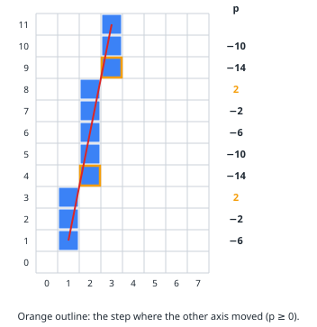
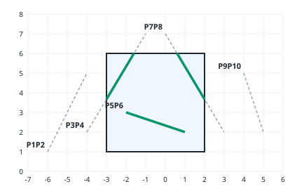

# SSG 511 Mock Exam 1: The 2025/26 Paper

This is the real 2025/2026 first-semester SSG 511 (Computer Graphics) exam, set out as a timed paper. Sit it like the real thing: closed book, on paper, with a calculator and graph paper, in one go.

**Instructions:** answer **Question 1 and any other three** questions. Question 1 carries 35 marks and the others 10 each, so the paper is out of 65 marks. Time allowed: **2 hours**. Draw neat diagrams where a question asks for one. The worked answers and marking scheme open after you submit; mark your own long answers against them honestly. (The app counts your best four questions, so answer Question 1: it is worth the most.)

## Question 1

### (a) Why line algorithms matter, and why Bresenham
<!-- q: open id="4cbead7e" marks="5" -->

Why are line and curve drawing algorithms important in computer graphics? State three reasons why Bresenham's algorithm is preferred over the digital differential analyser (DDA) for practical applications. (5 marks)

<details><summary>Solution</summary>

**Why they matter (2 marks).** A screen is a grid of pixels, so every straight edge, polygon outline, chart, font stroke and CAD drawing has to be turned into a set of pixels by a line or curve algorithm. They run millions of times a frame, so they must be both **accurate** (the pixels must sit as close to the true line as possible, with no gaps) and **fast**.

**Three reasons for Bresenham (1 mark each, any three):**

1. **Integer arithmetic only.** It uses only whole-number additions, subtractions and comparisons; DDA needs floating-point additions and a rounding at every step.
2. **No drift.** DDA adds a rounded fraction over and over, so rounding errors build up along a long line. Bresenham's decision parameter is exact, so the last pixel lands exactly on the end point.
3. **Faster and cheaper.** Integer adds are cheaper than floating-point adds and rounding, and the whole loop is simple enough to build into hardware.
4. **Always picks the nearer pixel.** Its decision is based on which of the two candidate pixels is closer to the true line.

**Revise:** [[computer-graphics/03-line-drawing-and-antialiasing-1|Line Drawing 1]], [[computer-graphics/04-line-drawing-and-antialiasing-2|Line Drawing 2]], [[computer-graphics/05-line-drawing-and-antialiasing-3|Line Drawing 3]].

</details>

### (b) Bresenham for slopes greater than one
<!-- q: open id="39b1e4b7" marks="15" -->

With illustration, derive an expression to execute Bresenham's algorithm with slope greater than one. Given two end points $A(1,1)$ and $B(3,11)$, construct a table and produce the plot to rasterise A and B. (15 marks)

<details><summary>Solution</summary>

**The derivation (8 marks).** For $m > 1$ the line rises faster than it runs, so **step in $y$** by 1 each time and decide whether $x$ moves.

1. **Set up (1 mark).** At pixel $(x_k, y_k)$, the next row is $y_k + 1$. The true line there is at $x = \dfrac{y_k + 1 - b}{m}$. The two candidates are $x_k$ (stay) and $x_k + 1$ (move right).
2. **The two distances (2 marks).** Draw the row $y_k + 1$ with the two candidate pixels and the true line crossing between them:
   $$d_1 = x - x_k = \frac{y_k + 1 - b}{m} - x_k,\qquad d_2 = (x_k + 1) - x = x_k + 1 - \frac{y_k + 1 - b}{m}$$
3. **The difference (1 mark).** $d_1 - d_2 = \dfrac{2(y_k + 1 - b)}{m} - 2x_k - 1$. If it is negative, the line is nearer $x_k$.
4. **Clear the fraction (2 marks).** Multiply by $dy$ (positive), using $m = dy/dx$:
   $$p_k = dy\,(d_1 - d_2) = 2dx\,y_k - 2dy\,x_k + c,$$ where $c$ collects the constants. $p_k < 0$: keep $x_k$; $p_k \ge 0$: move to $x_k + 1$.
5. **The update (1 mark).** $p_{k+1} - p_k = 2dx - 2dy\,(x_{k+1} - x_k)$, so $p_{k+1} = p_k + 2dx$ if $x$ stayed, and $p_{k+1} = p_k + 2dx - 2dy$ if $x$ moved.
6. **The start (1 mark).** At the first end point, $p_0 = 2dx - dy$.



**The table (4 marks).** $dx = 2$, $dy = 10$, so $2dx = 4$, $2dx - 2dy = -16$ and $p_0 = 4 - 10 = -6$.

| $k$ | $p_k$ | $x$ moves? | Next pixel | $p_{k+1}$ |
|---|---|---|---|---|
| start | | | (1, 1) | |
| 0 | −6 | no | (1, 2) | −6 + 4 = −2 |
| 1 | −2 | no | (1, 3) | −2 + 4 = 2 |
| 2 | 2 | yes | (2, 4) | 2 − 16 = −14 |
| 3 | −14 | no | (2, 5) | −10 |
| 4 | −10 | no | (2, 6) | −6 |
| 5 | −6 | no | (2, 7) | −2 |
| 6 | −2 | no | (2, 8) | 2 |
| 7 | 2 | yes | (3, 9) | −14 |
| 8 | −14 | no | (3, 10) | −10 |
| 9 | −10 | no | (3, 11) | −6 |

**The plot (3 marks).** The eleven pixels $(1,1), (1,2), (1,3), (2,4), (2,5), (2,6), (2,7), (2,8), (3,9), (3,10), (3,11)$, as in the picture.

**What to check in your drawing:**

- The illustration for the derivation shows one row $y_k + 1$, the two candidate pixels $x_k$ and $x_k + 1$, the true line between them, and $d_1$, $d_2$ marked.
- The table starts at $p_0 = -6$ and $x$ moves exactly twice, after $p = 2$ both times.
- The plot has 11 pixels, one in every row from $y = 1$ to 11, ending exactly on $(3, 11)$.

**Revise:** [[computer-graphics/06-line-drawing-and-antialiasing-4|Line Drawing 4: Bresenham for Steep Slopes]].

</details>

### (c)(i) The particle: equations and control points
<!-- q: open id="e2640fcc" marks="6" -->

A particle is animated in $\mathbb{R}^3$ so that it starts at $(0,0,0)$ at $t = 0$ and arrives at $(4,0,2)$ at $t = 1$. The initial velocity is $(6,0,0)$ and the final velocity is $(0,0,3)$. The motion is modelled with a degree-three Bézier curve $B(t)$. Derive the equations for computing the position and velocity of the particle, and give the control points $P_1$ and $P_2$. (6 marks)

<details><summary>Solution</summary>

**Position (2 marks).** $B(t) = (1-t)^3P_0 + 3t(1-t)^2P_1 + 3t^2(1-t)P_2 + t^3P_3$.

**Velocity (2 marks).** Differentiate: $B'(t) = 3\left[(1-t)^2(P_1 - P_0) + 2t(1-t)(P_2 - P_1) + t^2(P_3 - P_2)\right]$, so $B'(0) = 3(P_1 - P_0)$ and $B'(1) = 3(P_3 - P_2)$.

**Control points (2 marks).**

- $P_1 = P_0 + \tfrac13 B'(0) = (0,0,0) + \tfrac13(6,0,0) = (2, 0, 0)$.
- $P_2 = P_3 - \tfrac13 B'(1) = (4,0,2) - \tfrac13(0,0,3) = (4, 0, 1)$.

Putting them in: $x(t) = 6t - 2t^3$, $y(t) = 0$, $z(t) = 3t^2 - t^3$, and the velocity is $(6 - 6t^2,\ 0,\ 6t - 3t^2)$. Check: at $t = 0$ it is $(6,0,0)$, at $t = 1$ it is $(0,0,3)$.

**Revise:** [[computer-graphics/17-curves-3|Curves 3: The Cubic Bézier: Velocity and End Conditions]].

</details>

### (c)(ii) The position at t = ½
<!-- q: gap id="27f12cfa" marks="3" answers="2.75|11/4;0;0.625|5/8" -->

The same particle has control points $P_0 = (0,0,0)$, $P_1 = (2,0,0)$, $P_2 = (4,0,1)$ and $P_3 = (4,0,2)$. Find its position at $t = \tfrac12$. (3 marks)

$B(\tfrac12) = ($ ___ , ___ , ___ $)$

<details><summary>Solution</summary>

At $t = \tfrac12$ the cubic weights are $\tfrac18, \tfrac38, \tfrac38, \tfrac18$, so

$$B\!\left(\tfrac12\right) = \frac{P_0 + 3P_1 + 3P_2 + P_3}{8} = \frac{(0 + 6 + 12 + 4,\ 0,\ 0 + 0 + 3 + 2)}{8} = (2.75,\ 0,\ 0.625).$$

**Revise:** [[computer-graphics/17-curves-3|Curves 3]].

</details>

### (c)(iii) The first half as a Bézier curve
<!-- q: open id="420cad1a" marks="6" -->

The same particle has control points $P_0 = (0,0,0)$, $P_1 = (2,0,0)$, $P_2 = (4,0,1)$ and $P_3 = (4,0,2)$. The "first half" of the curve is $B_1(t) = B(t/2)$. Express $B_1(t)$ as a degree-three Bézier curve by giving its four control points. (6 marks)

<details><summary>Solution</summary>

Run de Casteljau at $t = \tfrac12$ and read down the left edge (1 mark for the method).

| Level | Points |
|---|---|
| 0 | (0,0,0), (2,0,0), (4,0,1), (4,0,2) |
| 1 | (1,0,0), (3,0,0.5), (4,0,1.5) |
| 2 | (2,0,0.25), (3.5,0,1) |
| 3 | (2.75,0,0.625) |

**The first half's control points (1 mark each, plus 1 for the working):**

$$Q_0 = (0,0,0),\quad Q_1 = (1,0,0),\quad Q_2 = (2,0,0.25),\quad Q_3 = (2.75,0,0.625).$$

These are $P_0$, $\tfrac12(P_0 + P_1)$, $\tfrac14(P_0 + 2P_1 + P_2)$ and $B(\tfrac12)$. Check: $B_1(1) = B(\tfrac12)$, and $B_1$'s start velocity $3(Q_1 - Q_0) = (3,0,0)$ is half of $B'(0)$, as it should be when time runs at half speed.

**Revise:** [[computer-graphics/18-curves-4|Curves 4: de Casteljau, Splitting and Drawing with Lines]].

</details>

## Question 2

A square has vertices $A(-1,-1)$, $B(-1,1)$, $C(1,1)$ and $D(1,-1)$, and is divided into four smaller squares by a horizontal and a vertical line through its centre. Points are row vectors $[x\ y\ 1]$, multiplied on the right by the matrix. Draw the image of the figure after it is transformed by each matrix.

### (a) The first matrix
<!-- q: sketch id="b5317bbb" marks="4" -->

$$\begin{pmatrix}\cos60° & \sin60° & 0\\ -\sin60° & \cos60° & 0\\ 0&0&1\end{pmatrix}$$ (4 marks)

<details><summary>Solution</summary>

With row vectors this is a **60° anticlockwise rotation about the origin**: $x' = 0.5x - 0.866y$, $y' = 0.866x + 0.5y$.

$A'(0.366, -1.366)$, $B'(-1.366, -0.366)$, $C'(-0.366, 1.366)$, $D'(1.366, 0.366)$. The square keeps its size and shape and its dividing lines turn with it.


**What to check in your drawing (panel a):**

- The convention is stated (row vectors), and the turn is anticlockwise.
- The four corners are at the values above, and the image is still a square of side 2 centred on the origin.
- The two dividing lines are drawn, still through the centre.

**Revise:** [[computer-graphics/14-2d-and-3d-transformations|2D and 3D Transformations]].

</details>

### (b) The second matrix
<!-- q: sketch id="82135a42" marks="3" -->

$$\begin{pmatrix}1&0&0\\1&3&0\\0&0&1\end{pmatrix}$$ (3 marks)

<details><summary>Solution</summary>

$[x\ y\ 1]$ times this matrix gives $x' = x + y$, $y' = 3y$: **a shear in $x$ (by $y$) together with a stretch of 3 in $y$.**

$A'(-2,-3)$, $B'(0,3)$, $C'(2,3)$, $D'(0,-3)$. The dividing lines go to the segment from $(-1,-3)$ to $(1,3)$ and the segment from $(-1,0)$ to $(1,0)$. The image is a parallelogram (panel b of the picture above).

**What to check in your drawing (panel b):**

- The image is a parallelogram 6 units tall, with horizontal top and bottom edges.
- Corners at $(-2,-3)$, $(0,3)$, $(2,3)$, $(0,-3)$, labelled.
- The vertical dividing line is now slanted, from $(-1,-3)$ to $(1,3)$; the horizontal one is unchanged.

**Revise:** [[computer-graphics/14-2d-and-3d-transformations|2D and 3D Transformations]].

</details>

### (c) The third matrix
<!-- q: sketch id="70f70b2b" marks="3" -->

$$\begin{pmatrix}1&0&0.5\\0&1&0\\0&0&1\end{pmatrix}$$ (3 marks)

<details><summary>Solution</summary>

**State the convention first (1 mark).** With row vectors, as in (a), $[x\ y\ 1]$ times this gives $(x,\ y,\ 0.5x + 1)$. The 0.5 sits where a perspective term lives, so you must divide by $w = 1 + 0.5x$: $x' = \dfrac{x}{1 + 0.5x}$, $y' = \dfrac{y}{1 + 0.5x}$. This is a **projective transform**, not a translation.

$A'(-2,-2)$, $B'(-2,2)$, $C'(0.667, 0.667)$, $D'(0.667,-0.667)$. The left side (where $w = 0.5$) doubles, the right side (where $w = 1.5$) shrinks: a trapezium, as if the square were seen in perspective (panel c of the picture above). Straight lines stay straight: the dividing lines run from $(0,-1)$ to $(0,1)$ and from $(-2,0)$ to $(0.667,0)$.

If you read the matrices as column vectors instead, (c) is a **translation by 0.5 in $x$**. Say which you assumed; with column vectors, (a) is then a 60° clockwise rotation.

**What to check in your drawing (panel c):**

- The convention is stated, and the division by $w$ is shown.
- The left edge is 4 units long at $x = -2$, the right edge 1.33 units long at $x = 0.667$.

**Revise:** [[computer-graphics/14-2d-and-3d-transformations|2D and 3D Transformations]] (recognising a matrix by its pattern).

</details>

## Question 3
<!-- q: open id="a71dfcee" marks="10" -->

The inkjet technology is widely used in industry for marking and coding, and relies on the emission of charged droplets at high velocity and high frequency. Give a detailed step-by-step account of the numerical modelling of the ink jet breakup process in COMSOL Multiphysics. (10 marks)

<details><summary>Solution</summary>

About 1 mark a step; a full answer covers most of these.

1. **Component: 2D axisymmetric.** The nozzle and jet are bodies of revolution, so a half-plane is enough and the 3D cost is avoided.
2. **Geometry.** The droplet-generator (stimulation) chamber, the nozzle with its chamfer, and a long downstream region that can hold several droplets.
3. **Physics.** Laminar Flow coupled with the Level Set interface: **Two-Phase Flow, Level Set**. Flow is laminar and incompressible; gravity is neglected.
4. **Equations.** Navier–Stokes with incompressibility, plus the surface-tension force at the interface; the conservative level-set equation carries $\phi$, with the interface at $\phi = 0.5$. Density and viscosity are blended across the interface by $\phi$. $\gamma$ (reinitialisation, about the jet velocity) and $\varepsilon_{ls}$ (interface thickness, matched to the mesh) are set.
5. **Materials.** Ink and air density and viscosity, and the ink–air surface tension.
6. **Boundary conditions.** A periodic inlet pressure $P_0 + P_1\sin(\omega t)$: $P_0$ drives the flow, $P_1$ perturbs the jet and sets the breakup length. Open, fixed-pressure outer boundaries; axial symmetry on the axis; no-slip or Navier-slip walls.
7. **Initial conditions.** Ink in the chamber and nozzle, air outside; compute a smooth initial level-set field first.
8. **Mesh.** Triangles, refined where the interface moves (down to about 2 µm near the axis).
9. **Study.** Time-dependent, with a small fixed maximum time step (the period ÷ 300), run for about 100 periods until the breakup is periodic.
10. **Calibrate.** Fit $P_0$ and the slip coefficient so the simulated flow rate and jet velocity match experiment, then sweep $P_1$ to match measured breakup lengths.
11. **Post-process.** Plot the $\phi = 0.5$ contour over time; read off the breakup length, jet shape at pinch-off and any satellite droplets; compare with photographs.
12. **Extension.** An Electric Currents study gives each droplet's charge at breakup.

The jet breaks up because of the Rayleigh–Plateau instability: surface tension amplifies the periodic disturbance until the jet pinches off into droplets.

**Revise:** [[computer-graphics/33-comsol-ink-jet-breakup|COMSOL: Modelling Ink Jet Breakup]].

</details>

## Question 4
<!-- q: open id="c9abce7f" marks="10" -->

Consider a cone of height one unit, with apex at $(0,1,0)$ and a base of diameter one unit centred at the origin. Transform it so that the apex is at $(-1,2,-3)$, the base is centred at $(1,4,-3)$, and the base's diameter is two units. What transformations are required, and in what order? Write down the product of the individual transformation matrices. (10 marks)

<details><summary>Solution</summary>

**Describe the target (2 marks).** The new axis runs from the base centre $(1,4,-3)$ to the apex $(-1,2,-3)$: the vector $(-2,-2,0)$, of length $2\sqrt2 \approx 2.828$, pointing along $(-1,-1,0)/\sqrt2$. So the new height is $2\sqrt2$, and the new radius is 1 (diameter 2).

**The transformations, in order (column vectors, $p' = Mp$) (5 marks):**

1. **Scale** while the cone still sits on the origin: radius 0.5 → 1 needs a factor 2 across the axis ($x$ and $z$), and height 1 → $2\sqrt2$ needs $2\sqrt2$ along $y$: $S(2,\ 2\sqrt2,\ 2)$. The apex is now at $(0, 2\sqrt2, 0)$.
2. **Rotate** the axis from $+y$ to $(-1,-1,0)/\sqrt2$: a rotation about $z$ by 135°, because $R_z(\theta)$ sends $(0,1,0)$ to $(-\sin\theta, \cos\theta, 0)$ and $\theta = 135°$ gives $(-0.707, -0.707, 0)$. The apex goes to $(-2,-2,0)$.
3. **Translate** the base centre from the origin to $(1,4,-3)$: $T(1,4,-3)$. The apex lands on $(-2,-2,0) + (1,4,-3) = (-1,2,-3)$.

**The product (3 marks):** $M = T(1,4,-3)\,R_z(135°)\,S(2,\ 2\sqrt2,\ 2)$, read right to left:

$$M = \begin{pmatrix}1&0&0&1\\0&1&0&4\\0&0&1&-3\\0&0&0&1\end{pmatrix}\begin{pmatrix}-0.707&-0.707&0&0\\0.707&-0.707&0&0\\0&0&1&0\\0&0&0&1\end{pmatrix}\begin{pmatrix}2&0&0&0\\0&2.828&0&0\\0&0&2&0\\0&0&0&1\end{pmatrix} = \begin{pmatrix}-1.414&-2&0&1\\1.414&-2&0&4\\0&0&2&-3\\0&0&0&1\end{pmatrix}$$

**Check:** $M(0,1,0,1)^T = (-1, 2, -3, 1)^T$, the apex, and $M(0,0,0,1)^T = (1,4,-3,1)^T$, the base centre. A rim point such as $(0.5,0,0)$ goes to a point 1 unit from the base centre. With row vectors the same steps are written left to right, $S\,R_z(135°)^T\,T$, each matrix transposed.

**Revise:** [[computer-graphics/14-2d-and-3d-transformations|2D and 3D Transformations]] (the "move this object so its features end up there" method).

</details>

## Question 5

### (a) Cohen–Sutherland
<!-- q: open id="da432de6" marks="6" -->

Give a detailed description of how Cohen–Sutherland can be used to clip a straight-line segment against a rectangle. (6 marks)

<details><summary>Solution</summary>

1. **Region codes (2 marks).** Give each end point a 4-bit code, TBRL: T = 1 if $y > y_{max}$, B = 1 if $y < y_{min}$, R = 1 if $x > x_{max}$, L = 1 if $x < x_{min}$. Inside the window the code is 0000. The nine regions round the window each get their own code.
2. **Trivial accept (1 mark).** If both codes are 0000 (their OR is 0000), the whole line is inside: keep it.
3. **Trivial reject (1 mark).** If the AND of the two codes is not 0000, both ends are on the same outside side: discard it.
4. **Otherwise clip (2 marks).** Take an end point that is outside, pick one of its set bits, and move that point to where the line crosses that edge: for the top edge $y = y_{max}$, $x = x_1 + (y_{max} - y_1)/m$; for the right edge $x = x_{max}$, $y = y_1 + m(x_{max} - x_1)$; similarly for bottom and left. Recompute its code and repeat from step 2 until the line is accepted or rejected.

**Revise:** [[computer-graphics/10-clipping|Clipping]].

</details>

### (b) Five lines against a window
<!-- q: open id="6a046219" marks="4" -->

A clipping window has its lower-left corner at $A(-3,1)$ and its upper-right corner at $C(2,6)$. Determine whether the lines $P_1(-6,1)$–$P_2(-4,5)$, $P_3(-4,2)$–$P_4(-1,7)$, $P_5(-2,3)$–$P_6(1,2)$, $P_7(0,7)$–$P_8(3,2)$ and $P_9(4,5)$–$P_{10}(5,2)$ can be clipped or not, and perform the clipping on each as appropriate. (4 marks)

<details><summary>Solution</summary>

$x_{min} = -3$, $x_{max} = 2$, $y_{min} = 1$, $y_{max} = 6$. Codes are TBRL. About 1 mark for the codes and decisions, 3 for the two clips.

| Line | Codes | AND | Result |
|---|---|---|---|
| $P_1P_2$ | 0001, 0001 | 0001 | **Reject**: both left of the window |
| $P_3P_4$ | 0001, 1000 | 0000 | **Clip** |
| $P_5P_6$ | 0000, 0000 | | **Accept** whole |
| $P_7P_8$ | 1000, 0010 | 0000 | **Clip** |
| $P_9P_{10}$ | 0010, 0010 | 0010 | **Reject**: both right of the window |

**$P_3P_4$**, slope $m = 5/3$. Left edge $x = -3$: $y = 2 + \tfrac53(1) = 3.667$. Top edge $y = 6$: $x = -4 + (6 - 2)/\tfrac53 = -1.6$. Kept: **$(-3, 3.667)$ to $(-1.6, 6)$**.

**$P_7P_8$**, slope $m = -5/3$. Top edge $y = 6$: $x = 0 + (6 - 7)/(-\tfrac53) = 0.6$. Right edge $x = 2$: $y = 7 - \tfrac53(2) = 3.667$. Kept: **$(0.6, 6)$ to $(2, 3.667)$**.



**Revise:** [[computer-graphics/10-clipping|Clipping]].

</details>

## Question 6
<!-- q: open id="4c3d7fb3" marks="10" -->

Develop a program to implement Bresenham's line drawing algorithm. Ensure it uses only integer arithmetic. The code should handle slopes with $m > 1$ and correctly plot pixels for user-defined start and end points. Justify your results with **three** use cases. (10 marks)

<details><summary>Solution</summary>

**The program (6 marks):** integer-only, steps along the longer axis, and uses the signs $s_x$, $s_y$ so it works in every direction, including $m > 1$.

```python
def bresenham(x0, y0, x1, y1):
    dx, dy = abs(x1 - x0), abs(y1 - y0)
    sx = 1 if x1 >= x0 else -1
    sy = 1 if y1 >= y0 else -1
    x, y = x0, y0
    pixels = [(x, y)]
    if dx >= dy:                      # |m| <= 1: step in x
        p = 2 * dy - dx
        for _ in range(dx):
            x += sx
            if p >= 0:
                y += sy
                p += 2 * dy - 2 * dx
            else:
                p += 2 * dy
            pixels.append((x, y))
    else:                             # |m| > 1: step in y
        p = 2 * dx - dy
        for _ in range(dy):
            y += sy
            if p >= 0:
                x += sx
                p += 2 * dx - 2 * dy
            else:
                p += 2 * dx
            pixels.append((x, y))
    return pixels

x0, y0, x1, y1 = map(int, input("x0 y0 x1 y1: ").split())
for px in bresenham(x0, y0, x1, y1):
    print(px)
```

**Three use cases (4 marks):** each one ends exactly on its end point with one pixel per row, which justifies the result.

1. $(1,1)$ to $(3,11)$, $m = 5$: $(1,1), (1,2), (1,3), (2,4), (2,5), (2,6), (2,7), (2,8), (3,9), (3,10), (3,11)$, the same as the hand table in Question 1(b).
2. $(2,8)$ to $(4,2)$, $m = -3$, steep and going down: $(2,8), (2,7), (3,6), (3,5), (3,4), (4,3), (4,2)$.
3. $(5,0)$ to $(5,4)$, vertical ($dx = 0$, which would divide by zero in $y = mx + b$): $(5,0), (5,1), (5,2), (5,3), (5,4)$.

**Revise:** [[computer-graphics/06-line-drawing-and-antialiasing-4|Line Drawing 4]] (the program and its test cases).

</details>

## About this paper

This is the real SSG 511 first-semester exam for 2025/2026, in its original order, wording and marks. Question 3 was not in the lecture notes: its answer comes from a published COMSOL inkjet paper, written up in [[computer-graphics/33-comsol-ink-jet-breakup|note 33]]. The square in Question 2 was a figure in the paper; its vertices and dividing lines are written into the question here. Every number in the worked answers, and every answer picture, is computed and checked by `scripts/diagrams/cg_papers.py`.
