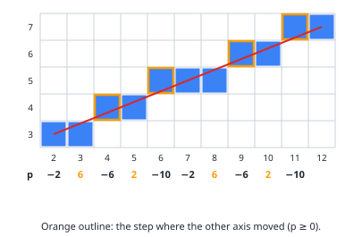
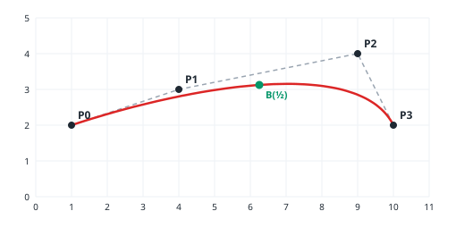
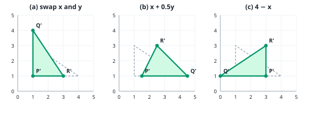
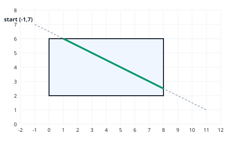

# SSG 511 Mock Exam 2

A full practice paper in the format of the real SSG 511 exam, with new questions. Take it after Mock 1, closed book, on paper, with a calculator and graph paper, in one go.

**Instructions:** answer **Question 1 and any other three** questions. Question 1 carries 35 marks and the others 10 each, so the paper is out of 65 marks. Time allowed: **2 hours**. Draw neat diagrams where a question asks for one. The worked answers and marking scheme open after you submit; mark your own long answers against them honestly. (The app counts your best four questions, so answer Question 1: it is worth the most.)

## Question 1

### (a) Antialiasing
<!-- q: open id="2262d650" marks="5" -->

What is antialiasing? Describe three methods of antialiasing a line, and state the price you pay for a smoother line. (5 marks)

<details><summary>Solution</summary>

**Definition (1 mark).** Aliasing is the staircase ("jaggies") a line gets because each pixel can only be fully on or fully off. Antialiasing is any method that reduces this, usually by giving the edge pixels in-between intensities.

**Methods (1 mark each, any three):**

1. **Higher resolution:** more, smaller pixels make smaller steps; it costs memory and time.
2. **Area sampling:** set each pixel's intensity in proportion to how much of it the line covers, so a pixel 30% covered gets 30% intensity (Wu's algorithm is the well-known example).
3. **Supersampling:** compute several samples per pixel (say a 2 × 2 grid) and average them; MSAA is the cheaper hardware form that only does this near edges.
4. **Pixel phasing:** the display shifts pixel positions by fractions of a pixel so lines and curves land more exactly.

**The price (1 mark).** Antialiased lines look smoother but also softer (a little fuzzy), and they need more computation.

**Revise:** [[computer-graphics/08-line-drawing-and-antialiasing-6|Line Drawing 6: Antialiasing]].

</details>

### (b) Bresenham for gentle slopes
<!-- q: open id="1a345cc9" marks="15" -->

With illustration, derive the decision parameter and its update for Bresenham's line algorithm when $0 < m < 1$. Given the end points $A(2,3)$ and $B(12,7)$, construct a table and produce the plot to rasterise $AB$. (15 marks)

<details><summary>Solution</summary>

**The derivation (8 marks).** For $0 < m < 1$, **step in $x$** by 1 and decide whether $y$ moves.

1. **Set up (1 mark).** At $(x_k, y_k)$, the next column is $x_k + 1$, where the true line is at $y = m(x_k + 1) + b$. The candidates are $y_k$ (stay) and $y_k + 1$ (move up).
2. **The two distances (2 marks).** $d_1 = y - y_k = m(x_k + 1) + b - y_k$ and $d_2 = (y_k + 1) - y = y_k + 1 - m(x_k + 1) - b$. Draw one column with the two candidate pixels, the true line between them, and $d_1$ and $d_2$ marked.
3. **The difference (1 mark).** $d_1 - d_2 = 2m(x_k + 1) - 2y_k + 2b - 1$. Negative means the lower pixel is nearer.
4. **Clear the fraction (2 marks).** Multiply by $dx > 0$: $p_k = dx(d_1 - d_2) = 2dy\,x_k - 2dx\,y_k + c$. $p_k < 0$: keep $y_k$; $p_k \ge 0$: move to $y_k + 1$.
5. **The update (1 mark).** $p_{k+1} = p_k + 2dy$ if $y$ stayed, $p_{k+1} = p_k + 2dy - 2dx$ if $y$ moved.
6. **The start (1 mark).** $p_0 = 2dy - dx$.

**The table (4 marks).** $dx = 10$, $dy = 4$, so $2dy = 8$, $2dy - 2dx = -12$, $p_0 = 8 - 10 = -2$.

| $k$ | $p_k$ | $y$ moves? | Next pixel | $p_{k+1}$ |
|---|---|---|---|---|
| start | | | (2, 3) | |
| 0 | −2 | no | (3, 3) | 6 |
| 1 | 6 | yes | (4, 4) | −6 |
| 2 | −6 | no | (5, 4) | 2 |
| 3 | 2 | yes | (6, 5) | −10 |
| 4 | −10 | no | (7, 5) | −2 |
| 5 | −2 | no | (8, 5) | 6 |
| 6 | 6 | yes | (9, 6) | −6 |
| 7 | −6 | no | (10, 6) | 2 |
| 8 | 2 | yes | (11, 7) | −10 |
| 9 | −10 | no | (12, 7) | −2 |

**The plot (3 marks).**



**What to check in your drawing:**

- The illustration shows one column $x_k + 1$, the two candidates, the true line and $d_1$, $d_2$.
- The table starts at $p_0 = -2$, and $y$ moves exactly 4 times ($dy = 4$).
- The plot has 11 pixels, one in each column from $x = 2$ to 12, ending exactly on $(12, 7)$.

**Revise:** [[computer-graphics/05-line-drawing-and-antialiasing-3|Line Drawing 3: Bresenham for Gentle Slopes]].

</details>

### (c)(i) A particle in the plane: control points
<!-- q: open id="15315cb0" marks="6" -->

A particle moves in $\mathbb{R}^2$ along a cubic Bézier curve $B(t)$, $0 \le t \le 1$. At $t = 0$ it is at $(1,2)$ with velocity $(9,3)$; at $t = 1$ it is at $(10,2)$ with velocity $(3,-6)$. Write the equations for its position and velocity, and find the four control points. (6 marks)

<details><summary>Solution</summary>

**Position and velocity (2 marks).** $B(t) = (1-t)^3P_0 + 3t(1-t)^2P_1 + 3t^2(1-t)P_2 + t^3P_3$ and $B'(t) = 3\left[(1-t)^2(P_1 - P_0) + 2t(1-t)(P_2 - P_1) + t^2(P_3 - P_2)\right]$, so $B'(0) = 3(P_1 - P_0)$ and $B'(1) = 3(P_3 - P_2)$.

**Control points (4 marks).**

- $P_0 = (1,2)$ and $P_3 = (10,2)$, the end points.
- $P_1 = P_0 + \tfrac13(9,3) = (4,3)$.
- $P_2 = P_3 - \tfrac13(3,-6) = (10,2) - (1,-2) = (9,4)$.



**Revise:** [[computer-graphics/17-curves-3|Curves 3: The Cubic Bézier: Velocity and End Conditions]].

</details>

### (c)(ii) The position at t = ½
<!-- q: gap id="08fb197b" marks="3" answers="6.25|25/4;3.125|25/8" -->

A cubic Bézier curve has control points $P_0 = (1,2)$, $P_1 = (4,3)$, $P_2 = (9,4)$ and $P_3 = (10,2)$. Find $B(\tfrac12)$. (3 marks)

$B(\tfrac12) = ($ ___ , ___ $)$

<details><summary>Solution</summary>

$$B\!\left(\tfrac12\right) = \frac{P_0 + 3P_1 + 3P_2 + P_3}{8} = \frac{(1 + 12 + 27 + 10,\ 2 + 9 + 12 + 2)}{8} = \frac{(50, 25)}{8} = (6.25,\ 3.125).$$

**Revise:** [[computer-graphics/17-curves-3|Curves 3]].

</details>

### (c)(iii) The second half as a Bézier curve
<!-- q: open id="d434d9f1" marks="6" -->

A cubic Bézier curve has control points $P_0 = (1,2)$, $P_1 = (4,3)$, $P_2 = (9,4)$ and $P_3 = (10,2)$. The part of the curve for $\tfrac12 \le t \le 1$ is also a cubic Bézier curve. Find its four control points. (6 marks)

<details><summary>Solution</summary>

de Casteljau at $t = \tfrac12$ (each new point is the midpoint of two neighbours):

| Level | Points |
|---|---|
| 0 | (1,2), (4,3), (9,4), (10,2) |
| 1 | (2.5,2.5), (6.5,3.5), (9.5,3) |
| 2 | (4.5,3), (8,3.25) |
| 3 | (6.25,3.125) |

**The second half is the right edge, read bottom to top (1 mark each, plus 2 for the working):**

$$R_0 = (6.25,\ 3.125),\quad R_1 = (8,\ 3.25),\quad R_2 = (9.5,\ 3),\quad R_3 = (10,\ 2).$$

Check: $R_0$ is $B(\tfrac12)$ and $R_3$ is $P_3$, so the piece starts where the first half ended and ends where the whole curve does.

**Revise:** [[computer-graphics/18-curves-4|Curves 4: de Casteljau, Splitting and Drawing with Lines]].

</details>

## Question 2

A triangle has vertices $P(1,1)$, $Q(4,1)$ and $R(1,3)$. Points are row vectors $[x\ y\ 1]$, multiplied on the right by the matrix. Draw the image of the triangle under each matrix, applied to the original triangle each time (not one after another), and name the transformation.

### (a) The first matrix
<!-- q: sketch id="0ebbafa5" marks="4" -->

$$\begin{pmatrix}0&1&0\\1&0&0\\0&0&1\end{pmatrix}$$ (4 marks)

<details><summary>Solution</summary>

$[x\ y\ 1]$ times this gives $(y, x)$: a **reflection in the line $y = x$**. $P'(1,1)$, $Q'(1,4)$, $R'(3,1)$. $P$ lies on the mirror line, so it stays put.



**What to check in your drawing (panel a):**

- The image corners are $(1,1)$, $(1,4)$, $(3,1)$, labelled $P'$, $Q'$, $R'$.
- The transformation is named as a reflection in $y = x$, and the original triangle is shown for comparison.

**Revise:** [[computer-graphics/14-2d-and-3d-transformations|2D and 3D Transformations]].

</details>

### (b) The second matrix
<!-- q: sketch id="bcc780da" marks="3" -->

$$\begin{pmatrix}1&0&0\\0.5&1&0\\0&0&1\end{pmatrix}$$ (3 marks)

<details><summary>Solution</summary>

$[x\ y\ 1]$ times this gives $(x + 0.5y,\ y)$: a **shear in $x$**, by half of $y$. $P'(1.5,1)$, $Q'(4.5,1)$, $R'(2.5,3)$ (panel b of the picture above). Every point moves right by half its height, so the base slides 0.5 and the top corner slides 1.5; the area stays 3.

**What to check in your drawing (panel b):**

- The base is still horizontal at $y = 1$, now from $x = 1.5$ to 4.5.
- The top corner is at $(2.5, 3)$, and the transformation is named as an $x$-shear.

**Revise:** [[computer-graphics/14-2d-and-3d-transformations|2D and 3D Transformations]].

</details>

### (c) The third matrix
<!-- q: sketch id="75c03ac5" marks="3" -->

$$\begin{pmatrix}-1&0&0\\0&1&0\\4&0&1\end{pmatrix}$$ (3 marks)

<details><summary>Solution</summary>

$[x\ y\ 1]$ times this gives $(4 - x,\ y)$: a **reflection in the vertical line $x = 2$** (flip about $x = 0$, then translate 4 to the right). $P'(3,1)$, $Q'(0,1)$, $R'(3,3)$ (panel c of the picture above). With row vectors the translation sits in the bottom row.

**What to check in your drawing (panel c):**

- The image corners are $(3,1)$, $(0,1)$, $(3,3)$: the triangle now points left.
- The mirror line $x = 2$ is named or drawn.

**Revise:** [[computer-graphics/14-2d-and-3d-transformations|2D and 3D Transformations]] (recognising a matrix by its pattern).

</details>

## Question 3
<!-- q: open id="0c1faba9" marks="10" -->

Describe the chain of transformations that carries a vertex from the model's own coordinates to a pixel on the screen, saying what the model, view and projection matrices each do, where clipping happens, and what the perspective divide is for. After projection, vertex $A$ has clip coordinates $(x, y, z, w) = (4, -2, 1, 2)$ and vertex $B$ has $(1, -0.5, 1.5, 2)$. Which one is inside the view volume? For the one that is, find its normalised device coordinates and its pixel on a $1920 \times 1080$ screen, using $x_{px} = \frac{x_{ndc} + 1}{2} \times 1920$ and $y_{px} = \frac{1 - y_{ndc}}{2} \times 1080$ (pixel rows counted from the top). (10 marks)

<details><summary>Solution</summary>

**The chain (4 marks).** $v_{clip} = P\,V\,M\,v_{model}$, then divide by $w$, then the viewport transform.

- **Model matrix $M$** places the object in the world (its scale, rotation and position); one per object.
- **View matrix $V$** moves the whole world so the camera sits at the origin looking down $-z$; it is the inverse of the camera's own placement.
- **Projection matrix $P$** maps the viewing volume to clip space and puts the depth into $w$, so that distant things will shrink.
- **Viewport transform** maps the $[-1, 1]$ square to pixels.

**Clipping and the divide (2 marks).** Clipping happens in clip space, before the divide: a point is visible when $-w \le x, y, z \le w$. It must come first because dividing by $w \le 0$ (points behind the camera) gives nonsense. Dividing by $w$ then gives normalised device coordinates; it is what makes far things smaller (perspective).

**The two vertices (4 marks).**

- $A = (4, -2, 1, 2)$: $x = 4 > w = 2$, so **$A$ is outside** (it would be at $x_{ndc} = 2$, off the right of the screen). It is clipped.
- $B = (1, -0.5, 1.5, 2)$: every coordinate lies between $-2$ and 2, so **$B$ is inside**. NDC: $(1/2,\ -0.5/2,\ 1.5/2) = (0.5,\ -0.25,\ 0.75)$. Pixel: $x_{px} = \frac{1.5}{2} \times 1920 = 1440$, $y_{px} = \frac{1.25}{2} \times 1080 = 675$, so **pixel (1440, 675)**, right of centre and a little below the middle.

**Revise:** [[computer-graphics/22-the-transform-pipeline|The Transform Pipeline]], [[computer-graphics/21-how-rendering-works|How Rendering Works]].

</details>

## Question 4
<!-- q: open id="2c61d30b" marks="10" -->

A cylinder of radius 1 and height 2 stands on the origin: its base is centred at $(0,0,0)$ and its axis runs up the $y$-axis to $(0,2,0)$. Transform it so that it lies along the $x$-axis direction with its base centred at $(3,1,2)$, its top centred at $(7,1,2)$, and a radius of 0.5. What transformations are needed, in what order? Write down the product of the matrices (column vectors, $p' = Mp$). (10 marks)

<details><summary>Solution</summary>

**The target (2 marks).** The new axis runs from $(3,1,2)$ to $(7,1,2)$: length 4, along $+x$. So the height goes from 2 to 4 (factor 2 along the axis) and the radius from 1 to 0.5 (factor 0.5 across it).

**The steps, in order (5 marks):**

1. **Scale** at the origin: $S(0.5,\ 2,\ 0.5)$. The top centre is now at $(0,4,0)$.
2. **Rotate** the axis from $+y$ to $+x$: $R_z(-90°)$, a 90° clockwise turn about $z$, because $R_z(\theta)$ sends $(0,1,0)$ to $(-\sin\theta, \cos\theta, 0)$, which is $(1,0,0)$ when $\theta = -90°$. The top centre goes to $(4,0,0)$.
3. **Translate** the base centre to $(3,1,2)$: $T(3,1,2)$. The top centre lands on $(7,1,2)$.

**The product (3 marks):** $M = T(3,1,2)\,R_z(-90°)\,S(0.5, 2, 0.5)$:

$$M = \begin{pmatrix}1&0&0&3\\0&1&0&1\\0&0&1&2\\0&0&0&1\end{pmatrix}\begin{pmatrix}0&1&0&0\\-1&0&0&0\\0&0&1&0\\0&0&0&1\end{pmatrix}\begin{pmatrix}0.5&0&0&0\\0&2&0&0\\0&0&0.5&0\\0&0&0&1\end{pmatrix} = \begin{pmatrix}0&2&0&3\\-0.5&0&0&1\\0&0&0.5&2\\0&0&0&1\end{pmatrix}$$

**Check:** $M(0,0,0,1)^T = (3,1,2,1)^T$ and $M(0,2,0,1)^T = (7,1,2,1)^T$; a rim point $(1,0,0)$ goes to $(3, 0.5, 2)$, 0.5 from the base centre. Scale first, while the cylinder is still on the origin, or the scaling would also move it.

**Revise:** [[computer-graphics/14-2d-and-3d-transformations|2D and 3D Transformations]].

</details>

## Question 5

### (a) Liang–Barsky
<!-- q: open id="0b0ca77f" marks="6" -->

Describe the Liang–Barsky line-clipping algorithm, and say why it is usually faster than Cohen–Sutherland. (6 marks)

<details><summary>Solution</summary>

1. **Write the line with one parameter (1 mark):** $x = x_0 + t\,dx$, $y = y_0 + t\,dy$, $0 \le t \le 1$.
2. **Four inequalities (2 marks).** Being inside the window means $p_k t \le q_k$ for each edge: $p_1 = -dx,\ q_1 = x_0 - x_{min}$ (left), $p_2 = dx,\ q_2 = x_{max} - x_0$ (right), $p_3 = -dy,\ q_3 = y_0 - y_{min}$ (bottom), $p_4 = dy,\ q_4 = y_{max} - y_0$ (top).
3. **Read each one (2 marks).** $p_k = 0$: the line is parallel to that edge; if $q_k < 0$ it is outside, reject. $p_k < 0$: the line enters across that edge at $t = q_k/p_k$, so $t_E = \max(0, \text{those})$. $p_k > 0$: it leaves at $t = q_k/p_k$, so $t_L = \min(1, \text{those})$.
4. **Decide (1 mark).** If $t_E > t_L$, reject; otherwise the visible piece runs from $t_E$ to $t_L$.

**Why faster:** it computes the two end values of $t$ directly, with no repeated intersect-and-recode loop, and only works out actual intersection points once, at the end.

**Revise:** [[computer-graphics/10-clipping|Clipping]].

</details>

### (b) A Liang–Barsky clip
<!-- q: open id="53007c71" marks="4" -->

Use Liang–Barsky to clip the line from $(-1,7)$ to $(11,1)$ against the window $0 \le x \le 8$, $2 \le y \le 6$. Give $t_E$, $t_L$ and the end points of the visible part. (4 marks)

<details><summary>Solution</summary>

$dx = 12$, $dy = -6$.

| $k$ | $p_k$ | $q_k$ | $q_k/p_k$ | Kind |
|---|---|---|---|---|
| 1 (left) | −12 | −1 | 1/12 | entering |
| 2 (right) | 12 | 9 | 3/4 | leaving |
| 3 (bottom) | 6 | 5 | 5/6 | leaving |
| 4 (top) | −6 | −1 | 1/6 | entering |

$t_E = \max(0, \tfrac1{12}, \tfrac16) = \tfrac16$ and $t_L = \min(1, \tfrac34, \tfrac56) = \tfrac34$. Since $t_E < t_L$ the line is visible from $t = \tfrac16$, the point $(-1 + 2,\ 7 - 1) = (1, 6)$ on the top edge, to $t = \tfrac34$, the point $(-1 + 9,\ 7 - 4.5) = (8, 2.5)$ on the right edge.



**Revise:** [[computer-graphics/10-clipping|Clipping]].

</details>

## Question 6
<!-- q: open id="caa5b848" marks="10" -->

Develop a program that draws a circle of radius $r$ about a centre $(x_c, y_c)$ with the midpoint circle algorithm, using only integer arithmetic and eight-way symmetry. Justify your results with **three** use cases. (10 marks)

<details><summary>Solution</summary>

**The program (6 marks):** compute one octant from $(0, r)$, and plot all eight mirror images of each point about the centre.

```python
def circle(xc, yc, r):
    pixels = set()

    def plot8(x, y):
        for a, b in ((x, y), (y, x), (-x, y), (-y, x), (x, -y), (y, -x), (-x, -y), (-y, -x)):
            pixels.add((xc + a, yc + b))

    x, y, p = 0, r, 1 - r
    plot8(x, y)
    while x < y:
        x += 1
        if p < 0:
            p += 2 * x + 1
        else:
            y -= 1
            p += 2 * (x - y) + 1
        if x <= y:
            plot8(x, y)
    return sorted(pixels)

xc, yc, r = map(int, input("xc yc r: ").split())
for px in circle(xc, yc, r):
    print(px)
```

**Three use cases (4 marks):**

1. **$r = 5$ about $(0,0)$:** the octant is $(0,5), (1,5), (2,5), (3,4)$ ($p$ = −4, −1, 4), and the mirrors complete a round outline that passes through $(5,0)$, $(0,-5)$ and $(-5,0)$.
2. **$r = 5$ about $(20,15)$:** the same shape moved by $(20,15)$, for example $(20,20)$ and $(23,19)$: this checks the centre is added after the symmetry, not before.
3. **$r = 1$:** the loop runs once and stops, giving only $(0,1)$ and its mirrors, the four pixels $(1,0)$, $(0,1)$, $(-1,0)$, $(0,-1)$: this checks the edge case of a tiny circle.

**Revise:** [[computer-graphics/09-circles-and-polygon-filling|Circles and Polygon Filling]].

</details>

## About this paper

New questions in the exact format of the SSG 511 exam: Question 1 (35 marks, compulsory) on a line algorithm and a cubic Bézier, then five 10-mark questions on transformations, rendering, 3D transformation, clipping and a program. Question 3 stands in for the real paper's COMSOL question with Part 2 of the course (the transform pipeline), so the mocks cover the whole subject. Every number in the worked answers, and every answer picture, is computed and checked by `scripts/diagrams/cg_papers.py`.
