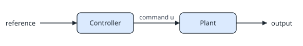
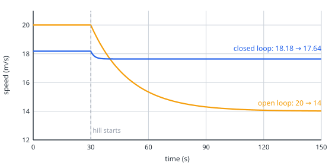

# What Control Theory Is 1: The Feedback Loop

Control theory is the maths of making a system do what you want, automatically, by measuring it and correcting it over and over.

## Before you start
<!-- bite: 48351add-5965-4389-8b2d-aff723d9f11f -->

You need nothing beyond school algebra for this lesson. Later lessons use [[mathematics/06-calculus/02-calculus-1/01-preview/01-preview|calculus]].

After this lesson you will be able to:

1. say the difference between open-loop and closed-loop control, with an example of each;
2. name every part of a feedback loop: reference, error, controller, actuator, plant, output, sensor and disturbance;
3. work out, with numbers, how much feedback reduces the effect of a disturbance or a wrong model.

## What control theory is
<!-- bite: ad145f16-f301-404a-8fec-895b52dd36be -->

You want a system to do something. A car to hold 20 m/s on the motorway. A room to stay at 24 °C. A drone to stay level in the wind. A motor to hold 3000 revolutions per minute.

The obvious way is to work out the right input and apply it: press the accelerator this far, run the heater this hard. That works on paper. In real life it fails, because:

1. **The model is wrong.** You never know the machine exactly.
2. **Disturbances happen.** A hill, a gust of wind, someone opening the door.
3. **Things drift.** Tyres wear, batteries sag, parts heat up.
4. **Some systems are unstable.** A drone or a balancing robot falls over without constant correction.

Control theory is the maths of making a system behave in spite of all four. Its main tool is the **feedback loop**: measure, compare, correct, again and again.

## The kid version
<!-- bite: 8157d00a-f4fc-4447-b893-1371b921d562 -->

You're carrying a full cup of tea across a room. You don't plan every step in advance and then walk with your eyes shut. You watch the tea, and the moment it tilts one way you tilt your hand the other way. Watch, compare, fix, many times a second. That is a feedback loop, and your eyes and hand are doing control theory.

**Where the analogy stops working.** Your brain adjusts how hard it corrects without thinking. A machine's controller only does what its equations say, so if they correct too hard the tea sloshes back and forth worse and worse. Most of this subject is about getting that "how hard" right.

## Open loop: decide, apply, hope
<!-- bite: f726b1fe-0d80-48a5-9eb5-64716e500655 -->

The first way to control something is to decide the input from what you know, apply it, and never look at the result. This is **open-loop control**.

A toaster runs for a set time. A washing machine runs its cycle. A stepper motor is told to move 200 steps. All three are cheap and simple, and none of them can correct anything, because none of them measures anything. If the bread is frozen, the toaster doesn't know. If the stepper motor slips, its controller keeps counting.

## Closed loop: measure, compare, correct
<!-- bite: fa618533-e889-4e0b-9151-a2ebfeb15e86 -->

The second way is to measure the output, compare it with what you wanted, and act on the difference. This is **closed-loop control**, also called **feedback control**. Look at the arrow coming back from the output: that return path is the "loop".

Every loop in this subject, from a thermostat to a rocket, has this shape. So the parts have standard names, and the next section gives them.

## Terms used in a feedback loop
<!-- bite: 63d15470-7578-4aa3-96fb-4de79041d1d2 -->

1. **Plant**: This is the thing being controlled: the car, the room, the motor. The word comes from process plants, where control theory grew up.
2. **Reference**: This is also known as the **setpoint**, written $r$. It is the value you want, such as 20 m/s.
3. **Output**: This is also known as the **process variable**, written $y$. It is the value you actually have right now.
4. **Error**: This is the reference minus the measured output, $e = r - y$. It is what the controller acts on.
5. **Controller**: This is the rule that turns the error into a command. Most of this subject is about choosing it.
## Terms used in a feedback loop: the rest
<!-- bite: 318f18f0-c55f-426a-8320-e186a5df5625 -->

Four more names complete the loop.

6. **Control input**: This is the command the controller sends, written $u$, such as "push with 600 newtons".
7. **Actuator**: This is the part that turns the command into a physical action: the engine, the heater, the motor driver.
8. **Sensor**: This is the part that measures the output: the speedometer, the thermometer.
9. **Disturbance**: This is anything outside your control that pushes the plant, written $d$: a hill, wind, an open door.

Remember this one: the whole of classical control is the question **what rule should turn $e$ into $u$?**

## The cruise control on a hill: the setup
<!-- bite: 17b0bff5-9be7-49a2-b96e-8b301e38589b -->

Let's carry one example through the whole subject: a car's cruise control. The car has mass 1000 kg, and air and road drag push back with 50 newtons for every metre per second of speed. So at a steady speed the engine force must equal 50 times the speed.

**Open loop.** We want 20 m/s, so we set the engine force to $50 \times 20 = 1000$ N and leave it there. On flat road, the car settles at exactly 20 m/s.

**Closed loop.** The controller measures the speed and pushes with 500 N for every m/s of error, on top of nothing else. At steady state the push must still balance drag: $500(20 - v) = 50v$, so $v = 10000/550 = 18.18$ m/s. It settles a little short of 20. Hold that thought: lesson 15 explains this gap and lesson 17 removes it.

Now the car reaches a hill that pulls back with 300 N. Before reading on, predict: which car slows down more?

## The cruise control on a hill: what happens
<!-- bite: 4d247b9f-dc59-4ebc-a350-e3d03f36505a -->

**Open loop.** The engine force doesn't change, so the new balance is $1000 - 300 = 50v$, and $v = 14$ m/s. The car loses 6 m/s.

**Closed loop.** The speed drops, the error grows, and the controller pushes harder by itself. The new balance is $500(20 - v) - 300 = 50v$, so $v = 9700/550 = 17.64$ m/s. The car loses only 0.55 m/s.

The closed-loop controller never knew there was a hill. It didn't need to: the error told it. That is the first thing feedback buys you.

## What feedback buys you: disturbances and a wrong model
<!-- bite: 71ae2525-df5c-49ab-a68e-2b8e15dcaf9e -->

**1. It rejects disturbances.** As you just saw, the error does the detecting for you. In the car, feedback shrank the hill's effect by a factor of 11, because the loop's push per m/s (500 + 50 = 550) is 11 times the drag alone (50).

**2. It makes you less dependent on the model.** This is the deep one. Suppose the drag is really 75 N per m/s, not 50. The open-loop car, still pushing 1000 N, settles at $1000/75 = 13.3$ m/s, a third too slow. The closed-loop car settles at $10000/575 = 17.4$ m/s, barely different from before.

In general, when the loop gain $L$ is large, the output follows the reference almost no matter what $L$ is exactly:

$$\frac{y}{r} = \frac{L}{1 + L} \approx 1 \quad\text{when } L \gg 1$$

With $L = 100$ that ratio is 0.990; double the plant so $L = 200$ and it is 0.995. That's why an op-amp, whose own gain varies wildly between $10^5$ and $10^6$, makes a precise amplifier once the loop is closed. → [[hardware/01-electricity|Hardware: Electricity]]

## What feedback buys you: unstable plants and faster ones
<!-- bite: d893f55a-0646-4e77-830f-49214dbc7204 -->

**3. It can steady a plant that would fall over by itself.** A drone, a balancing robot and a modern fighter jet are all unstable without control: left alone, a tiny tilt grows until they crash. Feedback catches each tilt while it is still small.

**4. It can change how a plant moves.** A sluggish system can be made quicker, and a wobbly one calmer, without changing the hardware. Our car on its own takes about 80 seconds to settle (lesson 13 shows why); with the 500 N per m/s loop it settles in about 7.

All of this sounds free. It isn't. Feedback can also make a perfectly calm system shake itself apart, and that is the next lesson.

## Common pitfalls
<!-- bite: b181a6b5-720b-4861-aa9f-1c9253b82b1a -->

1. **Mixing up the plant and the controller.** The plant is the thing you're stuck with; the controller is the part you design.
2. **Forgetting the sensor is in the loop.** The controller sees the measurement, not the truth. A wrong sensor gives a confidently wrong controller.
3. **Thinking open loop is always worse.** When the model is good and nothing disturbs the plant, open loop is cheaper and works fine. A toaster doesn't need a camera.
4. **Thinking feedback needs to know about disturbances.** It doesn't. It only needs to see their effect on the output.

## Check your understanding
<!-- bite: 688c7ffd-45bc-4df0-8432-a81fcb959150 -->

Try each one before you open the answer.

1. <!-- q: mcq id="5d2e81a0" -->
   Which of these is open-loop control?

   - [ ] A thermostat switching a heater on and off
   - [x] A microwave that runs for exactly 90 seconds
   - [ ] Cruise control holding a car's speed
   - [ ] A drone holding its height using a barometer

   

Answer

   The microwave. It runs for a set time and never measures the food. The other three all measure their output and correct it.

   

2. <!-- q: gap id="a4c7f913" answers="error;reference|setpoint;output|process variable" -->
   The ___ is the ___ minus the measured ___.

   

Answer

   The error is the reference (setpoint) minus the measured output. It is what the controller acts on.

   

3. <!-- q: exact id="0b6e3c58" answer="0.9901" sigfigs="3" -->
   A feedback loop has loop gain $L = 100$. What is the closed-loop ratio $y/r = L/(1+L)$?

   

Answer

   $100/101 = 0.990$. The output is within 1% of the reference.

   

4. <!-- q: exact id="e81f6a27" answer="5" -->
   A boat is held at a steady speed by an open-loop engine setting. Water drag is 40 N per m/s of speed. A current starts pushing against the boat with 200 N, and the engine setting doesn't change. By how many m/s does the boat slow down?

   

Answer

   5 m/s. The extra 200 N must be balanced by 200 N less drag, and $200/40 = 5$.

   

5. <!-- q: open id="3c90d4b2" -->
   A cruise control was designed assuming drag of 50 N per m/s, but the real car has 75. Explain why the closed-loop car's speed barely changes while an open-loop car's speed changes a lot.

   

Answer

   The open-loop car applies a fixed force worked out from the wrong drag, so the speed is wrong by the same proportion as the model. The closed-loop car keeps measuring: if it is slower than wanted, the error grows and it pushes harder until the push balances the real drag. Because its correction (500 N per m/s) is much bigger than the drag, the exact drag hardly matters.

   

## Before moving on
<!-- bite: 1b46e681-537f-44f6-b6bd-f973d87bef1b -->

You can name every part of a loop and show with numbers what feedback does to a disturbance. **Next:** [[control-theory/02-what-control-theory-is-2|02 — What Control Theory Is 2: Costs, Feedforward and Requirements]], which covers the price of feedback and the numbers a good loop must meet.

## Related
<!-- bite: 127f6010-f347-438f-a719-832f4f051332 -->

- [[control-theory/index|Control theory map]]
- [[robotics/index|Robotics]]: where most of this gets applied.
- [[networking/08-congestion-control|Congestion Control]]: a feedback loop running across the internet.

## About this lesson
<!-- bite: 00a85632-7f42-4547-9505-16a29a6d4164 -->

**Level:** Beginner. **Covers:** why commanding a system isn't enough, open and closed loops, the names of a loop's parts, and what feedback buys, worked through the cruise control on a hill.

**Where it sits:** lesson 1 of 58, part 1 of 2 on what control theory is.

**Source:** `[reference]`, assembled from standard control texts, not from tuning real systems. The diagrams come from `scripts/diagrams/control_theory.py`, which also checks the cruise-control numbers.
