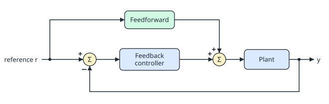

# What Control Theory Is 2: Costs, Feedforward and Requirements

Feedback has a price, a partner called feedforward, and a list of numbers that say whether a loop is good.

## Before you start
<!-- bite: cad0d58f-e293-4e01-a0d3-e729ac15324e -->

You should have read [[control-theory/01-what-control-theory-is-1|01 — What Control Theory Is 1: The Feedback Loop]].

After this lesson you will be able to:

1. list four things feedback costs, and say which one is the central risk;
2. explain how feedforward differs from feedback, and why good designs use both;
3. name the six requirements a control loop is judged on;
4. say what SISO and MIMO mean, and how classical and modern control differ.

## What this lesson covers
<!-- bite: 9f2a209b-4036-45ab-b6fb-f9a656065f5b -->

Remember the cruise control from lesson 01? Closing the loop made the car shrug off a hill and a wrong drag figure. That makes feedback sound like magic. This lesson is the honest other half: what feedback costs, what to add when feedback alone is too slow, and how engineers write down what "good control" means, so you can tell a good loop from a bad one with numbers.

## The kid version
<!-- bite: c2da3898-c964-4f4e-a7f6-fef1d8404d18 -->

You're steering a bicycle while looking only at the road right under your front wheel. You'll stay up, but you'll wobble, and you'll only react to a bend once you're already in it. If you also look ahead and start turning before the bend, most of the steering is done in advance and your eyes on the wheel only fix the small misses.

**Where the analogy stops working.** On a bike, looking ahead uses your eyes. In a machine, "looking ahead" means using a model or a measured disturbance, and it is only as good as that model. If the model is wrong, feedforward is wrong with full confidence.

## What feedback costs
<!-- bite: 9cefa132-01e6-48a7-92bf-96236ef91574 -->

1. **It can make a calm system unstable.** This is the central risk. Gain plus delay can make a loop correct too late and too hard, then overcorrect the other way, again and again. You know this from a shower: turn it hotter, feel nothing, turn it more, then both turns arrive and you're scalded. → [[control-theory/19-stability-1|19 — Stability 1: What Stability Means and Routh–Hurwitz]]
2. **It amplifies sensor noise.** The controller can't tell a real error from a noisy reading, so it acts on both. High gain means a jittery actuator.
3. **It needs a sensor.** Sensors cost money, add delay, and fail. A failed sensor is worse than none, because the controller acts confidently on rubbish.
4. **Speed and robustness pull against each other.** A faster loop tolerates less model error. This isn't a gap in our methods; it's a law, called the **waterbed effect**: push the loop's error down at some frequencies and it must rise at others. → [[control-theory/29-nyquist-3|29 — Nyquist 3: Uncertainty and Fundamental Limits]]

## Feedforward: acting before the error
<!-- bite: 3bdbc224-8c9f-4a8e-a9cf-0b7069f38951 -->

Feedback is reactive: an error must exist before it can correct it. **Feedforward** is predictive: it acts on something you know or can measure before any error appears, such as the planned path or a measured disturbance.

## Feedforward on the car
<!-- bite: 8da0616a-b37a-435a-a2eb-2e66cc4f82e9 -->

Back to the car. A navigation map knows the hill is coming and how steep it is. A feedforward term adds the 300 N the hill needs at the moment the hill starts, so the speed barely dips. Feedback then cleans up whatever the map got wrong.

Remember this one: **feedforward does the bulk of the work using the model; feedback fixes what the model missed.** A robot arm computes most of its torque from the planned motion and uses feedback only for the leftovers.

## The six requirements
<!-- bite: 1f8dd753-d8e0-429a-b9b8-13952913aa8f -->

What "good control" means, written as things you can measure. These become the specification you design against.

1. **Stability.** Non-negotiable. A bounded input must give a bounded output.
2. **Steady-state accuracy.** Does the output reach the reference? What's left over is the **steady-state error**. Our car's 1.82 m/s gap is one.
3. **Speed.** The **rise time** is how long it takes to get near the target; the **settling time** is how long until it stays within a small band around it.
4. **Overshoot.** How far past the target it goes. A lift that overshoots a floor by 10% is unacceptable however fast it is.
5. **Robustness.** Does it still work when the plant isn't quite what you modelled?
6. **Actuator limits.** Every real actuator saturates. A design that asks a 100 N motor for 500 N is not a design.

These fight each other. **A faster response usually means more overshoot and less robustness.** Control design is choosing where to sit on that trade, on purpose.

## One input or many
<!-- bite: bde038c8-8019-497a-94f1-d34acb4f3703 -->

**SISO** means single input, single output: one actuator, one sensor. The cruise control is SISO: one engine force, one speed. Most of classical control is SISO.

**MIMO** means multiple inputs, multiple outputs, usually **coupled**, so changing one input moves several outputs. A drone has four motors and six ways to move (three directions, three rotations); speeding up one motor changes its height, its tilt and its spin at once.

Coupling is what makes MIMO hard: you can't tune each loop alone, because each one disturbs the others. **State-space methods handle MIMO naturally**, which is the main reason they exist. → [[control-theory/30-state-space-1|30 — State Space 1: States and the State Equation]]

## The two traditions
<!-- bite: 197c31af-da6d-4615-ba73-ec3e4dc645cc -->

The field looks like two subjects because it grew up twice.

**Classical control (1930s to 1950s)** uses transfer functions, Bode and Nyquist plots, root locus and PID. It was built for telephone amplifiers and wartime gun aiming. It is graphical, intuitive, mostly SISO and enormously practical: most working engineers use it.

**Modern control (1960s on)** uses state space and matrices. It was built for aerospace, where many inputs and best-possible answers mattered. It handles MIMO, nonlinearity and optimisation, and is less intuitive. The Kalman filter and LQR come from here, and the Apollo guidance computer is its famous user.

Neither replaced the other. This subject teaches modelling and classical control first (lessons 03 to 29), because its intuition carries over, then modern control (30 to 45), then nonlinear systems (46 to 58).

## Where control shows up
<!-- bite: 1f4bd7d6-8c72-4b6a-80d4-51932f6257c9 -->

Not just in machines:

1. **Mechanical**: robots, vehicles, aircraft, machine tools. → [[robotics/index|Robotics]]
2. **Electrical**: power supplies, motor drives, op-amp circuits.
3. **Process**: chemical plants, refineries, air conditioning.
4. **Biology**: your body holds its temperature and blood sugar with feedback loops that evolved long before anyone wrote them down.
5. **Economics**: a central bank setting interest rates is a controller with a very long delay, which is exactly why it is hard.
6. **Computing**: the internet slowing senders down when it's busy, and cloud services adding servers under load. → [[networking/08-congestion-control|Congestion Control]]

That last one is worth taking seriously. Autoscaling on CPU usage has every classical problem: the sensor lags (metrics are averaged), the actuator lags (servers take minutes to boot), and it oscillates for the reasons this subject explains.

## Common pitfalls
<!-- bite: 5415a756-ac22-45aa-9f28-9b3606093f99 -->

1. **Treating feedback as free.** Every loop can go unstable; every sensor adds noise and delay.
2. **Using only feedforward.** It can't correct anything, so any model error stays in the output.
3. **Judging a design on speed alone.** Check overshoot, robustness and the actuator command too.
4. **Tuning MIMO loops one at a time.** Coupled loops fight; tune them together.

## Check your understanding
<!-- bite: ad760070-bdd1-4ba0-be51-f2bf18574286 -->

Try each one before you open the answer.

1. <!-- q: mcq id="7a13c9e4" -->
   Which of these is feedforward rather than feedback?

   - [ ] A heater that switches on when a thermometer reads below 20 °C
   - [x] A heater that turns up when an outdoor sensor reports the temperature outside has dropped
   - [ ] A speed controller that pushes harder when the car is slower than the setpoint
   - [ ] A level controller that opens a valve when the tank is too full

   

Answer

   The outdoor sensor. It measures a disturbance (the cold outside) and acts before the room temperature falls. The others all wait for the controlled output itself to be wrong.

   

2. <!-- q: mcq id="2f8b06d1" -->
   Which cost of feedback is the central risk?

   - [ ] It needs a sensor
   - [ ] It amplifies sensor noise
   - [x] It can make a stable system unstable
   - [ ] It needs a computer

   

Answer

   Instability. Gain plus delay can make a loop overcorrect again and again. The other costs are real but rarely make a system dangerous.

   

3. <!-- q: gap id="c5e2a790" answers="SISO;MIMO" -->
   A room heater with one thermometer is ___. A drone with four motors controlling height, tilt and spin is ___.

   

Answer

   SISO (single input, single output), then MIMO (multiple inputs, multiple outputs).

   

4. <!-- q: open id="94bd0e37" -->
   A lift reaches its floor quickly but goes 8 cm past it, then comes back. Which requirement does it fail, and why does that matter even though it is fast?

   

Answer

   Overshoot. Passengers would be jolted and the floor would not line up while it settles. Speed doesn't excuse it: requirements are separate, and a design must meet all of them.

   

5. <!-- q: open id="e06a4f5b" -->
   Why do good designs use feedforward and feedback together instead of just one?

   

Answer

   Feedforward acts before any error appears, so it is fast, but it relies on the model and can't fix the model's mistakes. Feedback fixes any error it sees, but only after the error appears. Together, feedforward does most of the work and feedback corrects what the model missed.

   

## Before moving on
<!-- bite: 4708ce73-5ece-44bb-b7c7-baba0fb52cb3 -->

You can list feedback's costs, explain feedforward and name the six requirements. **Next:** [[control-theory/03-modelling-1|03 — Modelling 1: From Physics to Transfer Functions]], where we turn the car into an equation so we can predict all those numbers before building anything.

## Related
<!-- bite: b681ae65-ce52-4c10-8d93-9bf7acd52b88 -->

- [[control-theory/index|Control theory map]]
- [[continuum-mechanics/index|Continuum Mechanics]]: the other engineering subject.

## About this lesson
<!-- bite: 70b88d24-e30b-4513-9216-982aedbec3a3 -->

**Level:** Beginner. **Covers:** what feedback costs, feedforward, the six requirements, SISO and MIMO, the classical and modern traditions, and where control shows up.

**Where it sits:** lesson 2 of 58, part 2 of 2 on what control theory is.

**Source:** `[reference]`, assembled from standard control texts. The diagram comes from `scripts/diagrams/control_theory.py`.
