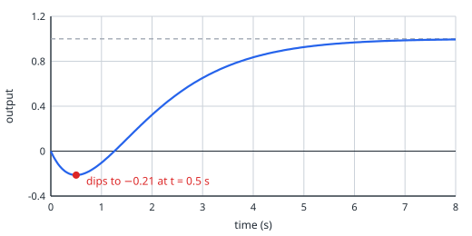

# Modelling 1: From Physics to Transfer Functions

A transfer function is a short formula that says how a system's output follows its input, built from the physics of the system.

## Before you start
<!-- bite: e5ede509-7bf8-4b9a-b8e0-dc2cf127b654 -->

You should have read [[control-theory/02-what-control-theory-is-2|02 — What Control Theory Is 2: Costs, Feedforward and Requirements]], and be able to differentiate simple functions like $e^{-at}$ ([[mathematics/06-calculus/02-calculus-1/01-preview/01-preview|calculus]]). Complex numbers such as $-1 + 2j$ appear near the end.

After this lesson you will be able to:

1. write the differential equation for a simple plant from a force or voltage balance;
2. turn it into a transfer function with the Laplace transform;
3. find its poles and zeros, and say what each one does to the response;
4. spot a right-half-plane zero and predict that the response starts the wrong way.

## What a model is
<!-- bite: ed34020a-a000-4660-82df-e0ad726e773b -->

In lesson 01 we worked out the car's steady speeds by balancing forces. That told us where the car ends up, but not how it gets there: how fast it speeds up, whether it overshoots. For that we need a **model**: an equation that describes how the system changes over time.

Every model starts with a balance law. For the car it is Newton's second law: mass times acceleration equals the net force. The engine pushes with force $u$, drag pushes back with $b$ times the speed $v$, so

$$m\dot{v} = u - bv \qquad\text{or}\qquad m\dot{v} + bv = u$$

The dot means "rate of change with time", so $\dot{v}$ is the acceleration. With $m = 1000$ kg and $b = 50$ N per m/s, this one line describes everything the car's speed can do. It is a **differential equation**: it links a quantity to its own rate of change.

## The kid version
<!-- bite: 86cdc388-0e7b-4823-b8c4-56ae2bf9fd79 -->

Think of a transfer function as a machine's ID card. You hand the machine something (a push), it hands you something back (a speed), and the card says exactly how one turns into the other: how much, how fast, and whether it wobbles on the way.

**Where the analogy stops working.** A real ID card is the same however you use it. A transfer function only describes the machine for small pushes around one way of running, and only if the machine is linear. Push hard enough to hit a limit, and the card is wrong.

## The same equation in different clothes
<!-- bite: c93d6015-4083-4e26-be69-afe2278001e0 -->

Two more plants you'll meet everywhere. A **mass on a spring with a damper**, like a car's suspension, with mass $m$, damping $c$, stiffness $k$ and force $F$:

$$m\ddot{x} + c\dot{x} + kx = F(t)$$

An **electric circuit** with a resistor, inductor and capacitor (an RLC circuit), where $v_C$ is the capacitor voltage:

$$LC\ddot{v}_C + RC\dot{v}_C + v_C = v_{in}(t)$$

Look closely: these are the same equation. Mass matches inductance, damping matches resistance, the spring matches one over capacitance. That's why control theory works across fields: the maths doesn't know whether it's describing a suspension or a filter. → [[hardware/01-electricity|Hardware: Electricity]]

## Why Laplace
<!-- bite: 16045761-4e09-47bf-aae5-f7593c807388 -->

Differential equations are awkward to combine. A controller feeding a plant feeding a sensor is three equations, and joining them means messy substitution.

The **Laplace transform** fixes this. It changes a function of time $f(t)$ into a function $F(s)$ of a new variable $s$, and the key property, in words first, is: **with everything starting from rest, taking a derivative becomes multiplying by $s$.**

$$\mathcal{L}\{f(t)\} = F(s) = \int_0^\infty f(t)e^{-st}\,dt, \qquad \mathcal{L}\{\dot{f}\} = sF(s) - f(0)$$

So a differential equation becomes an ordinary algebra equation, and chaining systems together becomes multiplying. That is the whole payoff.

## The transforms worth knowing
<!-- bite: 1a9cd337-db5f-439d-b6ac-08b4c9e0c6f8 -->

You'll use these few again and again, so this table is one to memorise:

| $f(t)$ | $F(s)$ |
| --- | --- |
| impulse $\delta(t)$ | $1$ |
| step (1 for $t \ge 0$) | $1/s$ |
| ramp $t$ | $1/s^2$ |
| $e^{-at}$ | $1/(s+a)$ |
| $\sin\omega t$ | $\omega/(s^2+\omega^2)$ |
| $f(t-T)$, a delay | $e^{-sT}F(s)$ |

Look at the last row. A pure time delay becomes $e^{-sT}$, which is not a ratio of polynomials like everything else, and lesson 14 shows why that makes delay so dangerous.

## Terms used in transfer functions
<!-- bite: 38e876a5-4cf9-4d51-af4d-e54c8e523c70 -->

1. **LTI system**: The letters stand for linear time-invariant. It is a system where doubling the input doubles the output, and where the rules don't change over time. Transfer functions only exist for these.
2. **Transfer function**: This is the Laplace transform of the output divided by that of the input, with everything starting from rest. It is written $G(s)$.
3. **Pole**: This is a value of $s$ that makes the transfer function's denominator zero. Each one is a natural way the system can move on its own.
4. **Zero**: This is a value of $s$ that makes the numerator zero. Zeros shape how the response starts, but not whether it settles.
5. **DC gain**: This is $G(0)$, how much the output changes per unit of input once everything has settled.

## The transfer function of the car
<!-- bite: 04a76a02-2f95-4a44-beda-b0e89ce011e3 -->

Take the car's equation $m\dot{v} + bv = u$ and transform it, starting from rest. The derivative becomes $s$:

$$msV(s) + bV(s) = U(s)$$

Now divide the output by the input:

$$G(s) = \frac{V(s)}{U(s)} = \frac{1}{ms + b} = \frac{1}{1000s + 50} = \frac{0.02}{20s + 1}$$

Read it off: the DC gain is $G(0) = 0.02$ m/s per newton, so 1000 N gives 20 m/s, matching lesson 01. The denominator is zero at $s = -0.05$, so the car has one pole at $-0.05$.

In general a transfer function is a ratio of polynomials, and factoring it shows the poles $p_i$ and zeros $z_i$:

$$G(s) = K\frac{(s - z_1)(s - z_2)\cdots}{(s - p_1)(s - p_2)\cdots}$$

## What poles mean
<!-- bite: 15302692-eec5-4ae0-a798-137e13d6a729 -->

This is the single most important idea in classical control: **each pole is a natural mode of the system, and adds a term $e^{p t}$ to its response.** Where the pole sits tells you what that term does.

## The five kinds of pole
<!-- bite: e5d69fe9-b6b8-497d-af0d-16a5a5938449 -->

Reading across the map from left to right:

1. A **real negative** pole at $-a$ gives $e^{-at}$, which decays.
2. A **complex pair** $-\sigma \pm j\omega$ gives $e^{-\sigma t}\sin\omega t$, a wobble that dies away.
3. A pair **on the imaginary axis** $\pm j\omega$ gives $\sin\omega t$, a wobble that never dies.
4. A pole **at the origin** gives a constant that holds whatever it was pushed to: an integrator.
5. A **real positive** pole at $+a$ gives $e^{at}$, which grows without limit.

## Poles: the stability rule
<!-- bite: 5df619c6-afdf-452e-b41f-f9fddbaf23ed -->

From that list, one rule follows, and the whole field rests on it. A system is stable when every term dies away, and a term dies away only when its pole has a negative real part. So:

$$\boxed{\text{Stable} \iff \text{every pole has a negative real part}}$$

That is, every pole sits in the **left half** of the s-plane. → [[control-theory/19-stability-1|19 — Stability 1: What Stability Means and Routh–Hurwitz]]

Distance from the imaginary axis sets the speed. A pole at $-10$ decays ten times faster than one at $-1$. Our car's pole at $-0.05$ is very close to the axis, which is why the car takes about 80 seconds to settle. The poles nearest the axis are the slowest, so they dominate the response, and lesson 14 uses that.

## What zeros mean
<!-- bite: 135ddc9d-0732-4db9-8953-54f4a1a83a52 -->

Zeros don't decide stability, because they don't change which terms appear, only how much of each. They shape the start of the response: a zero can add overshoot, speed up the first part, or cancel a pole.

The zeros to watch are in the **right half plane**. A system with one is called **non-minimum phase**, and it starts by going the **wrong way**. Take $G(s) = (1 - s)/(s+1)^2$, with a zero at $s = +1$. Its step response is $y = 1 - e^{-t} - 2te^{-t}$: it dips to $-0.21$ at $t = 0.5$ s before rising to 1.

## Right-half-plane zeros in real life
<!-- bite: e8fb1808-6732-41ac-b8c3-c1651fdfcad9 -->

You've met wrong-way starts:

1. **Reversing a car with a trailer.** To move the trailer left, you first steer the car right.
2. **A bicycle at speed.** To turn left, you first push the handlebar right (countersteering).
3. **A boiler's water level.** Add cold water and the level first *drops*, as steam bubbles collapse, before it rises.
4. **An aircraft pitching up.** It briefly loses height before it climbs.

Remember this one: **a right-half-plane zero puts a hard limit on how fast you can control the plant.** If the controller reacts hard to the wrong-way start, it fights the plant and goes unstable. That limit is a law, not a tuning problem, so spotting it early saves a lot of wasted effort.

## Common pitfalls
<!-- bite: 8598083f-a1a9-474a-98a2-a994b3145a0d -->

1. **Forgetting "starting from rest".** A transfer function assumes zero initial conditions. Starting conditions are handled separately.
2. **Reading the pole off the numerator.** Poles come from the denominator, zeros from the numerator.
3. **Thinking zeros decide stability.** Only poles do.
4. **Mixing up $-0.05$ and $0.05$.** Write the denominator as $s - p$ and solve; a sign slip turns a stable plant into an unstable one.

## Check your understanding
<!-- bite: b5cf755c-f720-41d0-8a04-ba6c450afddb -->

Try each one before you open the answer.

1. <!-- q: exact id="6f0c2d15" answer="-4" accept="−4" -->
   A plant has $G(s) = 3/(s + 4)$. Where is its pole?

   

Answer

   $s = -4$, where the denominator $s + 4$ is zero.

   

2. <!-- q: exact id="b19e7a43" answer="0.75" accept="3/4" -->
   What is the DC gain of $G(s) = 3/(s + 4)$?

   

Answer

   $G(0) = 3/4 = 0.75$. A step of 1 settles at 0.75.

   

3. <!-- q: mcq id="d4a70e2c" -->
   Which set of poles gives a stable system?

   - [ ] $-1,\ +2$
   - [x] $-3,\ -1 \pm 4j$
   - [ ] $\pm 3j$
   - [ ] $0,\ +1$

   

Answer

   $-3$ and $-1 \pm 4j$: every real part is negative. $+2$ and $+1$ grow; $\pm 3j$ oscillates forever, which is only marginally stable.

   

4. <!-- q: mcq id="20c8f6b9" -->
   A tank's level $h$ obeys $2\dot{h} + 10h = q$, where $q$ is the inflow. What is the transfer function $H(s)/Q(s)$?

   - [ ] $2s + 10$
   - [x] $1/(2s + 10)$
   - [ ] $10/(2s + 1)$
   - [ ] $1/(10s + 2)$

   

Answer

   Transform: $2sH + 10H = Q$, so $H/Q = 1/(2s + 10)$, the same as $0.5/(s+5)$ or $0.1/(0.2s + 1)$.

   

5. <!-- q: open id="58e3b7a1" -->
   A plant has a zero at $s = +2$. What will its step response do first, and why does that limit how aggressive the controller can be?

   

Answer

   It starts by moving the wrong way, because a right-half-plane zero makes the system non-minimum phase. A controller that reacts hard to that early wrong-way movement pushes even harder in the wrong direction and can go unstable, so there is a speed limit no tuning can beat.

   

## Before moving on
<!-- bite: 678a2233-1b83-4624-aa59-ef1b41ad3bea -->

You can go from a physical balance to a transfer function, and read its poles and zeros. **Next:** [[control-theory/04-modelling-2|04 — Modelling 2: Transfer Functions of Electrical Circuits]], which finds transfer functions straight from circuit impedances, without writing a differential equation.

## Related
<!-- bite: 3b273321-c796-447e-b244-b1c9c9adc9ee -->

- [[control-theory/13-time-response-1|13 — Time Response 1: First- and Second-Order Systems]]: what these poles produce over time.
- [[control-theory/30-state-space-1|30 — State Space 1: States and the State Equation]]: the other way to write a model.
- [[control-theory/index|Control theory map]]

## About this lesson
<!-- bite: 23a4a354-3c98-43f5-bc92-822779b171ca -->

**Level:** Intermediate. **Covers:** balance laws, the Laplace transform, transfer functions, poles, zeros, and right-half-plane zeros, with the car as the running example.

**Where it sits:** lesson 3 of 58, part 1 of 5 on modelling.

**Source:** `[reference]`, assembled from standard control texts. Diagrams and numbers from `scripts/diagrams/control_theory.py`.
