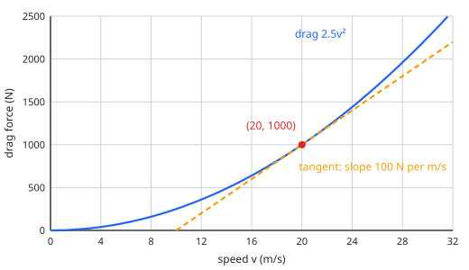

# Modelling 5: Linearisation and System Identification

Linearisation makes a curved plant straight near one operating point, identification measures a model you can't derive, and most results come out in one of two standard forms.

## Before you start
<!-- bite: 1fc7c658-7460-4f05-9ce0-abea541ebbd5 -->

You should have read [[control-theory/10-block-diagrams-3|10 — Block Diagrams 3: Multiple Inputs and Disturbances]] or at least [[control-theory/03-modelling-1|03 — Modelling 1: From Physics to Transfer Functions]], and be able to differentiate a function.

After this lesson you will be able to:

1. linearise a nonlinear equation about an operating point;
2. say when a linearised model stops being valid;
3. describe three ways to measure a model, and the traps in each;
4. recognise the standard first- and second-order forms.

## What this lesson covers
<!-- bite: 63fbfb3b-f0f0-4d01-8a0b-c50240901c5f -->

Every modelling lesson so far assumed the plant was linear and that we knew its numbers. Neither is quite true. Real drag isn't a straight line in speed, and some plants are too messy to write down at all. Linearisation and identification are how engineers get a usable transfer function anyway.

## The kid version
<!-- bite: 3947b1e9-73bd-4899-95ad-2499d24ea02e -->

The Earth is round, but a map of your street can be flat, because over a short distance the curve doesn't show. Linearising is drawing that flat map around the point where the machine usually runs. And when you can't survey the land at all, you walk it and measure: that's identification.

**Where the analogy stops working.** A street map stays useful however long you use it. A linearised model goes wrong as soon as the machine drifts far from its operating point, and an identified model is only as good as the walk you took.

## Linearisation
<!-- bite: f4aeb468-317b-4e3d-a895-32373124a36f -->

Transfer functions need a linear plant, and real plants aren't linear. Real air drag grows with speed squared: say $F_d = 2.5v^2$, which is 1000 N at 20 m/s.

The fix is to look only at small changes around an **operating point**. Near 20 m/s the curve is almost a straight line: its tangent. The slope of the tangent is the derivative, $dF_d/dv = 5v = 100$ N per m/s at 20 m/s. So near 20 m/s the car behaves like a linear plant with $b = 100$.

## Linearisation in general
<!-- bite: edc5d0f2-f43e-4dc4-9394-d9e03bfd0363 -->

The car's tangent line is one case of a general recipe. For $\dot{x} = f(x, u)$, keep the first-order terms of a Taylor series about $(x_0, u_0)$:

$$\delta\dot{x} \approx \left.\frac{\partial f}{\partial x}\right|_0 \delta x + \left.\frac{\partial f}{\partial u}\right|_0 \delta u$$

## Linearisation: the pendulum and the limits
<!-- bite: fafedccb-5250-4db8-9b8a-bd0ca59ef85b -->

The standard textbook example is the pendulum, $\ddot\theta + (g/L)\sin\theta = 0$. Near hanging straight down, $\sin\theta \approx \theta$, giving the linear $\ddot\theta + (g/L)\theta = 0$. It is accurate to about 20°.

Three things to keep in mind:

1. **A linearised model is local.** It holds near the operating point and nowhere else. A drone model linearised at hover doesn't describe a fast dive.
2. **Gain scheduling** is the practical answer: linearise at several points, design a controller for each, and switch between them. → [[control-theory/56-nonlinear-design-1|56 — Nonlinear Design 1: Describing Functions and Gain Scheduling]]
3. **Some nonlinearities can't be linearised away**: actuator limits, gear play, friction that sticks. Those need the nonlinear methods from lesson 46 on.

## System identification
<!-- bite: 43aee48c-de52-4235-934a-26f970280bc1 -->

Often you can't derive a model: the plant is too complicated or its numbers are unknown. So you measure one. This is **system identification**.

1. **Step test.** Apply a sudden change, record the output, fit a model. A first-order model with a dead time, $G(s) = Ke^{-\theta s}/(\tau s + 1)$, describes a surprising number of industrial processes with three numbers. Lesson 14 shows how to read them off.
2. **Frequency sweep.** Inject sine waves of many frequencies and measure how much each is amplified and delayed. This gives the Bode plot directly (lesson 24). Most informative, but slow.
3. **Least-squares fitting.** Apply a rich, random-looking input, then fit a model numerically. This is what identification software does.

## Identification: the traps
<!-- bite: b7faf748-93c5-4d8d-a5cd-07ab1062afee -->

1. **Excite the frequencies you care about.** A slow ramp tells you nothing about fast behaviour.
2. **Stay in the linear region.** Push too hard and you hit the actuator's limit, and fit a model of the limit.
3. **Check on different data** from the data you fitted, the same discipline as [[machine-learning/04-model-evaluation/index|any model fitting]].
4. **The model only holds over the range you tested.** Beyond it, you're guessing.

## Standard forms
<!-- bite: 76a967da-a106-457d-aaf8-05cb74a6e36d -->

Most plants look like one of two forms, so learn to recognise them on sight.

**First order:**

$$G(s) = \frac{K}{\tau s + 1}$$

$K$ is the DC gain and $\tau$ the **time constant**. The car is first order with $K = 0.02$ and $\tau = 20$ s. Heating, simple circuits and motor speed are too.

**Second order:**

$$G(s) = \frac{K\omega_n^2}{s^2 + 2\zeta\omega_n s + \omega_n^2}$$

$\omega_n$ is the **natural frequency** and $\zeta$ (zeta) the **damping ratio**. Anything with mass and springiness, like the suspension, is second order. These two numbers decide the whole character of the response, which is the next lesson.

## Common pitfalls
<!-- bite: 553476da-40a5-4dfc-8939-d65437f54d33 -->

1. **Linearising about the wrong point.** The slope depends on where you are: the car's linear drag is 100 at 20 m/s but only 50 at 10 m/s.
2. **Trusting a linear model far from its operating point.** It's local.
3. **Fitting a model to saturated data.** If the actuator hit its limit during the test, the model is wrong.
4. **Testing on the fitting data.** Check on fresh data.

## Check your understanding
<!-- bite: a149f366-fb00-4ee9-a062-78e332553f83 -->

Try each one before you open the answer.

1. <!-- q: exact id="7d21e9b4" answer="12" -->
   A fan's drag torque is $0.5\omega^2$. What is the slope of the linearised drag at $\omega = 12$ rad/s?

   

Answer

   $d(0.5\omega^2)/d\omega = \omega = 12$ (newton metres per rad/s).

   

2. <!-- q: open id="1f5c8e73" -->
   An engineer identifies a heater model from a step test, but during the test the heater was at full power the whole time. Why is the model untrustworthy?

   

Answer

   The heater was saturated, so the output wasn't responding to the input the model thinks it was. The fitted model describes the limit, not the plant, and the step test should be repeated with a smaller step that stays in the linear range.

   

3. <!-- q: mcq id="6a2d9f13" -->
   Which transfer function is in standard first-order form with time constant 5 s and DC gain 3?

   - [x] $3/(5s + 1)$
   - [ ] $5/(3s + 1)$
   - [ ] $3/(s + 5)$
   - [ ] $15/(s + 1)$

   

Answer

   $K/(\tau s + 1)$ with $K = 3$, $\tau = 5$. ($3/(s + 5)$ has time constant 0.2 s and DC gain 0.6.)

   

4. <!-- q: exact id="c95e1b04" answer="0.5" accept="1/2" -->
   A plant is $\dfrac{16}{s^2 + 4s + 16}$. What is its damping ratio?

   

Answer

   $\omega_n = 4$ and $2\zeta\omega_n = 4$, so $\zeta = 0.5$.

   

## Before moving on
<!-- bite: 4cbb9f0a-bbed-46ac-b9ed-c6c329c7cf70 -->

You can linearise, identify and recognise standard forms. **Next:** [[control-theory/08-block-diagrams-1|08 — Block Diagrams 1: Connections and the Feedback Rule]], which joins all these models into control loops.

## Related
<!-- bite: 6ea85f4d-fd67-4505-9a57-b837e28bffc5 -->

- [[control-theory/49-phase-plane-3|49 — Phase Plane 3: Linearising Around an Equilibrium]]: linearisation again, for nonlinear systems with several equilibria.
- [[control-theory/index|Control theory map]]

## About this lesson
<!-- bite: 1aec7157-a581-40f9-9653-c23cacde70a2 -->

**Level:** Intermediate. **Covers:** linearisation about an operating point, its limits, system identification and its traps, and the standard first- and second-order forms.

**Where it sits:** lesson 7 of 58, part 5 of the modelling lessons, the last before time response.

**Source:** `[reference]`, assembled from standard control texts. Diagram and numbers from `scripts/diagrams/control_theory.py`.
