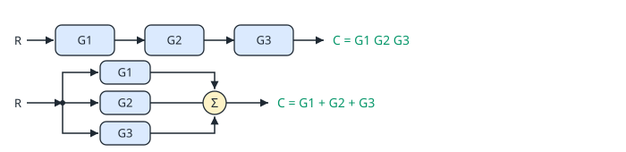
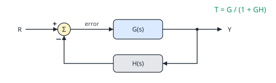

# Block Diagrams 1: Connections and the Feedback Rule

A block diagram draws a system as boxes of transfer functions joined by arrows, and three connection rules combine them.

## Before you start
<!-- bite: fafae28f-3e8e-4e52-9eb7-635810e9fa99 -->

You should have read [[control-theory/06-modelling-4|06 — Modelling 4: Rotational Systems, Gears and the DC Motor]], or at least [[control-theory/03-modelling-1|03 — Modelling 1: From Physics to Transfer Functions]].

After this lesson you will be able to:

1. name every element and signal of a block diagram in standard terms;
2. combine blocks in series, in parallel and in a feedback loop;
3. write the canonical form of a feedback system and its characteristic equation;
4. find the closed-loop transfer function of the cruise control.

## What a block diagram is
<!-- bite: 3c2ebc22-925b-463b-9333-54e997b287d2 -->

The modelling lessons gave each part of a system its own transfer function: the motor, the gears, the circuit. A **block diagram** puts them together. Each block holds a transfer function $G(s)$, with its input arrow on the left and output on the right, so that

$$C(s) = G(s)R(s)$$

Unlike a pile of differential equations, a block diagram lets you combine parts by algebra. This lesson gives the three basic connections; the next two lessons reduce complicated diagrams and handle several inputs.

## The kid version
<!-- bite: 1b14faa9-cc3f-42e1-ae8e-39ae1625be33 -->

A factory line: raw material goes into machine 1, its output into machine 2, and so on. Each machine changes what it's given in its own way. A block diagram is the factory's floor plan. Some lines split (a take-off point), some merge (a summing point), and some send finished products back to the start for checking (feedback).

**Where the analogy stops working.** Splitting a factory line divides the material between branches. Splitting a signal doesn't: every branch gets the full signal, because it's information, not stuff.

## The elements of a block diagram
<!-- bite: f7173c06-7396-4bea-ba49-d4defc1da5fa -->

1. **Block**: a box holding a transfer function. Output = transfer function × input.
2. **Arrow**: a signal, flowing one way.
3. **Summing point**: a circle where signals are added or subtracted; the sign at each arrowhead says which.
4. **Take-off point**: also known as a **pick-off point** or **branch point**. It is a dot where one signal goes to several places at once, unchanged.

## Terms used in feedback systems
<!-- bite: 72d10019-f2f1-49e1-8981-6d90d0e053f8 -->

The textbook names every part of the standard loop. With controller $G_2$, plant $G_3$ and feedback element $H$:

1. **Reference input $R(s)$**: the command, often the ideal output.
2. **Controlled output $C(s)$**: the quantity being controlled.
3. **Primary feedback signal $B(s)$**: the output after the feedback element, $B = HC$.
4. **Actuating signal $E(s)$**: also called the **error**. It is $R \pm B$, usually $R - B$.
5. **Control elements (controller)**: they turn $E$ into the **manipulated variable** $M(s)$, the signal applied to the plant.
6. **Plant**: the thing being controlled.
7. **Forward path**: from $E$ to $C$. **Feedback path**: from $C$ to $B$.

## Series and parallel
<!-- bite: 3f745e0a-3c63-4f0f-8afd-f45fc18dabdd -->

1. **Series** (cascade): blocks one after another, each fed by the last. The output is the input times every block, so they **multiply**: $G_1G_2G_3$.
2. **Parallel**: blocks sharing one input, outputs added at a summing point. They **add** (with the summing point's signs): $G_1 \pm G_2 \pm G_3$.

## The feedback rule
<!-- bite: d9f062e6-d7eb-488e-bb21-47d668a4dd00 -->

The third connection makes a loop. In words first: the output is $G$ times the error, and the error is the reference minus $H$ times the output. Solve those two together:

$$C = G(R - HC) \quad\Longrightarrow\quad (1 + GH)C = GR \quad\Longrightarrow\quad \frac{C(s)}{R(s)} = \frac{G(s)}{1 + G(s)H(s)}$$

For **positive** feedback (the summing point adds $B$), the sign flips: $G/(1 - GH)$. A single loop drawn like this, one forward block and one feedback block, is the **canonical form**, and any block diagram with one input and one output can be reduced to it (next lesson).

## The loop gain and the characteristic equation
<!-- bite: 6014f8db-3215-422a-be94-4127b3586b75 -->

The product $L = GH$ is the **loop gain**: what a signal is multiplied by on one trip around the loop. It is the central object of classical design.

The closed-loop poles are where the denominator is zero:

$$1 + G(s)H(s) = 0$$

This is the **characteristic equation**. Routh's test, the root locus and the Nyquist criterion are all, in the end, ways of studying the roots of this one equation.

The insensitivity result from lesson 01 drops straight out: when $|L| \gg 1$, the 1 in the denominator hardly matters, so $C/R \approx G/(GH) = 1/H$. With $H = 1$, $C/R \approx 1$ whatever $G$ is. The output depends on the sensor, not on the plant.

## The cruise control as a loop
<!-- bite: 67d382b0-77dd-4392-b54d-ab1c11fe790a -->

Put the car in the loop. The plant is $G = 1/(1000s + 50)$, the controller multiplies the error by 500, and the sensor is perfect ($H = 1$). In series, the forward path is $500G$:

$$\frac{C}{R} = \frac{500/(1000s + 50)}{1 + 500/(1000s + 50)} = \frac{500}{1000s + 550}$$

Before reading on, predict the steady speed for a 20 m/s reference, and the closed-loop pole.

The DC gain is $500/550 = 0.909$, so the car settles at $0.909 \times 20 = 18.18$ m/s, the same as lesson 01's force balance. The pole has moved from $-0.05$ to $-0.55$: eleven times further from the axis, so eleven times faster. One formula gave us both lesson 01 results.

## Common pitfalls
<!-- bite: 2ad71ea7-9545-4988-bc8a-897c2d0845da -->

1. **Writing $G/(1 - GH)$ for negative feedback.** Negative feedback puts a plus sign in the denominator.
2. **Forgetting $H$.** With a sensor that isn't perfect, the loop gain is $GH$, not $G$.
3. **Splitting a signal's value at a take-off point.** Every branch carries the full signal.
4. **Multiplying blocks that load each other.** The series rule needs each block's output unaffected by what it drives.

## Check your understanding
<!-- bite: db0d9c7e-ceaf-4d1b-991a-6d3c66ef19d2 -->

Try each one before you open the answer.

1. <!-- q: mcq id="9e4b1d02" -->
   A forward path $G$ has a feedback path $H$, with negative feedback. What is the closed-loop transfer function?

   - [x] $G/(1 + GH)$
   - [ ] $G/(1 - GH)$
   - [ ] $GH/(1 + G)$
   - [ ] $G + H$

   

Answer

   $G/(1 + GH)$. Negative feedback puts a plus sign in the denominator.

   

2. <!-- q: exact id="3a7c55e8" answer="-12" accept="−12" -->
   A plant $G(s) = 2/(s + 2)$ is in a unity-feedback loop with a controller gain of 5. Where is the closed-loop pole?

   

Answer

   $C/R = 10/(s + 2 + 10) = 10/(s + 12)$, so the pole is at $-12$.

   

3. <!-- q: exact id="c86f0a1d" answer="0.8333" sigfigs="3" -->
   A plant $G(s) = 2/(s + 2)$ is in a unity-feedback loop with a controller gain of 5. What is the closed-loop DC gain?

   

Answer

   $10/12 = 0.833$.

   

4. <!-- q: gap id="f4c0a729" answers="actuating|error;manipulated" -->
   The signal $E = R - B$ is called the ___ signal, and the controller's output, applied to the plant, is the ___ variable.

   

Answer

   The actuating signal (the error); the manipulated variable.

   

5. <!-- q: mcq id="2b8e6d15" -->
   Three blocks $2$, $1/(s+1)$ and $3/s$ are in parallel, all added. What is the equivalent block?

   - [ ] $6/(s(s+1))$
   - [x] $2 + 1/(s+1) + 3/s$
   - [ ] $(2 + 3)/(s(s+1))$
   - [ ] $2 \times 3/(s+1)$

   

Answer

   Parallel blocks add: $2 + 1/(s+1) + 3/s$. Multiplying is for series.

   

## Before moving on
<!-- bite: 6e4523aa-2f63-47ed-9305-801fbf74000b -->

You can name a loop's parts and combine blocks three ways. **Next:** [[control-theory/09-block-diagrams-2|09 — Block Diagrams 2: Reduction Rules]], for diagrams with several loops.

## Related
<!-- bite: 12b240ff-996d-4df3-94b6-91ba7349c4f8 -->

- [[control-theory/01-what-control-theory-is-1|01 — What Control Theory Is 1: The Feedback Loop]]: the loop's parts in words.
- [[control-theory/index|Control theory map]]

## About this lesson
<!-- bite: eb240814-c301-4737-8c3c-c1b1adc25715 -->

**Level:** Intermediate. **Covers:** block diagram elements, feedback-system terms, series, parallel and feedback connections, canonical form, loop gain, the characteristic equation, and the cruise control as a loop.

**Where it sits:** lesson 8 of 58, part 1 of 3 on block diagrams.

**Source:** the author's course notes, A. M. Hussein, *Control Engineering*, Benha University, chapter 3 (sections 4 and 5); `[reference]` for the cruise-control example. Diagrams from `scripts/diagrams/control_theory.py`.
