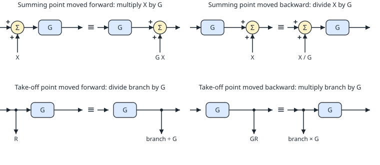
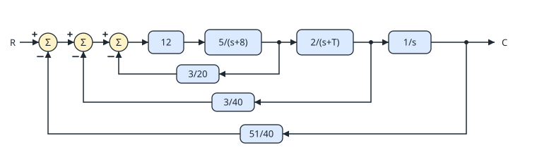
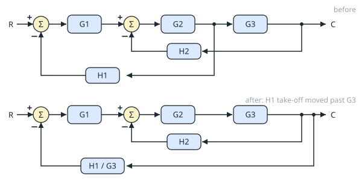

# Block Diagrams 2: Reduction Rules

Any single-input, single-output block diagram reduces to one block by combining connections and moving points past blocks.

## Before you start
<!-- bite: b0b18c96-45cb-4e77-a0f7-283899328f88 -->

You should have read [[control-theory/08-block-diagrams-1|08 — Block Diagrams 1: Connections and the Feedback Rule]], and know the series, parallel and feedback rules.

After this lesson you will be able to:

1. move a summing point or a take-off point past a block without changing the system;
2. follow the six-step reduction procedure;
3. reduce nested loops and overlapping loops to a single block;
4. find a system's characteristic equation when a parameter is left as a letter.

## What block diagram reduction is
<!-- bite: 6b1fff2d-5283-4c51-9eea-32bd9fed9241 -->

Real diagrams aren't one tidy loop. A motor drive has a current loop inside a speed loop inside a position loop; a feedback path may start in the middle of the forward path. The three rules of lesson Block Diagrams 1 only apply when blocks are *already* in series, parallel or a single loop. **Reduction** rearranges the diagram, without changing what it does, until those rules apply, ending in the canonical single loop and then one block.

## The kid version
<!-- bite: 806c8df3-499f-4147-8a95-78d47e717af2 -->

Untangling a knot of headphone cables. You don't cut anything; you slide loops along the cable until each one comes free, then pull it straight. Moving a summing or take-off point past a block is the slide; combining a loop into one block is pulling it straight.

**Where the analogy stops working.** Sliding a cable changes nothing. Sliding a point past a block changes the signal it carries, so you must add a correcting block to make up for it, and the rules say exactly what to add.

## Moving a summing point
<!-- bite: e402513b-582f-4cbf-8f36-9e23a9b58aa6 -->

A summing point adds a signal $X$ to the signal entering or leaving a block $G$.

1. **Moving it forward past $G$** (in the direction of signal flow): the added signal now skips the block, so multiply it by $G$. Before: $C = G(R + X)$. After: $C = GR + GX$.
2. **Moving it backward past $G$**: the added signal now passes through the block, so divide it by $G$ first. Before: $C = GR + X$. After: $C = G(R + X/G)$.

The rule in words: **whatever the moved signal gains or loses by the move, put a block on it to cancel the change.**

## Moving a take-off point
<!-- bite: e44d951e-5844-43e5-8bf6-609f4fd9df79 -->

A take-off point copies a signal to a side branch.

1. **Moving it forward past $G$**: the copy is now taken after the block, so it carries $G$ times too much. Divide the branch by $G$.
2. **Moving it backward past $G$**: the copy is taken before the block, so it's missing $G$. Multiply the branch by $G$.

## The reduction procedure
<!-- bite: dba0bcbc-dca8-4cc3-83b8-9a643d7f2a7c -->

The textbook's six steps:

1. Combine all **cascade** (series) blocks.
2. Combine all **parallel** blocks.
3. Eliminate all **minor (interior) feedback loops** with the feedback rule.
4. Shift summing points to the **left**.
5. Shift take-off points to the **right**.
6. Repeat until the **canonical form** is reached, then apply the feedback rule once more.

Steps 4 and 5 are only for untangling: use them when loops overlap, so that no loop can be closed without breaking another.

## Worked: nested loops
<!-- bite: da16a3b7-08f4-4e85-b5c4-b8ebef311094 -->

The textbook's example 13: the forward path is $12$, then $\dfrac{5}{s+8}$, then $\dfrac{2}{s+T}$, then $\dfrac1s$. Three feedback paths: $\tfrac{3}{20}$ around the first two blocks, $\tfrac{3}{40}$ around the first three, and $\tfrac{51}{40}$ around everything. Here $T$ is a parameter left as a letter.

## Nested loops: working from the inside out
<!-- bite: 495e04aa-0f9c-4770-8b03-b9ade1d1927d -->

The loops are nested, so work from the inside out:

1. Cascade $12 \times \dfrac{5}{s+8} = \dfrac{60}{s+8}$. Close the $\tfrac{3}{20}$ loop: $\dfrac{60}{s + 8 + 60 \times 3/20} = \dfrac{60}{s+17}$.
2. Cascade with $\dfrac{2}{s+T}$, giving $\dfrac{120}{(s+17)(s+T)}$. Close the $\tfrac{3}{40}$ loop: $\dfrac{120}{(s+17)(s+T) + 9}$.
3. Cascade with $\dfrac1s$ and close the outer loop, where $120 \times \tfrac{51}{40} = 153$:

$$\frac{C(s)}{R(s)} = \frac{120}{s^3 + (17 + T)s^2 + (17T + 9)s + 153}$$

The characteristic equation is $s^3 + (17 + T)s^2 + (17T + 9)s + 153 = 0$, ready for Routh's test with $T$ still a letter (lesson on Routh design).

## Worked: overlapping loops
<!-- bite: d489001b-7e54-4583-97fa-d536dbb85384 -->

Now the case that needs a move. The forward path is $G_1$, $G_2$, $G_3$. Feedback $H_1$ takes off **after $G_2$** and returns to the input summing point; feedback $H_2$ takes off **after $G_3$** (the output) and returns to the summing point **between $G_1$ and $G_2$**. Predict: why can't you close either loop directly?

## Overlapping loops: making the move
<!-- bite: 2c51a06a-5aa5-4168-b2f0-9139710a862f -->

The $H_1$ loop contains $G_1$ and $G_2$, the $H_2$ loop contains $G_2$ and $G_3$: they share $G_2$, so neither is a closed loop on its own. **Move $H_1$'s take-off point forward past $G_3$**, so its branch becomes $H_1/G_3$. Now:

1. The inner loop is $G_2G_3$ with feedback $H_2$: $\dfrac{G_2G_3}{1 + G_2G_3H_2}$.
2. In series with $G_1$, inside the outer loop with feedback $H_1/G_3$:

$$\frac{C}{R} = \frac{G_1G_2G_3}{1 + G_2G_3H_2 + G_1G_2H_1}$$

Notice the pattern in the denominator: one plus each loop's gain. Signal flow graphs make that pattern a rule (Mason's formula).

## Common pitfalls
<!-- bite: 8841928c-e51f-4756-8f3f-ceb19ad837f0 -->

1. **Multiplying when you should divide.** Ask what the moved signal gains or loses, and cancel it.
2. **Closing an overlapping loop directly.** Move a point first.
3. **Losing a sign.** Positive feedback paths give minus signs in the denominator.
4. **Stopping early.** Keep going until there's one block.

## Check your understanding
<!-- bite: 8190d416-fe83-4626-b76c-a2c456cc409e -->

Try each one before you open the answer.

1. <!-- q: mcq id="8c1e5f30" -->
   A summing point adds a signal $X$ just before a block $G$. You move the summing point to just after $G$. What block must go on $X$?

   - [x] $G$
   - [ ] $1/G$
   - [ ] $1 + G$
   - [ ] Nothing

   

Answer

   Before the move, $X$ passed through $G$. After the move it doesn't, so multiply it by $G$ to keep $C = GR + GX$.

   

2. <!-- q: mcq id="2d7a9b46" -->
   A take-off point copies the signal after a block $G$. You move it to before $G$. What block must go on the branch?

   - [x] $G$
   - [ ] $1/G$
   - [ ] $G^2$
   - [ ] Nothing

   

Answer

   The branch used to carry $G$ times the input. Taken before $G$, it carries the input itself, so multiply the branch by $G$.

   

3. <!-- q: exact id="e5f02c91" answer="-10" accept="−10" -->
   A block $\dfrac{20}{s + 2}$ has a minor feedback loop of gain $0.4$ around it. After closing the loop, where is its pole?

   

Answer

   $\dfrac{20}{s + 2 + 20 \times 0.4} = \dfrac{20}{s + 10}$, so the pole is at $-10$.

   

4. <!-- q: mcq id="5b3c8d72" -->
   Forward path $G_1G_2G_3$; feedback $H_1$ from after $G_2$ to the input; feedback $H_2$ from the output to between $G_1$ and $G_2$. What is $C/R$?

   - [ ] $G_1G_2G_3/(1 + G_1G_2G_3H_1H_2)$
   - [x] $G_1G_2G_3/(1 + G_1G_2H_1 + G_2G_3H_2)$
   - [ ] $G_1G_2G_3/(1 + G_1H_1 + G_3H_2)$
   - [ ] $G_1G_2G_3/((1 + G_1G_2H_1)(1 + G_2G_3H_2))$

   

Answer

   Move $H_1$'s take-off point past $G_3$ (branch becomes $H_1/G_3$), close the inner loop, then the outer: $G_1G_2G_3/(1 + G_2G_3H_2 + G_1G_2H_1)$. The loops share $G_2$, so they don't multiply.

   

5. <!-- q: open id="9a6d1e08" -->
   In the nested-loop example, why is it fine to close the $\tfrac{3}{20}$ loop first, but not to start with the $\tfrac{51}{40}$ loop?

   

Answer

   The $\tfrac{3}{20}$ loop is innermost: it contains only series blocks, so the feedback rule applies directly. The outer loop contains the other loops inside its forward path, and its forward path isn't a single block until they've been closed.

   

## Before moving on
<!-- bite: 3b0c3eeb-394b-4081-9334-9a8286d2a102 -->

You can move points and reduce nested and overlapping loops. **Next:** [[control-theory/10-block-diagrams-3|10 — Block Diagrams 3: Multiple Inputs and Disturbances]].

## Related
<!-- bite: eb2f1746-6710-4585-bc5b-facada13f76d -->

- [[control-theory/12-signal-flow-graphs-2|12 — Signal Flow Graphs 2: Mason's Gain Formula]]: the same answers without moving anything.
- [[control-theory/index|Control theory map]]

## About this lesson
<!-- bite: 02803483-f11f-4158-ae30-0770662799c8 -->

**Level:** Intermediate. **Covers:** moving summing and take-off points, the six-step reduction procedure, nested loops with a parameter, and overlapping loops.

**Where it sits:** lesson 9 of 58, part 2 of 3 on block diagrams.

**Source:** the author's course notes, A. M. Hussein, *Control Engineering*, Benha University, chapter 3 (sections 5.4 to 6.1, examples 5 to 9 and 13). Every reduction is checked numerically in `scripts/diagrams/control_theory.py`, which also draws the diagrams.
