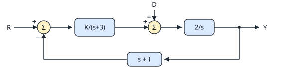

# Block Diagrams 3: Multiple Inputs and Disturbances

When a system has several inputs, such as a reference and a disturbance, superposition finds the output: take one input at a time, reduce, and add the results.

## Before you start
<!-- bite: 848f3a8c-f337-4a61-bed3-23b5af625955 -->

You should have read [[control-theory/09-block-diagrams-2|09 — Block Diagrams 2: Reduction Rules]], and be able to reduce a diagram to one block.

After this lesson you will be able to:

1. use superposition to find the output of a linear system with several inputs;
2. find the transfer functions from the reference and from a disturbance;
3. calculate the steady-state effect of a step disturbance;
4. describe a multi-input, multi-output system by its matrix of transfer functions.

## What this lesson covers
<!-- bite: 33e1e539-e153-4f8d-a60f-29ae1c2118c6 -->

Lesson 01's car met a hill: a **disturbance**, a second input that nobody chose. Every real loop has some: wind on a drone, load torque on a motor, an open door on a heated room. Block diagrams show them as a second arrow into a summing point. This lesson finds the output when both the reference and the disturbance act at once.

## The kid version
<!-- bite: 7c65e4f6-48d8-4258-ba94-f10713f6d35d -->

Two people push a swing at once. To work out how far it goes, figure out how far each push alone would move it, then add the two. That works because the swing (for small pushes) is linear: each push's effect doesn't change the other's.

**Where the analogy stops working.** Push a real swing hard enough and it stops being linear, and the two effects no longer simply add. Superposition only holds for linear systems.

## Superposition: the procedure
<!-- bite: 4e3629e4-7863-4421-acb8-b8edfabf3641 -->

For a linear system, the output due to several inputs is the sum of the outputs due to each one alone. The textbook's procedure:

1. Set every input to zero except one.
2. Rearrange the diagram into a solvable form, from that input to the output.
3. Find the output due to that input alone.
4. Repeat for each of the other inputs.
5. Add all the outputs.

Setting an input to zero means deleting its arrow; any minus sign it carried at a summing point stays with the other signals there. Where a feedback signal enters with a minus sign and you rearrange around a different input, carry the sign as a $-1$ block.

## The general disturbance loop
<!-- bite: cad82d9c-1ea9-4f3c-aa38-63075142e18c -->

The textbook's example 10: reference $R$ through a summing point (minus the output), then $G_1$, then a second summing point where a disturbance $D$ is added, then $G_2$ to the output $C$.

1. **With $D = 0$**: an ordinary loop, $C_R = \dfrac{G_1G_2}{1 + G_1G_2}R$.
2. **With $R = 0$**: $D$ goes through $G_2$ to the output, and the loop feeds back through $-1$ and $G_1$. So $C_D = \dfrac{G_2}{1 + G_1G_2}D$.
3. **Total**:

$$C(s) = \frac{G_2}{1 + G_1G_2}\big(G_1R + D\big)$$

Both share the denominator $1 + G_1G_2$: one loop, one characteristic equation, whichever input you look from. The controller $G_1$ appears in the disturbance's numerator only through the denominator, so **a big controller gain shrinks the disturbance's effect**, which is lesson 01's hill, as a formula.

## Worked: a disturbance on a motor
<!-- bite: cc8bf9ff-7474-4aa3-bd5d-04648390e6a8 -->

The textbook's example 12: the reference goes through a summing point to a controller $\dfrac{K}{s+3}$; a disturbance $D$ is added after it; then $\dfrac2s$ gives the output $Y$; the feedback path is $(s + 1)$.

Setting $D = 0$, then $R = 0$:

$$\frac{Y}{R} = \frac{2K}{s(s+3) + 2K(s+1)}, \qquad \frac{Y}{D} = \frac{2(s+3)}{s(s+3) + 2K(s+1)}$$

So $Y = \dfrac{2KR + 2(s+3)D}{s(s+3) + 2K(s+1)}$.

## How much the disturbance moves the output
<!-- bite: 5f3d029c-2570-4043-a3dd-a3a0acbddc95 -->

Take $K = 10$ and unit steps on both inputs. The steady-state values are the transfer functions at $s = 0$ (lesson 15):

1. From the reference: $\dfrac{2K}{2K} = 1$. The output follows the reference exactly.
2. From the disturbance: $\dfrac{2 \times 3}{2K} = \dfrac{3}{K} = 0.3$.

Predict before reading on: what gain $K$ would cut the disturbance's effect to 0.1?

$3/K = 0.1$, so $K = 30$. Raising the controller gain rejects the disturbance better, but lesson 19's Routh test is what tells you whether $K = 30$ is still stable.

## Many inputs, many outputs
<!-- bite: 1abc2942-0a00-4805-8ddd-419629d5f079 -->

A system with several inputs and several outputs (MIMO) is handled the same way, one input-output pair at a time. Each output is a sum over the inputs:

$$C_1 = T_{11}R_1 + T_{12}R_2, \qquad C_2 = T_{21}R_1 + T_{22}R_2$$

where $T_{ij}$ is the transfer function from input $j$ to output $i$, found with every other input set to zero. Arranged in a matrix, $\mathbf{C} = T(s)\mathbf{R}$: the **transfer function matrix**. The off-diagonal terms are the **coupling** that makes MIMO hard (lesson 02), and state space (lesson 30) is the cleaner way to handle them.

## Common pitfalls
<!-- bite: e29f170f-d9b7-4aaa-889e-7df81ea514bf -->

1. **Using superposition on a nonlinear system.** Effects only add for linear systems.
2. **Dropping the feedback sign when rearranging** around a disturbance. Carry it as a $-1$ block.
3. **Expecting different characteristic equations** for different inputs. A single loop has one denominator.
4. **Forgetting to check stability** after raising a gain to reject disturbances.

## Check your understanding
<!-- bite: b8f438f2-8ade-44b4-b2f7-66e4b149137c -->

Try each one before you open the answer.

1. <!-- q: mcq id="7e4b2c19" -->
   In the loop $R \to$ (minus $C$) $\to G_1 \to$ (plus $D$) $\to G_2 \to C$, what is $C/D$?

   - [x] $G_2/(1 + G_1G_2)$
   - [ ] $G_1G_2/(1 + G_1G_2)$
   - [ ] $1/(1 + G_1G_2)$
   - [ ] $G_2/(1 - G_1G_2)$

   

Answer

   With $R = 0$, $D$ passes through $G_2$ to the output, and the loop around it is $G_1G_2$ with negative feedback.

   

2. <!-- q: exact id="b0c6e3f8" answer="0.090909" sigfigs="3" -->
   In the loop $R \to$ (minus $C$) $\to G_1 \to$ (plus $D$) $\to G_2 \to C$, $G_1 = 10$ and $G_2 = 1/(s + 1)$. What steady-state output does a unit-step disturbance cause, with $R = 0$?

   

Answer

   $G_2(0)/(1 + G_1G_2(0)) = 1/(1 + 10) = 0.0909$.

   

3. <!-- q: exact id="3d9f6a24" answer="0.15" -->
   In the motor example, $Y/D = 2(s+3)/(s(s+3) + 2K(s+1))$. With $K = 20$, what steady-state output does a unit-step disturbance cause?

   

Answer

   $6/(2K) = 3/20 = 0.15$.

   

4. <!-- q: gap id="1c8e7d50" answers="zero|0;add|sum" -->
   Superposition: set every input to ___ except one, find the output it causes, repeat for each input, then ___ the outputs.

   

Answer

   Zero; add (sum) them.

   

5. <!-- q: open id="f6a01b27" -->
   Why do the transfer functions from the reference and from the disturbance share the same denominator?

   

Answer

   The denominator comes from the loop, $1 + (\text{loop gain})$, and both inputs travel round the same loop. Where an input enters only changes the numerator: which blocks it passes through on its way to the output.

   

## Before moving on
<!-- bite: bb974ca8-fe34-4e7c-8711-f63ab9243d7c -->

You can handle reference and disturbance inputs together, and describe MIMO systems by their transfer matrix. **Next:** [[control-theory/11-signal-flow-graphs-1|11 — Signal Flow Graphs 1: Nodes, Branches and Loops]], a second way of drawing the same systems.

## Related
<!-- bite: 313f70b1-7a8b-4da0-951d-1e0bce6cbe7e -->

- [[control-theory/01-what-control-theory-is-1|01 — What Control Theory Is 1: The Feedback Loop]]: the hill as a disturbance.
- [[control-theory/index|Control theory map]]

## About this lesson
<!-- bite: be70cd22-d310-4270-afc2-5e592f6415e0 -->

**Level:** Intermediate. **Covers:** superposition for several inputs, the general disturbance loop, a worked disturbance example with its steady-state effect, and transfer function matrices for MIMO systems.

**Where it sits:** lesson 10 of 58, part 3 of 3 on block diagrams.

**Source:** the author's course notes, A. M. Hussein, *Control Engineering*, Benha University, chapter 3 (section 7, examples 10 to 12 and 19). Checked numerically in `scripts/diagrams/control_theory.py`.
