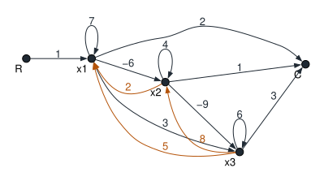
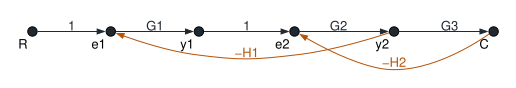

# Signal Flow Graphs 1: Nodes, Branches and Loops

A signal flow graph draws a system as dots for signals joined by arrows labelled with gains, which makes its paths and loops easy to list.

## Before you start
<!-- bite: 5505348d-0783-4021-8334-2d0b9b22b62e -->

You should have read [[control-theory/10-block-diagrams-3|10 — Block Diagrams 3: Multiple Inputs and Disturbances]], and be able to reduce a block diagram.

After this lesson you will be able to:

1. define nodes, branches, forward paths, loops and non-touching loops;
2. draw a signal flow graph from a set of linear equations;
3. convert a block diagram into a signal flow graph;
4. list every forward path and loop of a graph, and say which loops touch.

## What a signal flow graph is
<!-- bite: 3e31b542-d3fc-48a8-a7ca-235ac7676e47 -->

Block diagram reduction works, but on a complicated system it means redrawing the diagram again and again, moving points around. In 1953 Samuel Mason gave an alternative: draw the system as a **signal flow graph**, and read the transfer function off it with **one formula**, no moving required. This lesson is the drawing; the next is the formula.

A signal flow graph is a picture of a set of linear equations. The equation $y = ax$ is drawn as two dots, $x$ and $y$, with an arrow from $x$ to $y$ labelled $a$.

## The kid version
<!-- bite: 119d1fa1-ddcc-447a-84fd-ffe983dd5b8c -->

A map of one-way streets between towns, where each street multiplies whatever travels along it by its number. The value arriving at a town is the sum of everything arriving on its streets. A forward path is a road trip from the start town to the finish without visiting any town twice; a loop is a round trip back home.

**Where the analogy stops working.** A real car arriving at a town is in one place. A signal arriving at a node is copied out along *every* outgoing street at once.

## Terms used in signal flow graphs
<!-- bite: 171ecc2a-f9b0-4ff4-8fdc-f5b751b95425 -->

1. **Node**: a point that stands for a variable or signal, such as $R$, $C$ or $V_1$.
2. **Branch**: an arrow joining two nodes, labelled with its gain (its transfer function). Signals flow only in the arrow's direction.
3. **Input node** (source): a node with only outgoing branches, such as $R$.
4. **Output node** (sink): a node with only incoming branches, such as $C$.
5. **Mixed node**: a node with both incoming and outgoing branches.
6. **Forward path**: a chain of branches from the input to the output that touches no node twice.
7. **Loop**: a closed chain of branches that starts and ends at the same node, touching no other node twice. Its **gain** is the product of its branch gains.
8. **Non-touching loops**: loops with no node in common.

The rule a node obeys: **its value is the sum of the incoming branch gains times the nodes they come from.**

## From equations to a graph
<!-- bite: ca0ddb3a-9526-47e2-adc9-3211b23d4f0f -->

Every node's equation becomes its incoming branches. The textbook's example 1:

$$x_1 = R + 7x_1 + 2x_2 + 5x_3, \quad x_2 = -6x_1 + 4x_2 + 8x_3, \quad x_3 = 3x_1 - 9x_2 + 6x_3, \quad C = 2x_1 + x_2 + 3x_3$$

1. Draw a node for $R$, $x_1$, $x_2$, $x_3$ and $C$.
2. For $x_1$: a branch from $R$ with gain 1, from $x_2$ with gain 2, from $x_3$ with gain 5, and a **self-loop** on $x_1$ with gain 7 (it depends on itself).
3. Do the same for $x_2$, $x_3$ and $C$.

## Seeing the equations as a graph
<!-- bite: fadd6113-7494-4366-b289-2af78556cbfe -->

Here is the whole graph, with every term of every equation drawn as a branch.

The reverse works too: given a graph, write each node's equation by summing its incoming branches.

## From a block diagram to a graph
<!-- bite: f2a5606f-43d3-4ea8-9815-95e32018f339 -->

1. Give every signal a node: the input, the output, every summing point's output and every block's output.
2. Each block becomes a branch with the block's transfer function.
3. Each summing point becomes a node whose incoming branches carry the signs: a subtracted signal gets a branch with a minus in its gain.
4. A take-off point needs nothing special: a node can send branches to as many places as you like.

## Converting the overlapping-loop diagram
<!-- bite: 63072557-9c9e-4e8b-9e1b-2b33c6e6579a -->

Take Block Diagrams 2's overlapping loops: forward $G_1$, $G_2$, $G_3$; feedback $H_1$ from after $G_2$ to the input summing point; feedback $H_2$ from the output to the summing point between $G_1$ and $G_2$.

## Its paths and loops
<!-- bite: b774f2ee-3e4f-4aff-b49e-5009b23e1408 -->

Before reading on, list the forward paths and the loops.

1. **Forward paths**: just one, $R \to e_1 \to y_1 \to e_2 \to y_2 \to C$, with gain $P_1 = G_1G_2G_3$.
2. **Loops**: $L_1 = -G_1G_2H_1$ (through $e_1$, $y_1$, $e_2$, $y_2$) and $L_2 = -G_2G_3H_2$ (through $e_2$, $y_2$, $C$).
3. **Touching?** They share nodes $e_2$ and $y_2$, so they touch.

## Common pitfalls
<!-- bite: 5dbb9921-5585-49f4-9903-ffcbb2b8369a -->

1. **Forgetting the minus sign** on a branch from a subtracted signal.
2. **Counting a path that visits a node twice.** That's not a forward path.
3. **Missing self-loops.** A variable that appears in its own equation has one.
4. **Calling loops non-touching when they share any node.** One shared node is enough to touch.

## Check your understanding
<!-- bite: 73e51c0a-038d-4532-9030-609f21120694 -->

Try each one before you open the answer.

1. <!-- q: mcq id="4b6d0e93" -->
   A node has two incoming branches and three outgoing ones. What kind of node is it?

   - [ ] Input node
   - [ ] Output node
   - [x] Mixed node
   - [ ] Loop

   

Answer

   It has both incoming and outgoing branches, so it's a mixed node.

   

2. <!-- q: mcq id="e8a3c751" -->
   The equation $x_2 = 3x_1 - 2x_2 + x_3$ is drawn into a graph. Which branch represents the $-2x_2$ term?

   - [ ] A branch from $x_1$ to $x_2$ with gain $-2$
   - [x] A self-loop on $x_2$ with gain $-2$
   - [ ] A branch from $x_2$ to $x_3$ with gain $-2$
   - [ ] No branch: it moves to the left side

   

Answer

   $x_2$ depends on itself, so it's a self-loop on $x_2$ with gain $-2$.

   

3. <!-- q: exact id="1f7c9a24" answer="1" -->
   A graph has loops $L_1$ through nodes $a, b$; $L_2$ through $c, d$; and $L_3$ through $b, c$. How many pairs of loops don't touch?

   

Answer

   One. $L_1$ and $L_2$ share no node. $L_1$ and $L_3$ share $b$, and $L_2$ and $L_3$ share $c$, so those pairs touch.

   

4. <!-- q: gap id="c3e81b06" answers="forward path;loop" -->
   A chain of branches from input to output touching no node twice is a ___; a closed chain back to its starting node is a ___.

   

Answer

   A forward path; a loop.

   

5. <!-- q: open id="7a5f2d94" -->
   When converting a block diagram to a signal flow graph, how is a summing point with one subtracted input represented?

   

Answer

   As a node. Each incoming signal becomes a branch into that node, and the subtracted one carries a minus sign in its gain (for example $-H$).

   

## Before moving on
<!-- bite: b22d929e-e419-46dc-9ae7-994ef32171e6 -->

You can draw a signal flow graph and list its paths and loops. **Next:** [[control-theory/12-signal-flow-graphs-2|12 — Signal Flow Graphs 2: Mason's Gain Formula]].

## Related
<!-- bite: 6af4be2d-20df-4e49-b274-85735beca729 -->

- [[control-theory/09-block-diagrams-2|09 — Block Diagrams 2: Reduction Rules]]: the same systems, reduced the other way.
- [[control-theory/index|Control theory map]]

## About this lesson
<!-- bite: 963e6e6b-3e0f-4a2c-a5b9-5d001cf70f68 -->

**Level:** Intermediate. **Covers:** signal flow graph terms, building a graph from equations and from a block diagram, and listing paths and loops.

**Where it sits:** lesson 11 of 58, part 1 of 2 on signal flow graphs.

**Source:** the author's course notes, A. M. Hussein, *Control Engineering*, Benha University, chapter 4 (sections 1 to 4, examples 1 and 2). Graphs drawn by `scripts/diagrams/control_theory.py`.
