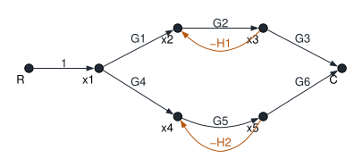

# Signal Flow Graphs 2: Mason's Gain Formula

Mason's gain formula gives a system's transfer function in one step from its signal flow graph, using its forward paths, its loops and which loops touch.

## Before you start
<!-- bite: fbe8e174-368d-432c-bf84-fddd42ef664d -->

You should have read [[control-theory/11-signal-flow-graphs-1|11 — Signal Flow Graphs 1: Nodes, Branches and Loops]], and be able to list a graph's forward paths and loops.

After this lesson you will be able to:

1. state Mason's gain formula and say what each term means;
2. compute the determinant $\Delta$ from loops and non-touching loop pairs;
3. compute each path's cofactor $\Delta_k$;
4. find the transfer function of graphs with one or several forward paths.

## What Mason's formula is
<!-- bite: f3820533-15d5-4a61-be20-a1950a50de8b -->

Lesson Signal Flow Graphs 1 drew the graph and listed its paths and loops. Mason's formula turns that list straight into the transfer function from input to output:

$$T = \frac{1}{\Delta}\sum_{k=1}^{N}P_k\Delta_k$$

1. $N$ is the number of forward paths, and $P_k$ is the gain of the $k$th one.
2. $\Delta$ is the graph's **determinant**, built from its loops.
3. $\Delta_k$ is the **cofactor** of path $k$: $\Delta$ with every loop that touches path $k$ removed.

## The kid version
<!-- bite: c9c6e188-7bef-4d40-bb1b-3742e78dc979 -->

Imagine counting all the ways water can get from a tap to a bucket through a network of pipes, some of which feed water back round in circles. Each straight route counts once; the circles boost or weaken the flow. Mason's formula is a bookkeeping rule: add up the routes, then correct for all the circles, including circles that happen far from a route and so only affect it partly.

**Where the analogy stops working.** Water just flows; there's no sign. Loops in a control system usually have negative gain (negative feedback), and the formula's alternating plus and minus signs keep track of that exactly.

## The determinant Δ
<!-- bite: 3180d80b-7e3b-451d-b451-5b7173c4d4c7 -->

In words: start with 1, **subtract** the sum of all loop gains, **add** the products of every pair of non-touching loops, **subtract** the products of every three mutually non-touching loops, and so on:

$$\Delta = 1 - \sum L_i + \sum L_iL_j - \sum L_iL_jL_k + \cdots$$

where the pairs, triples, and so on are only those whose loops don't touch each other.

Two examples with numbers. Loops of gain $-2$ and $-3$ that **touch**: $\Delta = 1 - (-2 - 3) = 6$. The same two loops **not touching**: $\Delta = 1 - (-2 - 3) + (-2)(-3) = 12$.

## The cofactor Δk
<!-- bite: 89006864-5593-4f2c-8775-0f0522ea8221 -->

$\Delta_k$ is built the same way as $\Delta$, but using only the loops that **don't touch** path $k$. If path $k$ touches every loop, $\Delta_k = 1$.

Why: a loop that touches the path modifies signals *on* the path, and that's already accounted for in $\Delta$. A loop off to the side of the path affects the path's contribution differently, and the cofactor corrects for it.

## Worked: the overlapping loops again
<!-- bite: d1a87eb3-c4c1-44b7-8e13-3421d12aea55 -->

Lesson Signal Flow Graphs 1 found, for Block Diagrams 2's overlapping-loop system, one forward path $P_1 = G_1G_2G_3$ and two touching loops $L_1 = -G_1G_2H_1$ and $L_2 = -G_2G_3H_2$.

1. **Δ**: no non-touching pairs, so $\Delta = 1 - (L_1 + L_2) = 1 + G_1G_2H_1 + G_2G_3H_2$.
2. **Δ₁**: the path touches both loops, so $\Delta_1 = 1$.

$$T = \frac{P_1\Delta_1}{\Delta} = \frac{G_1G_2G_3}{1 + G_1G_2H_1 + G_2G_3H_2}$$

The same answer as reducing the block diagram, without moving any take-off point.

## Worked: two paths, each missing a loop
<!-- bite: 3c050d0c-6559-40e3-bed9-2150dfae6fbc -->

Now a graph where cofactors matter. The input splits into two branches that rejoin at the output. The upper branch is $G_1$, $G_2$, $G_3$, with a loop $L_1 = -G_2H_1$ round $G_2$. The lower branch is $G_4$, $G_5$, $G_6$, with a loop $L_2 = -G_5H_2$ round $G_5$.

## Two paths: applying the formula
<!-- bite: d212cc24-f0ad-4929-b912-5edc21563099 -->

Now apply Mason's formula step by step.

1. **Paths**: $P_1 = G_1G_2G_3$ and $P_2 = G_4G_5G_6$.
2. **Loops**: $L_1$ and $L_2$, which don't touch (they're on different routes).
3. **Δ**: $1 - (L_1 + L_2) + L_1L_2$.
4. **Cofactors**: $P_1$ touches $L_1$ but not $L_2$, so $\Delta_1 = 1 - L_2$. Likewise $\Delta_2 = 1 - L_1$.

$$T = \frac{P_1(1 - L_2) + P_2(1 - L_1)}{1 - L_1 - L_2 + L_1L_2}$$

Since $1 - L_1 - L_2 + L_1L_2 = (1 - L_1)(1 - L_2)$, this is just $\dfrac{P_1}{1 - L_1} + \dfrac{P_2}{1 - L_2}$: two separate loops in parallel. The cofactors were exactly what made that come out right.

## The procedure, step by step
<!-- bite: 985f209f-6d35-4256-9404-0b5ccae119e7 -->

1. List every forward path and its gain $P_k$.
2. List every loop and its gain $L_i$.
3. Find every pair (then triple, and so on) of non-touching loops.
4. Compute $\Delta$.
5. For each path, compute $\Delta_k$ from the loops it doesn't touch.
6. Apply the formula.

Remember this one: **most mistakes are in step 3.** Check each pair of loops node by node; one shared node means they touch.

## Common pitfalls
<!-- bite: a110fccb-0fb4-4b1e-a9f6-6ad1b7c61abc -->

1. **Adding all loop products to Δ.** Only products of non-touching loops appear.
2. **Getting the signs wrong.** Subtract single loops, add pairs, subtract triples.
3. **Setting every Δk to 1.** It's 1 only if the path touches every loop.
4. **Forgetting minus signs inside loop gains.** A negative-feedback loop already has a negative gain.

## Check your understanding
<!-- bite: b5f4dada-c5ea-4a5d-b3c3-adabfc19b542 -->

Try each one before you open the answer.

1. <!-- q: exact id="6c0e4a81" answer="6" -->
   A graph has two loops, of gain $-2$ and $-3$, which touch. What is $\Delta$?

   

Answer

   $\Delta = 1 - (-2 - 3) = 6$.

   

2. <!-- q: exact id="d1f8b357" answer="12" -->
   A graph has two loops, of gain $-2$ and $-3$, which don't touch. What is $\Delta$?

   

Answer

   $\Delta = 1 - (-2 - 3) + (-2)(-3) = 12$.

   

3. <!-- q: exact id="9e2b6c04" answer="1.6667" accept="5/3" sigfigs="3" -->
   A graph has one forward path of gain 10, touching both of its two loops, which have gains $-2$ and $-3$ and touch each other. What is the transfer function?

   

Answer

   $\Delta = 6$ and $\Delta_1 = 1$, so $T = 10/6 = 1.67$.

   

4. <!-- q: exact id="3a7d9f12" answer="3.5" -->
   Two forward paths, $P_1 = 4$ and $P_2 = 6$. Loop $L_1 = -1$ touches only $P_1$; loop $L_2 = -3$ touches only $P_2$; the loops don't touch each other. What is $T$?

   

Answer

   $\Delta = 1 + 1 + 3 + 3 = 8$, $\Delta_1 = 1 - L_2 = 4$, $\Delta_2 = 1 - L_1 = 2$. $T = (4 \times 4 + 6 \times 2)/8 = 28/8 = 3.5$.

   

5. <!-- q: open id="b85e0c73" -->
   Why does a path's cofactor leave out the loops that touch it?

   

Answer

   Loops that touch the path change the signals on the path itself, and that effect is already counted in the main determinant $\Delta$. Loops that don't touch the path affect its contribution separately, so the cofactor keeps only them, to correct the path's term.

   

## Before moving on
<!-- bite: 13607b54-828b-4ef8-82e3-2aed394f5124 -->

You can find any transfer function from a signal flow graph with Mason's formula. **Next:** [[control-theory/13-time-response-1|13 — Time Response 1: First- and Second-Order Systems]].

## Related
<!-- bite: 8e1a3daa-d42c-4fbb-a3c5-af925589b205 -->

- [[control-theory/09-block-diagrams-2|09 — Block Diagrams 2: Reduction Rules]]: the same results by reduction.
- [[control-theory/index|Control theory map]]

## About this lesson
<!-- bite: 3b00a321-d198-4e0d-bda5-df2f7dfbaa5d -->

**Level:** Intermediate. **Covers:** Mason's gain formula, the determinant and cofactors, a single-path example with touching loops, a two-path example with non-touching loops, and the step-by-step procedure.

**Where it sits:** lesson 12 of 58, part 2 of 2 on signal flow graphs.

**Source:** the author's course notes, A. M. Hussein, *Control Engineering*, Benha University, chapter 4 (section 5, examples 3 to 8). Both examples are checked numerically against a direct solution in `scripts/diagrams/control_theory.py`.
