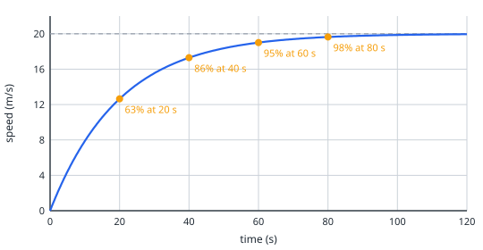
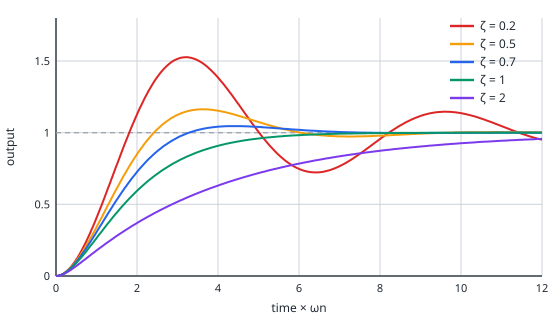
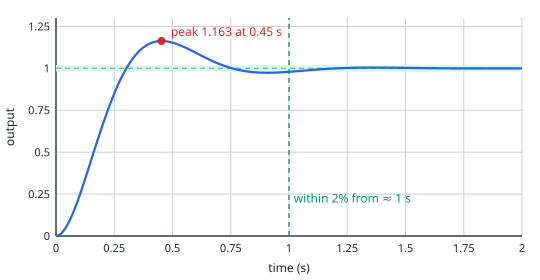

# Time Response 1: First- and Second-Order Systems

Time response is how a system's output changes over time after you change its input, and for most plants two or three numbers predict all of it.

## Before you start
<!-- bite: 327dfa10-0e42-4cc9-b757-067734ae76f7 -->

You should have read [[control-theory/08-block-diagrams-1|08 — Block Diagrams 1: Connections and the Feedback Rule]], and know the standard first-order form $K/(\tau s + 1)$ and second-order form with $\omega_n$ and $\zeta$.

After this lesson you will be able to:

1. sketch a first-order step response from its time constant, and give its settling time;
2. say what $\omega_n$ and $\zeta$ each do, and name the four kinds of second-order response;
3. read speed and damping off a pole's position in the s-plane;
4. calculate overshoot, peak time, rise time and settling time from $\zeta$ and $\omega_n$.

## What time response is
<!-- bite: f77706f9-ea16-4df5-a8e5-50e14f9a1ba0 -->

When you set the air conditioner to a new temperature, how fast the room gets there, and whether it overshoots, is the room's **time response**. Engineers test it with a **step**: change the input suddenly from one value to another and hold it, then watch the output.

Lesson 07 showed that most plants are first order (like the car's speed) or second order (like its suspension). This lesson shows what each one's step response looks like, and gives the handful of numbers engineers write in a specification.

## The kid version
<!-- bite: 4a42caf5-1be7-43ed-99fc-1f3a3996b0cf -->

Push a heavy shopping trolley with a steady force. It speeds up quickly at first, then more and more slowly, until drag balances your push. That's first order: it creeps up to its final value and never passes it.

Now push down on a car's bonnet and let go. It bounces up, past where it rests, back down, and settles. That's second order: it can overshoot and wobble, and how much depends on its shock absorbers.

**Where the analogy stops working.** A trolley and a bonnet each have one obvious behaviour. A second-order system can be tuned to anything from a lazy creep to wild bouncing, depending on one number, the damping ratio.

## First-order systems
<!-- bite: fec105cf-33dd-44de-9157-6477742377c9 -->

A first-order plant $G(s) = K/(\tau s + 1)$, given a step of size 1, responds with:

$$y(t) = K\left(1 - e^{-t/\tau}\right)$$

In words: it starts at zero, moves fastest at the start, and closes the remaining gap by the same fraction in every time constant. After one $\tau$ it has covered 63% of the way, after two 86%, after three 95%, after four 98%.

## The car's first-order response
<!-- bite: b0f08734-ec78-48ae-a377-0f41dd3badb4 -->

Our car has $\tau = 20$ s. Step the engine force to 1000 N and the speed climbs towards 20 m/s: 12.6 m/s at 20 s, 19.6 m/s at 80 s.

Remember this one: **settling time ≈ $4\tau$**. A first-order system can never overshoot, which is why heaters and simple circuits are so calm, and so slow.

## Forced and natural response
<!-- bite: bc01ef7d-9757-4cac-983e-baa9132567e6 -->

Every step response has two parts. Take $T(s) = \dfrac{s + 2}{s + 5}$, with a zero at $-2$ and a pole at $-5$ (the course notes' first example). With a unit step, partial fractions give

$$C(s) = \frac{s + 2}{s(s + 5)} = \frac{0.4}{s} + \frac{0.6}{s + 5} \quad\Longrightarrow\quad c(t) = 0.4 + 0.6e^{-5t}$$

The constant 0.4 comes from the input's pole at $s = 0$: the **forced** (steady-state) response. The decaying term comes from the system's own pole at $-5$: the **natural** (transient) response. Poles decide the natural response's shape; zeros and the input decide how much of each term appears.

## Reading a first-order step response
<!-- bite: 687cc1d9-0b09-4b3d-8932-9f9c0b84b2e0 -->

The course notes' test: a first-order system $K/(Ts + 1)$ is stepped, and its output settles at 0.72. So $K = 0.72$. The time constant is when the output reaches 63.2% of that: $0.632 \times 0.72 = 0.455$, which the plot shows at $T = 0.13$ s. Then the settling time is $4T = 0.52$ s, and the transfer function is $\dfrac{0.72}{0.13s + 1} = \dfrac{5.54}{s + 7.69}$.

## Second-order systems: the two numbers
<!-- bite: e40d93cc-cf88-40fa-a4e5-f6b79f046ac0 -->

The second-order form has two numbers, and they do completely different jobs:

$$G(s) = \frac{\omega_n^2}{s^2 + 2\zeta\omega_n s + \omega_n^2}$$

1. **Natural frequency $\omega_n$**: This says how *fast*. Double it and the whole response happens in half the time.
2. **Damping ratio $\zeta$**: This says what *shape*: how much it overshoots and wobbles.

Back to the suspension from lesson 03, $m\ddot{x} + c\dot{x} + kx = F$. Divide by $m$ and match the form: $\omega_n = \sqrt{k/m}$ and $\zeta = c/(2\sqrt{km})$. With $m = 250$ kg, $k = 16000$ N/m and $c = 2000$ N·s/m:

$$\omega_n = \sqrt{16000/250} = 8 \text{ rad/s}, \qquad \zeta = \frac{2000}{2\sqrt{16000 \times 250}} = 0.5$$

## Second-order systems: the four shapes
<!-- bite: 8eb021ba-d27f-4e8c-8f32-5ab51b9489e6 -->

The poles are at $s = -\zeta\omega_n \pm j\omega_n\sqrt{1-\zeta^2}$, and $\zeta$ decides which kind of response you get:

1. **$\zeta = 0$, undamped**: poles on the imaginary axis. It oscillates forever.
2. **$0 < \zeta < 1$, underdamped**: a complex pair. It overshoots, then settles.
3. **$\zeta = 1$, critically damped**: two equal real poles. Fastest with no overshoot.
4. **$\zeta > 1$, overdamped**: two different real poles. Slow, no overshoot.

## Seeing the four shapes
<!-- bite: 38deb9af-1f14-48ea-b50d-d754aaf0a244 -->

Here are five damping ratios with the same natural frequency, so only the shape changes.

Remember this one: **$\zeta \approx 0.7$ is the classic design target**: about 5% overshoot, quick settling, good robustness. And a surprise: $\zeta = 1$ never overshoots, but it is slower to get close. It is within 5% of the target after $4.7/\omega_n$ seconds, against $2.9/\omega_n$ for $\zeta = 0.7$.

## Reading the poles
<!-- bite: 6a4bf68b-f8ad-4672-8976-2123a832db14 -->

A pole's position in the s-plane carries both numbers, and once you can read it, pole placement (lesson 35) becomes intuitive.

## What each distance means
<!-- bite: e10f6e75-9e28-4374-92f9-e83578717057 -->

Each measurement on that picture is one of the numbers from the formula:

1. **Distance from the origin** is $\omega_n$: speed.
2. **Angle from the negative real axis** is $\theta = \cos^{-1}\zeta$: damping.
3. **Horizontal distance** is $\zeta\omega_n$: how fast the wobble dies, which sets settling time.
4. **Height** is $\omega_d = \omega_n\sqrt{1-\zeta^2}$: how fast it wobbles.

So: move a pole **left** and it settles faster; move it **towards the real axis** and it overshoots less. That's the whole vocabulary of placing poles.

## Step response specifications
<!-- bite: e21046c4-7c4a-4c3a-8417-1580e32c0025 -->

These are the numbers you design against, for an underdamped second-order system:

$$M_p = e^{-\pi\zeta/\sqrt{1-\zeta^2}} \qquad t_s \approx \frac{4}{\zeta\omega_n} \qquad t_r \approx \frac{1.8}{\omega_n} \qquad t_p = \frac{\pi}{\omega_d}$$

1. **Delay time $t_d$**: when the response first reaches 50% of its final value.
2. **Overshoot $M_p$**: how far past the final value it goes, as a fraction.
3. **Settling time $t_s$**: when it stays within 2% of the final value.
4. **Rise time $t_r$**: from 10% to 90% of the final value.
5. **Peak time $t_p$**: when it reaches its highest point.

The overshoot table is worth carrying in your head:

| $\zeta$ | 0.3 | 0.5 | 0.7 | 0.8 | 1.0 |
| --- | --- | --- | --- | --- | --- |
| overshoot | 37% | 16% | 4.6% | 1.5% | 0% |

## The suspension, worked
<!-- bite: 530f5c0e-7d68-47d7-a1bd-e08a097f316a -->

Predict before reading: with $\omega_n = 8$ rad/s and $\zeta = 0.5$, how much does the suspension overshoot, and when does it settle?

1. Overshoot: $M_p = e^{-\pi(0.5)/\sqrt{0.75}} = e^{-1.814} = 0.163$, so **16.3%**.
2. Damped frequency: $\omega_d = 8\sqrt{0.75} = 6.93$ rad/s, so peak time $t_p = \pi/6.93 = 0.45$ s.
3. Settling time: $t_s \approx 4/(0.5 \times 8) = 1.0$ s.
4. Rise time: $t_r \approx 1.8/8 = 0.23$ s.

## Two results that shape design
<!-- bite: e10af613-5088-4da7-9b50-1ee739ead29c -->

Look at the formulas again, because two facts fall out of them:

1. **Overshoot depends only on $\zeta$**, not on $\omega_n$. So set $\zeta$ to meet the overshoot spec, then set $\omega_n$ to meet the speed spec. The two requirements separate, which is unusually convenient.
2. **Settling time depends on $\zeta\omega_n$**, the pole's real part. That's why "move the poles left" means "settle faster".

But real plants are higher than second order, and they rarely settle exactly where you want. The next lesson handles both.

## Common pitfalls
<!-- bite: 27997734-2cb9-458c-b21f-b75ac3d0cbd1 -->

1. **Using the second-order formulas on a first-order plant.** A first-order plant can't overshoot; there is no $\zeta$.
2. **Thinking $\zeta = 1$ is fastest.** It's fastest *without overshoot*; $\zeta = 0.7$ rises sooner and gets within 5% sooner.
3. **Forgetting the formulas are approximate.** $t_s$ and $t_r$ are rules of thumb; only $M_p$ and $t_p$ are exact, and only for a pure second-order system with no zeros.
4. **Mixing up $\omega_n$ and $\omega_d$.** The wobble you see is at $\omega_d$, which is slower than $\omega_n$.

## Check your understanding
<!-- bite: c6c8d3c1-3db2-4b0d-b304-01f4e16278e8 -->

Try each one before you open the answer.

1. <!-- q: exact id="4e8a1f60" answer="20" -->
   An oven heats like a first-order system with time constant 5 minutes. Roughly how many minutes until it settles within 2%?

   

Answer

   $4\tau = 20$ minutes.

   

2. <!-- q: exact id="b7d3c290" answer="0.9502" sigfigs="2" -->
   A first-order system with time constant 3 s gets a step at $t = 0$. What fraction of its final value has it reached at $t = 9$ s?

   

Answer

   Three time constants: $1 - e^{-3} = 0.950$, so 95%.

   

3. <!-- q: mcq id="0c6e47ab" -->
   A second-order system has $\zeta = 1.5$. What does its step response look like?

   - [ ] It oscillates forever
   - [ ] It overshoots, then settles
   - [ ] It rises as fast as possible without overshoot
   - [x] It rises slowly with no overshoot

   

Answer

   $\zeta > 1$ is overdamped: two real poles, slow, no overshoot.

   

4. <!-- q: exact id="91f5d2c8" answer="0.2538" sigfigs="2" -->
   A system has $\zeta = 0.4$ and $\omega_n = 5$ rad/s. What is its overshoot $M_p$, as a fraction?

   

Answer

   $M_p = e^{-\pi(0.4)/\sqrt{0.84}} = e^{-1.371} = 0.254$, so about 25%.

   

5. <!-- q: exact id="6ad0e3f1" answer="2" -->
   Same system: $\zeta = 0.4$, $\omega_n = 5$ rad/s. Roughly how many seconds is its 2% settling time?

   

Answer

   $t_s \approx 4/(\zeta\omega_n) = 4/2 = 2$ s.

   

6. <!-- q: open id="e2b4a817" -->
   A designer needs less overshoot but the same settling time. Using the pole geometry, which way should the poles move?

   

Answer

   Settling time depends on the real part $\zeta\omega_n$, so keep the horizontal distance from the imaginary axis the same. Less overshoot needs a larger $\zeta$, a smaller angle from the negative real axis, so move the poles straight towards the real axis (reduce the height $\omega_d$).

   

## Before moving on
<!-- bite: 8e70c61c-d44e-4d20-bb76-d271d46eecf2 -->

You can sketch first- and second-order step responses and calculate the four specifications. **Next:** [[control-theory/14-time-response-2|14 — Time Response 2: Dominant Poles, Delay and Step Tests]], which deals with higher-order plants, delay, and getting a model from a step test.

## Related
<!-- bite: 10eeb856-c904-4c16-bd1f-070ef0b67ec5 -->

- [[control-theory/03-modelling-1|03 — Modelling 1: From Physics to Transfer Functions]]: where poles come from.
- [[control-theory/21-root-locus-1|21 — Root Locus 1: Sketching the Locus]]: moving poles on purpose.
- [[control-theory/index|Control theory map]]

## About this lesson
<!-- bite: cb768dda-af6e-4bf3-a1b8-35eda31d73ae -->

**Level:** Intermediate. **Covers:** forced and natural response, first-order step responses, the time constant and reading one from a plot, second-order systems and their four shapes, reading poles, and the step specifications, worked on the car and its suspension.

**Where it sits:** lesson 13 of 58, part 1 of 2 on time response.

**Source:** `[reference]` and the author's course notes (A. M. Hussein, *Control Engineering*, Benha University, chapter 7). Diagrams and numbers from `scripts/diagrams/control_theory.py`.
