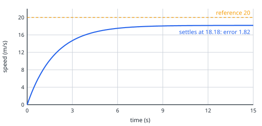

# Steady-State Error 1: Test Inputs and Error Constants

Steady-state error is the gap left between the reference and the output once the response has settled, and it depends on the input and on how many integrators the loop holds.

## Before you start
<!-- bite: bfa7513f-f81f-4ea6-9551-5e4615ece7c7 -->

You should have read [[control-theory/14-time-response-2|14 — Time Response 2: Dominant Poles, Delay and Step Tests]], and know the final value theorem: $\lim_{t\to\infty}f(t) = \lim_{s\to0}sF(s)$ for a stable system.

After this lesson you will be able to:

1. name the standard test inputs and their transforms;
2. compute the position, velocity and acceleration error constants $K_p$, $K_v$ and $K_a$;
3. find the steady-state error for a step, ramp or parabola from the system type;
4. choose a gain to meet a steady-state error specification.

## What steady-state error is
<!-- bite: 233103b9-5549-4326-abb2-3f37430416f5 -->

Does the output actually reach the reference? For a unity-feedback loop with loop gain $L(s)$, the error left once everything settles is

$$e_{ss} = \lim_{s\to 0} \frac{s\,R(s)}{1 + L(s)}$$

The answer depends on the loop's **type**: the number of integrators ($1/s$ factors) in $L(s)$. For a step of size 1, $R(s) = 1/s$, and the formula becomes $e_{ss} = 1/(1 + L(0))$. With no integrator, $L(0)$ is a finite number called the **position constant** $K_p$, and some error is always left.

## The kid version
<!-- bite: cabc3eaf-f586-40f5-97e4-c52159be61db -->

Ask a friend to walk beside you. If you stand still, they can stop exactly next to you. If you walk steadily, a lazy friend lags a little behind, always the same distance. If you keep speeding up, they fall further and further behind. How far behind they end up depends on what you do (the input) and how quick they are to catch up (the system).

**Where the analogy stops working.** A friend can decide to try harder. A control loop's ability to keep up is fixed by its structure: specifically, by how many integrators it contains.

## Test inputs
<!-- bite: 25f55ea1-d6b2-478c-95fc-df840f6a54db -->

Real inputs are messy, so systems are judged on simple **test signals** (chapter 7 of the course notes):

1. **Step**, $r(t) = 1$, $R(s) = 1/s$: a sudden change of setpoint.
2. **Ramp**, $r(t) = t$, $R(s) = 1/s^2$: a steadily moving target, like tracking a satellite.
3. **Parabola**, $r(t) = \tfrac12t^2$, $R(s) = 1/s^3$: a steadily accelerating target.
4. **Impulse**, $R(s) = 1$: a sudden shock. **Sinusoid**: used in frequency response (lesson 24).

The response to any of them has two parts: the **natural (transient)** part, which dies away if the system is stable, and the **forced (steady-state)** part, which remains. This lesson is about the forced part.

## The car's missing 1.82 m/s
<!-- bite: 41ce72c1-ca51-4e8b-9450-5abf74375777 -->

Now the cruise control. The loop gain is the controller times the plant: $L(s) = 500 \times 1/(1000s + 50)$. There's no integrator, so it is type 0, and

$$K_p = L(0) = 500/50 = 10, \qquad e_{ss} = \frac{1}{1 + 10} = \frac{1}{11}$$

For a 20 m/s reference that's $20/11 = 1.82$ m/s short: exactly the 18.18 m/s from lesson 01.

Raising the gain shrinks the gap but never removes it: with gain 5000, $K_p = 100$ and the car is still 0.2 m/s short. To remove it, the loop needs an integrator.

## The integrator table
<!-- bite: e254a6cd-f1d3-4345-bf34-88918684c294 -->

How the error depends on type, for each kind of input:

| Type | Step | Ramp | Parabola |
| --- | --- | --- | --- |
| 0 (no integrator) | $1/(1+K_p)$ | ∞ | ∞ |
| 1 (one integrator) | **0** | $1/K_v$ | ∞ |
| 2 (two integrators) | **0** | **0** | $1/K_a$ |

Here $K_v = \lim_{s\to0} sL(s)$ and $K_a = \lim_{s\to0} s^2L(s)$.

In words: **each integrator in the loop removes the steady-state error for one more kind of input.** That is precisely why the **I** in PID kills the car's offset: it adds an integrator, making the loop type 1. → [[control-theory/17-pid-control-1|17 — PID Control 1: The Three Terms]]

And it doesn't matter where the integrator comes from. A motor's *position* loop is naturally type 1, because speed integrates into position, so a plain gain gives zero position error. A motor's *speed* loop, like our car, is type 0 and needs the I term.

## The three error constants
<!-- bite: 95197302-ba42-40a2-ac2e-007c6b43dfe5 -->

For a unity-feedback system with forward transfer function $G(s)$, the error is $E = R/(1 + G)$, and by the final value theorem

$$e_{ss} = \lim_{s\to0}\frac{sR(s)}{1 + G(s)}$$

Put in each test input and one constant appears each time:

1. **Step**: $e_{ss} = \dfrac{1}{1 + K_p}$, with the **position constant** $K_p = \lim_{s\to0}G(s)$.
2. **Ramp**: $e_{ss} = \dfrac{1}{K_v}$, with the **velocity constant** $K_v = \lim_{s\to0}sG(s)$.
3. **Parabola**: $e_{ss} = \dfrac{1}{K_a}$, with the **acceleration constant** $K_a = \lim_{s\to0}s^2G(s)$.

The **type** of the system is the number of poles of $G$ at the origin, $n$ in $G = K\prod(s + z_i)/\big(s^n\prod(s + p_j)\big)$. A type-0 system has a finite $K_p$ and $K_v = K_a = 0$; type 1 has $K_p = \infty$ and a finite $K_v$; type 2 has $K_p = K_v = \infty$ and a finite $K_a$. That's the table above, derived.

## Worked: three inputs, one system
<!-- bite: 01240129-5261-403d-9e8a-787d0a866680 -->

The course notes' example 1: $G(s) = \dfrac{120(s + 2)}{(s + 3)(s + 4)}$, unity feedback. Find the error for inputs $5u(t)$, $5t\,u(t)$ and $5t^2u(t)$. Predict the type first.

No pole at the origin: type 0. So $K_p = \dfrac{120 \times 2}{3 \times 4} = 20$, $K_v = 0$, $K_a = 0$.

1. **Step of 5**: $e_{ss} = \dfrac{5}{1 + 20} = 0.238$.
2. **Ramp $5t$**: $e_{ss} = 5/K_v = \infty$. The output falls further and further behind.
3. **$5t^2$**: that's $10 \times \tfrac12t^2$, so $e_{ss} = 10/K_a = \infty$.

Always check stability first: the final value theorem only applies to a stable closed loop.

## Designing a gain for an error specification
<!-- bite: a49bbadc-9e8a-4a34-bb53-374da923293c -->

Turn it round: choose the gain to meet a required error. For $G(s) = \dfrac{K(s + 5)}{s(s + 6)(s + 7)(s + 8)}$ (type 1), find $K$ for a ramp error of 0.1.

$$K_v = \lim_{s\to0}sG(s) = \frac{5K}{6 \times 7 \times 8} = \frac{5K}{336}, \qquad e_{ss} = \frac{1}{K_v} = 0.1 \;\Rightarrow\; K_v = 10 \;\Rightarrow\; K = 672$$

Then check that $K = 672$ keeps the closed loop stable (Routh, lesson 19), since a high gain bought for accuracy may cost stability.

## Common pitfalls
<!-- bite: 59ebc332-8334-4e3b-aae8-d80a063c320d -->

1. **Using the final value theorem on an unstable loop.** It gives a number that means nothing.
2. **Forgetting the input's size.** A step of 5 gives five times the unit-step error.
3. **Mistaking $t^2$ for the unit parabola.** The unit parabola is $\tfrac12t^2$.
4. **Expecting more gain to remove a type-0 step error.** It only shrinks it; an integrator removes it.

## Check your understanding
<!-- bite: aecd41c1-ae0f-4a5f-991b-0d26dd7778b7 -->

Try each one before you open the answer.

1. <!-- q: exact id="2c7f81e5" answer="0.2" accept="1/5|20%" -->
   A type-0 loop has $L(0) = 4$. What fraction of a unit step is left as steady-state error?

   

Answer

   $1/(1 + 4) = 0.2$.

   

2. <!-- q: exact id="a85d4e10" answer="0.25" accept="1/4" -->
   A type-1 loop has $L(s) = 8/(s(s + 2))$. What is its steady-state error to a unit ramp?

   

Answer

   $K_v = \lim_{s\to0} sL(s) = 8/2 = 4$, so $e_{ss} = 1/K_v = 0.25$.

   

3. <!-- q: open id="c09d6a3b" -->
   Why does a motor position loop need no I term to reach its target exactly, while a motor speed loop does?

   

Answer

   Position is the integral of speed, so the position loop already contains an integrator: it is type 1 and has zero steady-state error to a step. The speed loop has no natural integrator, so it is type 0 and keeps an offset unless the controller adds one.

   

4. <!-- q: exact id="8f1c3b52" answer="0.5" accept="1/2" -->
   $G(s) = \dfrac{10}{s^2(s + 5)}$ with unity feedback. On its own this loop is unstable, so assume a compensator has stabilised it without changing $K_a$. What is the steady-state error to a unit parabola $\tfrac12t^2$?

   

Answer

   Type 2, $K_a = \lim s^2G = 10/5 = 2$, so $e_{ss} = 1/K_a = 0.5$.

   

5. <!-- q: exact id="d4a07e96" answer="80" -->
   $G(s) = \dfrac{K}{s(s + 4)}$ with unity feedback. What $K$ gives a steady-state error of 0.05 to a unit ramp?

   

Answer

   $K_v = K/4$ and $e_{ss} = 1/K_v = 0.05$, so $K_v = 20$ and $K = 80$.

   

## Before moving on
<!-- bite: 595e4f3d-e671-4228-9551-ca7a883d6586 -->

You can compute any of the three error constants and design a gain for an accuracy spec. **Next:** [[control-theory/16-steady-state-error-2|16 — Steady-State Error 2: Non-Unity Feedback and Disturbances]].

## Related
<!-- bite: e746495b-e29c-4143-ae41-26d95b8c1e1b -->

- [[control-theory/17-pid-control-1|17 — PID Control 1: The Three Terms]]: the I term that adds an integrator.
- [[control-theory/index|Control theory map]]

## About this lesson
<!-- bite: 760065d5-33c2-4c75-8996-5e64bc3f37b9 -->

**Level:** Intermediate. **Covers:** test inputs, natural and forced response, the final value theorem for error, $K_p$, $K_v$ and $K_a$, system type, a worked three-input example, and gain design for an error spec.

**Where it sits:** lesson 15 of 58, part 1 of 2 on steady-state error.

**Source:** the author's course notes, A. M. Hussein, *Control Engineering*, Benha University, chapters 7 (introduction) and 8 (sections 1 to 3, example 1); gain design after N. S. Nise. Numbers checked in `scripts/diagrams/control_theory.py`.
