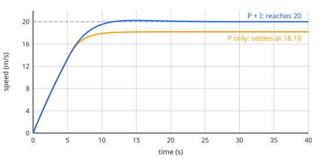

# PID Control 1: The Three Terms

A PID controller decides its push from three things about the error: how big it is now, how much has built up, and how fast it is changing.

## Before you start
<!-- bite: a9e5f682-ece4-46e3-86c1-b28a6adda023 -->

You should have read [[control-theory/14-time-response-2|14 — Time Response 2: Dominant Poles, Delay and Step Tests]], especially steady-state error and system type.

After this lesson you will be able to:

1. write the PID law and say what each of the three terms responds to;
2. explain why P alone leaves an offset and why I removes it;
3. describe integral windup, recognise its symptoms, and name three fixes;
4. explain why D is filtered and taken from the measurement, and when to leave it out.

## What PID control is
<!-- bite: 4c9a58b5-1862-458a-a7ab-a405e1377892 -->

Something like 95% of the control loops in industry are PID, and most of them are badly tuned. It's the controller you'll actually build.

The rule turns the error $e = r - y$ into a push $u$ by adding three terms:

$$u(t) = K_p e(t) + K_i \int_0^t e(\tau)\,d\tau + K_d \frac{de(t)}{dt}$$

1. **P, proportional**: responds to the error **now**. The main driving effort.
2. **I, integral**: responds to the error **built up over the past**. Removes the leftover offset.
3. **D, derivative**: responds to how fast the error is **changing**. Adds damping, like looking ahead.

A useful way to hold it: **P is the present, I is the past, D is the future.** In the Laplace domain the controller is $C(s) = K_p + K_i/s + K_d s$.

## The kid version
<!-- bite: 46fefe18-3578-4229-8d4a-1bd7edb109d7 -->

You're filling a bucket to a line with a hose. **P**: the further below the line, the more you open the tap. **I**: if it's been below the line for ages, you open it a bit more each second, because clearly something's slowing you down. **D**: if the water is rising fast, you start closing the tap early so you don't overflow.

**Where the analogy stops working.** You'd stop "opening more each second" once the tap is fully open. A naive PID doesn't know the tap has a limit, keeps adding, and overflows badly later. That bug is called windup, and it's this lesson's most important part.

## Proportional
<!-- bite: 1dff33e0-19ab-4819-aea6-56bc52d4f46f -->

$u = K_p e$: the bigger the error, the harder the push. Raising $K_p$ raises the loop gain, so the response is faster and the offset smaller. It has two failures.

**It leaves an offset.** This is our cruise control. If the error were zero, P would push zero, but the car needs 1000 N to hold 20 m/s against drag. So the error settles wherever $K_p e$ gives the force needed: 1.82 m/s with $K_p = 500$. Raising $K_p$ shrinks it but never removes it (lesson 15).

**It goes unstable at high gain.** On most real plants, keep raising $K_p$ and the loop starts to oscillate, then diverge. The gain where steady oscillation starts is the **ultimate gain** $K_u$, the basis of Ziegler–Nichols tuning (lesson 18).

Process engineers often quote the **proportional band**, $PB = 100/K_p$ percent instead. It is the same knob, turned upside down.

## Integral
<!-- bite: 64e95800-e082-4d24-a458-3abed63b7f22 -->

$u = K_i \int e\,dt$: **it accumulates.** As long as any error is left, the integral keeps growing, so the push keeps rising until the error is gone. That's what kills the car's offset: the $1/s$ adds an integrator, making the loop type 1 (lesson 15).

It isn't free. **An integrator adds 90° of phase lag at every frequency**, and lag eats stability margin, so integral action always makes a loop less stable. Too much $K_i$ gives a slow hunting around the setpoint. And it responds to history: after a disturbance the integral must unwind, which is why an I-heavy loop overshoots on the way back.

## Integral windup: the classic bug
<!-- bite: a3bfd60d-e238-4468-80e8-60c7153b0f34 -->

If you implement one thing correctly, make it this.

The actuator saturates: the valve is fully open, the engine is at full force. But the error is still large, so the integrator keeps adding, building a number that means nothing, because the push can't go any higher.

Then the output finally reaches the setpoint. The error changes sign, but the integral is now huge, so the controller **holds the actuator at its limit well past the setpoint** while the integral slowly unwinds.

## Windup in the car
<!-- bite: 5e3f6c35-1ada-40ba-97a4-ee397c711e46 -->

Here is the car's PI controller with the engine limited to 3000 N, run with and without a fix.

The symptom: big overshoot, and a long, unexplained delay before the controller responds to anything.

## Three fixes for windup
<!-- bite: b508e558-e2c0-4ce0-b4ca-885a6f26b839 -->

1. **Conditional integration (clamping).** Stop integrating whenever the output is saturated. Simplest, and usually enough.
2. **Back-calculation.** Feed the gap between what was commanded and what the actuator actually did back into the integrator, so it unwinds by itself.
3. **Integral limits.** Clamp the integral term to a fixed range. Crude, but easy to reason about.

Remember this one: **every real PID needs anti-windup.** A textbook PID without it will misbehave the first time it hits a limit, and it will hit a limit. In the car above, clamping cut the overshoot from 7.8 m/s to 0.23 m/s, with the same gains.

## Derivative
<!-- bite: b8c423c2-6f62-415d-a107-7bca0a0b50c0 -->

$u = K_d\,de/dt$ responds to how fast the error is changing, so it acts before the error is large. It adds damping: less overshoot, quicker settling, and extra stability margin, which lets you run a higher $K_p$ than you otherwise could.

It also has three problems, which is why D is often left at zero.

**Noise.** Differentiating multiplies each frequency by $\omega$, so fast sensor noise gets amplified hugely. On a noisy sensor, D is worse than useless. The fix is a **filtered derivative**, which stops differentiating above a corner frequency:

$$D(s) = \frac{K_d s}{1 + s/N}$$

with $N$ typically 8 to 20 times the loop's speed. Every practical PID filters its D term.

## Derivative: kick and dead time
<!-- bite: f33343d9-653e-45b3-9a22-95862733fd7b -->

**Derivative kick.** A sudden setpoint change makes $de/dt$ momentarily infinite, and the output spikes. The fix is to differentiate the **measurement** instead. Since $e = r - y$ and $r$ is usually constant, $\dot{e} = -\dot{y}$ almost always:

$$u = K_p e + K_i \int e\,dt - K_d \frac{dy}{dt}$$

Note the minus sign. This is what you should write by default: it handles disturbances exactly the same and removes the kick.

**Dead time.** If the plant has a long delay, the derivative reacts to old news. Most process-control loops run PI, with no D, for exactly this reason.

So D earns its place on a clean sensor with a plant that wobbles, like the suspension. On the car, a first-order plant that can't wobble, it has nothing to do.

## Common pitfalls
<!-- bite: 66bf2081-307b-4a5f-b2e9-ce4fbd612b53 -->

1. **Expecting P to remove an offset.** Only an integrator does.
2. **Shipping a PID without anti-windup.** It will overshoot badly the first time the actuator saturates.
3. **Differentiating the error.** Use the measurement, and filter it.
4. **Adding D to a noisy or delay-heavy loop.** It makes things worse; use PI.
5. **Treating the terms as independent.** Adding I costs stability, which may force a lower $K_p$.

## Check your understanding
<!-- bite: efa70c05-1512-4f60-aae4-1f50b680c0b9 -->

Try each one before you open the answer.

1. <!-- q: mcq id="8f2a6c31" -->
   A heater under P-only control always settles 1.5 °C below the setpoint. What removes the offset?

   - [ ] Doubling $K_p$
   - [x] Adding an integral term
   - [ ] Adding a derivative term
   - [ ] Filtering the sensor

   

Answer

   An integral term. More $K_p$ only shrinks the offset; the integrator keeps pushing until the error is exactly zero.

   

2. <!-- q: exact id="d61c7b08" answer="25" accept="25%" -->
   A controller has $K_p = 4$. What is its proportional band, in percent?

   

Answer

   $PB = 100/K_p = 25\%$.

   

3. <!-- q: mcq id="2b95e4d7" -->
   A tank level loop overshoots hugely after the inlet valve has been fully open for a long time, then takes ages to respond. What is the most likely cause?

   - [ ] Derivative kick
   - [x] Integral windup
   - [ ] Too little proportional gain
   - [ ] Sensor noise

   

Answer

   Integral windup. While the valve was at its limit the integral kept growing, and it must unwind before the controller can close the valve.

   

4. <!-- q: gap id="5a0e9f72" answers="measurement|output|y;filtered|filter" -->
   To avoid derivative kick, take the D term from the ___ instead of the error, and to stop it amplifying noise, it must be ___.

   

Answer

   From the measurement (the output $y$), and filtered.

   

5. <!-- q: open id="c2e8d4a6" -->
   Why do most process-control loops, such as temperature in a large tank, use PI rather than PID?

   

Answer

   They have long dead times and noisy measurements. The derivative would react to old, noisy information, adding jitter without useful damping, so D is left at zero.

   

## Before moving on
<!-- bite: aa83a372-1a25-4790-9596-6c454c49a4c3 -->

You can say what each term does, explain windup and its fixes, and say when to drop D. **Next:** [[control-theory/18-pid-control-2|18 — PID Control 2: Tuning and Implementation]], which picks the three gains and turns the law into code that works on a real controller.

## Related
<!-- bite: df9931ca-7d33-45e4-b2c1-aa44ed60437a -->

- [[control-theory/14-time-response-2|14 — Time Response 2: Dominant Poles, Delay and Step Tests]]: the steady-state error the I term removes.
- [[control-theory/25-frequency-response-2|25 — Frequency Response 2: Loop Shaping, Bandwidth and Margins]]: what I and D do to phase.
- [[control-theory/index|Control theory map]]

## About this lesson
<!-- bite: ba84af2b-62ff-46e5-a1db-87fb0fda235e -->

**Level:** Intermediate. **Covers:** the PID law, what P, I and D each do, integral windup and its fixes, the filtered derivative, and derivative on measurement, worked on the cruise control.

**Where it sits:** lesson 17 of 58, part 1 of 2 on PID control.

**Source:** `[reference]`, assembled from standard control texts. Diagrams and numbers from `scripts/diagrams/control_theory.py`, which simulates the same controller as lesson 18's program.
