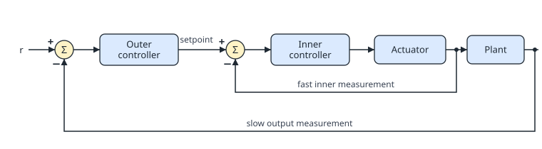

# PID Control 2: Tuning and Implementation

Tuning is choosing the three gains, and implementation is turning the PID law into code that survives sampling, limits and noise.

## Before you start
<!-- bite: 58f2c56d-58a1-4acd-a53a-4390b117ea31 -->

You should have read [[control-theory/17-pid-control-1|17 — PID Control 1: The Three Terms]], and be able to read dead time, time constant and gain off a step test ([[control-theory/14-time-response-2|14 — Time Response 2: Dominant Poles, Delay and Step Tests]]). You need Python 3 for the worked example; no libraries.

After this lesson you will be able to:

1. tune a loop by hand, and with the Ziegler–Nichols and lambda recipes;
2. say why Ziegler–Nichols is only a starting point;
3. write a discrete PID with anti-windup, a filtered derivative on the measurement and setpoint weighting, and run it on a simulated plant;
4. explain cascade control and when PID isn't enough.

## What this lesson covers
<!-- bite: 1237d04b-046d-4596-b528-88bacb86c089 -->

Lesson 17 said what each term does. Now the two practical questions: what numbers to put in, and how to write the code. Both matter equally. A well-tuned PID with no anti-windup still overshoots wildly, and perfect code with bad gains still oscillates. We'll finish by running the car's controller as a real program.

## The kid version
<!-- bite: 6aca066c-3b3e-4ab7-bdb7-a4e02ca469ef -->

Tuning a PID is like adjusting a shower with three knobs: one for how hard you react, one for how patient you are, one for how much you look ahead. There are recipes that get you close quickly, then you nudge each knob and watch.

**Where the analogy stops working.** In a shower the knobs barely affect each other. In a PID they do: more I usually means you need less P, and the recipes only know the plant through two or three numbers, so they are a starting point, never the answer.

## What each knob does
<!-- bite: 31ac06a3-3195-4545-b6a6-e528def5d10a -->

These are trends, not guarantees, because the terms interact:

| Increase | Rise time | Overshoot | Settling | Offset | Stability |
| --- | --- | --- | --- | --- | --- |
| $K_p$ | faster | worse | small change | smaller | worse |
| $K_i$ | faster | worse | worse | **removed** | worse |
| $K_d$ | small change | better | better | none | better |

## Tuning by hand
<!-- bite: 70e2d9a8-f4dd-4b8a-ad8e-a93a511f549c -->

The method to use when you can experiment on the plant:

1. Set $K_i = 0$ and $K_d = 0$.
2. Raise $K_p$ until the loop oscillates steadily. Note that gain: it's $K_u$.
3. Halve it. You now have a stable P controller with an offset.
4. Add $K_i$, raising it until the offset goes away quickly enough. Too much and it hunts slowly.
5. Add $K_d$ only if you need less overshoot and the sensor is clean. Back off when the output gets jittery.
6. **Test against a disturbance, not just a setpoint change.** They are different problems, and a loop tuned for one can be poor at the other.

## Ziegler–Nichols: two recipes
<!-- bite: 775ceaeb-e065-49dc-95d9-eccce2ee11e2 -->

The classic recipes, from 1942. Here $T_i$ and $T_d$ are times, with $K_i = K_p/T_i$ and $K_d = K_pT_d$.

**Closed loop.** Find $K_u$ and the oscillation period $T_u$ as in step 2 above:

| Controller | $K_p$ | $T_i$ | $T_d$ |
| --- | --- | --- | --- |
| P | $0.5K_u$ | | |
| PI | $0.45K_u$ | $T_u/1.2$ | |
| PID | $0.6K_u$ | $T_u/2$ | $T_u/8$ |

**Open loop.** From a step test, read gain $K$, dead time $\theta$ and time constant $\tau$:

| Controller | $K_p$ | $T_i$ | $T_d$ |
| --- | --- | --- | --- |
| P | $\tau/(K\theta)$ | | |
| PI | $0.9\tau/(K\theta)$ | $3.3\theta$ | |
| PID | $1.2\tau/(K\theta)$ | $2\theta$ | $0.5\theta$ |

## Ziegler–Nichols: worked, and its warning
<!-- bite: 2f690431-216f-4263-ace8-8cef312985d5 -->

Take lesson 14's step test: $K = 2$, $\theta = 3$ s, $\tau = 10$ s. Predict the PID gains before reading on.

$K_p = 1.2 \times 10/(2 \times 3) = 2$, $T_i = 2 \times 3 = 6$ s, $T_d = 0.5 \times 3 = 1.5$ s. So $K_i = 2/6 = 0.33$ and $K_d = 2 \times 1.5 = 3$.

Remember this one: **Ziegler–Nichols is aggressive.** It aims for each oscillation peak to be a quarter of the last, which means roughly 25% overshoot and thin stability margins. Treat it as a starting point: halve the gain, then tune from there. And never run the closed-loop test on anything where steady oscillation is dangerous.

For plants with a lot of dead time ($\theta/\tau > 0.3$), the **Cohen–Coon** recipe does better.

## Lambda tuning
<!-- bite: 0a8a0b2b-846c-4ddf-ba09-38c33925aa79 -->

What modern process control actually uses. You choose the closed-loop time constant $\lambda$ you want, and the gains follow from the model. For a first-order-plus-dead-time plant:

$$K_p = \frac{\tau}{K(\lambda + \theta)}, \qquad T_i = \tau$$

Same plant, asking for $\lambda = 6$ s: $K_p = 10/(2 \times 9) = 0.56$ and $T_i = 10$ s. Much gentler than Ziegler–Nichols.

The appeal is that $\lambda$ means something physical: "I want this loop to settle in about 30 seconds" instead of a bare number. A larger $\lambda$ is slower and more robust. When you have a model, this is the recommended default.

## Setpoint weighting
<!-- bite: c7119227-976e-4aa4-9bde-2d3cf4d932f3 -->

One more knob, because following the setpoint and rejecting disturbances want different tunings:

$$u = K_p(\beta r - y) + K_i\int(r - y)\,dt - K_d\frac{dy}{dt}$$

$\beta$ is between 0 and 1. With $\beta = 1$ this is the standard PID; with $\beta = 0$ the P term only sees the measurement. Tune the gains for disturbance rejection (usually what matters), then lower $\beta$ to soften the setpoint response, without retuning anything.

## Implementation: the car as a program
<!-- bite: 419176b0-550b-473c-8018-3805ca42bc1a -->

Here is a complete discrete PID with every fix applied, running on the car: 1000 kg, drag 50 N per m/s, engine limited to 0 to 3000 N, sampled every 0.1 s. Save it as `pid_car.py` in any folder and run `python3 pid_car.py` from that folder. It runs the same controller twice, with and without anti-windup.

```python
"""A discrete PID speed controller on the car, with and without anti-windup.

Run:  python3 pid_car.py
The car: mass 1000 kg, drag 50 N per m/s, engine force limited to 0..3000 N.
"""
M, B = 1000.0, 50.0          # car mass (kg) and drag (N per m/s)
U_MIN, U_MAX = 0.0, 3000.0   # engine force limits (N)
DT = 0.1                     # controller sample time (s)


class PID:
    def __init__(self, kp, ki, kd, beta=1.0, alpha=0.8, anti_windup=True):
        self.kp, self.ki, self.kd, self.beta, self.alpha = kp, ki, kd, beta, alpha
        self.anti_windup = anti_windup
        self.integral = 0.0          # the I term, in newtons
        self.prev_y = None           # last measurement, for the D term
        self.d_filt = 0.0            # filtered rate of change of the measurement

    def update(self, r, y):
        e = r - y
        p = self.kp * (self.beta * r - y)                  # P, with setpoint weighting
        self.integral += self.ki * e * DT                   # I
        dy = 0.0 if self.prev_y is None else (y - self.prev_y) / DT
        self.d_filt = self.alpha * self.d_filt + (1 - self.alpha) * dy
        d = -self.kd * self.d_filt                          # D on the measurement: note the minus
        self.prev_y = y
        u = p + self.integral + d
        u_sat = min(max(u, U_MIN), U_MAX)
        if self.anti_windup and u != u_sat:
            self.integral -= self.ki * e * DT               # undo this sample's integration
        return u_sat


def run(ctrl, r=20.0, t_end=40.0):
    v, t, peak, log = 0.0, 0.0, 0.0, {}
    for k in range(int(t_end / DT) + 1):
        t = k * DT
        if k % 50 == 0:
            log[round(t)] = v
        u = ctrl.update(r, v)
        v += DT * (u - B * v) / M            # the plant: m dv/dt = u - b v (Euler step)
        peak = max(peak, v)
    return peak, log


for name, aw in (('with anti-windup', True), ('without anti-windup', False)):
    peak, log = run(PID(kp=500, ki=100, kd=0, anti_windup=aw))
    print(f'{name}: peak {peak:.2f} m/s')
    print('  t (s): ' + ' '.join(f'{t:>5}' for t in log))
    print('  v    : ' + ' '.join(f'{v:5.2f}' for v in log.values()))
```

## Implementation: what it prints
<!-- bite: d40b5a7b-5073-4f9f-9e06-7050410c268a -->

The output, which you should get exactly, since nothing in it is random:

```text
with anti-windup: peak 20.23 m/s
  t (s):     0     5    10    15    20    25    30    35    40
  v    :  0.00 13.30 19.52 20.23 20.11 20.03 20.00 20.00 20.00
without anti-windup: peak 27.81 m/s
  t (s):     0     5    10    15    20    25    30    35    40
  v    :  0.00 13.30 23.65 26.88 22.42 20.45 20.02 19.98 19.99
```

Both runs are identical for the first 5 s, because the engine is at its 3000 N limit either way. Then they split: the wound-up integral carries the second car to 27.81 m/s. The simulation uses a simple Euler step for the plant, which is fine at this sample time; it isn't a model of a real car's engine.

## The details that matter in real code
<!-- bite: eaaa2741-5c99-464c-9ec7-54dc64c7835e -->

In order of how often they're got wrong:

1. **A fixed sample time.** The `DT` in the integral and derivative must match reality. Use a timer interrupt or a real-time loop, not `sleep()` in a while loop. If the time step really varies, measure it and use the measured value.
2. **Sample fast enough.** Roughly 10 to 20 samples per rise time. Too slow adds delay; too fast makes the derivative noisy. → [[control-theory/44-digital-control-1|44 — Digital Control 1: Sampling and the z-Transform]]
3. **Bumpless transfer.** Switching from manual to automatic, or changing gains live, must not jump the output. Set the integral so the new output equals the current one.
4. **Physical units.** Keep gains in real units (newtons per m/s), so wrong values look wrong.

There's also the **velocity form**: compute the *change* in output each sample and let the actuator accumulate it. It has no integral state to wind up, and bumpless transfer comes free, so PLCs use it to drive valves and stepper motors.

## Cascade control
<!-- bite: d136de38-5fe9-45f2-beee-9501e1f87def -->

When one loop isn't enough, the most useful next step is two loops, one inside the other. The outer loop controls what you care about, and its output becomes the **setpoint of the inner loop**, which controls something faster, closer to the actuator.



## Cascade control: the rules
<!-- bite: 8420c493-5ba1-4b88-806b-9ef263f0856a -->

A robot joint is the standard example: position loop outside, commanding a speed; speed loop inside, commanding a motor current; current loop innermost. → [[robotics/index|Robotics]]

1. **The inner loop must be 5 to 10 times faster**, or the loops fight.
2. **Tune the inner loop first**, with the outer loop off, then close the outer loop around it.
3. The payoff: **the inner loop kills disturbances before they reach the outer one.**

## When PID isn't enough
<!-- bite: 0e47d336-ad35-47c4-8373-038f3d0293cd -->

PID is remarkable value for three numbers, but it has limits:

1. **Long dead time**: use a Smith predictor or model predictive control.
2. **Strongly coupled inputs and outputs**: loops fight each other. → [[control-theory/30-state-space-1|30 — State Space 1: States and the State Equation]] and LQR
3. **Hard limits on states**, not just inputs: model predictive control. → [[control-theory/43-lqg-and-mpc|43 — LQG and MPC]]
4. **Strong nonlinearity** across the operating range: gain scheduling.
5. **A right-half-plane zero**: it caps the speed no matter how you tune (lesson 03).

But start with PID. The usual failure isn't that PID was too weak; it's that it was tuned badly, written without anti-windup, or differentiating a noisy signal.

## Common pitfalls
<!-- bite: efcc35ad-7c25-409c-9cfb-c1cb9cd160b8 -->

1. **Using Ziegler–Nichols gains as final.** They give about 25% overshoot; halve and refine.
2. **Testing only setpoint changes.** Most loops spend their life rejecting disturbances.
3. **Sleeping instead of timing.** A wandering sample time changes your gains every sample.
4. **Closing the outer cascade loop first.** Inner first, always.

## Check your understanding
<!-- bite: 054cf9da-ee47-40c7-9439-0628d55cce12 -->

Try each one before you open the answer.

1. <!-- q: exact id="0d4b7e19" answer="4" -->
   A step test gives $K = 1.5$, $\theta = 2$ s, $\tau = 10$ s. What is the Ziegler–Nichols open-loop PID gain $K_p$?

   <details><summary>Answer</summary>

   $K_p = 1.2\tau/(K\theta) = 12/3 = 4$. If you got 3, you used the PI factor 0.9 instead of 1.2.

   </details>

2. <!-- q: exact id="e7c3a5f2" answer="5" -->
   Closed-loop Ziegler–Nichols: a loop oscillates steadily at $K_u = 8$ with period $T_u = 10$ s. What is the PID integral time $T_i$, in seconds?

   <details><summary>Answer</summary>

   $T_i = T_u/2 = 5$ s. (And $K_p = 0.6 \times 8 = 4.8$, $T_d = 10/8 = 1.25$ s.)

   </details>

3. <!-- q: exact id="a3f8c6d0" answer="0.5" accept="1/2" -->
   Lambda tuning on a plant with $K = 4$, $\theta = 1$ s, $\tau = 10$ s, asking for $\lambda = 4$ s. What is $K_p$?

   <details><summary>Answer</summary>

   $K_p = \tau/(K(\lambda + \theta)) = 10/(4 \times 5) = 0.5$, with $T_i = 10$ s.

   </details>

4. <!-- q: mcq id="6b1e2d94" -->
   In a cascade loop on a heat exchanger, which loop should be tuned first?

   - [x] The inner (fast) loop, with the outer loop off
   - [ ] The outer (slow) loop, with the inner loop off
   - [ ] Both at the same time
   - [ ] Whichever has the larger gain

   <details><summary>Answer</summary>

   The inner loop first. The outer loop's plant includes the closed inner loop, so it can only be tuned once the inner loop is working.

   </details>

5. <!-- q: open id="94e0c7b3" -->
   In the car program, the two runs are identical for the first 5 seconds and then split. Explain why.

   <details><summary>Answer</summary>

   For the first 5 s the error is so large that the controller asks for more than 3000 N, so the engine is at its limit in both runs and the car accelerates the same way. Meanwhile the run without anti-windup keeps adding to its integral. When the speed nears 20 m/s, that oversized integral keeps the engine pushing hard, and that car overshoots to 27.81 m/s.

   </details>

## Practice: tune the car yourself
<!-- bite: 5f230c3e-50c8-4ce8-a9c0-32eb47e01aeb -->

Using the program above, with anti-windup on:

1. Set `ki=0` and find, by trial, the smallest `kp` that gets within 0.5 m/s of 20 at $t = 40$ s. (Predict first from lesson 15: you need $1/(1 + K_p/50) \times 20 < 0.5$.)
2. Restore `ki=100` and try `kd=200` with `beta=1`, then `beta=0`. Watch the peak.
3. Change the engine limit to 1500 N. Does anti-windup still matter more or less?

**Done when:** you can predict, before running, whether a change raises or lowers the peak, and you're right at least four times out of five.

## Before moving on
<!-- bite: 31b306d6-63ea-4c6a-a29c-a4b61db0c3d1 -->

You can tune a PID by hand and by recipe, and you've run one with every practical fix. **Next:** [[control-theory/19-stability-1|19 — Stability 1: What Stability Means and Routh–Hurwitz]], which explains *why* raising the gain makes a loop unstable, and how to check before it happens.

## Related
<!-- bite: cb765446-7529-4fb3-8c9b-fd94b2a23b71 -->

- [[control-theory/44-digital-control-1|44 — Digital Control 1: Sampling and the z-Transform]]: sampling the controller properly.
- [[control-theory/projects|Projects]]: tune a PID on a simulated plant with dead time.
- [[control-theory/index|Control theory map]]

## About this lesson
<!-- bite: 10ff12d2-3a77-48a9-9099-ae3b5a047443 -->

**Level:** Intermediate. **Covers:** the knob table, hand tuning, Ziegler–Nichols, lambda tuning, setpoint weighting, a complete discrete PID program, the real-code details, cascade control and PID's limits.

**Where it sits:** lesson 18 of 58, part 2 of 2 on PID control.

**Source:** `[reference]`, assembled from standard control texts. The program was run as shown; its output and lesson 17's figures come from the same controller in `scripts/diagrams/control_theory.py`.
