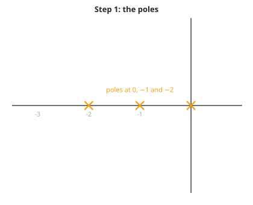
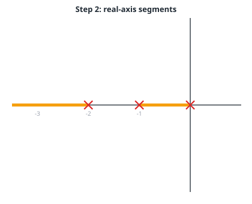
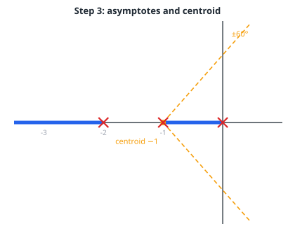
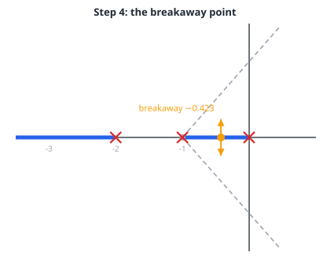
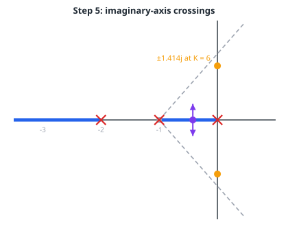
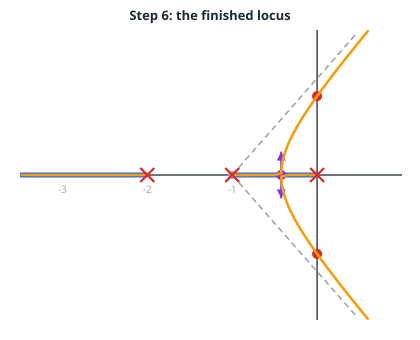

# Root Locus 1: Sketching the Locus

The root locus is a picture of where a loop's closed-loop poles move as you turn up the controller gain.

## Before you start
<!-- bite: cfb43218-2a85-4691-9de8-37e7b996acba -->

You should have read [[control-theory/19-stability-1|19 — Stability 1: What Stability Means and Routh–Hurwitz]], and be able to read speed and damping off a pole's position ([[control-theory/13-time-response-1|13 — Time Response 1: First- and Second-Order Systems]]).

After this lesson you will be able to:

1. state the angle and magnitude conditions, and say which one draws the locus;
2. sketch a root locus by hand with six rules;
3. read from a locus how the response changes as the gain rises;
4. explain why cancelling an unstable pole with a controller zero is dangerous.

## What the root locus is
<!-- bite: 1237faa4-0817-426d-a97e-654ac98ed29b -->

Lesson 19 found that the loop $L(s) = K/(s(s+1)(s+2))$ is stable for $0 < K < 6$. But it said nothing about *how* the response changes on the way: is $K = 1$ sluggish? Is $K = 4$ wobbly? The root locus answers that with one picture: the path of every closed-loop pole as $K$ goes from 0 to infinity.

The closed-loop poles are the roots of $1 + KG(s)H(s) = 0$, which is the same as $KG(s)H(s) = -1$. A complex number equals $-1$ when its size is 1 and its angle is 180°, so that one equation splits in two:

$$\text{Magnitude: } |KGH| = 1 \qquad\qquad \text{Angle: } \angle GH = 180° \pm 360°k$$

The angle condition alone decides the *shape* of the locus, because it doesn't involve $K$. The magnitude condition then says which gain puts a pole at a given point on it. That split is what makes drawing it by hand possible.

## The kid version
<!-- bite: 3e85af48-495f-4220-b912-96b960a2a759 -->

Imagine three toy cars parked on a map, each one a pole. Turning up the gain is like slowly pressing a single pedal that drives all three at once along set roads. Some roads run off to safety on the left; some bend towards the cliff edge on the right. The root locus is the road map, and the gain tells you how far along each road the cars are.

**Where the analogy stops working.** Real roads don't care about the pedal. Here the roads themselves come from the plant, and adding a controller with its own poles and zeros redraws the roads, which is exactly how compensators are designed.

## The six rules: where branches go
<!-- bite: 17f39113-318c-4432-962d-35aafe7eb3d6 -->

Enough to sketch a locus by hand, which is still the fastest way to understand a design. Here $n$ is the number of open-loop poles and $m$ the number of zeros.

1. **Start and end.** Branches start at the open-loop **poles** (at $K = 0$) and end at the open-loop **zeros** (as $K \to \infty$). There are $n$ branches, and $n - m$ of them go off to infinity.
2. **The real axis.** A point on the real axis is on the locus if the number of real poles and zeros **to its right** is odd.
3. **Asymptotes.** The $n - m$ branches going to infinity follow straight lines at angles $180°(2k+1)/(n-m)$, all starting from the **centroid** on the real axis:

$$\sigma_a = \frac{\sum \text{poles} - \sum \text{zeros}}{n - m}$$

## The six rules: special points
<!-- bite: 6707d4f3-1f20-422e-b761-52f63dd21612 -->

4. **Breakaway points.** Where branches leave the real axis. Write $K$ in terms of $s$ from the characteristic equation and solve $dK/ds = 0$.
5. **Imaginary-axis crossings.** Where the loop goes unstable. Find them with Routh: this gives $K_u$ and the crossing frequency.
6. **Symmetry.** The locus is a mirror image about the real axis, because complex poles come in conjugate pairs.

## Drawing our loop's locus
<!-- bite: 6fdb3d4b-d916-41e4-8aed-78b280b2b8be -->

Apply the rules to $L = K/(s(s+1)(s+2))$, one at a time, and watch the picture build up. In each picture the new piece is orange.

**Step 1: poles and zeros.** Three poles, at $0$, $-1$ and $-2$, and no zeros. So there are three branches, and since there are no zeros to end at, all three go off to infinity.

## Drawing the locus: real-axis segments
<!-- bite: 0fef1b96-152b-4def-b555-779a2ca6f657 -->

**Step 2.** A point on the real axis is on the locus when an odd number of poles and zeros lie to its right. Before reading on, predict which stretches qualify.

Between 0 and $-1$ there is one pole to the right: on the locus. Between $-1$ and $-2$ there are two: off. Left of $-2$ there are three: on, all the way to $-\infty$.

## Drawing the locus: asymptotes
<!-- bite: 5759e0ac-79e1-47eb-90ba-747d54433952 -->

**Step 3.** Three branches go to infinity, so there are three asymptotes, at $180°(2k+1)/3$: $60°$, $180°$ and $-60°$. They all start from the centroid, $(0 - 1 - 2)/3 = -1$.

The $180°$ asymptote lies along the negative real axis, which is the segment from $-2$ leftwards we already have. The other two are new.

## Drawing the locus: the breakaway point
<!-- bite: 6f7354aa-eb5b-4f7c-8e8a-0097d700753f -->

**Step 4.** The segment between 0 and $-1$ has a branch coming from each end, so they must meet and leave the axis somewhere between. Write $K$ from the characteristic equation, $K = -(s^3 + 3s^2 + 2s)$, and set $dK/ds = -(3s^2 + 6s + 2) = 0$.

That gives $s = -0.423$ and $s = -1.577$. Only $-0.423$ is on a locus segment, so that's the **breakaway point**, at $K = 0.385$. There the two branches turn and leave, one upwards and one downwards.

## Drawing the locus: crossing the imaginary axis
<!-- bite: 977a8852-4331-449b-ae69-835aee5270e8 -->

**Step 5.** Where do the branches cross into the right half plane? Lesson 19's Routh test found it: at $K = 6$, at $s = \pm j1.414$. Those two points pin down where the loop goes unstable.

## Drawing the locus: joining it up
<!-- bite: 0bd50120-a940-435d-940e-3963622af391 -->

**Step 6.** Now join the pieces. From the breakaway point, the two branches curve away from the axis, pass through $\pm j1.414$, and bend towards the $\pm60°$ asymptotes. The third branch runs left from $-2$ along the real axis. The locus is symmetric about the real axis, as every locus is.

## Reading a locus
<!-- bite: 7d976e14-7ab6-4207-a225-71ea8bad4b68 -->

Follow the two branches that start at 0 and $-1$, and you have the typical story:

1. **Low gain:** the poles are real and one is near the axis, so the response is sluggish with no overshoot.
2. **At the breakaway** ($K = 0.385$), they meet and become a complex pair: faster, starting to overshoot.
3. **Higher gain:** they curve towards the imaginary axis, so $\zeta$ falls: more overshoot, less damping.
4. **At $K = 6$** they cross, and the loop oscillates; beyond it, it diverges.

That one picture explains the whole $K_p$ row of the PID tuning table: higher gain is faster, overshoots more, and is less stable. The locus is *why*.

Compare our car from lesson 08. It has one pole, so its locus is a single branch running left from $-0.05$ forever: a first-order loop can't go unstable from gain alone. Real cars can, because of delay, which lesson 25 handles.

## Pole–zero cancellation: a warning
<!-- bite: bb070c77-a36e-43ac-a6e4-05f0ce9910e2 -->

The locus offers a tempting move: put a controller zero exactly on a bad plant pole to cancel it. Don't rely on it.

1. **It never cancels exactly.** Your model of the pole is approximate, so a tiny pole–zero pair survives where the real pole is.
2. **If the cancelled pole is unstable, the system is still unstable.** The pole is still there; you've only hidden it from the output. Inside, a state grows without limit while the output looks perfect, until something saturates or breaks. This is the most dangerous mistake in classical design, and lesson 34 gives it a name: the mode has become unobservable.
3. **Cancelling a stable, well-damped, well-known pole is fine.** Lag design does it on purpose. Cancelling anything near the imaginary axis or in the right half plane is not.

## Common pitfalls
<!-- bite: 5e3829cb-064e-4045-9796-ba7201078c32 -->

1. **Counting poles and zeros to the left on the real axis.** The rule counts those to the *right*.
2. **Putting the centroid at the average of the poles only.** Subtract the zeros, and divide by $n - m$.
3. **Accepting every root of $dK/ds = 0$.** Only roots on the locus are breakaway points.
4. **Cancelling a right-half-plane pole.** It hides the instability; it doesn't remove it.

## Check your understanding
<!-- bite: 99c5e44f-d241-4bf4-890c-51135f60a842 -->

Try each one before you open the answer.

1. <!-- q: mcq id="4c7e1a95" -->
   An open-loop transfer function has poles at $0, -2, -5$ and no zeros. Which real-axis stretches are on the root locus?

   - [x] Between 0 and $-2$, and left of $-5$
   - [ ] Between $-2$ and $-5$ only
   - [ ] Right of 0, and between $-2$ and $-5$
   - [ ] The whole negative real axis

   

Answer

   A point is on the locus when an odd number of poles and zeros lie to its right: one between 0 and $-2$, three left of $-5$. Between $-2$ and $-5$ there are two, which is even.

   

2. <!-- q: exact id="9d1f6b28" answer="-2.333" accept="−2.333|-7/3|−7/3" sigfigs="3" -->
   Same loop: poles at $0, -2, -5$, no zeros. Where is the centroid of the asymptotes?

   

Answer

   $(0 - 2 - 5)/3 = -7/3 = -2.33$.

   

3. <!-- q: gap id="e8a20c57" answers="60;180" -->
   A loop with three poles and no zeros has asymptotes at $\pm$ ___° and at ___°.

   

Answer

   $180°(2k+1)/3$ gives $60°$, $180°$ and $300° = -60°$.

   

4. <!-- q: mcq id="3b5d8e60" -->
   A designer adds a compensator zero at $s = -1.5$ to a loop. What happens to the root locus?

   - [x] It is pulled to the left, making the loop more stable
   - [ ] It is pushed to the right, making the loop less stable
   - [ ] Nothing changes; zeros don't affect the locus
   - [ ] It becomes symmetric about the imaginary axis

   

Answer

   Adding a zero pulls the locus left. This is what a lead compensator uses.

   

5. <!-- q: open id="70c4e9a2" -->
   A plant has a pole at $s = +1$. A controller with a zero at exactly $s = +1$ makes the closed-loop output look perfectly stable in simulation. Why is this design unsafe?

   

Answer

   The unstable pole is only hidden from the output, not removed, and the real pole is never exactly at $+1$. An internal state still grows like $e^{t}$, so it eventually saturates an actuator or breaks something, even though the output looked fine.

   

## Before moving on
<!-- bite: 198961f9-6b1a-4c52-8ac5-f54b23afbf55 -->

You can sketch a locus and read the response off it. **Next:** [[control-theory/22-root-locus-2|22 — Root Locus 2: Test Points, Departure Angles and Positive Feedback]], which adds the remaining sketching steps.

## Related
<!-- bite: 1861934f-657c-4c2b-82b5-9e40b04038d4 -->

- [[control-theory/35-pole-placement|35 — Pole Placement]]: putting every pole exactly where you want with state feedback.
- [[control-theory/index|Control theory map]]

## About this lesson
<!-- bite: 95ccff5b-551d-4d9f-a647-c14634e9ef1a -->

**Level:** Intermediate. **Covers:** the angle and magnitude conditions, the six sketching rules, reading a locus, and the danger of pole–zero cancellation.

**Where it sits:** lesson 21 of 58, part 1 of 2 on the root locus.

**Source:** `[reference]`, assembled from standard control texts. The locus is computed and drawn by `scripts/diagrams/control_theory.py`, which also checks the breakaway and crossing points.
