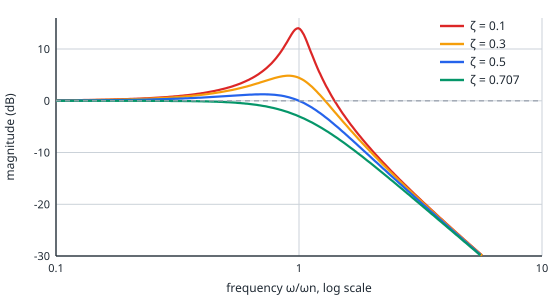

# Frequency Response 1: Bode Plots

Frequency response is how a system treats inputs that wiggle up and down at different speeds, and a Bode plot draws it.

## Before you start
<!-- bite: 3916b73f-67a0-4200-a6e0-9ffed001e7bb -->

You should have read [[control-theory/21-root-locus-1|21 — Root Locus 1: Sketching the Locus]], and be comfortable with logarithms and with complex numbers in polar form (a size and an angle).

After this lesson you will be able to:

1. say what happens to a sine wave passing through a linear system, and work it out by putting $s = j\omega$;
2. convert gains to decibels and back;
3. sketch a Bode plot from building blocks: gains, integrators, poles, zeros and delay;
4. spot a resonant peak and say why it's dangerous.

## What frequency response is
<!-- bite: ab0e9861-75bd-4228-a216-d31d50afd3d7 -->

A speaker's bass and treble settings are a frequency response: slow wiggles (bass) and fast ones (treble) come through at different strengths. Every system does this. Feed it a sine wave and, once the start-up has died away, **the output is a sine wave at the same frequency**; only its size and timing differ:

$$u(t) = A\sin\omega t \quad\longrightarrow\quad y(t) = A|G(j\omega)|\sin\big(\omega t + \angle G(j\omega)\big)$$

So to find out what happens at frequency $\omega$, put $s = j\omega$ into the transfer function. You get a complex number: its **size** $|G(j\omega)|$ is the gain, and its **angle** $\angle G(j\omega)$ is the phase shift, how far the output lags behind.

## The kid version
<!-- bite: 544117c8-d63e-41f9-bdc6-ace283e9ced2 -->

You're on a swing, and a friend pushes you in rhythm. If they push slowly, you just drift back and forth with their hands. Push at just the right rhythm and you go higher and higher. Push very fast, tiny jabs, and you barely move. The swing treats each pushing speed differently, and the frequency response is the list of how much you move, and how late, for every pushing speed.

**Where the analogy stops working.** The swing is a lightly damped system with one favourite speed. Many plants have none: they just pass slow wiggles and smother fast ones, like our car.

## Why engineers love it
<!-- bite: bc076e53-a139-4d74-9ee5-0d39c23bca55 -->

You can **measure it directly on real hardware**, with no model. Inject sine waves of many frequencies, measure the size and delay of the output, and you have the plot. That's why the frequency domain dominates practical control: you can get the Bode plot of a plant nobody has ever modelled.

The car makes it concrete. Its transfer function is $0.02/(20s+1)$. Wiggle the engine force slowly, once every few minutes, and the speed follows fully. Wiggle it every 10 seconds ($\omega = 0.63$ rad/s) and $|20j\omega + 1| = 12.6$, so the speed moves only a twelfth as much, and lags by 85°. The car's mass smooths out fast wiggles.

## Bode plots and decibels
<!-- bite: 4265426c-f686-43d9-a335-bad0bb04bc1f -->

A **Bode plot** is two graphs against frequency on a log scale:

1. **Magnitude** in decibels: $20\log_{10}|G(j\omega)|$.
2. **Phase** in degrees: $\angle G(j\omega)$.

Why logs? They turn multiplying into adding. Systems in series multiply, so on a Bode plot they **add**: you can sketch a complicated plot by adding the plots of its simple factors. That's the whole reason for the format.

Decibels worth memorising:

| Gain | 0.01 | 0.1 | 0.5 | 1 | 2 | 10 | 100 |
| --- | --- | --- | --- | --- | --- | --- | --- |
| dB | −40 | −20 | −6 | **0** | +6 | +20 | +40 |

**0 dB means a gain of 1**: the wiggle passes through unchanged in size. In a loop, that frequency is where everything interesting happens.

## The building blocks
<!-- bite: e9d6bde8-c196-417a-b618-ce4b15726e98 -->

Every rational transfer function is a product of these, so its Bode plot is their sum:

| Factor | Magnitude | Phase |
| --- | --- | --- |
| Gain $K$ | flat at $20\log K$ | 0° |
| Integrator $1/s$ | −20 dB per decade, everywhere | −90°, everywhere |
| Differentiator $s$ | +20 dB per decade | +90° |
| Pole $1/(1 + s/\omega_c)$ | flat, then −20 dB per decade after $\omega_c$ | 0° falling to −90° |
| Zero $1 + s/\omega_c$ | flat, then +20 dB per decade after $\omega_c$ | 0° rising to +90° |
| Delay $e^{-sT}$ | flat at 0 dB | $-\omega T$, without limit |

A **decade** is a factor of ten in frequency. Remember this one: **each pole costs 20 dB per decade and 90° of phase; each zero gives them back.**

## One pole in detail
<!-- bite: 9baf6ca1-20c6-46b9-be98-0e13840faba3 -->

The car's shape, a single pole with corner frequency $\omega_c = 1/\tau$, is the block you'll meet most:

**At the corner the magnitude is −3 dB and the phase is −45°.** The straight-line sketch misses by 3 dB there, which is close enough for design.

Now stare at the delay row of the table. A pure delay costs *nothing* in magnitude and *unlimited* phase. It gives no benefit and takes away the very thing that keeps a loop stable, as lesson 25 will show.

## Sketching by hand
<!-- bite: e74c7fcb-f553-407a-b39b-01168838c0f0 -->

Worth being able to do, because it builds the intuition the software plot doesn't:

1. Start at low frequency with the gain and any integrators: the slope is −20 dB per decade per integrator.
2. At each pole's corner, **subtract** 20 dB per decade from the slope.
3. At each zero's corner, **add** 20 dB per decade.
4. Phase: each pole takes away 90°, spread over about a decade either side of its corner; each zero adds 90°.

At high frequency the slope ends at $-20(n - m)$ dB per decade, where $n - m$ is how many more poles than zeros there are.

## Sketching our loop
<!-- bite: 343d6fc5-de33-4fd3-852f-a40fcda55335 -->

Take lesson 19's loop at $K = 1$: $L(s) = 1/(s(s+1)(s+2))$. Write it in corner form: $L = 0.5/(s(1 + s)(1 + s/2))$. Predict the slopes before looking.

1. Low frequency: gain 0.5 and one integrator, so −20 dB per decade, passing through $-6$ dB at $\omega = 1$.
2. Corner at 1: slope becomes −40.
3. Corner at 2: slope becomes −60, the final $-20 \times 3$.
4. Phase: starts at −90° (the integrator), falls towards −270°.

## Our loop's Bode plot
<!-- bite: 29dc0299-9cfb-4e54-ad64-010ab05051aa -->

Here is the plot those slopes describe.

The phase crosses −180° at $\omega = 1.414$ rad/s, the same frequency Routh found in lesson 19. That's no coincidence, and lesson 25 explains why.

## Second-order resonance
<!-- bite: 8b72069d-b8e9-48e9-bc7c-4b91fa16781e -->

The second-order form rolls off at −40 dB per decade past $\omega_n$, with 180° of total phase lag. But for $\zeta < 0.707$ there's a **resonant peak**, the swing's favourite speed:

$$M_r = \frac{1}{2\zeta\sqrt{1-\zeta^2}} \qquad \text{at} \qquad \omega_r = \omega_n\sqrt{1 - 2\zeta^2}$$

Our suspension, with $\zeta = 0.5$, peaks at $M_r = 1.15$ (1.2 dB) at $\omega_r = 8\sqrt{0.5} = 5.7$ rad/s.

## Why resonance is dangerous
<!-- bite: b442da39-81ed-49b9-87fe-d62d9110b751 -->

Lightly damped modes show up as sharp peaks, and they're the real danger in mechanical systems: a flexing structure, a stretchy drive belt, a part of the machine that wasn't in the model. A peak that pokes above 0 dB in the loop can destabilise it, even if the design on a rigid model was fine.

That's why engineers put a **notch filter** on a known resonance, a filter that cuts a narrow band of frequencies, and why a controller tuned on a rigid model can go unstable on the real machine.

## Common pitfalls
<!-- bite: 311d6ec1-5d63-4c88-b7d0-9ded7b94d8bd -->

1. **Mixing up gain and decibels.** A gain of 0.5 is −6 dB, not −50 dB.
2. **Starting the sketch at 0 dB.** Start at the low-frequency gain, including any integrators.
3. **Forgetting delay's phase.** It doesn't show on the magnitude plot at all.
4. **Ignoring peaks above 0 dB.** A resonance can cross 0 dB at a frequency the rigid model never shows.

## Check your understanding
<!-- bite: 719d4f56-cacb-4079-9ef4-55a91ab202ae -->

Try each one before you open the answer.

1. <!-- q: exact id="5e1b7c03" answer="26" tolerance="0.1" -->
   A system has gain 20 at some frequency. What is that in decibels?

   

Answer

   $20\log_{10}20 = 26.0$ dB.

   

2. <!-- q: mcq id="c8e4a210" -->
   A transfer function has 4 poles and 1 zero. What is the slope of its Bode magnitude at very high frequency?

   - [ ] −20 dB per decade
   - [ ] −40 dB per decade
   - [x] −60 dB per decade
   - [ ] −80 dB per decade

   

Answer

   $-20(n - m) = -20 \times 3 = -60$ dB per decade.

   

3. <!-- q: exact id="0f6d93b8" answer="-45" accept="−45|-45°|−45°" -->
   What is the phase, in degrees, of $1/(1 + s/10)$ at $\omega = 10$ rad/s?

   

Answer

   $-\tan^{-1}(10/10) = -45°$: the corner frequency.

   

4. <!-- q: exact id="a92f4c75" answer="1.7471" sigfigs="3" -->
   A second-order system has $\zeta = 0.3$. What is its resonant peak $M_r$, as a gain (not dB)?

   

Answer

   $\sqrt{0.91} = 0.954$, so $M_r = 1/(2 \times 0.3 \times 0.954) = 1/0.572 = 1.75$, about 4.8 dB.

   

5. <!-- q: open id="d3b06e81" -->
   A pure delay doesn't change the size of any wiggle passing through it. Why is it still harmful in a feedback loop?

   

Answer

   It adds phase lag that grows without limit as frequency rises ($-\omega T$). Lag pushes the loop's phase towards −180°, where feedback turns into positive feedback, so delay eats the stability margin while giving nothing back.

   

## Before moving on
<!-- bite: f9a0c599-1895-4785-9187-1a056da1ff99 -->

You can turn $s$ into $j\omega$, use decibels, and sketch a Bode plot from its pieces. **Next:** [[control-theory/25-frequency-response-2|25 — Frequency Response 2: Loop Shaping, Bandwidth and Margins]], which uses these plots to design a loop and measure how safe it is.

## Related
<!-- bite: 501371f9-0b54-45bd-89a4-b36a090a46f0 -->

- [[digital-signal-processing/index|Digital Signal Processing]]: the same plots for filters.
- [[control-theory/index|Control theory map]]

## About this lesson
<!-- bite: 5d9813bd-b7cb-44e9-8698-4d36fade9d18 -->

**Level:** Intermediate. **Covers:** sine waves through linear systems, decibels, Bode plot building blocks, sketching by hand, and second-order resonance.

**Where it sits:** lesson 24 of 58, part 1 of 3 on frequency response.

**Source:** `[reference]`, assembled from standard control texts. Plots computed by `scripts/diagrams/control_theory.py`.
