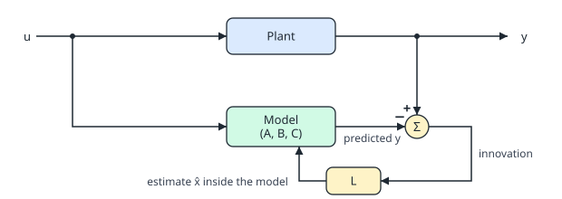

# Observers

An observer is a model that runs alongside the real system and uses the measurements you have to estimate the states you don't.

## Before you start
<!-- bite: 553073c8-aa07-41e1-a1e2-5fd8f1b42797 -->

You should have read [[control-theory/35-pole-placement|35 — Pole Placement]], and know what observability means ([[control-theory/34-controllability-and-observability|34 — Controllability and Observability]]).

After this lesson you will be able to:

1. explain why simply simulating the plant isn't enough, and what the innovation is;
2. derive the observer's error dynamics, $\dot{\mathbf{e}} = (A - LC)\mathbf{e}$;
3. choose an observer gain $L$ by placing the observer's poles;
4. state the separation principle and its two limits.

## What an observer is
<!-- bite: 44f117ec-5453-4e77-bdda-578ab233cf49 -->

Lesson 35 ended with a catch: state feedback $\mathbf{u} = -K\mathbf{x}$ needs every state, but you only measure $\mathbf{y} = C\mathbf{x}$, fewer numbers than states. The active suspension needs position *and* speed, and suppose it only has a position sensor.

The idea: **build a copy of the model in software, run it alongside the real system, and keep nudging it back towards reality using the measurements.** The copy's states are your estimate $\hat{\mathbf{x}}$ (read "x-hat"), and you feed the estimate to the controller.

## The kid version
<!-- bite: d58e2f33-f788-45ba-8431-d800ce3032dc -->

You're following a friend's car through a city, but you keep losing sight of it behind buses. Between glimpses, you guess where it is from its speed and the road. Each time you glimpse it, you correct your guess, a lot if you were way off, a little if you were close. You always have a best guess, even when you can't see it.

**Where the analogy stops working.** You'd forget your guess once you see the car again. An observer never throws its estimate away; it blends each measurement in by a fixed amount, set by the gain $L$, and that amount is the design choice.

## Why just simulating fails
<!-- bite: b522e1b0-5375-4923-b9e6-3afa3a7fdb0f -->

The naive version runs the model with the same input:

$$\dot{\hat{\mathbf{x}}} = A\hat{\mathbf{x}} + B\mathbf{u}$$

This doesn't work. If the starting estimate is wrong, the error never shrinks faster than the plant's own natural decay, and if $A$ is unstable the estimate drifts away from reality exponentially. It's open-loop estimation, with all the failings of open-loop control from lesson 01.

## The Luenberger observer
<!-- bite: 1a84c3f2-6ad4-4916-aab6-f09516a5c10a -->

The fix is the same as always: **feedback, applied to the estimator.**

$$\dot{\hat{\mathbf{x}}} = A\hat{\mathbf{x}} + B\mathbf{u} + L\underbrace{(\mathbf{y} - C\hat{\mathbf{x}})}_{\text{innovation}}$$

The **innovation** $\mathbf{y} - C\hat{\mathbf{x}}$ is the gap between what you measured and what your estimate says you *should* have measured. If it's not zero, the estimate is wrong, and the gain $L$ decides how hard to correct.

## Error dynamics
<!-- bite: db4bddb6-ea7e-4409-a474-5cb1c35db10b -->

Call the estimation error $\mathbf{e} = \mathbf{x} - \hat{\mathbf{x}}$. Subtract the observer's equation from the plant's: the $B\mathbf{u}$ terms cancel, and $\mathbf{y} - C\hat{\mathbf{x}} = C\mathbf{e}$, leaving

$$\dot{\mathbf{e}} = (A - LC)\mathbf{e}$$

In words: **the error has its own dynamics, set by $A - LC$, and they don't depend on the input at all.** So:

$$\boxed{\text{Choose } L \text{ so that } A - LC \text{ is stable} \implies \hat{\mathbf{x}} \to \mathbf{x}}$$

And by duality (lesson 34): **if $(A, C)$ is observable, you can put the eigenvalues of $A - LC$ anywhere.** It's the same pole-placement algorithm, run on $(A^T, C^T)$.

How fast? Rule of thumb: **observer poles 2 to 5 times faster than the controller poles**, so the estimate is ready before the controller needs it. Faster than that and the observer amplifies measurement noise, the trade-off the Kalman filter (lesson 37) settles optimally.

## An observer for the suspension
<!-- bite: fec1d1bc-0446-491a-abb5-b26ed961551f -->

The suspension measures position only: $C = \begin{bmatrix}1 & 0\end{bmatrix}$. With $L = \begin{bmatrix}l_1 \\ l_2\end{bmatrix}$:

$$A - LC = \begin{bmatrix}-l_1 & 1 \\ -64 - l_2 & -8\end{bmatrix}$$

Its characteristic polynomial is $s^2 + (8 + l_1)s + (64 + 8l_1 + l_2)$. The controller poles were $-8 \pm 8j$; put the observer's three times further out, at $-24 \pm 24j$, which is $s^2 + 48s + 1152$. Predict $L$ before reading on.

Matching: $8 + l_1 = 48$ gives $l_1 = 40$; $64 + 320 + l_2 = 1152$ gives $l_2 = 768$.

## Watching the observer catch up
<!-- bite: d7361c90-359a-4c36-a8a1-9e8e2545d111 -->

Release the suspension from 5 cm down, while the observer starts out believing the body is at rest at zero. It only sees position, so at first its speed estimate swings the wrong way, but within about a fifth of a second it has locked on to the true speed.

## The separation principle
<!-- bite: 5c00e0ad-b599-4912-825b-f74caf8c6413 -->

Now feed the estimate to the controller, $\mathbf{u} = -K\hat{\mathbf{x}}$. Here's the result that makes all this practical: **design the controller assuming you know the state perfectly, design the observer ignoring the controller, and put them together.** The closed-loop poles are just the two sets combined:

$$\text{eig}(A - BK) \ \cup \ \text{eig}(A - LC)$$

So the suspension with its observer has poles at $-8 \pm 8j$ and $-24 \pm 24j$, exactly as designed separately. This is genuinely surprising, because feedback loops normally interact strongly, and it's what makes state-space design usable: without it you'd have to design a $2n$-state system all at once.

## The two limits of separation
<!-- bite: e75dff4e-7ad8-44c6-b4c4-e25e8095f291 -->

1. **It holds exactly only for the linear model.** With nonlinearity, model error or saturation, controller and observer *do* interact, and an aggressive observer with a fast controller can misbehave together in ways neither does alone.
2. **Separation is about pole locations, not robustness.** An observer-based controller can have much worse margins than the state-feedback design it came from. The famous case: LQR has guaranteed margins, but LQR with a Kalman filter (LQG) has **none at all**. → [[control-theory/43-lqg-and-mpc|43 — LQG and MPC]]

## Common pitfalls
<!-- bite: b594a42f-c555-4fbc-9b6c-8443d38cbca9 -->

1. **Running the model without correction.** Without the $L$ term, errors never shrink faster than the plant itself.
2. **Making the observer as slow as the controller.** The estimate isn't ready when it's needed.
3. **Making the observer extremely fast.** It passes measurement noise straight into the estimate.
4. **Assuming separation means robustness.** Check the combined margins.

## Check your understanding
<!-- bite: 2481ebb2-96c5-4129-a4a2-a05dd6360ccc -->

Try each one before you open the answer.

1. <!-- q: mcq id="b6e2d0f5" -->
   What does a non-zero innovation $\mathbf{y} - C\hat{\mathbf{x}}$ tell the observer?

   - [ ] The plant is unstable
   - [x] Its estimate disagrees with the measurement, so it should correct
   - [ ] The sensor has failed
   - [ ] The controller gain is too high

   

Answer

   The estimate predicts a different measurement from the one actually seen, so the estimate is wrong and $L$ pushes it back.

   

2. <!-- q: exact id="3d8a0f17" answer="-7" accept="−7" -->
   A scalar plant $\dot{x} = -x + u$ is measured directly ($C = 1$). With observer gain $L = 6$, where is the observer's pole?

   

Answer

   $A - LC = -1 - 6 = -7$.

   

3. <!-- q: gap id="9c1e4b62" answers="30;204" -->
   $A = \begin{bmatrix}0 & 1 \\ -4 & -2\end{bmatrix}$, $C = \begin{bmatrix}1 & 0\end{bmatrix}$. The observer polynomial is $s^2 + (2 + l_1)s + (4 + 2l_1 + l_2)$. To get $s^2 + 32s + 268$, $l_1 = $ ___ and $l_2 = $ ___.

   

Answer

   $2 + l_1 = 32$ gives $l_1 = 30$; $4 + 60 + l_2 = 268$ gives $l_2 = 204$.

   

4. <!-- q: mcq id="0f7c3a58" -->
   A controller has poles at $-2 \pm 2j$. Where would a sensible observer put its poles?

   - [ ] At $-2 \pm 2j$, the same place
   - [x] Around $-6 \pm 6j$ to $-10 \pm 10j$
   - [ ] At $-200 \pm 200j$
   - [ ] At $-0.5 \pm 0.5j$

   

Answer

   2 to 5 times faster than the controller. Much faster amplifies noise; slower leaves the controller using a stale estimate.

   

5. <!-- q: open id="e48d2b39" -->
   State the separation principle, and say why it doesn't guarantee a robust design.

   

Answer

   The poles of a controller using an observer's estimate are the controller's poles plus the observer's poles, so the two can be designed separately. But it only fixes pole locations for the exact linear model; it says nothing about margins, and an observer-based design can be much more fragile than the full-state design (LQG has no guaranteed margins).

   

## Before moving on
<!-- bite: e21aefb5-3fae-4807-8995-14472aba30b9 -->

You can design an observer by placing its poles and explain separation. **Next:** [[control-theory/37-kalman-filter|37 — The Kalman Filter]], which chooses $L$ optimally when the sensors and the model are both noisy.

## Related
<!-- bite: 58c43621-86ae-44dc-9b73-bd6db5c1847d -->

- [[robotics/11-state-estimation-and-filtering|Robotics: State Estimation and Filtering]]
- [[control-theory/index|Control theory map]]

## About this lesson
<!-- bite: 98c666da-491b-4ffc-abb5-09f43a2f6d0d -->

**Level:** Advanced. **Covers:** why plain simulation fails, the Luenberger observer and the innovation, error dynamics, placing observer poles, and the separation principle with its limits, worked on the suspension.

**Where it sits:** lesson 36 of 58, part 1 of 2 on estimation.

**Source:** `[reference]`, assembled from standard control texts. The observer simulation comes from `scripts/diagrams/control_theory.py`.
