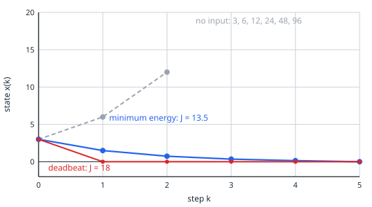

# Optimal Control 2: Minimum-Energy Control and Deadbeat

Minimum-energy control drives a linear system to a fixed final state with the least total effort, and deadbeat control gets there in the fewest possible steps.

## Before you start
<!-- bite: 1b64e95f-4ddb-4eb0-b99e-a433df3b1db1 -->

You should have read [[control-theory/38-optimal-control-1|38 — Optimal Control 1: The Performance Index and the Discrete Recipe]], and be able to write the Hamiltonian and the three equations.

After this lesson you will be able to:

1. solve the minimum-energy, fixed-final-state problem for a scalar plant by hand;
2. explain why the optimal inputs grow towards the start, and what the reachability Gramian is;
3. design a deadbeat controller by putting every closed-loop pole at the origin;
4. compare the effort of minimum-energy and deadbeat control on the same plant.

## What minimum-energy control is
<!-- bite: c2a9c7e3-bda5-4d8c-bbf9-c3b84dd73a28 -->

Lesson 38's recipe works for any plant, but a nonlinear one left us with a quartic. For a **linear** plant with an effort cost, the recipe solves in closed form, and the answer is worth knowing because it shows the costate doing exactly the "price tag" job the kid version promised.

The problem, in words: **get from where you are to exactly where you want to be in $N$ steps, using as little total effort as possible.**

$$x_{k+1} = Ax_k + Bu_k, \qquad J = \tfrac12\sum_{k=0}^{N-1}u_k^TRu_k, \qquad x_N = r_N \text{ fixed}$$

## The kid version
<!-- bite: 0aad5784-01e6-4ec7-8d48-11bfbdc96b98 -->

You need to push a heavy cart to a mark 5 metres away in 5 seconds, and your arms tire with the *square* of how hard you push. One huge shove at the start is exhausting. Many gentle pushes spread out are much easier, and the cheapest plan of all is the one that spreads the effort exactly right.

**Where the analogy stops working.** A cart on its own coasts. Our plant actively *runs away*: left alone, its state doubles every step. So an early push is worth more than a late one, because it stops the runaway before it grows, and the best plan pushes hardest at the start.

## The plant: it runs away on its own
<!-- bite: 9c69810b-a129-4ae8-af14-9e410efcf79b -->

Lewis problem 2.2-4 uses the scalar plant

$$x_{k+1} = 2x_k + u_k, \qquad x_0 = 3$$

Part a: the **homogeneous solution**, with no input. Each step doubles the state, so $x_k = 3 \cdot 2^k$:

| $k$ | 0 | 1 | 2 | 3 | 4 | 5 |
| --- | --- | --- | --- | --- | --- | --- |
| $x_k$ | 3 | 6 | 12 | 24 | 48 | 96 |

The plant is unstable (its pole is at 2, outside the unit circle). Left alone, it reaches 96 by step 5. We want $x_5 = 0$.

## The recipe on this plant
<!-- bite: 4effa588-e3b1-4c34-b11f-6298db56a699 -->

Part b: minimise $J = \tfrac12\sum_{k=0}^{4}u_k^2$ with $x_5 = 0$. The Hamiltonian is $H^k = \tfrac12u_k^2 + \lambda_{k+1}(2x_k + u_k)$.

1. **Costate**: $\lambda_k = \partial H/\partial x_k = 2\lambda_{k+1}$. So the price doubles going backwards: $\lambda_{k+1} = 2^{4-k}\lambda_5$.
2. **Stationarity**: $0 = u_k + \lambda_{k+1}$, so $u_k = -\lambda_{k+1} = -2^{4-k}\lambda_5$.

So the inputs are already known up to one number, $\lambda_5$. Each one is half the one before: the plan pushes hardest first, exactly as the kid version predicted.

## Finding the last unknown
<!-- bite: 6d44d805-7d6d-4455-aef6-99206559921e -->

Now use the final condition. Running the plant forward, the start contributes $2^5x_0 = 96$ and each input $u_k$ is doubled $4 - k$ times on the way:

$$x_5 = 96 + \sum_{k=0}^{4}2^{4-k}u_k = 96 - \lambda_5\sum_{k=0}^{4}4^{4-k} = 96 - 341\lambda_5$$

Setting $x_5 = 0$ gives $\lambda_5 = 96/341 = 0.2815$. Before reading on, predict $u_0$.

$$u_k = -0.2815 \times 2^{4-k}$$

| $k$ | 0 | 1 | 2 | 3 | 4 | 5 |
| --- | --- | --- | --- | --- | --- | --- |
| $u_k$ | −4.504 | −2.252 | −1.126 | −0.563 | −0.282 | |
| $x_k$ | 3 | 1.496 | 0.739 | 0.352 | 0.141 | 0.000 |

The check the problem asks for: the trajectory really does end at zero. The cost is $J = \tfrac12 \times 96^2/341 = 13.51$.

## The general formula
<!-- bite: 31fd7a92-a535-49f4-ab5a-ec2aaff6a779 -->

The number 341 wasn't luck. For any linear plant, the same steps give

$$u_k = R^{-1}B^T(A^T)^{N-k-1}G^{-1}(r_N - A^Nx_0), \qquad G = \sum_{i=0}^{N-1}A^{N-1-i}BR^{-1}B^T(A^T)^{N-1-i}$$

$G$ is the **reachability Gramian**. In words, it measures how easily the inputs can move the state, summed over the horizon. For our plant $G = 1 + 4 + 16 + 64 + 256 = 341$, and $r_N - A^Nx_0 = 0 - 96$.

$G$ must be invertible, which is exactly controllability (lesson 34). And the minimum cost is $\tfrac12(r_N - A^Nx_0)^TG^{-1}(r_N - A^Nx_0)$: directions that are hard to reach (small $G$) are expensive.

## Deadbeat control
<!-- bite: 556ee4ad-fd6a-4436-803d-946bb8b740d9 -->

A different goal: **reach zero in as few steps as possible, and stay there.** Use state feedback $u_k = -Kx_k$, and put **every closed-loop pole at the origin**. For an $n$-state system, $(A - BK)^n = 0$, so the state is exactly zero after at most $n$ steps. That's **deadbeat** control, and it only exists in discrete time.

Our scalar plant has $n = 1$: we want $A - K = 2 - K = 0$, so $K = 2$. Then $u_0 = -2 \times 3 = -6$ and $x_1 = 2 \times 3 - 6 = 0$. Done in one step.

## Deadbeat against minimum energy
<!-- bite: 5e81fd72-d97b-46c1-9163-8bf583eaf6b2 -->

Same plant, same start, two goals:

1. **Deadbeat**: one push of $-6$, cost $\tfrac12 \times 36 = 18$, finished in 1 step.
2. **Minimum energy**: five pushes starting at $-4.5$, cost 13.51, finished in 5 steps.

## Speed costs effort
<!-- bite: ba125749-ceb9-4b3f-9eb7-b4f02ddea863 -->

Remember this one: **speed costs effort.** Deadbeat is the fastest possible discrete controller, and its big first push makes it noisy and quick to saturate. In practice it's used where the plant is well known and the actuator has room, such as some digital motor drives.

For a two-state system, deadbeat needs $\text{trace}(A - BK) = 0$ and $\det(A - BK) = 0$. Lewis problem 2.2-5b does exactly this for a two-input plant, with the feedback going into input one only; the [[control-theory/optimal-control-problem-bank|problem bank]] has the answer.

## Common pitfalls
<!-- bite: 1f565c52-2816-4da4-a493-20c74b5f9eb1 -->

1. **Forgetting that the costate runs backwards.** Here $\lambda$ doubles going *back* in time, which is why the early inputs are big.
2. **Dropping the $\tfrac12$.** It changes the cost's value, not the optimal inputs.
3. **Expecting deadbeat to be cheap.** It's the fastest, not the cheapest.
4. **Using the Gramian formula on an uncontrollable plant.** $G$ is singular, and some targets can't be reached.

## Check your understanding
<!-- bite: c5730ab6-7beb-424d-a646-d96154dc8c8c -->

Try each one before you open the answer.

1. <!-- q: exact id="4b9d1e70" answer="40" -->
   A plant $x_{k+1} = 2x_k + u_k$ starts at $x_0 = 5$ with no input. What is $x_3$?

   

Answer

   $5 \times 2^3 = 40$.

   

2. <!-- q: exact id="e2a7c493" answer="21" -->
   For $x_{k+1} = 2x_k + u_k$ with $B = R = 1$ and $N = 3$, what is the reachability Gramian $G = \sum_{i=0}^{2}4^{i}$?

   

Answer

   $1 + 4 + 16 = 21$.

   

3. <!-- q: exact id="8c0f5d16" answer="-6.0952" accept="−6.0952" sigfigs="3" -->
   Drive $x_{k+1} = 2x_k + u_k$ from $x_0 = 4$ to $x_3 = 0$ with minimum $\tfrac12\sum u_k^2$. The inputs are $u_k = -\lambda_3 2^{2-k}$ with $\lambda_3 = 2^3x_0/21$. What is $u_0$?

   

Answer

   $\lambda_3 = 32/21 = 1.524$, and $u_0 = -2^2\lambda_3 = -6.10$. The other inputs are $-3.05$ and $-1.52$, and they bring the state from 4 to 1.90, 0.76 and exactly 0.

   

4. <!-- q: exact id="1d6a2f85" answer="0.5" accept="1/2" -->
   A scalar plant is $x_{k+1} = 0.5x_k + u_k$. What feedback gain $K$ in $u_k = -Kx_k$ makes it deadbeat?

   

Answer

   $0.5 - K = 0$, so $K = 0.5$.

   

5. <!-- q: open id="7e3b0c58" -->
   In the minimum-energy solution for $x_{k+1} = 2x_k + u_k$, each input is half the size of the one before. Explain why, in terms of the plant.

   

Answer

   The plant doubles whatever it holds each step, so a push at step $k$ is magnified by $2^{N-1-k}$ by the end. An early push is worth more per unit of effort, and since effort is charged by its square, the cheapest plan uses inputs in proportion to their effect: each one half the one before.

   

## Before moving on
<!-- bite: 9a01c8e9-ea41-4434-b9cb-677b29b21c6f -->

You can solve a minimum-energy problem with the recipe or the Gramian, and design a deadbeat gain. **Next:** [[control-theory/40-optimal-control-3|40 — Optimal Control 3: The Discrete Riccati Equation]], which turns the open-loop plan into feedback, by solving for the costate as a gain times the state.

## Related
<!-- bite: e514b9b8-08ec-4591-9a3a-ff04fc7038a7 -->

- [[control-theory/34-controllability-and-observability|34 — Controllability and Observability]]: why $G$ must be invertible.
- [[control-theory/optimal-control-problem-bank|Optimal control problem bank]]
- [[control-theory/index|Control theory map]]

## About this lesson
<!-- bite: 0abea22d-9ddc-4a54-bb84-6c85534dc7ef -->

**Level:** Advanced. **Covers:** the fixed-final-state minimum-energy problem, Lewis problem 2.2-4a and b solved, the reachability Gramian, deadbeat control, and the trade between speed and effort.

**Where it sits:** lesson 39 of 58, part 2 of 4 on optimal control.

**Source:** the author's optimal-control problem sheets, from F. L. Lewis, *Optimal Control*, section 2.2 (problems 2.2-4 and 2.2-5). Numbers checked in `scripts/diagrams/control_theory.py`.
