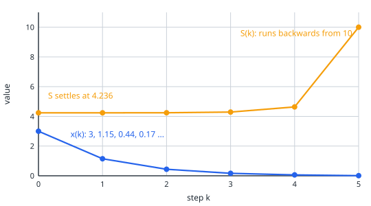

# Optimal Control 3: The Discrete Riccati Equation

For a linear plant with a quadratic cost, the optimal control is state feedback with gains from one backward sweep, the Riccati equation.

## Before you start
<!-- bite: ef6d0e42-fa87-4429-896d-8a8ac2ec09f3 -->

You should have read [[control-theory/39-optimal-control-2|39 — Optimal Control 2: Minimum-Energy Control and Deadbeat]], and be comfortable with the state, costate and stationarity equations.

After this lesson you will be able to:

1. explain the sweep idea, $\lambda_k = S_kx_k$, and why it turns a two-point problem into a one-way calculation;
2. run the discrete Riccati equation backwards by hand for a scalar plant;
3. compute the optimal gains, the trajectory and the cost-to-go at every step;
4. find the steady-state gain, and use the Lyapunov equation to price a fixed gain.

## What the Riccati equation does
<!-- bite: 7a9cbc7d-15eb-4231-babb-c3bd05f25179 -->

Lesson 39 produced an **open-loop** plan: a list of inputs worked out in advance. If a gust of wind knocks the state off course at step 2, the plan doesn't notice. We want **feedback**: the best input as a function of where the state actually is.

The problem is the **linear quadratic regulator** over a finite horizon:

$$x_{k+1} = Ax_k + Bu_k, \qquad J = \tfrac12x_N^TS_Nx_N + \tfrac12\sum_{k=0}^{N-1}\big(x_k^TQx_k + u_k^TRu_k\big)$$

The final state is free, but penalised by $S_N$. The recipe gives the costate equation $\lambda_k = Qx_k + A^T\lambda_{k+1}$, stationarity $u_k = -R^{-1}B^T\lambda_{k+1}$, and the end condition $\lambda_N = S_Nx_N$.

## The kid version
<!-- bite: 675b745b-317a-441d-9efe-e582a5634b19 -->

A satnav doesn't store one route from your house. It stores, for *every* junction, which way to turn from there. Get lost, take a wrong turn, and it still knows what to do, because the answer depends only on where you are now. The Riccati equation builds that "from here, do this" table, starting from the destination and working back.

**Where the analogy stops working.** A satnav's table is huge. For a linear plant with a quadratic cost, the whole table collapses to one gain matrix per step, because the best input is always just a multiple of the state.

## The sweep: guess the costate
<!-- bite: d6cff5ea-26db-4104-8ee5-d08d27fae9ac -->

Look at the end condition: $\lambda_N = S_Nx_N$, a matrix times the state. Guess that this holds at *every* step:

$$\lambda_k = S_kx_k$$

Put the guess into the equations. Stationarity gives $u_k = -R^{-1}B^TS_{k+1}x_{k+1}$, and with $x_{k+1} = Ax_k + Bu_k$, solving for $u_k$:

$$u_k = -K_kx_k, \qquad K_k = (B^TS_{k+1}B + R)^{-1}B^TS_{k+1}A$$

Then the costate equation, $S_kx_k = Qx_k + A^TS_{k+1}x_{k+1}$, holds for every $x_k$ only if

$$S_k = A^T\big[S_{k+1} - S_{k+1}B(B^TS_{k+1}B + R)^{-1}B^TS_{k+1}\big]A + Q$$

That's the **discrete Riccati equation**. It starts at $S_N$ and runs **backwards**, using no state at all. So the two-point problem splits in two one-way jobs: sweep $S$ and $K$ backwards once, offline; then run the plant forwards with $u_k = -K_kx_k$.

## The cost-to-go
<!-- bite: 4d047548-63f8-4c46-93f0-cf0673004211 -->

The matrix $S_k$ has a meaning of its own: the best cost still to pay, from step $k$ onwards, starting at $x_k$, is

$$J_k^* = \tfrac12x_k^TS_kx_k$$

So $S_k$ is the price of being at a given state with $N - k$ steps left. The kid version's price tags, made exact.

## The worked problem: the setup
<!-- bite: ca31efa4-e57b-4ab6-9d10-8eaaf40dfde1 -->

Lewis problem 2.2-4c, on the same runaway plant as lesson 39:

$$x_{k+1} = 2x_k + u_k, \qquad J_0 = 5x_5^2 + \tfrac12\sum_{k=0}^{4}\big(x_k^2 + u_k^2\big)$$

Match the form: $A = 2$, $B = 1$, $Q = 1$, $R = 1$, and $\tfrac12S_5x_5^2 = 5x_5^2$ gives $S_5 = 10$. For one state, the Riccati equation and gain simplify to

$$S_k = \frac{4S_{k+1}}{S_{k+1} + 1} + 1, \qquad K_k = \frac{2S_{k+1}}{S_{k+1} + 1}$$

Predict before reading on: as you sweep backwards, does $S$ grow or shrink?

## The worked problem: the backward sweep
<!-- bite: 37133d70-99c8-42ac-ace3-0185d938890f -->

Start at $S_5 = 10$:

1. $K_4 = 20/11 = 1.818$, and $S_4 = 40/11 + 1 = 4.636$.
2. $K_3 = 9.273/5.636 = 1.645$, and $S_3 = 4.290$.
3. $K_2 = 1.622$, $S_2 = 4.244$.
4. $K_1 = 1.619$, $S_1 = 4.237$.
5. $K_0 = 1.618$, $S_0 = 4.236$.

| $k$ | 0 | 1 | 2 | 3 | 4 | 5 |
| --- | --- | --- | --- | --- | --- | --- |
| $S_k$ | 4.236 | 4.237 | 4.244 | 4.290 | 4.636 | 10 |
| $K_k$ | 1.618 | 1.619 | 1.622 | 1.645 | 1.818 | |

$S$ shrinks from the heavy end weight and settles almost at once. Far from the end, the problem looks the same at every step, so the gain stops changing.

## The worked problem: running it forwards
<!-- bite: 20b26a0c-ac72-4c1d-bea7-11c9c2612067 -->

Now run the plant from $x_0 = 3$ with $u_k = -K_kx_k$, so $x_{k+1} = (2 - K_k)x_k$:

| $k$ | 0 | 1 | 2 | 3 | 4 | 5 |
| --- | --- | --- | --- | --- | --- | --- |
| $x_k$ | 3 | 1.146 | 0.437 | 0.165 | 0.059 | 0.011 |
| $u_k$ | −4.854 | −1.854 | −0.709 | −0.272 | −0.107 | |
| $J_k^*$ | 19.06 | 2.78 | 0.405 | 0.059 | 0.008 | 0.0006 |

Check: adding up $5x_5^2 + \tfrac12\sum(x_k^2 + u_k^2)$ directly gives 19.063, the same as $J_0^* = \tfrac12 \times 4.236 \times 3^2$. The Riccati price was right.

## The steady state, and a surprise
<!-- bite: af7d5e99-4397-4e40-8334-9ebf6a583c12 -->

If $S$ stops changing, then $S = 4S/(S+1) + 1$, which rearranges to $S^2 - 4S - 1 = 0$:

$$S = 2 + \sqrt5 = 4.236, \qquad K = \frac{2S}{S+1} = \frac{1 + \sqrt5}{2} = 1.618$$

The steady gain is the **golden ratio**. It's a coincidence of these particular numbers, but a memorable one. The closed-loop pole is $2 - 1.618 = 0.382$, well inside the unit circle: the feedback has tamed a plant that doubled every step. This steady equation is the **algebraic Riccati equation**, and it gives the infinite-horizon LQR of lesson 42.

## Pricing a fixed gain: the Lyapunov equation
<!-- bite: be17d99d-29a0-48c6-94ec-3a367f497831 -->

Sometimes the gain is fixed, say a constant $K$ you already chose, and you just want its cost. With $u_k = -Kx_k$ the closed loop is $A_c = A - BK$, and the cost-to-go matrix obeys

$$S_k = A_c^TS_{k+1}A_c + Q + K^TRK$$

That's the discrete **Lyapunov equation**: the Riccati equation with no optimisation in it. Its steady version, $S = A_c^TSA_c + Q'$, has a unique solution exactly when $A_c$ is stable. Lesson 55 meets its continuous-time twin as a stability test. Lewis problem 2.2-2 asks you to solve one by hand; see the [[control-theory/optimal-control-problem-bank|problem bank]].

The Riccati update can also be written in the **Joseph-stabilised** form, which keeps $S$ symmetric and positive despite rounding (Lewis problem 2.2-3). The same trick appears in the Kalman filter (lesson 37), because the filter's covariance obeys the dual Riccati equation.

## Common pitfalls
<!-- bite: 0a2d4fea-3e34-40de-beb2-3dcde8df629b -->

1. **Forgetting the $\tfrac12$ in $S_N$.** A terminal cost $5x_N^2$ means $S_N = 10$.
2. **Sweeping forwards.** $S$ starts at $N$ and runs back to 0.
3. **Using $K_k$ with $S_k$.** The gain at step $k$ uses $S_{k+1}$.
4. **Thinking feedback and the open-loop plan differ in cost.** With no disturbance they give the same inputs; feedback just also copes when things go wrong.

## Check your understanding
<!-- bite: dfde9020-9cdc-44d6-b1b2-d4bdae568669 -->

Try each one before you open the answer.

1. <!-- q: exact id="3f8a6c21" answer="20" -->
   A finite-horizon problem has terminal cost $10x_N^2$ in a cost written as $\tfrac12x_N^TS_Nx_N + \ldots$. What is $S_N$?

   

Answer

   $\tfrac12S_N = 10$, so $S_N = 20$.

   

2. <!-- q: exact id="b5d01e94" answer="0.6667" sigfigs="3" -->
   Plant $x_{k+1} = x_k + u_k$ with $Q = R = 1$ and $S_{k+1} = 2$. What is the gain $K_k = S_{k+1}/(S_{k+1} + 1)$?

   

Answer

   $2/3 = 0.667$.

   

3. <!-- q: exact id="6e9c2a73" answer="1.6667" sigfigs="3" -->
   Same plant and weights, $S_{k+1} = 2$. What is $S_k = S_{k+1} - S_{k+1}^2/(S_{k+1}+1) + 1$?

   

Answer

   $2 - 4/3 + 1 = 1.667$.

   

4. <!-- q: exact id="0a4e7d58" answer="1.618" sigfigs="3" -->
   Same plant, $x_{k+1} = x_k + u_k$, $Q = R = 1$. Its steady Riccati value solves $S^2 - S - 1 = 0$. What is $S$?

   

Answer

   $S = (1 + \sqrt5)/2 = 1.618$, the golden ratio again, with gain $K = S/(S+1) = 0.618$.

   

5. <!-- q: open id="d82b6f19" -->
   Why does guessing $\lambda_k = S_kx_k$ turn a hard two-point boundary-value problem into an easy one?

   

Answer

   The guess makes the costate a known matrix times the state. The matrices $S_k$ satisfy their own equation, the Riccati equation, which starts from the known $S_N$ and needs no state, so it can be run backwards once, offline. Then the input is $u_k = -K_kx_k$, which only needs the current state, so the plant runs forwards with no unknown left at either end.

   

## Before moving on
<!-- bite: d73d1b1c-1f59-4b22-83f7-565a1a8bd49f -->

You can sweep the Riccati equation, build the feedback, and price any gain. **Next:** [[control-theory/41-optimal-control-4|41 — Optimal Control 4: Continuous Time and the Euler–Lagrange Equations]], the same recipe for continuous-time plants.

## Related
<!-- bite: d8a729a5-20c5-422f-9644-29237667d415 -->

- [[control-theory/37-kalman-filter|37 — The Kalman Filter]]: the dual Riccati equation.
- [[operations-research/08-dynamic-programming|Dynamic Programming]]: the cost-to-go is Bellman's value function.
- [[control-theory/index|Control theory map]]

## About this lesson
<!-- bite: cc4fbbce-158a-4271-b5cc-f0ca3878d12a -->

**Level:** Advanced. **Covers:** the sweep method, the discrete Riccati equation, the optimal gains and cost-to-go, Lewis problem 2.2-4c worked in full, the steady-state solution, and the Lyapunov equation for a fixed gain.

**Where it sits:** lesson 40 of 58, part 3 of 4 on optimal control.

**Source:** the author's optimal-control problem sheets, from F. L. Lewis, *Optimal Control*, section 2.2 (problems 2.2-2, 2.2-3 and 2.2-4c). Numbers checked in `scripts/diagrams/control_theory.py`.
