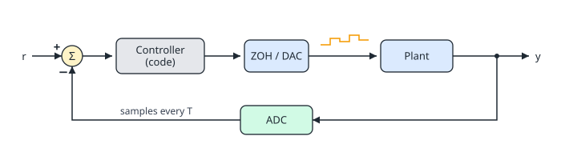
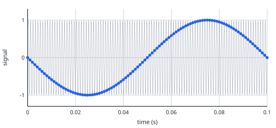
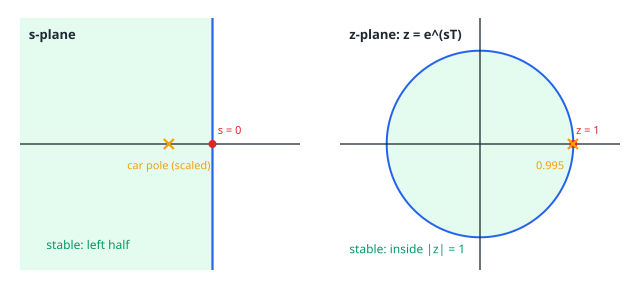

# Digital Control 1: Sampling and the z-Transform

Digital control runs the controller on a computer that reads the plant and updates its output at fixed moments, and sampling changes how the loop behaves.

## Before you start
<!-- bite: 8b200c49-fe8d-4cd2-b26e-e12b1d90d190 -->

You should have read [[control-theory/25-frequency-response-2|25 — Frequency Response 2: Loop Shaping, Bandwidth and Margins]] (phase margin) and [[control-theory/31-state-space-2|31 — State Space 2: Solution, Eigenvalues and Conversions]] (discretising a state model).

After this lesson you will be able to:

1. name the three things sampling does to a loop, and estimate the phase lost to the hold;
2. work out what frequency an aliased signal appears at, and say where the anti-aliasing filter goes;
3. choose a sample rate for a given closed-loop bandwidth;
4. map poles between the s-plane and the z-plane, and test discrete stability.

## What digital control is
<!-- bite: afb2ce44-1f30-41ed-8aee-29ed5face1cb -->

Almost every controller today, from a washing machine to a drone, is a program. It reads the sensor through an **ADC** (analogue-to-digital converter), computes, and writes the actuator through a **DAC** (digital-to-analogue converter) or a PWM output, which **holds** the value until the next update. That's a **zero-order hold** (ZOH): a staircase, not a smooth curve.

Sampling does three things to the loop. The next three sections take them one at a time.

## The kid version
<!-- bite: cd796e58-7b97-4623-badb-b03eaf66e6a6 -->

Imagine driving with your eyes shut, opening them for a blink once a second, then holding the steering wheel still until the next blink. At slow speeds you'd manage. At high speed, a second's blindness is long enough to drift off the road. Sampling is that blinking, and the sample rate is how often you blink.

**Where the analogy stops working.** You'd at least notice something odd happening between blinks. A sampler can't: a vibration at just the wrong speed can look like a slow drift that isn't there, and the controller fights a ghost.

## Effect 1: the hold adds delay
<!-- bite: b8cd15e3-89ae-4c47-925a-fa15f2a36134 -->

The output is held for a whole sample period $T$, so on average it's half a sample late:

$$\text{effective delay} \approx \frac{T}{2} \quad\Longrightarrow\quad \text{phase lag} \approx \frac{\omega T}{2} \text{ rad}$$

This eats phase margin, exactly like lesson 25's sensor delay, and it's the single most common reason a controller that simulated beautifully oscillates on hardware.

Take lesson 25's loop, crossing over at $\omega_c = 0.446$ rad/s with 53.4° of margin. Sampled every $T = 0.5$ s, the hold costs $0.446 \times 0.25 = 0.11$ rad, which is 6.4°: margin down to 47°. Sampled every 2 s, it costs 25.6°, leaving 28°: a wobbly loop.

## Effect 2: aliasing
<!-- bite: 8841206a-e5e0-409a-bfd5-0094b8ebdbe4 -->

A sampler can't tell a fast signal from a slow one that passes through the same sample points. Any frequency above half the sample rate (the **Nyquist frequency**, $f_s/2$) **folds back** and appears at a lower one. Sample at $f_s = 1000$ Hz, and a 990 Hz vibration lands at $1000 - 990 = 10$ Hz: a slow wobble your controller will earnestly try to fight.

Remember this one: **anti-aliasing is an analogue job.** Once a signal has aliased, it looks exactly like a real one, and no digital filter can separate them. You need a low-pass filter **before** the ADC. It's the commonest omission in a first digital controller.

## Effect 3: quantisation
<!-- bite: 207276d3-c01f-48f8-b019-eb422536405e -->

Finite resolution puts a floor on precision. A 10-bit ADC over 10 V resolves about 10 mV, and the DAC has its own steps. **The derivative term amplifies quantisation noise directly**: the derivative of a staircase is a row of spikes. That's a big reason the D term behaves worse on hardware than in simulation.

## Choosing the sample rate
<!-- bite: c481fb65-91c0-44b6-bbef-46607f7eb082 -->

Shannon's theorem says $f_s > 2f_{max}$, but that's the floor for *rebuilding* a signal, and far too slow for *controlling* one. The practical rule:

$$f_s \approx 20 \text{ to } 40 \times f_b \qquad \text{(}f_b\text{ is the closed-loop bandwidth)}$$

or, the same thing, **10 to 20 samples per rise time**. Our PID car (lesson 18) rises from 10% to 90% in about 7 s and runs at 10 Hz: about 70 samples per rise time, comfortably fast.

| Application | Typical rate |
| --- | --- |
| Temperature and process | once per second to once a minute |
| Motor speed | 1 kHz |
| Motor current | 10 to 20 kHz |
| Drone attitude | 500 Hz to 1 kHz |
| Hard-disk head | 20 to 50 kHz |

## Too slow, too fast, and jitter
<!-- bite: da2ce4de-4c55-451a-b283-c09547b23a76 -->

**Too slow**: the hold delay destroys phase margin, disturbances between samples go unseen, and the design stops behaving like its continuous model.

**Too fast** isn't free either: quantisation noise swamps the derivative, filter coefficients bunch up near $z = 1$ where fixed-point maths loses precision, and you burn processor time.

Remember this one: **jitter is worse than latency.** A steady 2 ms delay you can design around. A delay wandering between 1 and 3 ms you can't, because your effective gains change every sample. Use a timer interrupt, not `sleep()` in a loop; this matters more than the exact rate.

## The z-transform
<!-- bite: 95682fdc-c9b1-4899-94a1-8ab19dffc882 -->

Sampled signals need their own transform, doing for difference equations what Laplace did for differential ones:

$$X(z) = \sum_{k=0}^{\infty}x[k]z^{-k}$$

The intuition in one line: **$z^{-1}$ is a one-sample delay**, just as $s$ is a derivative. A controller that says "$u[k] = u[k-1] + e[k]$" becomes $U = z^{-1}U + E$, so $U/E = 1/(1 - z^{-1}) = z/(z-1)$.

The two transforms are linked by

$$z = e^{sT}$$

## Discrete stability
<!-- bite: d2214746-92fa-4292-8d6b-d9506789b657 -->

That mapping moves the stability region. The left half of the s-plane maps to the **inside of the unit circle**; the imaginary axis maps onto the circle itself.

## The discrete stability test
<!-- bite: 4ab0167c-5f92-46e0-9671-3b24737056f3 -->

In symbols, the picture says:

$$\boxed{\text{Discrete stability} \iff |z_i| < 1 \text{ for every pole}}$$

This is the same test as lesson 31's $|\lambda| < 1$ for $A_d$. Three consequences:

1. $s = 0$ maps to $z = 1$, so a **discrete integrator**, $1/(z-1)$, has its pole on the boundary, just as $1/s$ sits on the imaginary axis.
2. **Poles near $z = 1$ are slow; poles near $z = 0$ are fast.** At $z = 0$ the response finishes in a few samples: deadbeat (lesson 39).
3. A continuous pair maps to $|z| = e^{-\zeta\omega_nT}$ and $\angle z = \omega_dT$. The car's pole at $-0.05$, sampled every 0.1 s, lands at $e^{-0.005} = 0.995$: just inside, and slow.

## Common pitfalls
<!-- bite: b311c2c1-37ce-4837-9525-518bcdc37650 -->

1. **Ignoring the hold delay.** It costs $\omega_cT/2$ radians of margin.
2. **No analogue anti-aliasing filter.** Aliased noise can't be removed digitally.
3. **Sampling at twice the bandwidth.** That's Shannon's floor for reconstruction, not a control rate.
4. **Using the left-half-plane test on $z$.** Discrete stability is $|z| < 1$.

## Check your understanding
<!-- bite: c0c8df17-4195-41eb-8008-7e408da3d632 -->

Try each one before you open the answer.

1. <!-- q: exact id="0c9e3a71" answer="40" -->
   A loop sampled at 500 Hz picks up a 460 Hz vibration. At what frequency, in Hz, does it appear?

   

Answer

   $500 - 460 = 40$ Hz. Anything above the 250 Hz Nyquist frequency folds back.

   

2. <!-- q: exact id="d72a5f08" answer="5.7296" sigfigs="2" -->
   A loop crosses over at 2 rad/s and is sampled every 0.1 s. Roughly how many degrees of phase margin does the hold cost?

   

Answer

   $\omega_cT/2 = 0.1$ rad $= 5.7°$.

   

3. <!-- q: mcq id="5e01b6c9" -->
   A loop needs a closed-loop bandwidth of 5 Hz. Which sample rate fits the 20 to 40 times rule?

   - [ ] 10 Hz
   - [ ] 25 Hz
   - [x] 150 Hz
   - [ ] 10 kHz

   

Answer

   20 to 40 times 5 Hz is 100 to 200 Hz. 10 Hz is just Shannon's floor; 10 kHz wastes processor time and makes the derivative noisy.

   

4. <!-- q: exact id="a83f1c24" answer="0.8187" sigfigs="3" -->
   A continuous pole at $s = -2$ is sampled with $T = 0.1$ s. Where is the discrete pole, $z = e^{sT}$?

   

Answer

   $e^{-0.2} = 0.819$, inside the unit circle: stable.

   

5. <!-- q: open id="6b4d8e03" -->
   Why can't a digital filter after the ADC remove aliasing?

   

Answer

   After sampling, an aliased high frequency produces exactly the same samples as a real signal at the folded-down frequency. The digital filter only sees the samples, so it can't tell them apart. The high frequency has to be removed by an analogue low-pass filter before sampling.

   

## Before moving on
<!-- bite: a717b314-abce-4ace-a629-12c33e59ff12 -->

You can cost the hold, predict aliasing, choose a sample rate and test discrete stability. **Next:** [[control-theory/45-digital-control-2|45 — Digital Control 2: Discretising and Implementing a Controller]], which turns a continuous controller into code.

## Related
<!-- bite: f484542c-289d-48e5-a2e9-f15b1f07a226 -->

- [[digital-signal-processing/index|Digital Signal Processing]]: sampling and the z-transform in depth.
- [[control-theory/index|Control theory map]]

## About this lesson
<!-- bite: d33c56c6-700c-466a-9a9b-1e760793026d -->

**Level:** Intermediate to advanced. **Covers:** the zero-order hold and its delay, aliasing, quantisation, choosing a sample rate, jitter, the z-transform, and discrete stability.

**Where it sits:** lesson 44 of 58, part 1 of 2 on digital control.

**Source:** `[reference]`, assembled from standard control texts. Diagrams and numbers from `scripts/diagrams/control_theory.py`.
