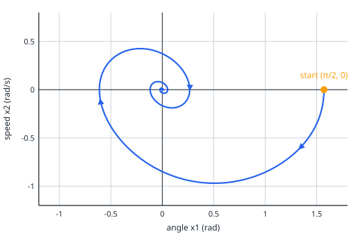

# Phase Plane 1: Trajectories, Vector Fields and Isoclines

Phase plane analysis draws every motion of a two-state system as a curve in one picture, without solving its equations.

## Before you start
<!-- bite: 9a64570d-0b98-4b4a-9534-a5da2400c698 -->

You should have read [[control-theory/46-nonlinear-systems|46 — Nonlinear Systems]], and remember the state plane picture of the suspension from [[control-theory/30-state-space-1|30 — State Space 1: States and the State Equation]].

After this lesson you will be able to:

1. define the phase plane, a trajectory and a phase portrait;
2. draw a vector field by hand and use it to follow a trajectory;
3. construct a phase portrait with the isocline method;
4. read stability and oscillation off a phase portrait, and say the method's main limit.

## What phase plane analysis is
<!-- bite: 73dfd3cb-55fe-4e71-804f-3a08301ce38b -->

**Phase plane analysis** is a graphical method for second-order systems. You draw the motion for many starting points, look at the shapes, and read off stability and other behaviour. Henri Poincaré developed it in the 19th century.

It applies to an **autonomous** second-order system, one whose equations don't depend on time directly:

$$\dot{x}_1 = f_1(x_1, x_2), \qquad \dot{x}_2 = f_2(x_1, x_2)$$

## Why use the phase plane
<!-- bite: b6ad593c-4980-4a63-8804-2804fbb83f93 -->

Why it's worth learning:

1. With two states, every solution is a **curve in a plane**, so behaviour is easy to see.
2. You can study a nonlinear system **without solving its equations**.
3. It works for **hard** nonlinearities (saturation, friction), not just smooth ones.
4. Many real systems are well approximated by second-order ones.

Its one big limit: **it only works for two states.** Three or more get geometrically messy.

## The kid version
<!-- bite: eda58b75-25eb-4136-9f95-cd24f5bb2ccc -->

Imagine a marble rolling on a tilted, bumpy tray, seen from above. Wherever you drop it, it rolls along a path decided by the tray's slopes. Draw the paths from dozens of drop points and you see the whole tray's personality at once: the dips where marbles settle, the ridges they roll away from, the rings they circle for ever.

**Where the analogy stops working.** A real marble's path depends on the tray's height. A phase plane's arrows come straight from the equations, and one of the two axes is a *speed*, not a position, so "rolling downhill" isn't quite what's happening.

## Terms used in the phase plane
<!-- bite: 647c9711-eb4a-4f0d-a2a2-1a78eacee05c -->

1. **Phase plane**: This is also known as the **state plane**. It is the plane with $x_1$ on one axis and $x_2$ on the other.
2. **Trajectory**: This is also known as an **orbit**. It is the curve traced in the phase plane by the solution starting at a given point $x_0$, for all later time.
3. **Phase portrait**: This is the family of trajectories for many different starting points, drawn together.
4. **Vector field**: This is the arrow $f(x) = (f_1, f_2)$ attached to every point, showing which way and how fast the state moves from there.

## The vector field
<!-- bite: 0acf2d32-9250-463d-9917-b0d9c8674b86 -->

At each point $x = (x_1, x_2)$, the equations give a velocity $f(x) = (f_1(x), f_2(x))$. Draw it as a small arrow there. Do this at enough points and you get a **vector field diagram**.

A tiny example from the lecture: for $f(x) = (2x_1^2,\ x_2)$, at the point $(1, 1)$ the arrow is $(2, 1)$, so a step of one unit along it takes you to $(1, 1) + (2, 1) = (3, 2)$.

The key fact: the arrow at a point is **tangent to the trajectory through that point**, because the trajectory's slope is

$$\frac{dx_2}{dx_1} = \frac{f_2}{f_1}$$

So from any starting point, follow the arrows and you trace the trajectory.

## The pendulum's vector field
<!-- bite: 925e70fc-e45d-44da-b18a-d78ba8151048 -->

Back to the frictionless pendulum, $\dot{x}_1 = x_2$, $\dot{x}_2 = -10\sin x_1$. Predict before looking: what do the trajectories look like near hanging straight down?

Around hanging down, the trajectories are **closed loops**: the pendulum swings back and forth for ever. Near upright, the arrows come in one way and leave another: it's unstable. And far up or down, wavy curves show the pendulum whirling over the top, round and round.

## The isocline method
<!-- bite: 03e37092-791e-4db5-a880-8b7eb51c486d -->

Drawing arrows everywhere by hand is slow. The **isocline** method (Greek for "same slope") is a shortcut. An isocline is a curve along which every trajectory crosses with the **same slope** $\alpha$:

$$S(x) = \frac{f_2(x_1, x_2)}{f_1(x_1, x_2)} = \alpha \quad\Longleftrightarrow\quad f_2(x_1, x_2) = \alpha f_1(x_1, x_2)$$

The algorithm:

1. Plot the curve $S(x) = \alpha$ in the phase plane.
2. Along it, draw short line segments with slope $\alpha$. Their direction (which way along the segment) follows the signs of $f_1$ and $f_2$ there.
3. Repeat for enough values of $\alpha$ that the plane is full of isoclines.
4. From a starting point, sketch the trajectory crossing each isocline at its slope.

One thing is lost: **time is eliminated.** Isoclines give the shape of trajectories, not when the state is where, so you read stability and oscillation from them, not $x_1(t)$ itself.

## Isoclines of the pendulum
<!-- bite: 34535fdb-be45-4bc7-bc06-d871c552ef58 -->

Take the lecture's frictionless pendulum with $g/L = 1$: $\dot{x}_1 = x_2$, $\dot{x}_2 = -\sin x_1$. The slope is $S = -\sin x_1/x_2$, so the isocline for slope $c$ is

$$x_2 = -\frac{1}{c}\sin x_1$$

Every isocline is a sine wave, scaled by $-1/c$. On the $c = 0$ isocline ($x_1 = 0, \pm\pi$) trajectories cross flat; on the $c = \infty$ one ($x_2 = 0$) they cross vertically.

## Seeing the isoclines
<!-- bite: 8f71af63-fc65-4891-98cd-cd334ea549fb -->

Here are six isoclines with their slope marks, and the trajectory that crosses them.

The trajectory from $x_0 = (\pi/2, 0)$, the pendulum let go from horizontal, closes on itself. **A closed trajectory means it oscillates for ever**: the frictionless pendulum is only marginally stable.

## Adding friction
<!-- bite: 0a590a13-104c-42dd-a436-b52855206c7e -->

Now add friction: $\dot{x}_2 = -0.5x_2 - \sin x_1$. The isoclines become

$$S = \frac{-0.5x_2 - \sin x_1}{x_2} = c \quad\Longrightarrow\quad x_2 = -\frac{\sin x_1}{0.5 + c}$$

The same sine-wave shapes, with different slopes attached. And now the trajectory from $(\pi/2, 0)$ no longer closes: it **spirals inwards** to the origin, each swing smaller than the last.

## The spiral with friction
<!-- bite: d11490aa-14fe-4e02-84eb-83eaa1b242cb -->

Here is that trajectory, from the same starting point.

That's asymptotic stability, read straight from the picture. Lesson 48 names the shapes properly: a closed loop around a point is a **centre**, a spiral inwards a **stable focus**.

## Common pitfalls
<!-- bite: 633d83c2-8a1e-4847-9987-dff86f0d7618 -->

1. **Drawing the isocline with slope $\alpha$ itself.** The isocline is a curve of any shape; the *short segments on it* have slope $\alpha$.
2. **Ignoring direction.** The sign of $f_1$ tells you whether the state moves left or right along a segment. With $\dot{x}_1 = x_2$, it moves right in the top half and left in the bottom half.
3. **Reading times off isoclines.** Time is eliminated; only shapes remain.
4. **Applying it to three states.** The method is for second-order systems.

## Check your understanding
<!-- bite: cbae6f0b-19a6-4254-b4bf-f5c51b860b76 -->

Try each one before you open the answer.

1. <!-- q: gap id="b8e2c514" answers="6;3" -->
   For $\dot{x}_1 = 3x_1x_2$, $\dot{x}_2 = x_1 + x_2$, the vector field arrow at the point $(1, 2)$ is $($ ___ $,$ ___ $)$.

   

Answer

   $f_1 = 3 \times 1 \times 2 = 6$ and $f_2 = 1 + 2 = 3$. A unit step along it from $(1, 2)$ reaches $(7, 5)$.

   

2. <!-- q: exact id="5d0f9a37" answer="0.16667" accept="1/6" sigfigs="2" -->
   For $\dot{x}_1 = 3x_1x_2$, $\dot{x}_2 = x_1 + x_2$, what is the slope $dx_2/dx_1$ of the trajectory through the point $(1, -2)$?

   

Answer

   $f_1 = 3(1)(-2) = -6$ and $f_2 = 1 - 2 = -1$, so the slope is $f_2/f_1 = (-1)/(-6) = 1/6 \approx 0.17$.

   

3. <!-- q: mcq id="72c4e0f6" -->
   For $\dot{x}_1 = x_2$, $\dot{x}_2 = -4x_1$, what is the isocline for slope $c$?

   - [x] $x_2 = -4x_1/c$
   - [ ] $x_2 = -cx_1/4$
   - [ ] $x_2 = 4cx_1$
   - [ ] $x_1 = -4x_2/c$

   

Answer

   $S = -4x_1/x_2 = c$, so $x_2 = -4x_1/c$: straight lines through the origin.

   

4. <!-- q: mcq id="e5a91b30" -->
   A phase portrait shows every trajectory near the origin as a closed loop. What does that mean?

   - [ ] The origin is asymptotically stable
   - [ ] The origin is unstable
   - [x] The system oscillates for ever: the origin is marginally stable
   - [ ] The system has a limit cycle

   

Answer

   A family of closed loops means sustained oscillation whose size depends on the start: marginal stability. (A limit cycle is a single isolated loop, lesson 50.)

   

5. <!-- q: open id="38f6d2a1" -->
   What is lost when you construct a phase portrait with isoclines, and why?

   

Answer

   Time. Isoclines use the slope $dx_2/dx_1 = f_2/f_1$, in which time has cancelled out, so you get the shapes of the trajectories but not when the state is at each point. You can read stability and oscillation, but not $x_1(t)$ itself.

   

## Before moving on
<!-- bite: 0b623cad-bde2-4dea-9e65-64c166d555b3 -->

You can draw a vector field, build isoclines and read a portrait. **Next:** [[control-theory/48-phase-plane-2|48 — Phase Plane 2: The Equilibria of Linear Systems]], which names every shape a linear system's portrait can take.

## Related
<!-- bite: 0afcf3cc-06b5-4892-83ca-814a270b8097 -->

- [[control-theory/30-state-space-1|30 — State Space 1: States and the State Equation]]: the suspension's trajectory.
- [[mathematics/06-calculus/05-ode|Differential equations]]
- [[control-theory/index|Control theory map]]

## About this lesson
<!-- bite: ce97af13-71df-4bd3-b9f6-23c50856632c -->

**Level:** Advanced. **Covers:** the phase plane, trajectories and portraits, vector fields, the isocline method, and the pendulum with and without friction.

**Where it sits:** lesson 47 of 58, part 1 of 3 on the phase plane.

**Source:** the author's nonlinear-control lecture notes, F. Abdollahi, *Nonlinear Control*, lecture 2 ("Phase Plane Analysis"), slides 1 to 11. Portraits computed in `scripts/diagrams/control_theory.py`.
