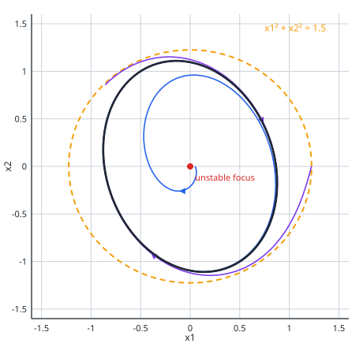

# Limit Cycles 2: Proving They Exist or Don't

Three results decide limit cycles without solving anything: one rules them out, one guarantees one, one says what lies inside.

## Before you start
<!-- bite: 084d4790-7157-4fc9-a61c-f71dfb89c02f -->

You should have read [[control-theory/50-limit-cycles-1|50 — Limit Cycles 1: Stable, Unstable and Semi-Stable]], and be able to take partial derivatives and a dot product with a gradient.

After this lesson you will be able to:

1. use Bendixson's criterion to show a region has no closed orbits;
2. use the Poincaré–Bendixson theorem, with a trapping region, to show a limit cycle exists;
3. check whether trajectories can leave a region using $f \cdot \nabla V$;
4. use the index theorem to say which equilibria a closed orbit must surround.

## Why we need tests
<!-- bite: 488b77b3-6c11-4f17-9823-4f5c9fbd4ba9 -->

Lesson 50's examples were built to separate neatly in polar coordinates. Real systems rarely do. Is there an oscillation hiding in a circuit model, or isn't there? You'd like an answer without simulating every starting point. These three results give it. All three are **two-dimensional only**: in three or more states, trajectories can wander in bounded regions for ever without settling or repeating (chaos).

## The kid version
<!-- bite: ac9eafb7-7378-4165-ac77-9a548f920910 -->

To prove there's no racetrack in a field, show the ground slopes downhill everywhere in the same direction: you can't drive a loop that always goes downhill. To prove there *is* a racetrack, build a fence that cars can't drive out of and make sure there's nowhere to park inside: then they must end up driving round and round.

**Where the analogy stops working.** Bendixson's "slope" isn't height; it's the divergence of the vector field, whether the flow spreads out or squeezes together. And Poincaré–Bendixson only promises *some* closed orbit inside the fence, not where it is.

## Bendixson's criterion: no limit cycles
<!-- bite: 9d952ca2-de2c-4cab-a75e-849b08bc39bf -->

For $\dot{x}_1 = f_1(x_1, x_2)$, $\dot{x}_2 = f_2(x_1, x_2)$, define the **divergence**

$$\nabla \cdot f = \frac{\partial f_1}{\partial x_1} + \frac{\partial f_2}{\partial x_2}$$

**Bendixson's criterion**: in a **simply connected** region $\Omega$ (one with no holes), if $\nabla \cdot f$ doesn't change sign and isn't zero over any patch, then $\Omega$ contains **no closed orbit**. It's a *sufficient* condition for non-existence: if it fails, you've learned nothing.

The proof, by contradiction: along any trajectory $dx_2/dx_1 = f_2/f_1$, so $f_2\,dx_1 - f_1\,dx_2 = 0$, and the integral of that around a closed orbit $L$ is zero. Green's theorem turns it into the integral of $\nabla \cdot f$ over the area $S$ inside $L$, which must therefore be zero too. That's only possible if $\nabla \cdot f$ is zero there or changes sign, which contradicts the assumption.

## Bendixson: two examples
<!-- bite: e7bb7588-0bf3-4652-8050-c2d83438c907 -->

**Linear systems.** For $\dot{x} = Ax$, $\nabla \cdot f = a_{11} + a_{22}$, the trace of $A$. If the trace isn't zero, there's no periodic solution. That agrees with lesson 48: a centre needs eigenvalues $\pm j\beta$, which needs trace zero and positive determinant.

**A nonlinear one** from the lecture:

$$\dot{x}_1 = g(x_2) + 4x_1x_2^2, \qquad \dot{x}_2 = h(x_1) + 4x_1^2x_2$$

Whatever $g$ and $h$ are, $\nabla \cdot f = 4x_2^2 + 4x_1^2 > 0$ everywhere except the origin. So there is **no limit cycle anywhere in the plane**.

## Poincaré–Bendixson: a limit cycle exists
<!-- bite: b096b1e0-042e-4cab-825a-eea16ee56c6c -->

**The theorem**: suppose there's a closed, bounded set $M$ such that

1. $M$ contains **no equilibrium**, or contains only **one**, whose Jacobian has eigenvalues with positive real parts (an unstable node or focus); and
2. **every trajectory starting in $M$ stays in $M$** for all future time.

Then $M$ contains a **periodic solution**.

The idea: in the plane, a trajectory trapped in a bounded region must end up approaching either an equilibrium or a closed orbit. If there's no equilibrium to approach (or only one that pushes everything away), cut out a small disc around that unstable point, and what's left must hold a closed orbit.

## Checking that trajectories stay inside
<!-- bite: 5d43886f-9b9b-49e3-8dcc-4ab48660927c -->

How do you show condition 2? Take a smooth function $V(x)$ and the curve $V(x) = c$. At a point on that curve, the flow points:

1. **inward** if $f \cdot \nabla V < 0$;
2. **outward** if $f \cdot \nabla V > 0$;
3. **along the curve** if $f \cdot \nabla V = 0$.

Here $f \cdot \nabla V = \dfrac{\partial V}{\partial x_1}f_1 + \dfrac{\partial V}{\partial x_2}f_2$. Trajectories can only leave through a point where the flow points outward. So:

1. For a region $M = \{V(x) \le c\}$, trajectories are trapped if $f \cdot \nabla V \le 0$ all along $V = c$.
2. For a ring-shaped region $M = \{W(x) \ge c_1 \text{ and } V(x) \le c_2\}$, they're trapped if $f \cdot \nabla V \le 0$ on the outer curve and $f \cdot \nabla W \ge 0$ on the inner one.

## Poincaré–Bendixson: worked
<!-- bite: 1f5835ad-4323-4920-9180-a2130a111b8b -->

The lecture's example:

$$\dot{x}_1 = x_1 + x_2 - x_1(x_1^2 + x_2^2), \qquad \dot{x}_2 = -2x_1 + x_2 - x_2(x_1^2 + x_2^2)$$

1. **The only equilibrium** is the origin. Its Jacobian is $\begin{bmatrix}1 & 1 \\ -2 & 1\end{bmatrix}$, eigenvalues $1 \pm j\sqrt2$: an **unstable focus**. Condition 1 holds.
2. **Take $V = x_1^2 + x_2^2$**, circles $V = c$. Then

$$f \cdot \nabla V = 2(x_1^2 + x_2^2) - 2(x_1^2 + x_2^2)^2 - 2x_1x_2 \le 3c - 2c^2$$

using $|2x_1x_2| \le x_1^2 + x_2^2$. Predict: for which $c$ is that $\le 0$?

For $c \ge 1.5$, the right side is $\le 0$, so trajectories can't leave the disc $V \le 1.5$. Condition 2 holds, and **there's at least one periodic orbit** inside it.

## Seeing the trapped orbit
<!-- bite: 74ea39f7-7ea8-44c0-86f9-a3ff5127d9d3 -->

Here are the trapping circle and the orbit inside it.

## The index theorem
<!-- bite: 55d81720-0caa-45b3-9c11-638bb1ca2f6d -->

One more tool, about what a closed orbit must surround. Walk counter-clockwise around a simple closed curve $C$ that passes through no equilibrium, and watch the direction of the arrow $f(x)$. When you get back to the start it has turned through $2\pi k$ for some whole number $k$. If $C$ encircles a single isolated equilibrium, $k$ is that equilibrium's **index**:

1. **Node or focus**: index $+1$.
2. **Saddle**: index $-1$.

The consequence: **inside any periodic orbit there's at least one equilibrium.** If the equilibria inside are all hyperbolic (no eigenvalues on the imaginary axis), with $N$ nodes and foci and $S$ saddles, then

$$N - S = 1$$

So a closed orbit can't surround just a saddle, or two nodes alone; it could surround two nodes and one saddle.

## Common pitfalls
<!-- bite: 5b809fc8-23fc-4052-935c-bd57d673d409 -->

1. **Using Bendixson in a region with a hole.** It needs a simply connected region.
2. **Reading a sign change of the divergence as proof of a cycle.** Bendixson then says nothing either way.
3. **Forgetting condition 1 of Poincaré–Bendixson.** A stable equilibrium inside the trapping region can swallow every trajectory.
4. **Using either theorem in three dimensions.** Neither holds there.

## Check your understanding
<!-- bite: e9da66e9-efb5-4378-8d91-44b500f2ac35 -->

Try each one before you open the answer.

1. <!-- q: mcq id="5b2e7c08" -->
   What does Bendixson's criterion say about $\dot{x}_1 = -x_1 + x_2^2$, $\dot{x}_2 = -x_2 + x_1^2$?

   - [x] No closed orbit anywhere in the plane
   - [ ] There's a stable limit cycle
   - [ ] Nothing: the test is inconclusive
   - [ ] There's an unstable limit cycle

   

Answer

   $\nabla \cdot f = -1 - 1 = -2$, never zero and never changing sign, so there's no closed orbit.

   

2. <!-- q: mcq id="e4a9d613" -->
   For $\dot{x}_1 = x_2$, $\dot{x}_2 = -x_1 - x_2 + x_1^2x_2$, what does Bendixson say on the whole plane?

   - [ ] No closed orbit
   - [x] Nothing: the divergence $-1 + x_1^2$ changes sign
   - [ ] A limit cycle exists
   - [ ] The origin is unstable

   

Answer

   $\nabla \cdot f = 0 + (-1 + x_1^2)$, negative for $|x_1| < 1$ and positive beyond, so the test can't rule a cycle out. (It does rule one out inside the strip $|x_1| < 1$.)

   

3. <!-- q: mcq id="1d8f5a42" -->
   Which linear system can have periodic solutions?

   - [ ] $A = \begin{bmatrix}1 & 2 \\ 3 & -4\end{bmatrix}$
   - [x] $A = \begin{bmatrix}2 & 5 \\ -1 & -2\end{bmatrix}$
   - [ ] $A = \begin{bmatrix}-1 & 0 \\ 0 & -1\end{bmatrix}$
   - [ ] $A = \begin{bmatrix}0 & 1 \\ 2 & 1\end{bmatrix}$

   

Answer

   It needs trace 0 (Bendixson) and positive determinant. $\begin{bmatrix}2 & 5 \\ -1 & -2\end{bmatrix}$ has trace 0 and determinant $-4 + 5 = 1$, so eigenvalues $\pm j$: a centre.

   

4. <!-- q: exact id="7c0b3e95" answer="1" -->
   A periodic orbit surrounds two nodes and some saddles, all hyperbolic. How many saddles?

   

Answer

   $N - S = 1$ with $N = 2$, so $S = 1$.

   

5. <!-- q: open id="a2f60d17" -->
   For the worked example, why does $f \cdot \nabla V \le 0$ on the circle $x_1^2 + x_2^2 = 1.5$ show that trajectories can't leave the disc inside it?

   

Answer

   $\nabla V$ points straight outwards from the circle, so $f \cdot \nabla V$ is the outward part of the flow. Where it's negative the flow points in, and where it's zero it runs along the circle. Nowhere does it point out, so no trajectory can cross the circle outwards.

   

## Before moving on
<!-- bite: 9a884b9d-e647-4124-9d37-cba8afe9e1b5 -->

You can rule limit cycles out, prove one exists, and use the index theorem. That ends the phase plane. **Next:** [[control-theory/52-lyapunov-stability-1|52 — Lyapunov Stability 1: What Stable Means]], which proves stability for any number of states.

## Related
<!-- bite: c9d87a98-13c9-46f7-8c17-68a641e9d053 -->

- [[control-theory/54-lyapunov-stability-3|54 — Lyapunov Stability 3: Global Stability, LaSalle and Discrete Time]]: the Lorenz system, where three states allow chaos.
- [[control-theory/index|Control theory map]]

## About this lesson
<!-- bite: 4f0fece7-8651-44db-8288-80b65a72f5ff -->

**Level:** Advanced. **Covers:** divergence and Bendixson's criterion with its proof, the Poincaré–Bendixson theorem, trapping regions with $f \cdot \nabla V$, the lecture's worked example, and the index theorem.

**Where it sits:** lesson 51 of 58, part 2 of 2 on limit cycles, and the end of the phase-plane lessons.

**Source:** the author's nonlinear-control lecture notes, F. Abdollahi, *Nonlinear Control*, lecture 2, slides 42 to 52. The trapping bound and the portrait are checked in `scripts/diagrams/control_theory.py`.
