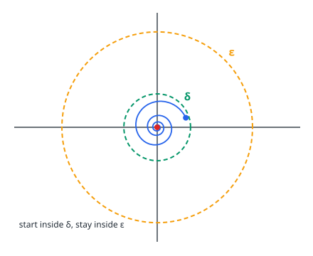

# Lyapunov Stability 1: What Stable Means

Stable in the sense of Lyapunov means starting close keeps you close, and asymptotically stable means you also come back.

## Before you start
<!-- bite: f999ebe3-dc5a-437c-8ba1-52cc95d128e3 -->

You should have read [[control-theory/46-nonlinear-systems|46 — Nonlinear Systems]], and know the eigenvalue stability tests for continuous and discrete linear systems ([[control-theory/31-state-space-2|31 — State Space 2: Solution, Eigenvalues and Conversions]]).

After this lesson you will be able to:

1. state the definitions of stable (in the sense of Lyapunov), asymptotically stable, marginally stable and unstable;
2. explain, with an example, why "every trajectory converges" doesn't mean stable;
3. give the stability conditions for linear systems in continuous and discrete time, including the Jordan-block subtlety;
4. state the conditions for a linear time-varying system.

## Why we need a careful definition
<!-- bite: 24d8926b-4b50-4bab-8cdc-050c7d7ee9b1 -->

The phase plane (lessons 47 to 51) drew stability. That works for two states. For three or more, and to *prove* stability rather than eyeball it, we need a precise definition, and that's what the Russian mathematician Aleksandr Lyapunov gave in 1892. This lesson and the next three follow the MIT course notes on Lyapunov stability that the author studied.

Consider an undriven system, in continuous time (CT) or discrete time (DT):

$$\dot{x}(t) = f(x(t), 0, t) \qquad\text{or}\qquad x(k+1) = f(x(k), 0, k)$$

A point $\bar{x}$ is an **equilibrium** from time $t_0$ if $f(\bar{x}, 0, t) = 0$ for all $t \ge t_0$ (in DT: $f(\bar{x}, 0, k) = \bar{x}$). Start there and you stay there. We always shift coordinates so the equilibrium of interest is at the origin.

## The kid version
<!-- bite: ada98aab-7b85-4f19-8e91-4c1ecabcf391 -->

You're balancing a ball in a bowl. "Stable" means: if I promise to only nudge it a tiny bit, you can promise it'll never roll further than some distance you choose, however small. "Asymptotically stable" adds: and it rolls back to the bottom. "Unstable" means no promise is possible: some tiny nudges, eventually, send it far away.

**Where the analogy stops working.** A bowl is simple: things that come back also stay close. The surprising example in this lesson comes back from *everywhere*, yet still counts as unstable, because it takes a long trip on the way.

## The definitions
<!-- bite: 7e43fda9-2b8b-4ea3-bd64-38d9a756a71d -->

**Stable in the sense of Lyapunov** (written "stable i.s.L."): for every $\epsilon > 0$, there's a $\delta_1 > 0$ such that

$$\|x(t_0)\| < \delta_1 \implies \|x(t)\| < \epsilon \quad \text{for all } t \ge t_0$$

In words: you can keep the state inside any small ball of radius $\epsilon$ you like, just by starting inside a small enough ball of radius $\delta_1$.

## Asymptotic, marginal and unstable
<!-- bite: 83ca5e05-7f2c-4341-b791-512731407363 -->

Three more definitions build on the first.

**Asymptotically stable**: stable i.s.L., **and** there's a $\delta_2 > 0$ such that starting within $\delta_2$ makes $x(t) \to 0$.

**Marginally stable**: stable i.s.L. but not asymptotically stable. The frictionless pendulum (lesson 47) is one: small swings stay small, but never die.

**Unstable**: not stable i.s.L.

## Converging isn't enough
<!-- bite: f3c83a13-6d89-4fe8-9d09-e3cc3534f77b -->

Why does the definition need the first condition at all? Wouldn't "every trajectory goes to the equilibrium" be enough? The MIT notes give a system that shows it isn't. In polar coordinates:

$$\dot{r} = r(1 - r), \qquad \dot\theta = \sin^2(\theta/2)$$

It has two equilibria: the origin, and the point $r = 1$, $\theta = 0$. Every trajectory (except the one sitting at the origin) ends up at $r = 1$, $\theta = 0$.

But that point is **not stable i.s.L.** Start a tiny distance above it, at $r = 1$, $\theta = 0.02$. The radius stays 1, and the angle creeps, then speeds up, all the way round the circle, before slowly settling back. On the way it goes to the far side, a distance 2 from where it ended up. No small starting ball keeps it within a small $\epsilon$.

## Seeing the long trip
<!-- bite: edbca3c8-047c-46fa-92a4-31491c8acb8a -->

Here are the trajectories, including the one that starts just above the equilibrium.

Remember this one: **attracting everything is not the same as stable.** That's why asymptotic stability asks for both conditions.

## Linear systems
<!-- bite: 5c8b3d5c-e736-4a09-92ed-e8a2425abbfb -->

For $\dot{x} = Ax$ with diagonalisable $A$, and no input, the solutions are sums of $e^{\lambda_it}$ terms (CT) or $\lambda_i^k$ terms (DT). The origin is the unique equilibrium as long as $A$ has no eigenvalue at 0 (CT) or at 1 (DT); otherwise there's a whole subspace of equilibria. So:

1. **CT asymptotically stable** exactly when $\text{Re}(\lambda_i) < 0$ for every eigenvalue.
2. **DT asymptotically stable** exactly when $|\lambda_i| < 1$ for every eigenvalue.

If some eigenvalue sits on the boundary ($\text{Re} = 0$ in CT, $|\lambda| = 1$ in DT) and the rest are inside, the system is **marginally stable**, with one catch.

## The Jordan-block catch
<!-- bite: b4a93da6-3dcd-42dd-b834-c186028c3adb -->

The same conditions hold for asymptotic stability even when $A$ isn't diagonalisable. But **marginal stability** needs more: every eigenvalue on the boundary must have **Jordan blocks of size 1** (its geometric multiplicity must equal its algebraic multiplicity).

Why: a Jordan block of size 2 on the boundary produces terms like $te^{\lambda t}$. With $\text{Re}(\lambda) = 0$ that's $t$ times something of constant size, which grows without limit. Example: $A = \begin{bmatrix}0 & 1 \\ 0 & 0\end{bmatrix}$ has a double eigenvalue 0 in one block; from $x(0) = [0, 1]^T$ the solution is $x_1 = t$. Unstable, although every eigenvalue has zero real part.

## Linear time-varying systems
<!-- bite: 3e0e7e2a-0ada-4ed4-927d-401fed442a2b -->

When $A$ changes with time, eigenvalues stop telling the story. The solution is $x(t) = \Phi(t, t_0)x(t_0)$, where $\Phi$ is the **state transition matrix**. Straight from the definitions:

1. **Stable i.s.L.** at 0 if $\sup_t\|\Phi(t, t_0)\| = m(t_0) < \infty$: the transition matrix stays bounded.
2. **Asymptotically stable** at 0 if $\|\Phi(t, t_0)\| \to 0$ as $t \to \infty$, for every $t_0$.

## Common pitfalls
<!-- bite: 84936b62-be04-46b0-ba32-4bbe494de17c -->

1. **Treating "all trajectories converge" as stability.** It also needs staying close.
2. **Calling repeated eigenvalues on the axis marginally stable.** Only if their Jordan blocks are size 1.
3. **Using the CT test on DT systems.** DT uses $|\lambda| < 1$.
4. **Using eigenvalues for a time-varying $A$.** Use the transition matrix.

## Check your understanding
<!-- bite: 9d49edec-693e-41af-a2a0-9bdbadb3f78c -->

Try each one before you open the answer.

1. <!-- q: mcq id="2c7b9e04" -->
   $\dot{x} = Ax$ with $A = \begin{bmatrix}-1 & 0 \\ 0 & 0\end{bmatrix}$. What is the origin?

   - [ ] Asymptotically stable
   - [x] Marginally stable
   - [ ] Unstable
   - [ ] Not an equilibrium

   

Answer

   Eigenvalues $-1$ and $0$; the zero eigenvalue has a block of size 1, so $x_2$ just stays constant. Stable i.s.L. but not asymptotically: marginal. (In fact every point on the $x_2$ axis is an equilibrium.)

   

2. <!-- q: mcq id="8e1f4a39" -->
   $\dot{x} = Ax$ with $A = \begin{bmatrix}0 & 1 \\ 0 & 0\end{bmatrix}$. What is the origin?

   - [ ] Asymptotically stable
   - [ ] Marginally stable
   - [x] Unstable
   - [ ] It can't be decided

   

Answer

   A double eigenvalue 0 in one Jordan block of size 2: solutions grow like $t$. Unstable.

   

3. <!-- q: mcq id="d5c03b72" -->
   A discrete-time system has eigenvalues 0.5 and −0.9. What is it?

   - [x] Asymptotically stable
   - [ ] Marginally stable
   - [ ] Unstable, because one eigenvalue is negative
   - [ ] Unstable, because one eigenvalue is near 1 in size

   

Answer

   Both have size less than 1, so asymptotically stable. A negative eigenvalue just makes that mode alternate in sign.

   

4. <!-- q: gap id="6a9e2f15" answers="epsilon|ε;delta|δ" -->
   Stable in the sense of Lyapunov means: for every ___ $> 0$ there is a ___ $> 0$ such that starting within the second keeps the state within the first for ever.

   

Answer

   For every $\epsilon$ there is a $\delta$.

   

5. <!-- q: open id="b30d7c68" -->
   In the system $\dot{r} = r(1 - r)$, $\dot\theta = \sin^2(\theta/2)$, every trajectory ends at $(1, 0)$. Explain why that point is still called unstable.

   

Answer

   Stability i.s.L. needs small starts to stay close. A start just above $(1, 0)$, at angle 0.02, travels all the way round the unit circle, reaching $(-1, 0)$, distance 2 away, before coming back. However small the starting ball, some trajectory from it goes that far, so no $\delta$ works for a small $\epsilon$.

   

## Before moving on
<!-- bite: 6bdbba04-d3df-4fae-9f81-f6308a5a5e2b -->

You can state the definitions precisely and apply them to linear systems. **Next:** [[control-theory/53-lyapunov-stability-2|53 — Lyapunov Stability 2: The Direct Method]], which proves stability of nonlinear systems without solving them.

## Related
<!-- bite: 095fc662-42d6-4696-b125-8fd11f02f5ae -->

- [[control-theory/19-stability-1|19 — Stability 1: What Stability Means and Routh–Hurwitz]]: BIBO stability for transfer functions.
- [[control-theory/index|Control theory map]]

## About this lesson
<!-- bite: ec2d04cc-09eb-4dcb-ba9e-ba11b395c60c -->

**Level:** Advanced. **Covers:** equilibria in CT and DT, stability i.s.L., asymptotic and marginal stability, the unstable-but-attracting example, linear stability tests and the Jordan-block condition, and time-varying systems.

**Where it sits:** lesson 52 of 58, part 1 of 4 on Lyapunov stability.

**Source:** the author's notes from M. Dahleh, M. A. Dahleh and G. Verghese, *Lectures on Dynamic Systems and Control*, chapter 13, "Internal (Lyapunov) Stability", MIT OpenCourseWare 6.241J (sections 13.1 to 13.3). Figures computed in `scripts/diagrams/control_theory.py`.
