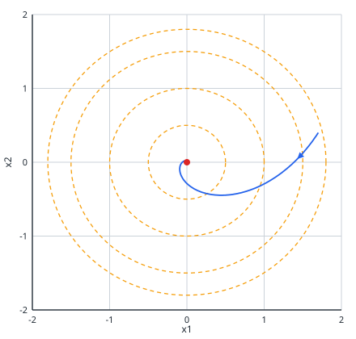

# Lyapunov Stability 2: The Direct Method

Lyapunov's direct method proves an equilibrium stable by finding an energy-like function that never increases along the system's motion, without ever solving the equations.

## Before you start
<!-- bite: 2ceb80e5-6b52-4e39-8748-fb04900eb869 -->

You should have read [[control-theory/52-lyapunov-stability-1|52 — Lyapunov Stability 1: What Stable Means]], and be able to differentiate a function of several variables with the chain rule.

After this lesson you will be able to:

1. define locally positive definite and semidefinite functions;
2. compute $\dot{V}$, the rate of change of $V$ along trajectories, without solving the system;
3. state Lyapunov's theorem and use it to prove stability or asymptotic stability;
4. explain why failing to find a Lyapunov function proves nothing.

## What the direct method is
<!-- bite: 2858065f-2d07-4dc8-947a-246bd52dff9f -->

For a nonlinear system $\dot{x} = f(x)$ with an equilibrium at the origin, there's usually no formula for the trajectories, so we can't check the definitions of lesson 52 directly. Lyapunov's idea: **don't follow the trajectories; watch one number change along them.**

Take a scalar function $V(x)$ that's zero at the origin and positive everywhere else nearby: think of it as an **energy**. Work out how fast $V$ changes as the state moves. If it always decreases, the energy is draining away, and since it can't go below zero, it must drain to zero: the state goes to the origin.

It's called the **direct** method to contrast it with Lyapunov's **indirect** method, which looks at the linearisation instead (lesson 55).

## The kid version
<!-- bite: 3f0bd99a-dd63-43e6-84d9-cb062a601b5c -->

A ball rolls inside a bowl with a little friction. You don't need to calculate its path to know where it ends up: its height can only go down, the bottom is the lowest point, so it ends at the bottom. Lyapunov's method is exactly that argument, with "height" replaced by any function shaped like a bowl.

**Where the analogy stops working.** For a real ball, the bowl's shape is its actual height. For a system, *you* choose the bowl, and choosing a shape that works is the hard part: a bad choice proves nothing, even if the system is perfectly stable.

## Positive definite functions
<!-- bite: 3657d10b-710a-4606-8d86-c46bf426db4b -->

Let $V$ be a continuous function from $\mathbb{R}^n$ to $\mathbb{R}$.

1. **Locally positive definite (lpd)**: $V(0) = 0$, and $V(x) > 0$ for $0 < \|x\| < r$, for some $r$. Near the origin it looks like a bowl.
2. **Locally positive semidefinite (lpsd)**: the same with $V(x) \ge 0$: a bowl that may have flat parts.
3. **Locally negative definite (lnd)** and **negative semidefinite (lnsd)**: $-V$ is lpd or lpsd.

A good mental picture: near the origin, the contours $V(x) = c$ of an lpd function are a nested set of closed curves around the origin, smaller $c$ inside.

For example, $x_1^2 + x_2^2$ is lpd; $x_1^2$ alone is only lpsd (it's zero all along the $x_2$ axis); $x_1^2 - x_2^2$ is neither.

## The derivative along trajectories
<!-- bite: baa08223-82a0-4d43-827f-b437edc3ff2e -->

Here's the trick that avoids solving anything. By the chain rule, the rate of change of $V$ along a trajectory is

$$\dot{V}(x) = \frac{dV}{dx}\dot{x} = \frac{dV}{dx}f(x) = \frac{\partial V}{\partial x_1}f_1(x) + \cdots + \frac{\partial V}{\partial x_n}f_n(x)$$

Everything on the right is known at every point $x$. So $\dot{V}$ is just a function of $x$, which you can check for sign.

**A Lyapunov function** for the system is an lpd function $V$ whose $\dot{V}$ is lnsd: the energy never increases.

## Lyapunov's theorem
<!-- bite: af02ce24-4d0c-4fa5-be75-f255900c6cfd -->

**Theorem.** If the system $\dot{x} = f(x)$ has a Lyapunov function, then $x = 0$ is **stable in the sense of Lyapunov**. If in addition $\dot{V}$ is **locally negative definite**, then $x = 0$ is **asymptotically stable**.

The ideas behind the proof:

1. **Stable.** Given $\epsilon$, let $m$ be the smallest value of $V$ on the sphere $\|x\| = \epsilon$. Pick $\delta$ so small that $V < m$ inside the ball of radius $\delta$. A trajectory starting there has $V < m$ for ever (since $V$ never increases), so it can never reach the sphere where $V \ge m$.
2. **Asymptotically stable.** $V$ decreases and is bounded below, so it tends to some $c \ge 0$. If $c > 0$, the state stays outside a small ball where $\dot{V} \le -\gamma < 0$, so $V$ would fall by at least $\gamma t$, eventually below zero: a contradiction. So $c = 0$, and the state goes to the origin.

## Seeing V fall
<!-- bite: 076ecece-d96c-4bfe-9d3c-6479cfb758e0 -->

Here is the picture behind the theorem: a trajectory crossing the level curves of $V$ inwards.

## Example: a sector nonlinearity
<!-- bite: 21273774-ce37-46f1-804b-70143803967a -->

From the MIT notes: $\dot{x} = -g(x)$, where $g$ is any function with the same sign as $x$ (like a saturation curve through the origin). Take the area under $g$ as the energy:

$$V(x) = \int_0^xg(y)\,dy$$

Since $g$ has the sign of $x$, $V$ is lpd. And $\dot{V} = g(x)\dot{x} = -g(x)^2$, which is lnd. So the origin is **asymptotically stable**, for *every* such $g$, without knowing its formula.

## Example: the pendulum's energy
<!-- bite: da3a0397-ed30-4b1e-aff6-351ca8bf71da -->

The frictionless pendulum, mass $M$ on a rod of length $R$: $\dot{x}_1 = x_2$, $\dot{x}_2 = -(g/R)\sin x_1$. Take the total energy, kinetic plus potential:

$$V(x) = \tfrac12MR^2x_2^2 + MgR(1 - \cos x_1)$$

It's zero at the bottom and positive nearby, so lpd. Its derivative:

$$\dot{V} = MgR\sin x_1 \cdot x_2 + MR^2x_2 \cdot \left(-\frac{g}{R}\sin x_1\right) = 0$$

Energy is conserved, so $\dot{V} = 0$, which is lnsd. Conclusion: **stable i.s.L.**, but we can't conclude asymptotic stability. That's right: without friction it swings for ever (lesson 47). Lesson 54 adds friction.

## What the method can and can't do
<!-- bite: 5b012928-5b53-46e7-8400-f56221526ec4 -->

1. **It needs no solution.** For nonlinear systems, where closed-form solutions rarely exist, that's the whole value.
2. **It's sufficient, not necessary.** Failing to find a $V$ proves nothing: the system may be stable and you just haven't found the right function. Finding $V$ is an art. For mechanical systems, energy is the first thing to try. For polynomial systems, **sum-of-squares programming** now searches for $V$ automatically.
3. **It gives regions, not just yes or no.** A level set of $V$ inside the region where $\dot{V} < 0$ is a proven estimate of the region of attraction (lesson 54).

## Common pitfalls
<!-- bite: 50dc10d7-bf33-460f-93d6-c607424f3cff -->

1. **Forgetting to check that $V$ is positive definite.** $\dot{V} < 0$ means nothing if $V$ isn't a bowl.
2. **Concluding asymptotic stability from $\dot{V} \le 0$.** That only gives stability i.s.L.
3. **Concluding instability because one $V$ failed.** Try another; the method is only sufficient.
4. **Sign slips in $\dot{V}$.** Write out $\partial V/\partial x_i \cdot f_i$ term by term.

## Check your understanding
<!-- bite: 043a5537-366a-4f8d-85f8-33d261608c7f -->

Try each one before you open the answer.

1. <!-- q: mcq id="4a1e8c93" -->
   Which function is locally positive definite around the origin of $\mathbb{R}^2$?

   - [ ] $V = x_1^2$
   - [ ] $V = x_1^2 - x_2^2$
   - [x] $V = x_1^2 + 3x_2^2$
   - [ ] $V = x_1 + x_2$

   

Answer

   $x_1^2 + 3x_2^2$ is zero only at the origin and positive elsewhere. $x_1^2$ is zero on the whole $x_2$ axis; the other two take negative values.

   

2. <!-- q: exact id="c2d97f50" answer="-4" accept="−4" -->
   For $\dot{x}_1 = -x_1 + x_2$, $\dot{x}_2 = -x_1 - x_2$ and $V = x_1^2 + x_2^2$, what is $\dot{V}$ at the point $(1, 1)$?

   

Answer

   $\dot{V} = 2x_1(-x_1 + x_2) + 2x_2(-x_1 - x_2) = -2x_1^2 - 2x_2^2$, which is $-4$ at $(1, 1)$.

   

3. <!-- q: mcq id="f8b0e216" -->
   For $\dot{x}_1 = x_2$, $\dot{x}_2 = -x_1 - x_2^3$ with $V = x_1^2 + x_2^2$, $\dot{V} = -2x_2^4$. What does Lyapunov's theorem conclude, on its own?

   - [ ] Asymptotically stable
   - [x] Stable in the sense of Lyapunov
   - [ ] Unstable
   - [ ] Nothing

   

Answer

   $\dot{V} = -2x_2^4$ is only negative semidefinite (zero on the $x_1$ axis), so the theorem gives stability i.s.L. (LaSalle's principle, in lesson 54, upgrades it to asymptotic stability.)

   

4. <!-- q: mcq id="1b7d4f05" -->
   $\dot{x} = -x^3$. With $V = x^2$, what can you conclude?

   - [x] Asymptotically stable, since $\dot{V} = -2x^4$ is negative definite
   - [ ] Only stable i.s.L.
   - [ ] Unstable
   - [ ] Nothing, since the linearisation is zero

   

Answer

   $\dot{V} = 2x(-x^3) = -2x^4 < 0$ for $x \ne 0$: asymptotically stable. The linearisation ($\dot{x} = 0$) can't decide, but the direct method can.

   

5. <!-- q: open id="7e5a02c4" -->
   An engineer tries $V = x_1^2 + x_2^2$ on a system, finds $\dot{V}$ positive at some points near the origin, and declares the system unstable. What's wrong?

   

Answer

   Lyapunov's theorem is only sufficient. One failed candidate shows nothing about the system; a different $V$ might work. To prove instability you'd need a separate instability theorem or another argument.

   

## Before moving on
<!-- bite: 0446e795-5c46-439b-8984-dec643e59503 -->

You can compute $\dot{V}$ and use Lyapunov's theorem. **Next:** [[control-theory/54-lyapunov-stability-3|54 — Lyapunov Stability 3: Global Stability, LaSalle and Discrete Time]], which goes from "near the origin" to "everywhere", and handles the damped pendulum.

## Related
<!-- bite: afa4fb02-f5ff-45b4-8f58-8cbb98f5aac9 -->

- [[control-theory/49-phase-plane-3|49 — Phase Plane 3: Linearising Around an Equilibrium]]: where linearisation fails.
- [[control-theory/index|Control theory map]]

## About this lesson
<!-- bite: 62f63084-948a-430c-997e-fdd2da71957e -->

**Level:** Advanced. **Covers:** the energy idea, positive definite functions, the derivative along trajectories, Lyapunov's stability theorem and its proof idea, the sector and pendulum examples, and the method's limits.

**Where it sits:** lesson 53 of 58, part 2 of 4 on Lyapunov stability.

**Source:** the author's notes from Dahleh, Dahleh and Verghese, *Lectures on Dynamic Systems and Control*, chapter 13 (section 13.4, examples 13.2 and 13.6), MIT OpenCourseWare 6.241J. Figure computed in `scripts/diagrams/control_theory.py`.
