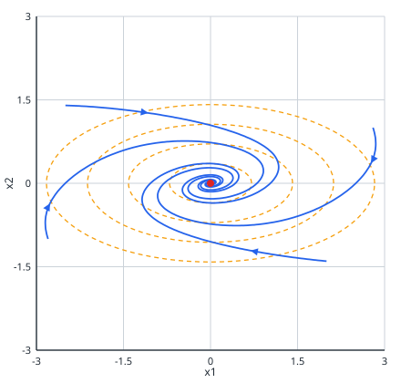

# Lyapunov Stability 3: Global Stability, LaSalle and Discrete Time

Lyapunov's method extends to every starting state, to energy that only stops falling, and to discrete-time systems.

## Before you start
<!-- bite: a9b044e9-8c50-413d-8914-cbaf38f5e5b0 -->

You should have read [[control-theory/53-lyapunov-stability-2|53 — Lyapunov Stability 2: The Direct Method]], and be able to compute $\dot{V}$.

After this lesson you will be able to:

1. state the conditions for global asymptotic stability, including radial unboundedness;
2. choose a free constant in a quadratic $V$ to cancel a cross term;
3. use LaSalle's argument when $\dot{V}$ is only negative semidefinite;
4. estimate a region of attraction, and apply the direct method to discrete-time systems.

## From local to global
<!-- bite: 37f4841c-3fe0-45c2-a612-4dc0bc563ad9 -->

Lesson 53's theorem was **local**: it held near the origin, wherever $V$ worked as a Lyapunov function. Often we want more: does *every* starting state end at the equilibrium? The set of starting states that do is the **basin of attraction** (or region of attraction), and an equilibrium is **globally asymptotically stable** when its basin is the whole state space.

## The kid version
<!-- bite: 8d3fc306-b2e6-4d6c-9daa-fd6f5b6699a9 -->

Lesson 53 said a ball in a bowl rolls to the bottom. But a bowl has a rim: start beyond it and the ball rolls off. To be sure the ball reaches the bottom from *anywhere*, the bowl must keep rising for ever in every direction, with no rim to spill over.

**Where the analogy stops working.** A real bowl's sides rise forever only in a drawing. Here "rising forever" is a precise condition on $V$, called radially unbounded, and some innocent-looking functions fail it.

## The global theorem
<!-- bite: 230af626-4dc2-4425-bc09-e4b2eb51a8fb -->

If $V$ is **positive definite on the whole state space**, its derivative $\dot{V}$ is **negative definite on the whole state space**, and

$$|V(x)| \to \infty \text{ as } \|x\| \to \infty \quad \text{(radially unbounded)}$$

then the origin is **globally asymptotically stable**.

The last condition is the "no rim" one. Without it, the level sets of $V$ may not be closed curves far out, and a trajectory can slide off to infinity while $V$ still decreases. For example $V = x_1^2 + x_2^2/(1 + x_2^2)$ is positive definite but levels off at 1 in the $x_2$ direction, so it isn't radially unbounded.

**A simple family** (MIT example 13.3): $\dot{x} = -C(x)$ with $C(0) = 0$ and $x^TC(x) > 0$ for $x \ne 0$. Take $V = x^Tx$, which is radially unbounded; then $\dot{V} = -2x^TC(x) < 0$. Globally asymptotically stable.

## Choosing the constant
<!-- bite: 993a8718-18f7-4edf-9e59-3fca1a143bc2 -->

MIT example 13.4:

$$\dot{x}_1 = -x_1 + 4x_2, \qquad \dot{x}_2 = -x_1 - x_2^3$$

The only equilibrium is the origin. Try $V = x_1^2 + ax_2^2$, with $a > 0$ still to choose. It's positive definite and radially unbounded. Its derivative:

$$\dot{V} = 2x_1(-x_1 + 4x_2) + 2ax_2(-x_1 - x_2^3) = -2x_1^2 + (8 - 2a)x_1x_2 - 2ax_2^4$$

The cross term $x_1x_2$ can take either sign, so it spoils things. Predict before reading on: what $a$ removes it?

$a = 4$. Then $\dot{V} = -2x_1^2 - 8x_2^4$, negative definite everywhere: **globally asymptotically stable**.

## Seeing global stability
<!-- bite: f11aa9bf-d31b-4804-9652-ee524fdd8cd6 -->

Here are trajectories from far out, all crossing the level curves inwards.

## The Lorenz system
<!-- bite: a88b9be7-9dea-4206-bcd4-e15fb36a924a -->

A famous example (MIT 13.5): a crude model of a fluid layer heated from below, which under strong heating becomes chaotic:

$$\dot{x} = \sigma(y - x), \qquad \dot{y} = rx - y - xz, \qquad \dot{z} = xy - bz$$

with $\sigma$, $r$, $b$ positive. For $r < 1$ (gentle heating) the notes show the origin is globally stable. Take $V = x^2/\sigma + y^2 + z^2$. The $xz$ and $xy$ terms cancel, leaving

$$\dot{V} = -2\left[\left(x - \tfrac{1+r}{2}y\right)^2 + \left(1 - \left(\tfrac{1+r}{2}\right)^2\right)y^2 + bz^2\right]$$

For $0 < r < 1$, $(1+r)/2 < 1$, so every bracket term is non-negative and the sum is zero only at the origin: $\dot{V}$ is negative definite, and the origin is **globally asymptotically stable**. A three-state result the phase plane could never give.

## The damped pendulum and LaSalle
<!-- bite: 9c653fcf-85bb-44d0-882f-8e0098e47014 -->

Add friction to lesson 53's pendulum: $\dot{x}_2 = -Dx_2 - (g/R)\sin x_1$. With the same energy $V$:

$$\dot{V} = -DMR^2x_2^2 \le 0$$

Only semidefinite: $\dot{V} = 0$ whenever the speed $x_2$ is zero, whatever the angle. So the theorem gives just "stable i.s.L.". But think about where $\dot{V} = 0$: at an instant with $x_2 = 0$, the acceleration is $\ddot\theta = -(g/R)\sin\theta$, which isn't zero unless the pendulum is straight down or straight up. So the speed doesn't *stay* zero, and the energy starts falling again. The only places the state can end up are the equilibria.

That argument, made general, is **LaSalle's invariance principle**: if $\dot{V} \le 0$, trajectories approach the largest set inside $\{\dot{V} = 0\}$ that the system can stay in for ever. Here that set is just the equilibria, so near the bottom, the pendulum is asymptotically stable. LaSalle's principle is needed for most mechanical systems, where damping doesn't act in every direction.

## Another route: a better V
<!-- bite: 12465041-21e2-4704-a064-0ef9444d5615 -->

Sometimes a cleverer $V$ avoids LaSalle. For the damped pendulum with $D = 1$ and $g/R = 1$, try

$$V = \tfrac12x_2^2 + \tfrac12(x_1 + x_2)^2 + 2(1 - \cos x_1)$$

Then $\dot{V} = -(x_2^2 + x_1\sin x_1)$. Near the origin, $x_1\sin x_1 > 0$ unless $x_1 = 0$, so $\dot{V}$ is negative definite in a small neighbourhood: **asymptotic stability** directly.

## Estimating the region of attraction
<!-- bite: 34f025ed-ce20-4d5e-abed-eb70a865128e -->

When stability is only local, Lyapunov functions also estimate *how* local. Take $\dot{x} = -x + x^3$, with equilibria at 0 and $\pm1$. With $V = x^2$:

$$\dot{V} = 2x(-x + x^3) = -2x^2(1 - x^2)$$

which is negative for $0 < |x| < 1$. So every level set of $V$ inside $|x| < 1$ is trapped and drains to 0: the region of attraction contains $(-1, 1)$. Here it's exact: beyond $\pm1$, $\dot{x}$ has the sign of $x$ and the state runs away. In general the estimate, the largest level set of $V$ inside the region where $\dot{V} < 0$, is conservative.

## Discrete time
<!-- bite: 39ee5202-c23f-47f6-8937-3286653235cf -->

The same theorems hold for $x(k+1) = f(x(k))$ if $\dot{V}$ is replaced by the change over one step:

$$\Delta V(x) = V(f(x)) - V(x) = V(\text{next state}) - V(\text{present state})$$

MIT example 13.7:

$$x_1(k+1) = \frac{x_2(k)}{1 + x_2(k)^2}, \qquad x_2(k+1) = \frac{x_1(k)}{1 + x_2(k)^2}$$

With $V = x_1^2 + x_2^2$:

$$\Delta V = V(x(k))\left[\frac{1}{(1 + x_2(k)^2)^2} - 1\right] \le 0$$

So the origin is stable i.s.L., and a LaSalle-style argument shows it's in fact globally asymptotically stable.

## Common pitfalls
<!-- bite: e33cf741-e265-4ec4-8919-e2efcf13a957 -->

1. **Claiming global stability without radial unboundedness.** Check $V \to \infty$ in every direction.
2. **Stopping at "stable i.s.L." when $\dot{V} \le 0$.** Try LaSalle: can the state stay where $\dot{V} = 0$?
3. **Using LaSalle without checking the invariant set.** If the system can stay in $\{\dot{V} = 0\}$ away from the equilibrium, there's no asymptotic stability.
4. **Using $\dot{V}$ in discrete time.** Use $\Delta V = V(f(x)) - V(x)$.

## Check your understanding
<!-- bite: ddccfd43-b89d-4265-a185-707826ae8db9 -->

Try each one before you open the answer.

1. <!-- q: exact id="6d3a0e87" answer="2" -->
   For $\dot{x}_1 = -x_1 + 2x_2$, $\dot{x}_2 = -x_1 - x_2^3$ and $V = x_1^2 + ax_2^2$, $\dot{V} = -2x_1^2 + (4 - 2a)x_1x_2 - 2ax_2^4$. What value of $a$ cancels the cross term?

   

Answer

   $4 - 2a = 0$ gives $a = 2$, leaving $\dot{V} = -2x_1^2 - 4x_2^4$: globally asymptotically stable.

   

2. <!-- q: mcq id="b9f15c24" -->
   Which function is radially unbounded?

   - [ ] $V = x_1^2 + \dfrac{x_2^2}{1 + x_2^2}$
   - [x] $V = x_1^2 + x_2^4$
   - [ ] $V = 1 - e^{-(x_1^2 + x_2^2)}$
   - [ ] $V = x_1^2$

   

Answer

   $x_1^2 + x_2^4$ grows without limit in every direction. The first levels off in $x_2$, the third is bounded by 1, and the last doesn't grow along the $x_2$ axis.

   

3. <!-- q: gap id="0e7c4b51" answers="-2;2" -->
   For $\dot{x} = -x + x^3/4$, the equilibria other than 0 are at ___ and ___, and the region of attraction of 0 is the interval between them.

   

Answer

   $-x + x^3/4 = 0$ gives $x^2 = 4$, so $\pm2$. With $V = x^2$, $\dot{V} = -2x^2(1 - x^2/4) < 0$ for $0 < |x| < 2$.

   

4. <!-- q: mcq id="58a2e6d1" -->
   A damped mechanical system has $\dot{V} = -cx_2^2$ with $c > 0$. What does Lyapunov's theorem alone give, and what does LaSalle add?

   - [x] Alone: stable i.s.L.; LaSalle: asymptotically stable, if the state can't stay at $x_2 = 0$ away from the equilibrium
   - [ ] Alone: asymptotically stable; LaSalle: nothing more
   - [ ] Alone: nothing; LaSalle: stable i.s.L.
   - [ ] Alone: unstable; LaSalle: stable

   

Answer

   $\dot{V} \le 0$ only gives stability i.s.L. LaSalle checks whether trajectories can stay on $\{x_2 = 0\}$; if only the equilibrium can, the system is asymptotically stable.

   

5. <!-- q: open id="d7f04a39" -->
   For the discrete system $x(k+1) = x(k)/(1 + x(k)^2)$, use $V = x^2$ to show the origin is stable.

   

Answer

   $\Delta V = x^2/(1 + x^2)^2 - x^2 = x^2[1/(1 + x^2)^2 - 1] \le 0$, with equality only at $x = 0$. So $V$ never increases, and the origin is stable; in fact $\Delta V < 0$ for $x \ne 0$, which gives asymptotic stability.

   

## Before moving on
<!-- bite: e2519272-5614-4e6a-aab7-77eb33218495 -->

You can prove global stability, use LaSalle, estimate a region of attraction, and work in discrete time. **Next:** [[control-theory/55-lyapunov-stability-4|55 — Lyapunov Stability 4: The Lyapunov Equation and the Indirect Method]], which finds $V$ automatically for linear systems and uses it to justify linearisation.

## Related
<!-- bite: 5bc94012-5125-4400-a336-d3da6e68ae35 -->

- [[control-theory/51-limit-cycles-2|51 — Limit Cycles 2: Proving They Exist or Don't]]: trapping regions, the same idea with $f \cdot \nabla V$.
- [[control-theory/index|Control theory map]]

## About this lesson
<!-- bite: 53689912-6d48-4ead-b3f0-832246b4dc18 -->

**Level:** Advanced. **Covers:** global asymptotic stability and radial unboundedness, choosing a quadratic $V$, the Lorenz system, the damped pendulum and LaSalle's principle, region-of-attraction estimates, and the discrete-time direct method.

**Where it sits:** lesson 54 of 58, part 3 of 4 on Lyapunov stability.

**Source:** the author's notes from Dahleh, Dahleh and Verghese, *Lectures on Dynamic Systems and Control*, chapter 13 (examples 13.3 to 13.7), MIT OpenCourseWare 6.241J. Derivatives and the figure checked in `scripts/diagrams/control_theory.py`.
