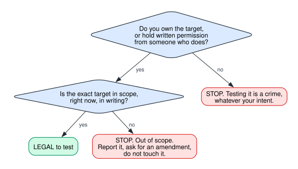

# Rules of Engagement and the Law

**Ethical hacking is doing exactly what a criminal hacker does — scanning, breaking in, taking data — except you have written permission first, so it is a job instead of a crime.**

## Before you start
<!-- bite: e6d26b7f-ec3c-4097-9891-377cfb421ae7 -->

You should be able to:

- Rent and log into a basic Linux server (a VPS) → the lab is built in [[cybersecurity/02-ethical-hacking/05-home-lab-setup|home lab setup]].
- Say what an IP address and a port are → [[networking/index|networking]].

After this lesson you will be able to:

1. State the one question that decides whether a test is legal, and apply it to a target.
2. Write a short rules-of-engagement record for your own lab, the way a real one is written.
3. Name the main computer-misuse laws and say what they all have in common.
4. Explain scope creep and what to do when you find something interesting that's out of bounds.

**Study route.** Read the kid version and §1–4, then do the practice task: you write the actual authorization record for the VPS you'll attack in the rest of this section. That record is the artifact — don't skip it, because every later lesson assumes it exists.

## What ethical hacking is
<!-- bite: 638e7b12-40c3-444b-850f-84b59ea41388 -->

The technical action is identical; the only difference between a job and a prison sentence is whether you were allowed to touch that machine. This lesson is about getting that one thing right, every time, before you type a command.

## The kid version
<!-- bite: 2f0130ee-d316-4774-90f3-21dfcb326900 -->

Imagine a locksmith. The skill — opening a lock without the key — is the same whether they're hired to get you back into your own house or they're breaking into your neighbour's. The only difference is a piece of paper: *you asked them to open your door.* Without that paper, the exact same hands doing the exact same thing is burglary.

A hacker is a locksmith for computers. The whole of "ethical" lives in the paper that says *you're allowed to open this one.* No paper, no test — even if you were only curious, even if you would have told them about the weak lock afterwards.

**Where the analogy stops working.** A locksmith's job is one door at a time, and it's obvious which door. A computer target is fuzzy: one website quietly talks to five servers, some of which belong to other companies. You can be "inside your own door" and three clicks later be standing in someone else's house without noticing. That fuzziness is the real daily danger, and it's why scope has to be written down and checked again and again (§4).

## 1. Why authorization is the whole thing
<!-- bite: dd9c7fe9-0bcd-45bd-aca3-311694ebcf05 -->

Here's the rule, and it has no exceptions: **touching a computer you don't own and weren't given written permission to touch is a crime, no matter why you did it.**

Not "a crime if you steal something". Not "a crime if you meant harm". The access itself is the offence. A security researcher who finds a weak login on a company's website, logs in "just to check it's real", and then emails the company to warn them — kindly, helpfully, asking nothing in return — has in most countries already broken the law. Good intentions are not permission. This is the exact trap the [[cybersecurity/01-fundamentals/03-attacker-and-hacker-types|grey-hat hacker]] falls into.

So throughout this section, we sidestep the trap completely: **every target is something you own.** A server you rented. An app you wrote. A PDF you locked yourself. A database of pretend people you filled in. You can't commit burglary in your own house. That's what makes it legal to be this hands-on — and it's also, conveniently, how the real job is practised before anyone lets you near a client.

That still leaves a question for every single command: *is this exact machine really mine, right now?* The answer lives in a small document. That's next.

## Terms used in this lesson
<!-- bite: e103d489-7801-41a4-a1be-10ec281f4304 -->

1. **Authorization**: This is documented, informed permission to test a specific system, given by someone with the legal authority over it. For your own lab, you are that person — but you still write it down, because the habit is the skill.
2. **Scope**: This is the exact list of what you're allowed to touch — which servers, which addresses, which apps — and, just as important, what you're *not*. Anything not in scope is out of scope by default.
3. **Rules of engagement (RoE)**: This is the written agreement, signed before any work starts, that fixes the scope, the timing, the allowed techniques and what to do if something goes wrong.
4. **Statement of work (SOW)**: This is also known as the engagement contract. It's the document for a paid job that says what will be done, by when, and what the client gets at the end. The RoE is usually part of it or attached to it.

## Terms used in this lesson: the letter, the drift and the disclosure
<!-- bite: b58a33d5-a8ca-4485-bea0-554ce51668ef -->

The rest of the terms cover the letter you carry, drifting out of bounds, the server you rent, and how to report a real bug politely.

5. **Authorization letter**: This is also known as a "get out of jail letter". It's a signed statement you can produce if someone — the target's own security team, or the police — notices your testing and asks what you think you're doing.
6. **Scope creep**: This is drifting out of bounds without meaning to, by following an interesting trail from an in-scope system into one that isn't.
7. **VPS (virtual private server)**: This is a Linux machine you rent by the month from a hosting company. Renting it makes it yours to break into — the basis of this whole section's lab.
8. **Responsible disclosure**: This is also known as coordinated disclosure. It's the agreed, polite way to report a real weakness you stumble on in software you don't own: tell the maker privately, give them time to fix it, don't publish how to exploit it.

## 2. The one question, drawn as a chart
<!-- bite: b434e78f-c636-48be-b372-a85a202cb70b -->

Before any command — a scan, a login attempt, a file download — you ask one question, and it has two parts. Owning the target is not enough on its own; the target also has to be the one you actually meant, inside the window you set. Here it is as a chart you run top to bottom:



Read it as: *Do I own this, or hold written permission from whoever does? → Is this exact target in scope, in writing, right now?* Two yeses, and only two yeses, mean go. A single no means stop — and "stop" for an out-of-scope find doesn't mean delete-and-forget, it means **write it down and ask** before you touch it again. We'll see in §4 how easy it is to reach the right-hand "crime" box by accident.

## 3. What a rules-of-engagement record contains
<!-- bite: a1f0dec4-a894-4c4d-b23a-514a847e5552 -->

Even for your own VPS, you write a short RoE, for two reasons: it builds the exact muscle a real job needs, and it stops *you* drifting. A real one, signed before any work, fixes these:

1. **Scope** — the exact machines in bounds, by IP address or hostname, and what's explicitly out. "The droplet at 203.0.113.9 and the app on it. Nothing else, including the hosting provider's own dashboard."
2. **Timeframe** — the window testing may happen in. Outside it, you're not authorized, even against an in-scope box.
3. **Permitted techniques** — whether noisy or risky methods are allowed: denial-of-service testing, social engineering, physical entry. These carry different risk and are often excluded or negotiated separately.

## 3. What a rules-of-engagement record contains: data, stops and the letter
<!-- bite: 177d4b96-9f75-44f8-8f5e-877eb58c228f -->

The last three parts of the record say what you may do with data, when you must stop, and who signed off.

4. **Data handling** — what to do if you hit genuinely sensitive data. The rule is usually "touch the minimum needed to prove it, copy nothing more."
5. **Emergency contacts and stop conditions** — who to call and what to do if testing breaks something, and the conditions under which you stop immediately.
6. **Authorization letter** — the signed "I own this and I permit this specific testing" statement. For your lab, you sign it to yourself; it feels silly until the day your scan hits the hosting provider's shared infrastructure and you're glad you wrote down exactly what was yours.

The practice task at the end is writing this record for your lab. Keep it; the rest of the section refers back to "your scope."

## 4. Scope creep — the way people actually get in trouble
<!-- bite: ec298f6e-d7c3-4f7d-b111-f0fe257806f2 -->

Almost nobody gets prosecuted for openly attacking a system they knew was off-limits. They get in trouble by **following a lead**. You're testing your own app. It loads images from a second server to save space. You scan "the app" and the scan quietly walks onto that second server — which is shared, and the other tenants didn't agree to anything. You never decided to leave your lane; you just followed the traffic.

This is why scope isn't checked once at the start. Every new address [[cybersecurity/02-ethical-hacking/03-reconnaissance|reconnaissance]] turns up gets checked against the written scope *before* you point a tool at it. On your own VPS the discipline is lower-stakes but identical: when a scan reveals an IP you don't recognise, you stop and find out whose it is before continuing. On a real engagement, a find outside scope goes back to the client for a written amendment — you don't test it "just to confirm."

And the related case: while testing your own cloned copy of some open-source app, you might find a genuine weakness in the software *itself* — one that affects everyone running it, not just your copy. Testing it on your own box is fine; **publishing how to exploit it is not your call to make alone.** That's what responsible disclosure is for: tell the maintainers privately, let them fix it, then tell the world. More on this in [[cybersecurity/02-ethical-hacking/09-post-exploitation-and-reporting|reporting]].

## 5. The laws, and the one thing they share
<!-- bite: c8bd01b1-d6ae-49f4-b6cb-b7ffc29323c8 -->

You don't need to be a lawyer, but you should know these exist and that they all pivot on the same word — *authorization*:

1. **Computer Fraud and Abuse Act (CFAA)** — the main US federal law against unauthorized access. It's written broadly, which is exactly why "clearly authorized, clearly scoped" is your defence.
2. **Computer Misuse Act (CMA)** — the UK equivalent. Different wording, same pivot.
3. **GDPR and similar data-protection laws** — these bite the moment testing touches real personal data, even briefly. Another reason the data-handling rule in §3 matters.
4. **Equivalent laws almost everywhere** — Nigeria's Cybercrimes Act, and others. The specifics vary; "did you have permission?" is the deciding question in all of them.

This is a map of what exists, not legal advice. A real paid engagement gets an actual contract reviewed for the countries involved — not just someone who's read these names.

Because every law here turns on authorization, the owned-target lab keeps you on the right side of all of them at once. You're next going to see the overall shape of an engagement these rules wrap around.

## Worked example — an RoE for a one-box lab
<!-- bite: 269cb956-20d7-418d-a4b2-6361173a309d -->

Here's a complete, minimal RoE for a lab that is a single rented server. This is the shape your practice task produces. Read it and notice how specific the scope is — that specificity is the whole point.

```text
RULES OF ENGAGEMENT — personal lab
Owner / tester: <your name> (same person)

1. Scope (in bounds):
   - Host: lab.example.com  ->  203.0.113.9   (my rented VPS)
   - The web app I deployed on it, on ports 80 and 443.
   - The SSH service on port 22.

2. Out of scope (do NOT touch):
   - The hosting provider's control panel and API.
   - Any other IP the provider uses (shared infra).
   - Any address reconnaissance turns up that is not 203.0.113.9.
   -> If I find one, I stop and confirm ownership before continuing.

3. Timeframe: whenever I choose; I take a VPS snapshot before each session
   so I can roll back if I break the box.

4. Permitted techniques: all technical testing against the host above.
   Denial-of-service testing: allowed only in a window where the box
   serves nothing I care about (it's mine, no users).

5. Data handling: the only data here is dummy data I seeded. If I ever
   deploy something with real data, this clause gets rewritten.

6. Stop conditions: if the box becomes unreachable or the provider
   emails me about abuse, I stop and investigate before resuming.

7. Authorization: I own host 203.0.113.9 (provider invoice attached)
   and I authorize the testing described above.
   Signed: <your name>, <date>.
```

## Worked example: why the RoE reads like this
<!-- bite: 23330a74-b337-4777-9b4b-2abfe2388c72 -->

Every line in that record is there for a reason.

**Why it reads like this.** The scope names one IP, because "my app" is vague and an IP is not. The out-of-scope list names the two places a scan on a cheap VPS most often wanders — the provider's panel and shared addresses — so that when it happens, you've already decided to stop. The snapshot line is the computer version of "measure twice": it means a mistake costs a rollback, not a rebuild.

## Common pitfalls and traps
<!-- bite: 2200d021-1270-444a-ad21-60c91e2b2225 -->

1. **"Yeah, go ahead" is not authorization.** Verbal permission vanishes the moment something goes wrong and memories differ. Get it written and signed — even a one-line email is worlds better than a conversation.
2. **Permission from the wrong person doesn't count.** A manager who doesn't actually control the systems can't authorize testing them. The signer must have genuine authority over the exact targets.
3. **Owning the app isn't owning the server.** On shared hosting, the app is yours but the machine is the provider's, and the other tenants' apps live on it too. Read the provider's terms: many forbid scanning even your own instance without telling them first.
4. **A find outside scope is not a prize to chase.** It's a note to write and a question to ask. Chasing it is exactly how authorized testers become defendants.
5. **Your lab's weakness in someone else's software isn't yours to publish.** Disclose it responsibly; don't drop an exploit because you found it on your own box.

## Check your understanding
<!-- bite: b8a4874c-491c-4bc2-9f15-5868a80ddff0 -->

Try each one before you open the answer.

1. <!-- q: mcq id="a1b2c3d4" -->
   You run a port scan. It finishes with no errors and reveals three open ports on a server. Which fact makes that scan legal rather than criminal?

   - [ ] The scan was read-only and changed nothing on the server.
   - [ ] You didn't log in or take any data, only looked at ports.
   - [x] You own the server, or hold written permission to test it, and it's in scope.
   - [ ] You intended to report anything you found.

   <details><summary>Answer</summary>

   Only authorization over that specific target makes it legal. The technical action is identical to a criminal's; intent, gentleness, and "I only looked" are all irrelevant to whether access was permitted.

   </details>

2. <!-- q: mcq id="b2c3d4e5" -->
   While testing your own app on your VPS, your scanner reports an open service on an IP address you don't recognise. What's the correct next move?

   - [ ] Scan it too — it showed up from your in-scope app, so it's fair game.
   - [x] Stop, and find out who owns that IP before pointing any tool at it.
   - [ ] Ignore it; if it's not your app it can't matter.
   - [ ] Report it to the police.

   <details><summary>Answer</summary>

   Stop and check ownership. A new address appearing mid-test is the classic scope-creep moment — it's often shared infrastructure belonging to someone who never agreed to be tested. In-scope systems pointing at it does not put it in scope.

   </details>

3. <!-- q: gap id="c3d4e5f6" answers="rules of engagement|RoE" -->
   The signed document, agreed before any technical work begins, that fixes the scope, timeframe, permitted techniques and stop conditions is called the ___.

   <details><summary>Answer</summary>

   The rules of engagement (RoE). It's the written record that turns "I'm allowed to do this" from a memory into evidence.

   </details>

4. <!-- q: open id="d4e5f6a7" -->
   Your friend asks you to "just quickly check if my company's website is hackable — I work there, so it's fine." List two reasons this is not yet safe to do, even though your friend asked you.

   <details><summary>Answer</summary>

   (1) Your friend working there doesn't mean they have authority over the systems — authorization must come from someone who genuinely controls the targets (IT/security leadership), in writing. (2) There's no scope: you don't know which systems are theirs versus a third party's (hosting, payment providers, shared services), so you could easily touch something nobody authorized. The fix is a written RoE signed by someone with real authority, naming exact in-scope targets — not a verbal "it's fine."

   </details>

5. <!-- q: mcq id="e5f6a7b8" -->
   What do the CFAA, the UK Computer Misuse Act, and Nigeria's Cybercrimes Act all have in common?

   - [ ] They all set the same maximum prison sentence.
   - [ ] They only apply to attacks that steal money or data.
   - [x] They all turn on whether the access was authorized.
   - [ ] They only apply to government systems.

   <details><summary>Answer</summary>

   All of them pivot on authorization. The wording and penalties differ by country, but "did you have permission to access this system?" is the deciding question everywhere — which is why the owned-target lab keeps you legal under all of them at once.

   </details>

## Practice — write your lab's RoE
<!-- bite: 151bd039-c2d0-4f6b-ab27-9521af7de455 -->

**Task.** Write the rules-of-engagement record for the lab you'll use in the rest of this section. Model it on the worked example.

**Inputs.** The VPS you rented (or will rent) in [[cybersecurity/02-ethical-hacking/05-home-lab-setup|home lab setup]] — its hostname and IP — and a note of which app(s) you deployed on it.

**Your record must state:**
- The exact in-scope host(s), by IP address, and the ports/apps in bounds.
- An explicit out-of-scope list naming the provider's panel and any unrecognised IPs.
- Your snapshot/rollback plan.
- A one-line authorization statement you "sign."

## Practice: when your RoE is done
<!-- bite: b6485e97-6eed-4e16-b0ce-79cf6c9bdb11 -->

Here is how you know the record is finished, plus one stretch step.

**Done when:** you have a text file (`roe.txt`) saved beside your lab notes that you could hold up and point to for any command you're about to run, and it answers "is this exact target mine, right now?" with a yes in writing. Every later lesson in this section assumes this file exists.

**Stretch.** Read your VPS provider's acceptable-use policy and add a line to your RoE noting whether they require you to notify them before security testing your own instance. Many do.

## Before moving on
<!-- bite: b5f22c06-7f9a-4ba2-a53c-9c24b8bebf40 -->

You can now say the one thing that separates ethical hacking from crime — written authorization over the exact target — and you've written the record that gives you it for your own lab. You know scope creep is the daily danger and that a find outside scope is a question, not a prize.

**Recap for later lookup:** legal ethical hacking = owning the target or holding written, scoped permission, checked before every command. The RoE fixes scope, timing, techniques, data handling and stop conditions. All computer-misuse laws pivot on authorization.

Next: [[cybersecurity/02-ethical-hacking/02-penetration-testing-methodology|the penetration testing methodology]] — the overall shape of an engagement, the loop these rules wrap around, from scoping to the final report.

## Related
<!-- bite: 562eb8b7-95a5-404a-98a3-186839f6f175 -->

- [[cybersecurity/02-ethical-hacking/02-penetration-testing-methodology|Penetration testing methodology]] — the engagement these rules wrap.
- [[cybersecurity/01-fundamentals/03-attacker-and-hacker-types|Attacker and hacker types]] — why the white/grey/black-hat line is authorization, not skill.
- [[cybersecurity/02-ethical-hacking/05-home-lab-setup|Home lab setup]] — building the owned target the RoE describes.

## About this lesson
<!-- bite: d25f6d58-70ea-4c2f-8dba-ea70a6263545 -->

**Level:** Beginner. **Covers:** why authorization is the whole of "ethical" in ethical hacking; the one-question legal test; the rules-of-engagement document; scope creep and responsible disclosure; the main computer-misuse laws. **Where it sits:** lesson 1 of the [[cybersecurity/02-ethical-hacking/index|Ethical Hacking]] section — read it before every other note here, because they all assume authorization is already settled. **Sources:** the original vault note, reframed around the owned-target lab model (your own VPS, app, PDF and dummy database) that this section now uses throughout. `[reference]` — not drawn from a personal paid engagement.
