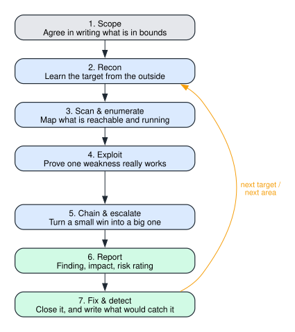

# Penetration Testing Methodology

**A penetration test is a planned attack on a system you're allowed to attack, run in a fixed order of stages so that nothing is missed and everything can be explained afterwards.**

## Before you start
<!-- bite: 5e3bbc52-4d48-4f32-afe3-28e9ea700f00 -->

You should be able to:

- State the one thing that makes testing legal → [[cybersecurity/02-ethical-hacking/01-rules-of-engagement-and-legal|rules of engagement]]. This lesson assumes authorization is already settled.

After this lesson you will be able to:

1. Name the stages of an engagement in order, and say what each one feeds into the next.
2. Explain why skipping straight to "break in" makes you slower and more dangerous, not faster.
3. Tell a penetration test apart from a red-team engagement, and black-box from white-box.
4. Trace the whole loop once, at a high level, against a real target you can run today.

**Study route.** Read the kid version and §1–4, look at the loop diagram until you can redraw it from memory, then do the practice task: plan (don't execute) a full engagement against Juice Shop on paper.

## What a penetration test is

The order is the whole point. A beginner pokes at whatever looks interesting; a professional walks the same stages every time, because each stage produces the information the next one needs. This lesson is the map of those stages — the loop every other lesson in this section is one piece of.

## The kid version
<!-- bite: 2d024071-0994-45c4-b1c2-3ad10cdb69c0 -->

Think of how a careful burglar really robs a house. They don't run at the front door. First they watch for a few days — who lives there, when they leave, which windows stay open (recon). Then they walk the perimeter trying handles (scanning). Only then do they climb in through the one unlocked window (exploitation). Inside, they find the keys to the garage, worth more than the house (post-exploitation).

A penetration test is that same patient order — except you're the "burglar" the owner hired to find the open window so they can lock it, and you write down every step so they can fix it.

**Where the analogy stops working.** A burglar wants to stay hidden and wants the loot. You want the opposite: you want to be *reproducible* — to prove exactly how you got in so it can be closed — and you take nothing. And a burglar is done once they're inside; your most valuable work, the report and the fix, only starts there.

## 1. Why a fixed order, and not improvisation
<!-- bite: f17f7b98-5ea4-4b35-a9c4-c613b2834aa9 -->

The reason the stages are always run in order is simple: **each stage's output is the next stage's input.** You can't sensibly scan until recon has told you what's there to scan. You can't exploit until scanning has shown you what's plausibly weak. Jump straight to "try exploits" and three bad things happen at once — you miss most of the attack surface because you never mapped it, you're more likely to break something because you're firing blind at a live system, and afterwards you can't explain *why* you tried a particular thing, which is exactly what a report (and a court, if it ever came to that) wants to know.

Done in order, the test is **thorough** (you covered everything), **repeatable** (someone else following your notes reaches the same place), and **defensible** (every action traces back to a reason). Those three words are what separate a professional test from messing about. The stages themselves come next.

## Terms used in this lesson
<!-- bite: dbec518c-9764-432e-9e62-5c752aa758af -->

1. **Attack surface**: This is everything about a target that an attacker could poke at — every open port, page, input box, login and API. Recon and scanning exist to map it.
2. **Enumeration**: This is going one level deeper than "is this port open" to "what exactly is running here, and what will it tell me about itself" — usernames, versions, folders.
3. **Exploitation**: This is using a weakness to make the system do something it shouldn't — log you in as someone else, run your command, hand over data.
4. **Post-exploitation**: This is everything you do *after* the first way in: finding out how much that foothold is really worth, and whether it leads somewhere bigger.
## Terms used in this lesson: going deeper, and kinds of test

The last four terms cover going further once you're in, and the different kinds of engagement.

5. **Privilege escalation**: This is turning a low-powered foothold (an ordinary user) into a high-powered one (an admin). The "find the garage keys" step.
6. **Lateral movement**: This is using one broken machine to reach another one that wasn't reachable from outside.
7. **Black-box / white-box / grey-box**: These describe how much you're told before you start — nothing, everything, or something in between.
8. **Red team**: This is a narrower kind of engagement that tests whether the *defenders* notice and stop you, not just whether a weakness exists.

## 2. The engagement loop
<!-- bite: cfa3c8e6-1bda-40d5-9df1-148b52817cc3 -->

Here are the stages. Most formal frameworks (PTES, the OSSTMM, NIST SP 800-115) describe the same shape with slightly different names; this is the version this whole section uses:

## 2. The engagement loop: the seven stages

Here is what each stage does, and which lesson teaches it.

1. **Scope** — agree in writing what's in bounds. This is [[cybersecurity/02-ethical-hacking/01-rules-of-engagement-and-legal|lesson 01]], and it happens before any command.
2. **Recon** — learn the target from the outside without really touching it → [[cybersecurity/02-ethical-hacking/03-reconnaissance|lesson 03]].
3. **Scan and enumerate** — map what's reachable and squeeze each service for detail → [[cybersecurity/02-ethical-hacking/06-scanning-and-enumeration|lesson 06]].
4. **Exploit** — prove one weakness genuinely works → [[cybersecurity/02-ethical-hacking/07-exploitation-concepts|lesson 07]].
5. **Chain and escalate** — turn that one win into a bigger one (privilege escalation, lateral movement).
6. **Report** — write up each finding with its impact and a risk rating → [[cybersecurity/02-ethical-hacking/09-post-exploitation-and-reporting|lesson 09]].
7. **Fix and detect** — close the hole, and write the detection that would have caught the attack.

The orange arrow is the part people forget: it's a **loop**, not a straight line. A finding in stage 5 (you discovered a second server you couldn't see before) sends you back to recon on that new thing. You go round as many times as there are areas to cover.

## 3. Why stages 6 and 7 are the senior part
<!-- bite: 25e55ee3-d169-4d18-bdbb-d281bd5ed853 -->

Most people learning this stop mentally at stage 4: "I got a shell, I win." That's the junior finish line. The stages that actually pay are the last two.

**The report (stage 6) is the deliverable.** Nobody is paying for you to break in; they're paying for a document that tells them what's broken, how bad it is, and how to fix it, clearly enough that a developer who wasn't there can act on it. A brilliant break-in written up badly is worthless. → [[cybersecurity/02-ethical-hacking/09-post-exploitation-and-reporting|lesson 09]].

**Fix-and-detect (stage 7) is what makes you senior.** A junior says "you have SQL injection on the login." A senior says "here's the injection, here's the one-line parameterised-query fix, *and* here's the log pattern your monitoring should have alerted on when I ran it — you didn't see me, and that's a second finding." That ties the offensive work back to the [[cybersecurity/07-security-operations/02-logging-siem-and-detection|defence]], and it's the difference between a finding and an improvement. We build that habit into every exploitation lesson.

## 4. Flavours of engagement
<!-- bite: 2c938a33-75ee-4f40-b45a-da86b643c8fc -->

The same loop runs under different rules. Two distinctions matter:

**How much you're told at the start:**

1. **Black-box**: you're given nothing — just a name or an address, like a real external attacker. Most realistic, but slow, and it can miss internal-only bugs.
2. **White-box**: you're given everything — source code, architecture, credentials. Most thorough and efficient; the usual choice for an application security review, where the goal is finding *all* the bugs, not simulating an attacker.
3. **Grey-box**: you're given something — typically an ordinary user account but no source. A practical middle ground that mirrors a phished employee or a malicious insider.

## 4. Flavours of engagement: pen test or red team

The second distinction is what the engagement is really testing.

**What's actually being tested:**

- A **penetration test** has a defined scope and time, and tries to find as many weaknesses as it can within them.
- A **red-team engagement** is goal-driven ("can you reach the customer database without being noticed?") and explicitly tests the *defenders'* detection and response, not just whether a bug exists. Its report is as much about what the blue team missed as about the bug used.

Confusing the two sets the wrong expectations: a red-team report that just lists vulnerabilities has failed at its real job.

## Worked example — the loop against Juice Shop, on paper
<!-- bite: 23fbe8c9-1f2d-44a7-85f6-82457284a75c -->

You don't need a server to see the whole loop. OWASP Juice Shop is a web app you'll run later in one Docker command; here we just *plan* an engagement against it, to make each stage concrete. (Running it is lessons 06–09 — this is the map, not the territory.)

| Stage | What it means for Juice Shop |
| --- | --- |
| 1. Scope | It's your own container on your laptop. In bounds: the app on `localhost:3000`. Out: everything else. Written in your `roe.txt`. |
| 2. Recon | From the browser: it's a single-page app (Angular front end, Node/Express back end), with a product list, a login, a search box and a REST API under `/rest` and `/api`. |
| 3. Scan & enumerate | Map the routes and inputs: the login form, the search parameter, the product-review endpoints. Each input is a place to test. |
| 4. Exploit | Pick one and prove it: e.g. the login takes `' OR 1=1--` and logs you in as the first user — SQL injection, confirmed. |
| 5. Chain & escalate | That first user is the admin. Admin access exposes an endpoint that lists all users → a bigger finding than the login bug alone. |
| 6. Report | Write it up: "SQL injection in login (`email` field) → authentication bypass → admin → full user list. Impact: total account takeover." With a risk rating. |
| 7. Fix & detect | Fix: parameterise the login query. Detect: the string `' OR 1=1` in a login request is a log pattern your monitoring should alert on. |

Notice the shape: one small weakness in stage 4 became "total account takeover" by stage 6, purely by following the loop. That escalation is the story a report tells, and you can only tell it if you walked the stages in order.

## Common pitfalls and traps
<!-- bite: c00d4c38-12eb-4779-8373-964c17ecc09d -->

1. **Treating it as a rigid script run once.** It's a loop. A late finding routinely sends you back to recon on something you only just discovered. Rigidly doing each stage exactly once, in order, misses the second half of most engagements.
2. **Skipping recon because exploitation is the fun part.** Firing exploits blind is slower (you waste time on things that aren't there), more dangerous (you break live systems), and indefensible (you can't say why you tried it).
3. **Stopping at the shell.** The break-in is the middle of the job, not the end. No report, no value.
4. **Every stage past scope still needs authorization.** The loop assumes [[cybersecurity/02-ethical-hacking/01-rules-of-engagement-and-legal|written permission]] is already in place; without it, the identical actions are crimes.
5. **Mismatching the engagement type to the goal.** Running a vulnerability-counting pentest when the client wanted to test their detection (a red team) delivers the wrong document.

## Check your understanding
<!-- bite: 9341b051-b793-4e39-a30a-149b5bf41f69 -->

Try each one before you open the answer.

1. <!-- q: mcq id="d97e4941" -->
   A tester, eager to get results, runs a batch of exploit tools against a target before doing any reconnaissance or scanning. Which is **not** one of the three problems this causes?

   - [ ] They miss attack surface they never mapped.
   - [ ] They're more likely to break something on a live system.
   - [ ] They can't explain afterwards why each attempt was made.
   - [x] The exploits run more slowly because the target isn't scanned.

   

Answer

   Firing blind doesn't make the exploits technically slower to execute — it makes the *engagement* slower and less thorough because effort is wasted on things that aren't there, it risks breaking live systems, and it's indefensible. The other three are the real problems; raw tool speed isn't one of them.

   

2. <!-- q: gap id="b3cbe7cd" answers="post-exploitation|post exploitation" -->
   You've just used a weak login to get in as an ordinary user, and you're now looking for a way to become admin and reach other machines. The stage of the engagement you're in is called ___.

   

Answer

   Post-exploitation — everything after the first foothold, including privilege escalation (becoming admin) and lateral movement (reaching other machines). The first way in is rarely the real prize.

   

3. <!-- q: mcq id="cef4d5c7" -->
   A company wants to know whether their security team will *notice and stop* an attacker who's trying to quietly reach one specific database, without being told an attack is happening. Which kind of engagement fits?

   - [ ] A white-box penetration test.
   - [x] A red-team engagement.
   - [ ] A black-box penetration test.
   - [ ] A vulnerability scan.

   

Answer

   A red-team engagement: it's goal-driven ("reach this database") and explicitly tests the defenders' detection and response, not just whether vulnerabilities exist. A penetration test aims to find as many weaknesses as possible within a known scope, and wouldn't primarily measure the blue team's reaction.

   

4. <!-- q: mcq id="2212e899" -->
   You're hired to review a web app and the client gives you the full source code and an admin login up front, because they want you to find as many bugs as possible. Which style of engagement is this?

   - [ ] Black-box
   - [x] White-box
   - [ ] Grey-box
   - [ ] Red team

   

Answer

   White-box: you're given full information (source, credentials). It's the usual choice for an application security review, where thoroughness matters more than simulating a realistic outside attacker's limited starting knowledge.

   

5. <!-- q: open id="027ea815" -->
   Two testers both find the same SQL injection in a login form. One writes "SQLi in login." The other writes the injection, the parameterised-query fix, and the log pattern that monitoring should have alerted on. In terms of the engagement loop, what has the second tester done that the first hasn't — and why does it matter?

   

Answer

   The second tester completed stages 6 and 7 (report, then fix-and-detect), not just stage 4 (exploit). They turned a break-in into something actionable: a developer can apply the fix without them, and they surfaced a *second* finding — that the attack wasn't detected — tying the offensive result back to the defenders. That back half of the loop is the actual deliverable and is what separates senior work from "I got a shell."

   

## Practice — plan a full engagement on paper
<!-- bite: 0696dd27-1844-4f62-a824-6b1397702536 -->

**Task.** Without running anything, write a one-page plan for a black-box engagement against Juice Shop, with a row for each of the seven stages. For each stage, write the one or two sentences describing what you'd *try* and what its output would feed into next.

**Inputs.** Only what you know so far: it's a web app you'll run on `localhost:3000`, and the engagement loop above.

**Done when:** you have seven stages, each naming a concrete action and what it hands to the next stage, and you can point to where a late finding would loop you back to an earlier stage. Keep it — when you actually run Juice Shop in lesson 06, you'll compare reality against this plan.

**Stretch.** Mark which two stages a *red-team* version of this engagement would emphasise that a plain pentest wouldn't, and say why.

## Before moving on
<!-- bite: 0696dd27-1844-4f62-a824-6b1397702537 -->

You now have the map the rest of this section fills in: scope, recon, scan, exploit, chain, report, fix-and-detect — a loop, not a line, with the real value in the last two stages. You can tell a pentest from a red team and black-box from white-box.

**Recap for later lookup:** stages run in order because each feeds the next; that makes a test thorough, repeatable and defensible. Black/white/grey-box = how much you're told; red team = testing the defenders, not just the bugs. The report and the detection are the deliverables.

Next: [[cybersecurity/02-ethical-hacking/03-reconnaissance|reconnaissance]] — stage 2, learning a target from the outside before you touch it.

## Related
<!-- bite: 0696dd27-1844-4f62-a824-6b1397702538 -->

- [[cybersecurity/02-ethical-hacking/01-rules-of-engagement-and-legal|Rules of engagement]] — stage 1, before any command.
- [[cybersecurity/02-ethical-hacking/03-reconnaissance|Reconnaissance]] · [[cybersecurity/02-ethical-hacking/06-scanning-and-enumeration|Scanning and enumeration]] · [[cybersecurity/02-ethical-hacking/07-exploitation-concepts|Exploitation]] · [[cybersecurity/02-ethical-hacking/09-post-exploitation-and-reporting|Post-exploitation and reporting]] — the stages as full lessons.

## About this lesson
<!-- bite: e2508cdf-fcda-47cb-bad5-9a04dc959397 -->

**Level:** Beginner. **Covers:** the engagement loop (scope → recon → scan → exploit → chain → report → fix/detect), why order makes a test thorough, repeatable and defensible, the senior value of the report and detection stages, black/white/grey-box, and penetration test versus red team. **Where it sits:** lesson 2 of the [[cybersecurity/02-ethical-hacking/index|Ethical Hacking]] section — the map that lessons 03, 06, 07 and 09 each fill in one stage of. **Sources:** the original vault note, reframed around the seven-stage loop diagram and a planned run against Juice Shop (the section's tier-1 target). `[reference]` — not drawn from a personal paid engagement.
