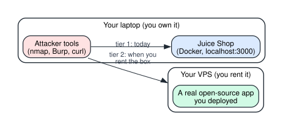

# Building the Home Lab — Step by Step

**This turns "here's what a lab is" into "here's one running tonight."**

## Before you start
<!-- bite: 29d52ad3-dfe3-451c-9022-d20d5b254cbd -->

You should have:

- Read [[cybersecurity/02-ethical-hacking/04-lab-setup-and-os-choice|lab setup and OS choice]] and decided your setup.
- Docker installed, or the ability to install it. On Fedora: `sudo dnf install docker` (or Docker Desktop).

After this lesson you will be able to:

1. Stand up Juice Shop (your tier-1 target) in one command and reach it.
2. Prepare a VPS as a realistic multi-service target, with a snapshot to roll back to.
3. Keep every target isolated and resettable.
4. Confirm the whole lab is live before you try to attack it.

**Study route.** Do Step 1 now — it takes five minutes and gives you something to attack tonight. The VPS steps can wait until you rent one; the three-VM alternative at the end is optional.

## What the home lab is

Everything from here on in this section attacks the lab you build now — so the goal is to finish this lesson with a target you can actually hit.

Everything below is a machine **you own**: a container on your laptop, a server you rent. Nothing here ever points at a target you don't control — that isolation is what makes the rest of this section practice instead of a crime ([[cybersecurity/02-ethical-hacking/01-rules-of-engagement-and-legal|rules of engagement]]).

## The kid version
<!-- bite: b7cb70e7-a05c-4453-92ec-b2bc62359f0f -->

A boxer doesn't learn by fighting strangers in the street. They have a gym: a heavy bag that doesn't hit back (to learn the moves), and a sparring partner who does (to make it real) — both inside four walls, where nothing they do spills outside.

Your lab is that gym. Juice Shop is the heavy bag: a web app that sits still and lets you practise every technique cleanly. The VPS is the sparring partner: a real, multi-service machine that behaves like something in the wild. And "isolation" is the gym's four walls — your practice never lands on anyone outside.

**Where the analogy stops working.** A gym is one place you go to. Your lab is made of things you create and destroy on demand — spin up the bag, delete it, snapshot the sparring partner and rewind it after it knocks you down. Resetting is the superpower a real gym doesn't have.

## What you're building
<!-- bite: 5556f400-21cd-4b44-bc19-6c2a8f26810f -->

Two targets, both yours, both isolated:



## What you're building: the two targets

Here is what each of the two targets is for.

- **Juice Shop** (tier 1) — a modern web app, running as a Docker container on `localhost:3000`. Your heavy bag: perfect for web-application techniques. Reachable only from your own machine.
- **Your VPS** (tier 2) — a rented Linux box running a real open-source app, plus the normal services a real host runs (SSH, a web server). Your sparring partner: the realistic, multi-service target that `nmap` and the later stages shine against.

Start with Juice Shop today; add the VPS when you're ready. The three-VM classic lab is an optional third path at the end.

## Terms used here
<!-- bite: 46c98ed0-c0c2-4143-88ec-70fb7f34bb20 -->

1. **Docker image**: This is a packaged, ready-to-run copy of an app and everything it needs. You download one and run copies of it.
2. **Container**: This is a running copy of an image, isolated from the rest of your system. Delete it and it's gone, cleanly.
3. **Publishing a port** (`-p 3000:3000`): This connects a port inside the container to a port on your machine, so you can reach the app. Binding it to `localhost` keeps it reachable only from your own machine.
4. **Snapshot**: This is a saved state of a VM or VPS you can restore, undoing anything since. Your reset button.

## Step 1 — Juice Shop, running tonight
<!-- bite: e3f6f4c7-d7cb-4baf-8af3-c127ffca00f8 -->

One command pulls the image and runs it:

```bash
docker run --rm -p 127.0.0.1:3000:3000 bkimminich/juice-shop
```

- `--rm` removes the container when you stop it (Ctrl-C) — clean by default.
- `-p 127.0.0.1:3000:3000` publishes the app on `localhost:3000` **and nowhere else**. Binding to `127.0.0.1` explicitly means even if this laptop is on a café network, no one else can reach your deliberately-weak target. (Plain `-p 3000:3000` would bind to all interfaces — fine at home, risky on a shared or public network.)

Open `http://localhost:3000` in a browser. You should see the Juice Shop storefront. That's your tier-1 target live. To keep it running in the background instead, add `-d` and give it a name:

```bash
docker run -d --name juice -p 127.0.0.1:3000:3000 bkimminich/juice-shop
docker stop juice && docker rm juice     # when you're done
```

## Step 2 — first look, and resetting it
<!-- bite: ff7b7641-3850-40f9-8a0b-9ade3190c027 -->

Confirm it's really there and reachable from your attacker tools, not just the browser:

```bash
curl -I http://localhost:3000/            # should return HTTP/1.1 200 OK
curl -s http://localhost:3000/robots.txt  # the recon hint from lesson 03
```

**Resetting Juice Shop** is trivial, which is the point: it keeps its state in memory, so stopping and restarting the container gives you a clean app. If you corrupt something mid-exercise:

```bash
docker restart juice      # back to a fresh Juice Shop in seconds
```

No snapshots needed for the container — "delete and re-run" *is* the reset. Snapshots matter for the VPS, next.

## Step 3 — the VPS, as a realistic target
<!-- bite: 3e5ab305-2ff0-4d32-87b0-09c605773622 -->

When you want a *host* to attack (many services, a real OS) rather than a single web app, rent a small VPS and deploy a real open-source app to it. The build, in outline:

1. **Rent the smallest VPS** that runs your chosen app (any provider). It's yours the moment you pay — that's your authorization basis.
2. **Write it into your `roe.txt`** from lesson 01: the exact IP is in scope; the provider's panel and any other IP are not.
3. **Deploy a real open-source app** (a storefront, a CMS, a forum — something people actually run). Follow its normal install docs. You now have a genuine production-shaped target.
## Step 3 — the VPS: snapshot and firewall

The last two steps give you an undo button and keep the box from being open to everyone.

4. **Take a snapshot** through the provider's panel, labelled `clean`, *before* you attack it. This is your undo button for when you break it.
5. **Put a firewall in front** so the only things exposed are what you mean to test — never leave a deliberately-weak configuration open to the whole internet.

The VPS is where `nmap` has something interesting to find (SSH, web, maybe a database port) and where the full engagement loop feels real. Juice Shop teaches the web techniques; the VPS puts them on a real box.

## Step 4 — the attacker side
<!-- bite: 629d6fa0-26d2-49ae-a637-6cb7ee88feb5 -->

You attack from either your host Linux with the tools installed, or a Kali VM — your choice from lesson 04. The minimum you need running:

```bash
# On your attacker box (host Linux example, Fedora):
sudo dnf install nmap            # scanning (lesson 06)
# Burp Suite Community: download from portswigger.net, or it's preinstalled on Kali
```

That's enough to start. `nmap` for mapping, a browser with dev tools for recon, and Burp Suite for intercepting web traffic cover lessons 06–09. You'll add tools as specific lessons call for them, rather than installing everything up front.

## Alternative — the three-VM classic lab
<!-- bite: e304286a-ae5d-4836-958b-28ea5cd1fce8 -->

If you want purely-local, multi-service targets (no VPS) and have the RAM, the classic lab is Kali plus two deliberately-vulnerable VMs on a host-only network. It's heavier (plan ~6–8 GB of RAM running at once), so it's an alternative, not the default on a 16 GB machine.

1. **Hypervisor:** VirtualBox (`sudo dnf install VirtualBox`), the most-documented choice.
2. **Host-only network first:** VirtualBox → *Host Network Manager → Create* (e.g. `vboxnet0`, `192.168.56.0/24`). **Every lab VM uses this adapter and nothing else** — no bridged, no NAT — so the weak VMs can't reach your real router.
3. **Kali (attacker):** import the official VirtualBox image from kali.org, set its network to the host-only adapter, boot, and change the default password immediately (`passwd`).
## Alternative — the three-VM classic lab: the targets

With Kali on the host-only network, you add the two weak targets.

4. **Metasploitable2 (network target):** a deliberately ancient, service-rich VM from Rapid7. Same host-only adapter. Login `msfadmin`/`msfadmin`. **Never** give this one a bridged or public network — it's genuinely exploitable on purpose.
5. **DVWA (web target):** the Damn Vulnerable Web Application, as a prebuilt image or installed in a minimal VM on the same host-only network. Set its security level to **Low** for your first pass through any technique.

This is the same lab the original version of this lesson described; it still works, and Metasploitable is a great `nmap` target. On a small laptop, though, Juice Shop + a VPS gets you further with less memory.

## Step 5 — snapshot discipline
<!-- bite: fe6c5c5c-5a8a-4527-a598-8de8f57a3a53 -->

For anything that *isn't* a throwaway container (a VPS, a VM), take a snapshot **before you attack it**, labelled `clean`:

- **VirtualBox:** select the VM → *Machine → Take Snapshot*.
- **VPS:** the provider's panel → *Snapshots → Take snapshot*.

This is what makes a heavier target disposable: break a service, corrupt a database testing SQL injection, lock yourself out — revert to `clean` in a minute instead of rebuilding. Take a fresh snapshot after any setup you don't want to repeat (e.g. right after the app finishes installing). Containers don't need this — delete-and-re-run is their reset.

## Verifying the whole lab is ready
<!-- bite: bf5fd9a6-e8ad-4048-9d2c-fe1b672d27a0 -->

Before any exercise, confirm each target answers. Tier 1:

```bash
curl -I http://localhost:3000/              # Juice Shop: HTTP 200
```

Tier 2 (from your attacker box, against your own VPS IP — in scope per your RoE):

```bash
ping -c1 <your-vps-ip>                       # reachable
nmap -sV <your-vps-ip>                       # should list SSH, web, etc. with versions
```

Three-VM alternative (from Kali):

```bash
nmap -sn 192.168.56.0/24                     # lists Kali, Metasploitable, DVWA
curl -I http://192.168.56.30/dvwa/           # DVWA reachable
```

If your target answers, the lab is live — on to [[cybersecurity/02-ethical-hacking/06-scanning-and-enumeration|scanning and enumeration]].

## Common pitfalls and traps
<!-- bite: ffc0f59e-36fa-408b-96cc-3a3613d50c10 -->

1. **Publishing a weak container to the world.** `-p 3000:3000` binds to every interface; on a VPS or public Wi-Fi that exposes Juice Shop to strangers. Bind to `127.0.0.1` locally, or firewall it.
2. **Adapter mismatch in the VM lab.** The number-one "nothing can reach anything" cause is one VM left on NAT while the others are host-only. Check each VM individually; VirtualBox won't warn you.
3. **No `clean` snapshot before attacking a VPS/VM.** Then the first thing you break costs a full rebuild. Snapshot first, always.
4. **Assuming a target's IP is stable.** Host-only DHCP can hand a VM a new IP after a reboot; re-run `nmap -sn` rather than trusting last time's address.
5. **Host firewall blocking the lab.** If VMs can't reach each other despite correct adapters, your host OS firewall is the next suspect.

## Check your understanding
<!-- bite: ffc0f59e-36fa-408b-96cc-3a3613d50c11 -->

Try each one before you open the answer.

1. <!-- q: mcq id="f01d706b" -->
   You run `docker run -p 3000:3000 bkimminich/juice-shop` on a VPS with no firewall. What's the problem?

   - [ ] Nothing — Juice Shop is only reachable from the VPS itself.
   - [x] `-p 3000:3000` binds to all interfaces, putting a deliberately-vulnerable app on the public internet.
   - [ ] Docker will refuse to run a vulnerable image.
   - [ ] The container can't reach the internet to pull the image.

   <details><summary>Answer</summary>

   Plain `-p 3000:3000` binds to `0.0.0.0` — every interface — so on a public VPS the vulnerable app is reachable by anyone. That breaks the isolation that makes it safe to run intentionally-weak software. Bind to `127.0.0.1:3000:3000`, or put a firewall in front.

   </details>

2. <!-- q: mcq id="a19fc3b5" -->
   Why do you need to reset Juice Shop differently from a VPS target?

   - [ ] Juice Shop can't be reset at all.
   - [x] Juice Shop is a throwaway container — delete and re-run resets it; a VPS needs a snapshot taken beforehand.
   - [ ] A VPS resets itself automatically after each attack.
   - [ ] Containers need snapshots; VPSes don't.

   <details><summary>Answer</summary>

   The container is disposable: `docker restart`/re-run gives a clean app, so no snapshot is needed. A VPS holds persistent state, so you take a `clean` snapshot *before* attacking and revert to it when you break something.

   </details>

3. <!-- q: gap id="89efbc0a" answers="host-only" -->
   In the three-VM lab, every VM must use the ___ network adapter and nothing else, so the deliberately-vulnerable machines can't reach your real router or the internet.

   <details><summary>Answer</summary>

   Host-only. A single VM accidentally left on NAT or bridged is the classic way a lab either can't talk to itself or, worse, exposes a vulnerable VM beyond the lab.

   </details>

4. <!-- q: mcq id="4b7c9a55" -->
   What makes Juice Shop a good *first* target but not a great target for practising `nmap` host scanning?

   - [x] It's a single web app on one port, whereas nmap shines against a host running many services.
   - [ ] It blocks nmap entirely.
   - [ ] It only runs on Windows.
   - [ ] nmap can't scan localhost.

   <details><summary>Answer</summary>

   Juice Shop is one web application exposing essentially one port — ideal for web-app techniques but thin for host scanning. `nmap`'s service-mapping value shows against a real host (your VPS, or Metasploitable) running SSH, web, databases and more. That's why the lab has both a web target and a host target.

   </details>

5. <!-- q: open id="6e422ec5" -->
   You're about to run SQL-injection exercises against the real app on your VPS, and you know one of them can corrupt the database. List the two things you should do *before* starting, and why.

   <details><summary>Answer</summary>

   (1) Take a `clean` snapshot of the VPS through the provider's panel, so that if the database is corrupted you revert in a minute rather than rebuilding — that's what makes the heavy target disposable. (2) Confirm the target is in scope in your `roe.txt` (the exact VPS IP, in bounds) and that it's firewalled so you're not exposing a now-damaged app publicly. Snapshot for recoverability, scope/firewall for staying legal and contained.

   </details>

## Practice — stand up tier 1 and verify it
<!-- bite: b14e6cde-1920-48b5-919c-0fa00044e412 -->

**Task.** Get Juice Shop running and prove, from the command line, that your attacker tooling can reach it.

**Steps.**
1. Run the `docker run` command binding to `127.0.0.1:3000`.
2. From a terminal, `curl -I http://localhost:3000/` and confirm a `200`.
3. `curl -s http://localhost:3000/robots.txt` and read what it hints at.
4. Restart the container and confirm the app is fresh again.

**Done when:** `curl` returns `200`, you've seen the `robots.txt` contents, and you've reset the container once. You now have the target the next three lessons attack. Record the run in your lab notes (and it's on the `cybersecurity/LIVE-RUNS-TODO.md` list to confirm).

**Stretch.** Rent a small VPS, deploy any real open-source app, add its IP to your `roe.txt`, take a `clean` snapshot, and run `nmap -sV` against it from your attacker box. Note how different its service list looks from Juice Shop's single port.

## Before moving on
<!-- bite: b14e6cde-1920-48b5-919c-0fa00044e413 -->

You have a target. Juice Shop is live on `localhost:3000`, isolated to your own machine, resettable in seconds; and you know how to add a VPS as a realistic multi-service target with a `clean` snapshot to fall back on. The whole rest of this section has something to hit.

**Recap for later lookup:** Juice Shop = `docker run -p 127.0.0.1:3000:3000 bkimminich/juice-shop`, reset by restart. VPS = real host target, snapshot `clean` before attacking. Isolate everything (localhost bind / host-only net / firewall). Verify with `curl -I` and `nmap -sV` before you start.

Next: [[cybersecurity/02-ethical-hacking/06-scanning-and-enumeration|scanning and enumeration]] — mapping exactly what your target runs.

## Related
<!-- bite: b14e6cde-1920-48b5-919c-0fa00044e414 -->

- [[cybersecurity/02-ethical-hacking/04-lab-setup-and-os-choice|Lab setup and OS choice]] — the choices behind this build.
- [[cybersecurity/02-ethical-hacking/06-scanning-and-enumeration|Scanning and enumeration]] — the first thing to do to the lab.
- [[cybersecurity/02-ethical-hacking/12-practice-exercises|Practice exercises]] — drills written against this lab.

## About this lesson
<!-- bite: c51a673a-02fa-4853-86ab-69393e3aa5e5 -->

**Level:** Beginner. **Covers:** standing up Juice Shop in Docker as a tier-1 target, preparing a VPS as a realistic multi-service target, snapshot and reset discipline, lab isolation, the three-VM classic alternative, and verifying the lab is live. **Where it sits:** lesson 5 of the [[cybersecurity/02-ethical-hacking/index|Ethical Hacking]] section — the concrete build the practical lessons attack. **Sources:** the original three-VM vault note, reframed around a container-first, VPS-backed lab (kept the VM build as an alternative). `[reference]` — not drawn from a personal paid engagement. Commands are tracked in `cybersecurity/LIVE-RUNS-TODO.md` for a verified run.
