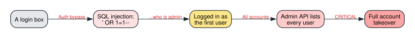

# Exploitation Concepts

**Exploitation is taking a weakness you found and proving it actually works — making the system do something it was never meant to let you do.**

## Before you start
<!-- bite: 34c1d5ec-b23c-4b57-8a46-7b0aa7faad28 -->

You should have:

- A target map from [[cybersecurity/02-ethical-hacking/06-scanning-and-enumeration|scanning and enumeration]] (Juice Shop's endpoints, your host's services).
- Met injection and encoding once already → [[cybersecurity/04-web-security/01-input-validation-and-output-encoding/index|input validation and output encoding]] is the defender's view of the same bugs.

After this lesson you will be able to:

1. Explain the mechanism of the main weakness classes — injection, broken auth, XSS, broken access control, memory safety, misconfiguration.
2. Prove at least one of them against Juice Shop, and say exactly why it worked.
3. For each weakness, give the structural fix and the log pattern that detects it.
4. Explain why *mechanism* transfers to new targets but memorised payloads don't.

**Study route.** Kid version, §1 (the chain), the weakness classes §2–7, then the full worked example (the login SQLi, end to end with fix and detection). Everything you run is against your own Juice Shop.

## What exploitation is

It's stage 4 of the [[cybersecurity/02-ethical-hacking/02-penetration-testing-methodology|engagement loop]]. This lesson teaches the major *classes* of weakness by the thing that matters most: **why each one works**, shown against Juice Shop, each paired with its fix and how a defender would catch it.

## The kid version
<!-- bite: a93298aa-fc5a-45f2-bd18-1a61383bb5c8 -->

Every one of these attacks is the same trick underneath: **getting a machine to treat your input as an instruction instead of as data.** You write something in a box that's meant for a name or a search term, and because the program glues your text straight into a command, your text *becomes* part of the command.

It's like signing a cheque and, in the "amount" line, writing "one hundred pounds, and also give the bearer the keys to the vault." A careless bank that reads the whole line as instructions hands over the keys. A careful bank treats the amount line as *only ever* an amount, no matter what you wrote there. Almost every attack in this lesson is a careless bank somewhere.

**Where the analogy stops working.** A bank has one clerk reading one line. A real app has many "clerks" — the database, the browser, the operating system — each reading a different line in its own language. The same careless-reading bug wears a different costume at each one (SQL injection, XSS, command injection), which is why there are several classes below and not one.

## 1. One small bug becomes total compromise
<!-- bite: a7a8a7a3-e8e7-4d3c-8f49-14fbeb45a1d1 -->

Before the classes, the thing that makes exploitation matter: weaknesses **chain**. A single small bug is rarely the whole story — it's the first link. Here's the chain you'll actually build in the worked example, against Juice Shop:



A login box (harmless-looking) → SQL injection gets you in without a password → the account you land in happens to be the admin → the admin API lists every user → full account takeover. No single step is exotic; the *chain* is what turns "a login form has a bug" into "critical: total account takeover." This is why stage 5 of the loop (chain and escalate) exists, and why a report tells a story, not a list.

## Terms used in this lesson
<!-- bite: ccff4cd9-efdf-4454-b5e0-1bac0c170a8a -->

1. **Exploit**: This is the specific input or action that makes a weakness do something. As a verb, to exploit is to use the weakness.
2. **Payload**: This is the crafted input you send — the `' OR 1=1--`, the `<script>` tag. The part that does the work.
3. **Injection**: This is an attack where input reaches an interpreter (a database, a shell, a browser) and changes its instructions instead of being treated as data.
4. **Interpreter**: This is anything that reads text and acts on it as commands — a SQL engine, a shell, a template engine, a browser's HTML/JS parser.
## Terms used in this lesson: access control and defences

The last four terms are about reaching what isn't yours, and what stands in the way.

5. **Broken access control**: This is a system failing to enforce that you may only reach what you're allowed to. Changing an id to read someone else's data is the classic case.
6. **IDOR / BOLA**: These name the same bug: an **insecure direct object reference** (web) / **broken object level authorization** (APIs) — reaching another user's object by changing its id.
7. **Privilege escalation**: This is turning low-powered access into high-powered access — ordinary user to admin.
8. **WAF (web application firewall)**: This is a filter in front of a web app that tries to block malicious-looking requests. A reason a theoretically-present bug may not be exploitable in practice.

## 2. Injection — input that becomes code
<!-- bite: 9be23c12-9f98-471f-b2e1-de23f870064c -->

Injection happens when untrusted input reaches an **interpreter** without being kept separate from that interpreter's own syntax, so part of your input runs as command instead of data. **SQL injection** is the classic. A vulnerable login builds its query by gluing your input in:

```text
query = "SELECT * FROM users WHERE email = '" + input + "' AND password = '...'"
```

Send an email of `' OR 1=1--` and the query becomes:

```sql
SELECT * FROM users WHERE email = '' OR 1=1--' AND password = '...'
```

`1=1` is always true, and `--` comments out the password check. The database returns every user, and the app logs you in as the first one. **Command injection, template injection and LDAP injection are the identical pattern** at a different interpreter.

## 2. Injection: the fix and the alert

Every injection has the same fix, and a pattern a defender can watch for.

**The fix: parameterised queries.** The query text is fixed with a placeholder, and your input is sent separately as *data* that can never become syntax — the careful bank that treats the amount line as only ever an amount. **Detection:** login requests containing `' OR`, `--`, `UNION SELECT` and friends are a classic alert pattern for your [[cybersecurity/07-security-operations/02-logging-siem-and-detection|monitoring]].

## 3. Broken authentication and sessions
<!-- bite: 8602af14-1b4f-4c93-9769-2a172a238b4a -->

Weaknesses in how a system proves *who you are* and keeps you logged in: weak or default passwords, guessable session tokens, sessions that never expire, missing two-factor, or a password-reset flow with a logic hole (a security question whose answer is on the user's public profile — Juice Shop has exactly this). Often the **highest-value** class, because a successful login skips the need for any other bug at all.

**The fix:** strong password storage (argon2/bcrypt), unguessable tokens, session expiry, real MFA, reset flows that don't lean on guessable secrets → [[cybersecurity/04-web-security/02-secure-authentication|secure authentication]]. **Detection:** many failed logins then a success (credential stuffing), logins from impossible locations, password resets that bypass normal steps.

## 4. Cross-site scripting (XSS) — input that runs in a browser
<!-- bite: 3bb66372-cb05-438b-a780-14a7ffee5b44 -->

XSS is injection aimed at the **browser's** interpreter instead of the database's. An app puts untrusted input into a page without encoding it, so your input runs as script in *another user's* browser. Juice Shop's search reflects your term into the page; a term like `<iframe src="javascript:alert(1)">` executes. In the real world the script isn't an alert — it steals the victim's session token or acts as them.

```text
Search results for: <iframe src="javascript:alert(1)">   ← runs as script, not shown as text
```

**The fix: output encoding** — turn `<` into `&lt;` so the browser *shows* the tag instead of running it; frameworks like Angular and React do this by default unless you switch it off. → [[cybersecurity/04-web-security/01-input-validation-and-output-encoding/index|output encoding]]. **Detection:** requests and stored fields containing `<script`, `javascript:`, `onerror=`.

## 5. Broken access control — the most common real bug
<!-- bite: 1e308200-1378-4df5-a918-baf96a807112 -->

Broken access control is a system failing to enforce that you only reach what you're allowed to. The everyday case (**IDOR/BOLA**): you view your own basket at `/rest/basket/1`, change the `1` to `2`, and you're looking at someone else's basket — because the app checked you were *logged in* but never checked the basket was *yours*. Juice Shop lets you do exactly this. The admin-only variant (**BFLA**): calling an admin API route as an ordinary user because the route never checks your role.

This is consistently **the most common finding in real engagements**, because access control has to be enforced on *every single action*, and one missed check anywhere is the whole bug. **The fix:** check ownership and role on every request, server-side, from the session — never trust an id in the URL → [[cybersecurity/14-api-security/03-authorization-and-bola|authorization and BOLA]]. **Detection:** one user accessing a wide spread of object ids, or non-admins hitting admin routes.

## 6. Memory safety and misconfiguration
<!-- bite: d763a9ad-a279-45c4-a921-a6f68237d435 -->

Two more classes you won't prove on Juice Shop but must know:

**Memory-safety bugs** (buffer overflows and friends) live in C and C++: writing past the end of a fixed buffer overwrites adjacent memory, and in the classic case the function's return address, redirecting execution into attacker-controlled code. This is a whole section of its own → [[cybersecurity/11-binary-exploitation/index|binary exploitation]]. It's *why* memory-safe languages (Rust, garbage-collected languages) structurally delete an entire vulnerability class.

**Misconfiguration** isn't a code bug at all — the system works exactly as configured, but configured badly: default passwords left unchanged, debug mode on in production, a database exposed to the internet (your scan in lesson 06 may have found one), an overly open cloud bucket, error pages leaking internals. Often the **easiest** class to find — no clever exploit, just checking whether obvious hardening was done — and among the most common. **The fix:** harden by default; **detection:** config scanning and asking "should this be reachable at all?"

## 7. The senior move — fix and detect, every time
<!-- bite: ea9e45e8-2920-4972-a38f-90fc5a0485d9 -->

Notice that every class above came with two extra things after the attack: **the structural fix** and **how to detect it**. That pairing is the whole difference between junior and senior, and it's stage 7 of the loop made into a habit.

A junior writes: *"SQL injection in the login."* A senior writes: *"SQL injection in the login `email` field (proof below) → auth bypass → admin → full user list. **Fix:** parameterise the query (one line). **Detect:** you had no alert on `' OR 1=1` in a login body — that's a second finding, because you didn't see me."* Same bug; one of those reports gets the system genuinely safer and the other just scores a point. Build the fix-and-detect reflex now, on every single weakness, and it's automatic by the time it's a paid job.

## Worked example — the login SQLi, end to end
<!-- bite: 4288e735-0807-4a54-86ba-d7ca1a29cac2 -->

The full chain from the diagram, against your own Juice Shop on `localhost:3000`. This is the centerpiece: find, prove, chain, then *fix and detect*.

1. **Find.** Scanning flagged the login as an input worth testing. In the email field, enter `' OR 1=1--` and any password.
2. **Prove.** You're logged in — as the first user in the table, which in Juice Shop is the administrator. The password check never ran. That's authentication bypass via SQL injection, confirmed.
3. **Chain.** As admin, the app exposes administrative data — the user list at an admin endpoint. One login bug has become every account.
## Worked example — the login SQLi: rate, fix, detect

The second half of the chain is the senior part: rate it, close it, and catch it next time.

4. **Rate it.** Trivial to exploit (type a string), maximum impact (total account takeover). That's **critical** — see [[cybersecurity/02-ethical-hacking/09-post-exploitation-and-reporting|reporting]] for the CVSS score.
5. **Fix.** The login query must be parameterised: the email is sent as data, so `' OR 1=1--` is searched for as a literal (nonexistent) email and matches nothing. One structural change kills the class, not just this payload.
6. **Detect.** A login request whose body contains `' OR`, `--` or `UNION SELECT` should raise an alert. If your monitoring stayed silent while you did this, that silence is a second finding.

**Why this transfers.** You didn't memorise `' OR 1=1--` as a magic spell — you understood that the login glued input into a query, so *any* input that closes the string and adds logic works. Meet a different login tomorrow and the same *reasoning* applies, even though the exact payload differs. That's why §2–6 taught mechanisms, not a payload list.

## Common pitfalls and traps
<!-- bite: a1babb5d-2562-40a7-b96e-00d295b86dce -->

1. **Memorising payloads instead of mechanisms.** Exact payloads are patched and vary by target; understanding *why* the class works is what transfers to a new, unseen target.
2. **"It exists" ≠ "it's exploitable."** A WAF, validation elsewhere, or a mitigating config can block a theoretically-present bug. Verifying real exploitability is what separates a test from a raw scan.
3. **Stopping at the first bug.** The value is in the chain. A login SQLi you don't follow to "admin, all users" is undersold.
4. **Reporting the attack without the fix or the detection.** That's the junior finish line. Every finding carries both.
5. **Forgetting scope.** The identical action is a valued finding or a crime depending only on authorization. Everything here is your own Juice Shop.

## Check your understanding
<!-- bite: dcd0bab5-25c0-40ef-851e-9d5c0a570365 -->

Try each one before you open the answer.

1. <!-- q: mcq id="018a0e92" -->
   A login builds its query by gluing your input straight into the SQL, right after `email = '`. You send `' OR 1=1--` as the email. Why are you logged in without a valid password?

   - [ ] The `OR` tells the database to skip password hashing.
   - [x] Your input closes the email string, `1=1` makes the condition always true, and `--` comments out the password check — so the query returns a user regardless of password.
   - [ ] `1=1` is a known admin backdoor in most databases.
   - [ ] The database crashes and defaults to logging you in.

   <details><summary>Answer</summary>

   The input is glued into the SQL as *syntax*: `'` ends the email literal, `OR 1=1` makes the condition always true, and `--` comments out the rest including the password condition. The query returns rows regardless of password, and the app logs you in as the first. Nothing is skipped or crashed — your input rewrote the query's logic.

   </details>

2. <!-- q: mcq id="22066717" -->
   What is the *structural* fix for that login SQL injection — the one that kills the whole class, not just this payload?

   - [ ] Block the characters `'` and `-` in the email field.
   - [ ] Add a web application firewall to spot `OR 1=1`.
   - [x] Use a parameterised query, so the input is sent as data to a placeholder and can never become SQL syntax.
   - [ ] Hash the email before putting it in the query.

   <details><summary>Answer</summary>

   Parameterised queries separate code from data: the query text is fixed and the input is bound as a value, so no input can alter the query's structure. Blocking characters is a fragile denylist (plenty of payloads avoid them), and a WAF is a mitigation, not a fix — the bug is still there behind it.

   </details>

3. <!-- q: gap id="83d4f943" answers="broken access control|access control" -->
   You view your own order at `/rest/order/1`, change it to `/rest/order/2`, and see someone else's order. The app checked you were logged in but not that the order was yours. This class of bug is called ___ (its IDOR/BOLA form).

   <details><summary>Answer</summary>

   Broken access control. The specific pattern — reaching another user's object by changing its id — is an insecure direct object reference (IDOR) / broken object level authorization (BOLA), and it's the most common real-world finding because every action needs its own ownership check.

   </details>

4. <!-- q: mcq id="1daf84ca" -->
   Why does understanding a vulnerability's *mechanism* beat memorising a specific payload like `' OR 1=1--`?

   - [ ] Mechanisms are easier to remember than payloads.
   - [x] Exact payloads get patched and vary by target; understanding why the class works lets you adapt to a new, unseen target where the exact payload differs.
   - [ ] Payloads are illegal to write down but mechanisms aren't.
   - [ ] Mechanisms work without authorization.

   <details><summary>Answer</summary>

   A memorised payload is brittle — it's patched, filtered, or shaped differently on the next target. Understanding that a login glues input into a query means you can craft whatever input closes the string and adds logic *here*, on a target you've never seen. Mechanism transfers; a spell doesn't.

   </details>

5. <!-- q: mcq id="dddf6724" -->
   A cross-site scripting (XSS) bug targets which interpreter?

   - [ ] The database's SQL engine.
   - [ ] The server's operating-system shell.
   - [x] Another user's browser, which runs injected markup/script as if it came from the site.
   - [ ] The web server's configuration parser.

   <details><summary>Answer</summary>

   XSS is injection aimed at the browser: unencoded input is placed in a page and the victim's browser runs it as script. SQL injection targets the database; command injection targets the shell — same careless-reading pattern, different interpreter. The fix is output encoding so the browser displays the markup instead of running it.

   </details>

6. <!-- q: open id="f6e39f5c" -->
   You find the login SQL injection and write only "SQLi in login" in your report. Your lead sends it back. Using stage 7 of the engagement loop, what two things must you add, and why does each matter?

   <details><summary>Answer</summary>

   (1) **The fix:** parameterise the login query — so a developer can actually close the bug without you, and so you've killed the class, not just noted it. (2) **The detection:** the log pattern (`' OR`, `--`, `UNION SELECT` in a login body) that should have alerted, plus the fact it didn't — which is a *second* finding, because an undetected attack is a monitoring gap. Together they turn a scored point into a genuinely safer system, which is the actual deliverable; "SQLi in login" alone is the junior finish line.

   </details>

## Practice — prove and write up one weakness
<!-- bite: c23e2322-2182-4017-8552-63d08114ea7e -->

**Task.** Against your own Juice Shop, pick **one** weakness class and take it all the way through the loop.

1. **Prove it.** Either the login SQL injection, the search XSS, or the basket IDOR (change the basket id). Capture the request and the result.
2. **Chain it** if you can — does the access get you something bigger?
3. **Write the fix** — the structural one, in one or two sentences.
4. **Write the detection** — the log pattern that would catch it.

**Done when:** you have a mini-finding with four parts (proof, impact/chain, fix, detection) for one weakness — the exact shape lesson 09 turns into a full report. Don't skip the fix and detection: that's the point of the exercise. Log the run in `cybersecurity/LIVE-RUNS-TODO.md`.

**Stretch.** Do a second class, and note how the *mechanism* reasoning differed even though both were "untrusted input reaching an interpreter."

## Before moving on
<!-- bite: dcd0bab5-25c0-40ef-851e-9d5c0a570366 -->

You can now explain the main weakness classes by their mechanism, prove at least one against Juice Shop, and — the senior habit — pair every one with its structural fix and its detection. You know weaknesses chain, and that mechanism transfers where memorised payloads don't.

**Recap for later lookup:** injection = input becomes code at an interpreter (SQL/shell/browser/template); fix = keep code and data separate (parameterise, encode). Broken access control = missing per-action ownership/role check; the most common real bug. Memory safety = C/C++ overflows. Misconfiguration = working as configured, configured badly. Always: find → prove → chain → fix → detect.

Next: [[cybersecurity/02-ethical-hacking/08-common-tools|common tools]] — the standard toolkit that automates these, and where each fits the loop.

## Related
<!-- bite: dcd0bab5-25c0-40ef-851e-9d5c0a570367 -->

- [[cybersecurity/02-ethical-hacking/06-scanning-and-enumeration|Scanning and enumeration]] — stage 3, the target map exploitation works from.
- [[cybersecurity/02-ethical-hacking/09-post-exploitation-and-reporting|Post-exploitation and reporting]] — stages 5–7, turning a proven bug into a finding.
- [[cybersecurity/04-web-security/01-input-validation-and-output-encoding/index|Input validation and output encoding]] — the defender's view of injection and XSS.
- [[cybersecurity/14-api-security/03-authorization-and-bola|Authorization and BOLA]] — the fix for broken access control, in depth.

## About this lesson
<!-- bite: f17f558b-c7f5-4e4a-9bac-7639254c4757 -->

**Level:** Intermediate. **Covers:** the major weakness classes (injection, broken authentication, XSS, broken access control/IDOR/BOLA, memory safety, misconfiguration) by mechanism, each with its Juice Shop proof, structural fix and detection; weakness chaining; and why mechanism transfers where payloads don't. **Where it sits:** lesson 7 of the [[cybersecurity/02-ethical-hacking/index|Ethical Hacking]] section — stage 4 of the engagement loop, the heart of the section. **Sources:** the original vault note, made concrete against Juice Shop with the fix-and-detect pairing that the senior half of the loop requires. `[reference]` — not drawn from a personal paid engagement. Attacks are tracked in `cybersecurity/LIVE-RUNS-TODO.md` for a verified run.
