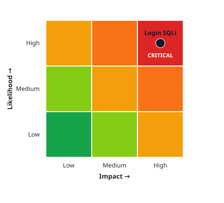

# Post-Exploitation and Reporting

**Getting in is the middle of the job, not the end. Post-exploitation works out what that access is really worth, and the report turns it into something the owner can act on — which is the actual deliverable you're paid for.**

## Before you start
<!-- bite: bce3c67a-2ecb-4c8c-82ac-d630eb3a698e -->

You should have:

- Proven at least one weakness → [[cybersecurity/02-ethical-hacking/07-exploitation-concepts|exploitation concepts]].
- Met the likelihood × impact idea → [[cybersecurity/01-fundamentals/01-what-is-cybersecurity|what cybersecurity is]].

After this lesson you will be able to:

1. Say what post-exploitation investigates and why "we got in" is an incomplete finding.
2. Write a finding with the parts a real report needs: impact, evidence, fix.
3. Rate severity with a likelihood × impact matrix, and read a CVSS score.
4. Explain responsible disclosure for bugs found outside a formal engagement.

**Study route.** Kid version, §1–5, then the worked example — a complete findings report from your Juice Shop chain — then write your own in the practice task.

## What post-exploitation and reporting are
<!-- bite: 758e75b6-bbc9-4758-b049-043949853e2d -->

This is stages 5–7 of the [[cybersecurity/02-ethical-hacking/02-penetration-testing-methodology|engagement loop]], and professionally it's the most important part: a finding nobody can act on delivered no value, however clever the break-in was.

## The kid version
<!-- bite: f132c00b-8258-4265-aaa7-3d7382e8b6a0 -->

Imagine you're hired to test a shop's security and you find a key under the mat. Two ways to report back. The junior way: "there's a key under the mat." The senior way: "there's a key under the mat; it opens the front door; inside, the safe was unlocked; in the safe were the staff's bank details — here are photos; move the key, fit a lock on the safe, and your alarm never went off while I did all this, which is a second problem."

Same key. One report lets the owner understand and fix the real danger; the other just notes a key exists. Post-exploitation is walking through the unlocked door to find the safe; reporting is writing the second version.

**Where the analogy stops working.** With a real shop the damage is obvious — a safe full of cash. In software the "what's behind the door" is often invisible until you look: the same unlocked door might lead to nothing, or to every customer's data. That's why post-exploitation is its own deliberate step — you can't rate the danger until you've found what the access actually reaches.

## 1. What post-exploitation investigates
<!-- bite: d3bf4def-5db4-4d3e-a55d-fa93c0b146bd -->

Once you have a foothold, four questions tell you what it's worth:

1. **Privilege escalation** — can limited access become higher access (user → admin)? This usually needs a *second*, separate weakness from the one that got you in.
2. **Lateral movement** — can this foothold reach *other* machines that weren't reachable from outside? This is what turns "one server was weak" into "the whole internal network was reachable from one server."
3. **Data access** — what sensitive data can you actually reach from here, concretely? This is what separates a low finding from a critical one: the *same* technical bug is minor or catastrophic depending on what it exposes.
4. **Persistence** (red-team only) — could an attacker keep access even after the bug is patched? Tested to evaluate detection and response, not a default step.

Answering these is what lets you rate a finding honestly, which is §4.

## 2. Why "we got in" is incomplete
<!-- bite: c5026ea3-171f-404d-9427-3c517d653c19 -->

A report that says "we gained access via X" and stops leaves the owner unable to judge how much to care. Compare:

- *"The printer's admin panel had a default password."*
- *"The printer's admin panel had a default password; from it we reached the finance file share; it held unencrypted payroll data — 400 staff — here's a redacted sample."*

**Same root cause.** The first tells the owner nothing about why it matters, so it competes for attention with every other minor note. The second makes the priority obvious. The impact — what the access *reached* — is the finding. The vulnerability is just how you got there.

## Terms used in this lesson
<!-- bite: eb591ff2-9f0e-4892-9aa0-d29b3a9c5c3e -->

1. **Post-exploitation**: This is everything you do after the first foothold to measure its real worth — escalation, lateral movement, data access.
2. **Finding**: This is one reported issue, with its description, impact, evidence, severity and fix.
3. **Executive summary**: This is the non-technical overview at the front of a report, for the people who decide budgets and priorities.
4. **Remediation**: This is the fix — the specific, actionable change that closes the finding.
5. **Severity**: This is how serious a finding is, usually critical/high/medium/low, from likelihood × impact.
6. **CVSS (Common Vulnerability Scoring System)**: This is a standard formula that turns a vulnerability's properties into a 0–10 number and a severity band.
7. **Proof of concept (PoC)**: This is the smallest demonstration that the bug really works — the evidence in a finding.
8. **Responsible disclosure**: This is the agreed, private way to report a bug you found *outside* a paid engagement, giving the maker time to fix before any public detail.

## 3. Anatomy of a good report
<!-- bite: 7f1e1d00-a025-4516-b5ac-cee014f49fbf -->

A report has four parts, each for a different reader:

1. **Executive summary** — overall risk and the top findings, in plain language, for decision-makers. No jargon; they're deciding what to fund, not how to patch.
2. **Findings, ranked by severity** — each with a clear description, the real business **impact** (see [[cybersecurity/01-fundamentals/02-cia-triad|the CIA triad]] for the vocabulary), **steps to reproduce**, and **evidence** (the request/response, a screenshot).
3. **Remediation guidance** — specific, actionable fixes. "Parameterise the login query," not "fix SQL injection." The whole point is enabling the fix.
4. **Methodology and scope** — what was tested, what wasn't, and how. So the owner knows the *boundaries* — a clean area might just mean it was out of scope, not safe.

Ranked by severity, so the owner fixes the critical things first. Which means you have to rate severity honestly — §4.

## 4. Rating severity — likelihood × impact
<!-- bite: 0dc2094a-6159-4dc2-ba0d-842b744365a9 -->

Severity comes from two questions: **how easy is this to exploit** (likelihood) and **how bad is it if someone does** (impact). Plot them:



A trivially-exploitable bug exposing critical data sits top-right: **critical**. A hard-to-exploit bug with minor impact sits bottom-left: **low**. Most findings land in between. The login SQL injection from lesson 07 is plotted top-right — you exploit it by typing a string (maximum likelihood) and it yields total account takeover (maximum impact).

## 4. Rating severity: the CVSS score
<!-- bite: 876b1f71-9426-419d-9e20-81a0f1d4325f -->

A matrix is a picture; CVSS turns it into a number everyone agrees on.

**CVSS** is the industry's standard way to make this precise: a formula over properties (how the attack is delivered, whether it needs privileges, what it affects) producing a **0–10 score** and a band — 9.0+ critical, 7.0–8.9 high, and so on. A report often gives both the CVSS number and the band, so everyone rates findings the same way instead of by gut feel.

## 5. Responsible disclosure — outside an engagement
<!-- bite: d3635010-9e19-42a0-a230-a0e23e5b7cfc -->

When you find a bug *outside* a paid, scoped engagement — in open-source software you run, during independent research, on a bug-bounty program — you can't just publish it. **Responsible disclosure** means telling the affected maker privately first, giving them reasonable time to fix, before any public detail. Publishing a working exploit before a fix exists hands attackers a weapon.

This matters directly for your lab: when you clone a real open-source app onto your VPS and find a genuine flaw in the *software* (not just your config), testing it on your own box is fine, but **publishing how to exploit it is not your call alone**. Most serious projects publish a security policy or run a bug-bounty / vulnerability-disclosure program precisely to make this safe and clear for researchers. Report privately, let them fix, then share.

## Worked example — a full finding from the Juice Shop chain
<!-- bite: 7cbd3d5d-fd1a-4afc-956d-b9ee14be9c18 -->

Here is the login SQL injection from lesson 07, written as a real report entry. **This is the deliverable** — the thing the whole engagement existed to produce. Notice every part earns its place.

```text
FINDING 1 — Authentication bypass via SQL injection in login
Severity: CRITICAL   (CVSS 9.8 — AV:N/AC:L/PR:N/UI:N/S:U/C:H/I:H/A:H)

Summary (for the executive summary):
  An attacker can log in as any user — including the administrator —
  without a password, by typing a crafted string into the login form.
  This exposes every customer account and all administrative data.

Affected: POST /rest/user/login  (email field)

Steps to reproduce:
  1. Go to the login page.
  2. Email:  ' OR 1=1--
     Password:  anything
  3. Submit. You are logged in as the first user (the administrator).
  4. The admin session then lists all registered users at <admin endpoint>.

Evidence:
  [request/response capture + screenshot of the admin user list]

Impact:
  Complete authentication bypass -> administrator access -> disclosure of
  all user accounts. Full confidentiality and integrity loss. (CIA: C, I.)

Remediation:
  Use a parameterised query for the login lookup, so the email is bound as
  data and can never alter the query's structure. This removes the class,
  not just this payload. Add server-side input validation as defence in depth.

Detection:
  No alert fired during testing. Add monitoring for login request bodies
  containing SQL metacharacters (' OR, --, UNION SELECT). The absence of any
  alert during this attack is itself FINDING 2 (monitoring gap).
```

## Worked example: why each part of the finding is there
<!-- bite: c71b18a0-d0f3-4de4-acae-4e2434f03a2b -->

Go back over the finding part by part.

**Read back over it.** The severity is justified by likelihood × impact and pinned with a CVSS vector. The reproduction is exact enough for a developer to confirm without you. The impact is the *reached* data, not the technique. The remediation is a specific change, not "fix it." And the detection turns one bug into two findings — the attack, and the fact nobody saw it. That last move is the senior signature from stage 7 of the loop.

## Common pitfalls and traps
<!-- bite: bb145e56-0762-4d1e-a2a8-589904b47281 -->

1. **Stopping at "we got in."** Without post-exploitation you can't state impact, and impact is the finding.
2. **A report that just lists bugs.** No impact, no fix, no ranking — the owner can't prioritise or act. The report *is* the job.
3. **Mis-rating severity.** Overstating to look impressive or understating to look calm both wreck prioritisation. Rate honestly, with likelihood × impact or CVSS.
4. **Treating the report as an ordinary document.** It's a map of the owner's weaknesses — store and send it encrypted, with restricted access.
5. **Thinking delivery ends the job.** A retest to confirm fixes were really applied (not superficially patched) is standard and often contractual.
6. **Dropping a public exploit for a bug in software you don't own.** Disclose responsibly; give the maker time first.

## Check your understanding
<!-- bite: e53cf37d-1c68-4977-a3e0-4e1d4362c396 -->

Try each one before you open the answer.

1. <!-- q: mcq id="50bde288" -->
   Two reports describe the same bug. A: "the printer had a default password." B: "the printer's default password let us reach the finance share with unencrypted payroll for 400 staff (sample attached)." Why is B the better finding?

   - [ ] B uses more technical language.
   - [x] B states the impact — what the access actually reached — so the owner can judge how urgently to fix it.
   - [ ] B found a different, more serious bug.
   - [ ] A is wrong about the root cause.

   <details><summary>Answer</summary>

   Same root cause; B adds the impact from post-exploitation (what the foothold reached), which is what lets the owner prioritise. A gives no basis to judge severity, so it competes for attention with trivial notes. The vulnerability is how you got in; the impact is the finding.

   </details>

2. <!-- q: mcq id="b6929714" -->
   A finding is trivially easy to exploit (type a string) and, if exploited, exposes every customer's account. On a likelihood × impact matrix, where does it sit?

   - [x] Top-right — high likelihood, high impact — critical.
   - [ ] Bottom-left — low likelihood, low impact — low.
   - [ ] Top-left — high likelihood, low impact — medium.
   - [ ] It can't be rated without running a scanner.

   <details><summary>Answer</summary>

   Easy to exploit = high likelihood; exposes every account = high impact; so it's top-right, critical. This is exactly where the login SQL injection plots. Severity comes from likelihood × impact (or a CVSS score), not from a tool.

   </details>

3. <!-- q: gap id="fcddbedc" answers="executive summary" -->
   The non-technical overview at the front of a report, written for the people who decide budgets and priorities rather than for engineers, is called the ___.

   <details><summary>Answer</summary>

   The executive summary. It states overall risk and the top findings in plain language, because its readers are deciding what to fund, not how to patch.

   </details>

4. <!-- q: mcq id="9d7d622f" -->
   Which remediation line is actually useful in a report?

   - [ ] "Fix the SQL injection."
   - [ ] "Make the login secure."
   - [x] "Use a parameterised query for the login lookup so the email is bound as data."
   - [ ] "Follow security best practices."

   <details><summary>Answer</summary>

   Remediation must be specific and actionable — a developer should be able to act on it directly. "Parameterise the login query" names the exact change; "fix the SQL injection" or "follow best practices" just restates the problem and enables nothing.

   </details>

5. <!-- q: mcq id="4147c95a" -->
   While testing a real open-source app you cloned onto your own VPS, you find a genuine flaw in the software itself (not your config). What's the right thing to do?

   - [ ] Publish a full exploit immediately so everyone knows.
   - [x] Report it privately to the maintainers and give them time to fix before any public detail (responsible disclosure).
   - [ ] Nothing — you can't touch it since it's not yours.
   - [ ] Use it against other installs of the same software to confirm it.

   <details><summary>Answer</summary>

   Responsible disclosure: tell the maintainers privately and give them reasonable time to fix before publishing details. Testing on your own instance is fine; publishing a working exploit before a fix exists arms attackers, and using it against installs you don't own is unauthorized access. Most projects have a security policy or bug-bounty for exactly this.

   </details>

6. <!-- q: open id="cc614808" -->
   Your report has a finding: "SQL injection in the login (`email` field)." Turn it into a complete finding by naming the four things it still needs, and briefly why each matters.

   <details><summary>Answer</summary>

   It needs: (1) **Impact** — what the bypass reaches (admin access, all user accounts), because impact is what lets the owner prioritise. (2) **Steps to reproduce / evidence** — the exact payload and a request/response capture, so a developer can confirm it without you. (3) **Severity** — critical, justified by likelihood × impact or a CVSS score, so it's ranked against other findings. (4) **Remediation** — "parameterise the login query," a specific change that enables the fix. (Bonus: the detection gap — no alert fired — as a second finding.) Without these, it's a note, not a finding, and the report is the actual deliverable.

   </details>

## Practice — write a real finding
<!-- bite: 86a174d8-ae45-49f9-b822-c0c89020f5fd -->

**Task.** Take the weakness you proved on Juice Shop in lesson 07 (or 08) and write it up as a complete report finding, using the worked example's shape.

**Your finding must include:**
- A one-line summary fit for an executive summary.
- The affected endpoint and exact steps to reproduce.
- Evidence (your captured request/response or screenshot).
- Impact — what the access actually reaches, in CIA terms.
- A severity rating, justified by likelihood × impact (CVSS vector optional).
- Specific remediation, and the detection that should catch it.

**Done when:** a developer who wasn't there could read your finding, reproduce the bug, understand why it matters, and apply the fix — and you've named the detection gap. That's the real deliverable of the whole engagement. Save it with your lab notes.

**Stretch.** Write a two-sentence executive summary covering your finding plus the "no alert fired" detection gap, in language a non-technical manager would act on.

## Before moving on
<!-- bite: 3e80f5f6-8ac3-464d-bba3-69e22bdca08c -->

You can now finish the loop: measure a foothold's real worth (escalation, lateral movement, data access), and write a report whose findings have impact, evidence, honest severity and a specific fix — plus the detection gap that makes you senior. You know how to disclose responsibly when a bug isn't yours to publish.

**Recap for later lookup:** post-exploitation answers "what is this access worth?" (privesc, lateral, data). A finding = description + impact + reproduction + evidence + severity (likelihood × impact / CVSS) + remediation + detection. The report is the deliverable; rate honestly; protect the report; retest the fix; disclose responsibly outside an engagement.

Next: [[cybersecurity/02-ethical-hacking/10-pdf-and-document-security|PDF and document security]] — the offline-cracking pattern on a file you locked yourself.

## Related
<!-- bite: 435e1cbf-be2b-4e1b-9161-3d1cb1114729 -->

- [[cybersecurity/02-ethical-hacking/07-exploitation-concepts|Exploitation concepts]] — the proven bug this stage turns into a finding.
- [[cybersecurity/02-ethical-hacking/02-penetration-testing-methodology|Methodology]] — stages 5–7 of the loop.
- [[cybersecurity/01-fundamentals/02-cia-triad|The CIA triad]] — the vocabulary for stating impact.
- [[cybersecurity/07-security-operations/02-logging-siem-and-detection|Logging, SIEM and detection]] — where the detection half of a finding gets built.

## About this lesson
<!-- bite: 6876d757-cfe5-47ad-b3f1-b53732f8771d -->

**Level:** Intermediate. **Covers:** post-exploitation (privilege escalation, lateral movement, data access, persistence), why "we got in" is incomplete, the anatomy of a report, severity by likelihood × impact and CVSS, responsible disclosure, and a full worked findings report from the Juice Shop chain. **Where it sits:** lesson 9 of the [[cybersecurity/02-ethical-hacking/index|Ethical Hacking]] section — stages 5–7 of the engagement loop, the deliverable the whole loop builds toward. **Sources:** the original vault note, closed with a complete report finding and a likelihood × impact matrix. `[reference]` — not drawn from a personal paid engagement.
